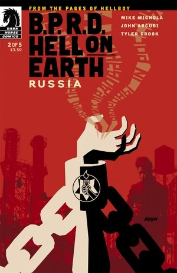
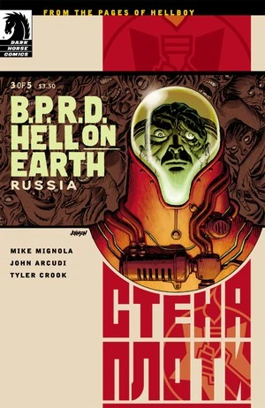

***Russia*** is a five-issue miniseries published from September 2011 to January 2012.

## Publication History

This is the fourth arc of the [*Hell on Earth* cycle](/entry/BPRD%3A%E4%BA%BA%E9%97%B4%E5%9C%B0%E7%8B%B1)), following *[Monsters](/entry/Monsters)*. The issues were published with covers by [Dave Johnson](/entry/Dave_Johnson). It is collected in *[B.P.R.D.: Hell on Earth—Russia](/entry/Trade_Collections)*.

## Synopsis

### Part One

A graveyard of mutated horror is uncovered deep inside a Russian mine. With Liz still missing and Abe Sapien lying on his deathbed, the newly international B.P.R.D. sends Kate and Johann to meet the Russian equivalent of the Bureau—which readers first saw in [B.P.R.D.: 1946](/entry/1946)—and face an exploding fungus monster at the Kremlin, and a spreading contagion.

### Part Two

In the vault of the Russian Occult Bureau’s headquarters is a man chained down and heavily monitored. When Kate and Johann are brought in for assistance, the zombie director of the Russian bureau pits them against the possessed prisoner!

### Part Three

While Johann is locked in spectral combat with the spirit of a possessed prisoner of Russia’s Special Sciences Service, Kate learns about the deserted town of Rampayedik and its mysterious zombie looters.

### Part Four

Johann confronts the Ogdru-Hem spririt while Kate battles zombies.

### Part Five

After a brutal assault from proletariat zombies, the B.P.R.D. and the Russian bureau must form an alliance in order to rescue Johann from a deadly mine.

## Gallery

 \#1

 \#2

 \#3

 \#4

 \#5
