**Karl Rupert Kroenen** was a German Nazi scientist and SS Officer. After sustaining injuries during an experiment gone wrong, he was never seen without a protective gas mask and body suit. Kroenen had a fascination with experimenting on corpses, creating super-soldiers, and even attempting to cheat death – dark interests shared with fellow Nazi scientist and friend [Herman von Klempt](/entry/Herman_von_Klempt). He initially served [Grigori Rasputin](/entry/Grigori_Rasputin) and his plans to bring about the end of the world. After failing to bring his master back from the dead, he allied with [Varvara](/entry/Varvara) before being killed at her hands.

The character's backstory and design was greatly expanded upon by [Guillermo del Toro](/entry/Guillermo_del_Toro) for the 2004 film adaptation *[Hellboy](/entry/Hellboy_%282004_film%29)*, re-imagining Kroenen as an undying supernatural assassasin.

## History

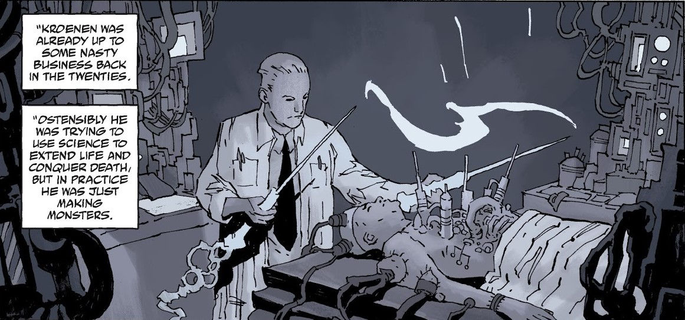 A German scientist trying to extend life and conquer death, Dr. Kroenen was already active in the 1920s. Working for the Nazis, and a member of the Thule Society, he was presumed to be involved in an attempt to harness the 'shakti' energy force in 1930. An accident during the attempt left Kroenen injured, and the operations that saved his life left him resembling his monstrous creations and bound to live in a protective bodysuit. His later work led him to run afoul of [A.N. Sandhu](/entry/A.N._Sandhu) a number of times

Kroenen would eventually become one of the top scientists for [Project Ragna Rok](/entry/Project_Ragna_Rok), and a close disciple of [Grigori Rasputin](/entry/Grigori_Rasputin), along with [Ilsa Haupstein](/entry/Ilsa_Haupstein) and [Leopold Kurtz](/entry/Leopold_Kurtz). While serving Rasputin became his main goal, Kroenen would be allowed to indulge in his own projects towards creating an unstoppable army for the Reich.

### [Rasputin: The Voice of the Dragon](/entry/Rasputin__The_Voice_of_the_Dragon)

In 1941, under the auspices of 'Operation Geist', he and Kurtz summoned the spirit of [Albert Mayhew](/entry/Albert_Mayhew) and bound it to the body to a German soldier for Rasputin to find and gain access to the tomb of [Eugene Remy](/entry/Eugene_Remy). While in Paris to find the tomb, Kroenen set up a laboratory to continue his personal project, where he was discovered by Sandhu and a young [Trevor Bruttenholm](/entry/Trevor_Bruttenholm). Kroenen initially had the upper hand until he was blinded and gunned down by Sandhu and left for dead. Recovering enough soon afterward, Kroenen reached Rasputin in the catacombs and found that he had killed Sandhu himself. He witnessed Mayhew opening Remy's sarcophagus and Rasputin gaining the ancient tablet he sought in the wake of Remy's retribution. Kroenen was later present with Rasputin at the secret ritual in Scotland that brought [Hellboy](/entry/Hellboy_%28character%29) to the world.

Kroenen, Haupstein, and Kurtz have frozen inside a secret Nazi base sometime afterward, until they were resuscitated in 1994 by industrialist [Roderick Zinco](/entry/Roderick_Zinco), acting on Rasputin's orders. Kroenen resumed work on several of his former projects, including making an "Apocalypse Army" by combining corpses with robotics. He also convinced Zinco to retrieve the head of his colleague, [Herman von Klempt](/entry/Herman_von_Klempt), from South America. Kroenen retained an affection for his colleague, though Rasputin had rejected von Klempt as unsuitable for Ragna Rok. When von Klempt's head was re-animated, he tried to convince Kroenen to abandon Rasputin's plan - to awaken the Ogdru Jahad - and instead to use the Army to retrieve von Klempt's work in South America. Overhearing, Kurtz became furious and attacked von Klempt's head, screaming, "Rasputin is master!" In a panic, Kroenen seized a knife and stabbed Kurtz. When their plan failed, an enraged Rasputin struck Zinco blind. Wandering around, Zinco accidentally pressed a self-destruct button in the base, destroying it completely and seemingly taking Kroenen with it.

Kroenen survived the explosion and reappeared in a meeting room of the [Zinco Corporation](/entry/Zinco_Corporation) with Leopold Kurtz many years later. Under the direction of [Isiah Marsten](/entry/Isiah_Marsten), Kroenen began preparing a body to retrieve the soul of Rasputin, thinking it to be locked with the Ogdru Jahad. After acquiring a suitable body from the B.P.R.D., Kroenen and Kurtz succeeded before realizing that they had been duped by Marsten into bringing back [the Black Flame](/entry/the_Black_Flame) instead.

### [Pandemonium](/entry/Pandemonium_%28story_arc%29)

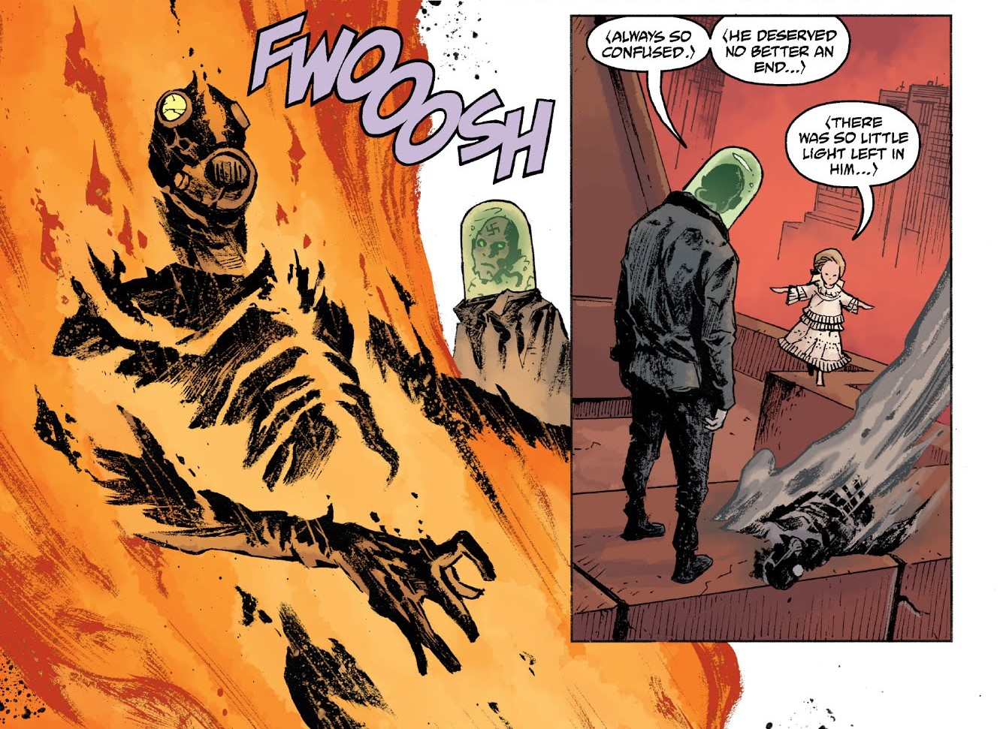 As Marsten proceeded with his own plans and destroyed Zinco's collection of Nazi relics, a disillusioned Kroenen saved von Klempt's head and escaped. Sometime later, he was found by [Varvara](/entry/Varvara)/[Yomyael](/entry/Yomyael), who reawakened von Klempt and invited the two men to join her (and the demons [Balam](/entry/Balam) and [Bifrons](/entry/Bifrons)) cause to rebuild Pandemonium on Earth. Kroenen became increasingly skeptical of his choice and voiced his concern to von Klempt after Varvara seemed to intentionally lead Hellboy to them. While explaining that she was hiding something, Kroenen was set on fire by Varvara and his ashes scattered to the wind.

## Other Media

### 2004-2008 film series

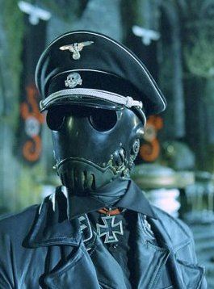
Karl Ruprecht Kroenen in <em>Hellboy</em> (2004)

Kroenen was greatly reimagined for the 2004 film *[Hellboy](/entry/Hellboy_%282004_film%29)*; writer/director [Guillermo del Toro](/entry/Guillermo_del_Toro) used the comic character's distinctive mask as a jumping-off point to create a distinctive assassin. The spelling of his middle name was also changed to "Ruprecht" (rather than Ruprect). He was portrayed by actor and choreographer Ladislav Beran.

In the film, Kroenen is depicted as an assassin, using distinctive baton swords[1] and push daggers. His mask is worn as the result of self-experimentation, a "surgical addiction" that led to the removal of his eyelids, lips, and more; Kroenen's skill for mechanical work led him to create a clockwork body for himself that allowed him to cheat death. Del Toro provided an expanded biography for the character, which appeared in a series of comic panels in the book *Hellboy: The Art of the Movie*, as well as in the special features of the film's DVD.

[thumb|left|"DVD Comic" biography](/entry/FIle%3AKroenen_story_by_kroenen4millennium.jpg) Born in Munich, Germany in 1897, Karl Ruprecht Kroenen was a musical prodigy with angelic features and blonde hair, who toured the capitals of Europe singing opera, until his voice deepened with the onset of puberty. Kroenen also demonstrated great skill with fencing and clockwork mechanics. From a very early age, Kroenen demonstrated symptoms of masochism, whipping himself with a fresh branch of oak each day. By his teenage years, feeling awkward, Kroenen's masochism developed into an extreme form of body dysmorphic disorder (termed "surgical addiction" in the film). In his obsession with physical purity and perfection, Kroenen conducted brutal experiments on his own body, including surgically removing his own eyelids, lips, and his nails, both from his toes and fingers. He also designed a tight-fitting gas mask to filter out germs, which he wore almost permanently. Kroenen was quite adept with mechanical devices, believing that fusing mechanical constructs with living bodies would help create perfection. One of his early inventions was a clockwork nightingale that sang a Mozart aria perfectly.

In 1930, Kroenen met the resurrected Rasputin for the first time and quickly became his most loyal disciple. He subsequently joined the Nazi Party, and rose quickly through the ranks, joining the Schutzstaffel in 1933 and achieving the rank of Obersturmbannführer (Lieutenant Colonel). He also became [Hitler's](/entry/Adolf_Hitler) top assassin and was tasked with eliminating troublesome individuals both within the Nazi Party, and out. He was awarded the Iron Cross for services to the Third Reich, including a tour of duty as commandant of Auschwitz concentration camp, where he conducted horrific and grotesque experiments with his clockwork mechanical constructs on the living flesh of the prisoners in the pursuit of purity. When Kroenen became the head of the [Thule Society](/entry/Thule_Society), a group of German aristocrats obsessed with the occult, He used their resources and knowledge to spearhead Project Ragna Rok as its chief engineer, designing and constructing both the substitute "right hand of doom" gauntlet wielded by Rasputin and the portal generator that would conjure the Scarlet Beast, Hellboy, in October 1944.

#### *Hellboy* (2004)

When Allied Forces stormed the island off the coast of Scotland where Project Ragna Rok took place, Kroenen killed several American soldiers attacking the base before a grenade was thrown under the portal device by a young Professor [Trevor Bruttenholm](/entry/Trevor_Bruttenholm). Kroenen tried to retrieve the grenade, but the explosion tore off his left hand and threw him backwards into a stone column, where he was impaled through the chest by a length of rebar. Though this severed his spine, Kronen somehow managed to disappear in the aftermath of the battle. Twelve years later, an unmarked grave in Romania was found, and the body inside was confirmed through dental records to be Kroenen's.

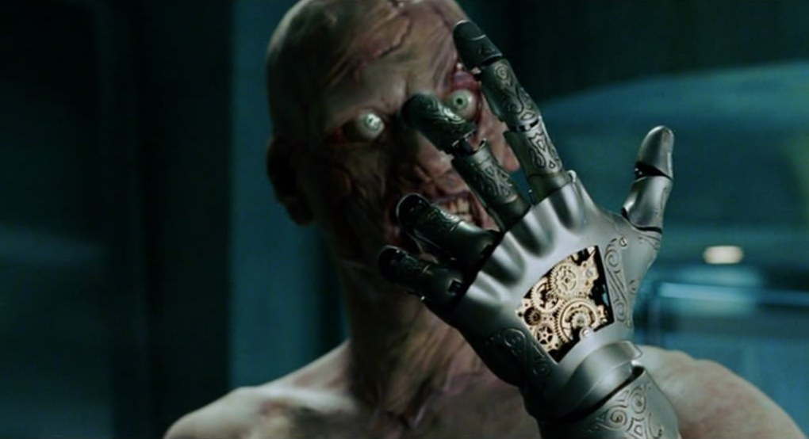 However, Kroenen reappeared in 2004. Thanks to the inexplicable powers of science and black magic, Kroenen "repaired" himself with a prosthetic mechanical hand, a steel rod replacing the broken part of his spine, and a clockwork heart operated by a wind-up key implanted in his chest. By cranking the key, he was able to increase his speed and reflexes. After long decades, the blood in his veins dried up completely, leaving only dust, and rendering him virtually invulnerable to gunshot wounds. He could also turn the key to "switch off" his body (literally), remaining in a dormant state and appearing dead until he was reanimated. He used this deceptive technique to infiltrate the BPRD headquarters. After critically wounding BPRD Agent [Clay](/entry/Clay), he faked his own death and lay beside Clay, and they were both taken into the headquarters. Once inside, Kroenen drew Rasputin there, and personally killed the now elderly Professor Bruttenholm, before disappearing with Rasputin.

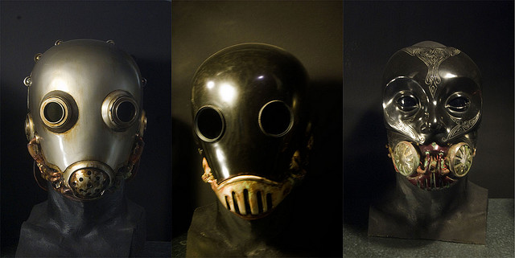 The BPRD tracked Rasputin to his own mausoleum beneath Moscow. [Hellboy](/entry/Hellboy_%282004%E2%80%932008_film_character%29) seemingly avenged Bruttenholm's death by throwing Kroenen into a spiked pit hidden beneath a trapdoor. Skewered on the stakes, Kroenen then watched helplessly as Hellboy dropped a giant cog on top of him.

#### *Hellboy II: The Golden Army* (2008)

Presumed dead after the events of the first film, Kroenen does not bodily appear in the sequel. His battered gas mask can be seen several times in a display case, along with a golden mask that resembles the head of [Sammael](/entry/Sammael).

##### The Zinco Epilogue

An animated comic was included on the film's DVD release, teasing a potential plot (drawing influence from the opening of the *[Wake the Devil](/entry/Wake_the_Devil)* comic) for an unproduced third film. In this short, Kroenen is voiced by Adam Fulton.

The comic depicts [Roderick Zinco](/entry/Roderick_Zinco) traveling to the Arctic, where a remnant of the Project Ragna Rok base was located. Zinco inserts Kroenen's head into a machine dome. Completely revived by the machine, Kronen laughs insidiously and tells his "master" that this was just what he promised: he is addressing a revived Rasputin, who tells Zinco and Kroenen that they have served them well and that he has one more task for them.[2]

#### Gallery

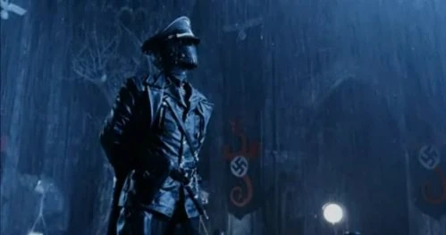

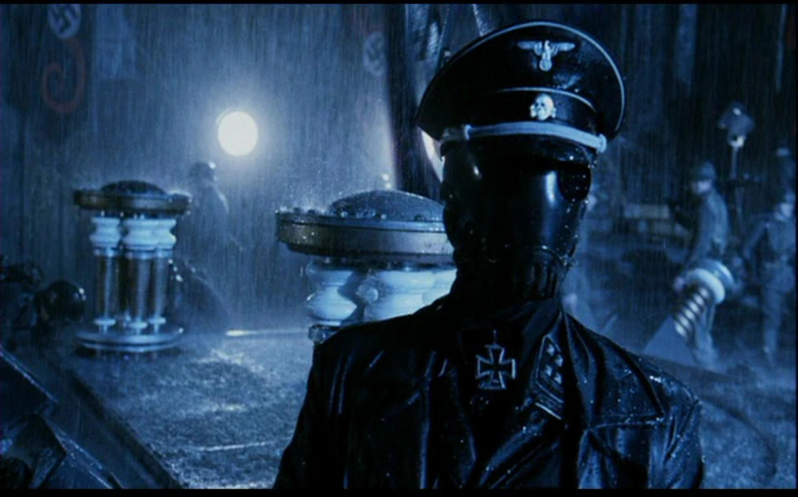

|

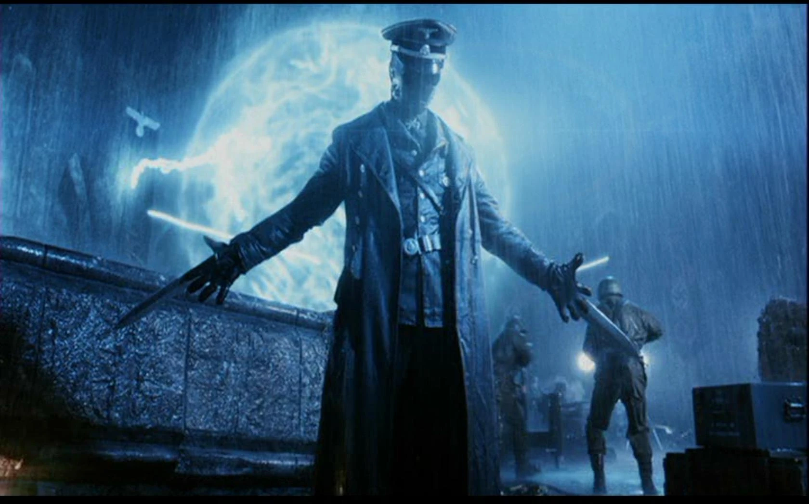

|

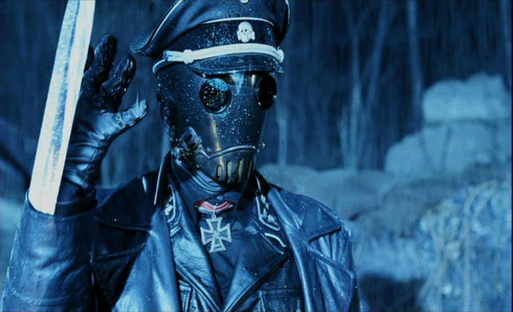

|

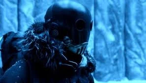

|

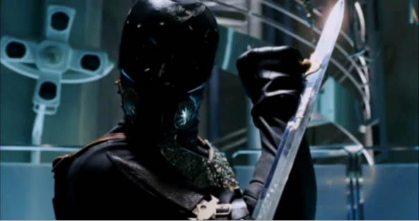

|

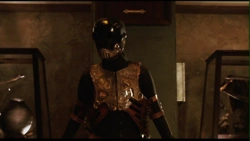

|

#### Trivia

- Del Toro's film design was assisted by several other artists: [TyRuben Ellingson](/entry/TyRuben_Ellingson) developed the look of Kroenen's vest, while Sergio Sandoval of DDT Special Effects created and designed the masks.
- In the original script for *Hellboy*, the young Professor Bruttenholm describes Kroenen as "one of the Reich's top scientists, and head of the Thule Occult Society." In the film release, the line was re-dubbed so that the first phrase was replaced by "Hitler's top assassin."
- This portrayal in the film is radically different from the comics. Kroenen, who originally played the part of a meek character, who Del Toro describes as someone who is likely to say "Aargh! Don't break the machine!" is here portrayed as a murderous soldier who is inhumanly loyal to Rasputin.

### *Hellboy* (2019)

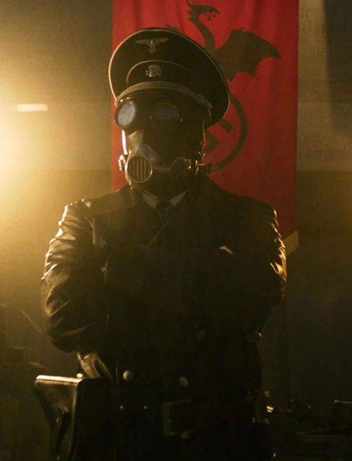 Kroenen also appears in the 2019 *[Hellboy](/entry/%E5%9C%B0%E7%8B%B1%E7%94%B7%E7%88%B5%EF%BC%9A%E8%A1%80%E7%9A%87%E5%90%8E%E5%B4%9B%E8%B5%B7))* movie, in a much smaller role closer to his comic depiction. Ilko Iliev portrays Professor Doctor Karl Ruprect Kroenen.

He is seen in a flashback of the Ragna Rok Project alongside Rasputin, Kurtz, Haupstein, von Krupt and Leni Riefenstahl, who was filming the event. When [the Lobster](/entry/the_Lobster) and his soldiers came to stop them, Kroenen fired twice at the Lobster and then fled, being the only Nazi present to evade capture. His fate afterwards is unknown.

## References

<references/>

[1] ["Kroenen Baton Sword from Hellboy"](https://www.iloveswords.com/MOV_Hellboy.html)

[2] ["Zinco Epilogue - Animated Comic"](https://www.youtube.com/watch?v=Tilh0_WusTQ) on YouTube
