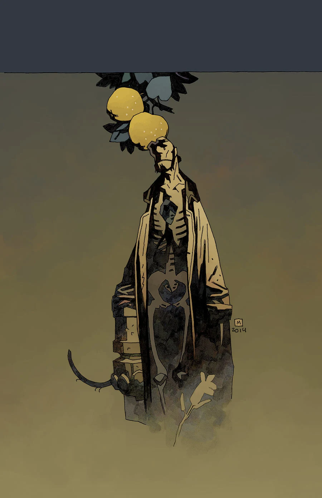
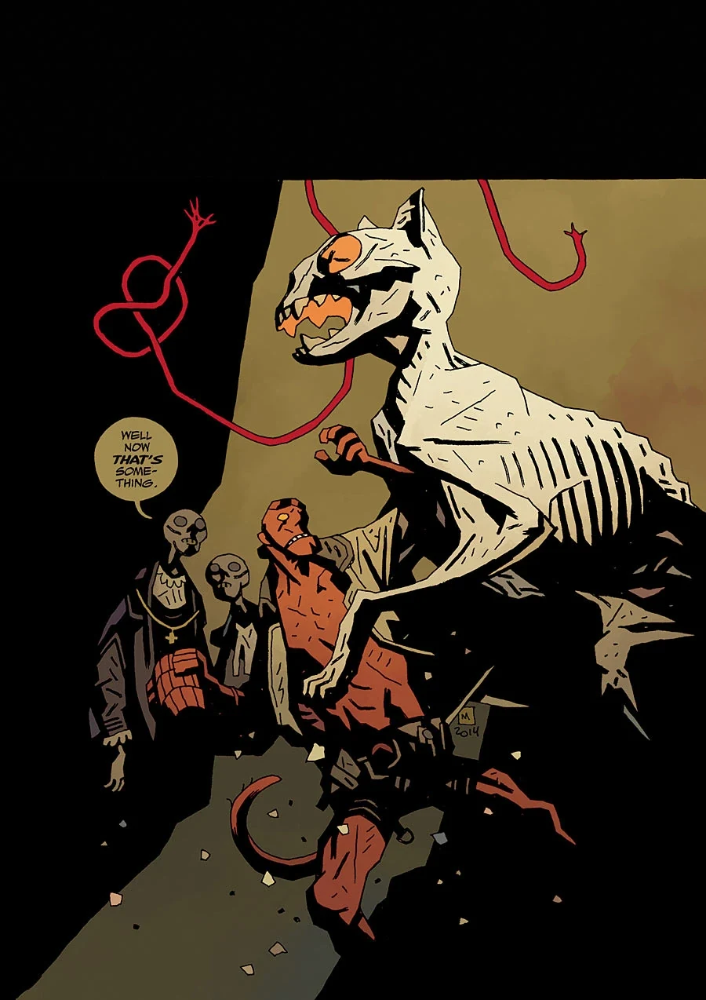

***The Hounds of Pluto*** came out August to September of 2015. When this story was collected, the first part was retitled *The Trials of Dr. Hoffmann*.

## Synopsis

### Part One: *The Trials of Dr. Hoffmann*

A sickness eats away at [Hellboy](/entry/Hellboy_%28character%29). Though he's dead, he risks losing himself and becoming one of the hollow phantoms that haunt [Hell](/entry/Hell). A team of doctors promises a cure, but they need something from him first…

### Part Two: *The Hounds of Pluto*

A mummified cat, a trial in Hell, and a horrible family reunion stand in the way of Hellboy’s search for a cure.

## Gallery

 \#7: *The Hounds of Pluto (Part 1)*

 \#8: *The Hounds of Pluto (Part 2)*
