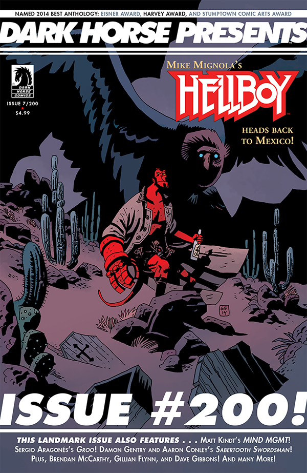

**Gabriel Bá** is an Brazilian comics writer and artist. He made his Hellboy Universe debut in July 2009 with [*B.P.R.D.: 1947*](/entry/1947). He is [Fábio Moon](/entry/F%C3%A1bio_Moon)'s twin brother.

## Writer

Gabriel Bá co-wrote the [*B.P.R.D.: Vampire* story cycle](/entry/Vampire_%28story_cycle%29) with Fábio Moon and Mike Mignola.

- *[B.P.R.D.: Vampire](/entry/Vampire_%28story%29)* (with Mike Mignola and Fábio Moon)
- *[B.P.R.D.: Lost Ones](/entry/Lost_Ones)* (with Fábio Moon)

## Interior Art

- [*B.P.R.D.: 1947*](/entry/1947) (with Fábio Moon)
- [*B.P.R.D.: Vampire*](/entry/Vampire) (with Fábio Moon)
- [*Hellboy: The Coffin Man 2—The Rematch*](/entry/The_Coffin_Man_2__The_Rematch)
- *[B.P.R.D.: Lost Ones](/entry/Lost_Ones)* (with Fábio Moon)

## Cover Art

|*Hellboy: The Coffin Man 2 – The Rematch* (*Dark Horse Presents* \#200/#

## External Links

- [**Wikipedia:** Gabriel Bá](http://en.wikipedia.org/wiki/Gabriel_B%C3%A1)
- [**Comic Book DB:** Gabriel Bá](http://www.comicbookdb.com/creator.php?ID=4007)
- [Fábio Moon and Gabriel Bá's Blog](http://www.fabioandgabriel.blogspot.com.au/)
