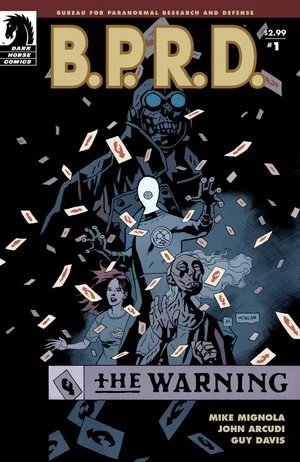
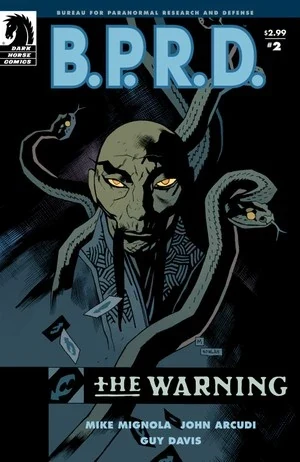
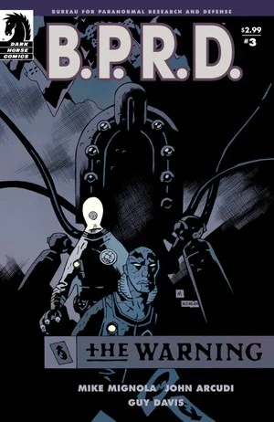
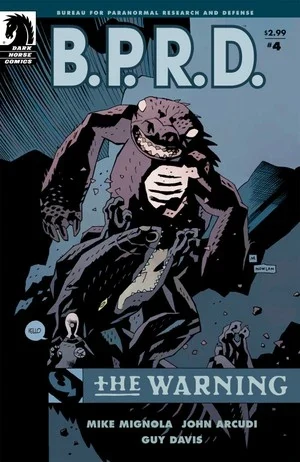
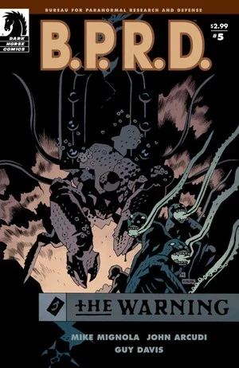

***The Warning*** is a five-issue miniseries and the first part of the [*Scorched Earth* trilogy](/entry/Scorched_Earth_Trilogy). It follows [Abe Sapien](/entry/Abe_Sapien), [Liz Sherman](/entry/Liz_Sherman), Dr. [Kate Corrigan](/entry/Kate_Corrigan), [Johann Kraus](/entry/Johann_Kraus) and [Panya](/entry/Panya_%28character%29) as they try to find out the identity of the mysterious man who keeps appearing in Liz's dreams.

## Publication History

The five-issue miniseries was published from July to November 2008. The story was collected together with *[Out of Reach](/entry/Out_of_Reach)* in the trade paperback *[B.P.R.D.: The Warning](/entry/Trade_Collections)* in April 2009.

## Synopsis

### Part One

The first issue starts with the after-math of *[Killing Ground](/entry/Killing_Ground)*, then Panya, Johann Kraus, Kate Corrigan and Liz Sherman join in a medium session guided by Johann Kraus to connect with [Lobster Johnson](/entry/Lobster_Johnson). This leaves them with a clue, "GILFRYD" is written in Lobster Johnson cards upon the wall.

Then Panya uses her psychic gifts to enter the mysterious man's mind and confirms him to be [Martin Gilfryd](/entry/Martin_Gilfryd) and also reveals she has found the location of his lair.

### Part Two

Abe is forced to give up his search for Daimio when Liz's mysterious gentleman proves more powerful than the B.P.R.D. had anticipated as they play further into his plans.

### Part Three

Stranded and missing a teammate, Abe, Kate, and Johann discover that the situation is far worse than they had thought, as another old enemy resurfaces.

### Part Four

Liz remains missing as the rest of the Bureau faces off against giant robots on the streets of Munich.

### Part Five

Abe, Johann, and Kate discover that their old enemies have joined forces, threatening to shake the very foundations of the world.

## Content

Note: For the content of the prologue included in the Trade Paperback and the Omnibus edition go to [Out of Reach](/entry/Out_of_Reach)

### Characters

#### [B.P.R.D.](/entry/Bureau_for_Paranormal_Research_and_Defense)

- [Abraham Sapien](/entry/Abraham_Sapien)
- [Elizabeth Sherman](/entry/Elizabeth_Sherman)
- [Katherine Corrigan](/entry/%E5%87%AF%E7%89%B9%C2%B7%E8%80%83%E7%91%9E%E6%A0%B9))
- [Andrew Devon](/entry/Andrew_Devon)
- [Johann Kraus](/entry/Johann_Kraus)
- [Panya](/entry/Panya_%28character%29)
  - Olly
  - Mutated Animals
- Doris (Panya's Caretaker)
- [Benjamin Daimio](/entry/Benjamin_Daimio) (Mentioned)
- Other Agents and Personnel

#### Others

- German Old Woman
- [Servants of the Left Hand](/entry/Servants_of_the_Left_Hand)
- [Memnan Saa/Martin Gilfryd](/entry/Martin_Gilfryd)
- [Heliopic Brotherhood of Ra](/entry/Heliopic_Brotherhood_of_Ra) Members (Flashback)
- [Bruno Karhu](/entry/Bruno_Karhu)
- [Frog Monsters](/entry/Frog_monster)
- [Landis Pope](/entry/Landis_Pope) ([The Black Flame](/entry/The_Black_Flame_%28character%29)) (Mural)
- [The Lobster](/entry/The_Lobster) (Mentioned)
- [King of Fear](/entry/King_of_Fear_%28character%29) (Dream/Vision)
- Edith Howard (Photograph)
- [Hellboy](/entry/Hellboy_%28character%29) (Photograph)

### Locations

- U.S.A.
  - Colorado Wilderness
  - [B.P.R.D.](/entry/Bureau_for_Paranormal_Research_and_Defense) Headquarters (Colorado)
  - Caul Residence (Littleport, RI) (Dream/Vision)
- England (Flashback)
  - British Historical Society (Flashback)
  - London Streets (Flashback)
- [Memnan Saa's](/entry/Memnan_Saa) Temple
- Germany
  - Munich Streets
  - Munich Metro/Hollow Earth

### Noteworthy Artifacts

- [The Lobster's](/entry/The_Lobster) Calling Cards
- [Hyperborean](/entry/Hyperboreans) War Machines

## Gallery

 \#1

 \#2

 \#3

 \#4

 \#5
