The *Hellboy* series and its [spinoff comics](/entry/The_Hellboy_Universe_Comics) have been collected in over ninety trade paperbacks. They usually include extensive special features such as additional story material, forewords, afterwords, galleries, and sketchbooks. Starting in late 2021, several new series have been collected in hardcover collections of a similar length.

## In Continuity Collections

These trades collect the canonical Hellboy Universe stories. They have been broken down by publishing line below.

### *[Hellboy](/entry/Hellboy_%28series%29)*

*Hellboy* trade paperbacks occasionally contain additional story material not previously published; sometimes this is the presence of a new short story, a new epilogue, or a few new pages in a story. Trades always contain additional art, either in the form of a gallery or a sketchbook. Usually, each story is collected with a short text introduction containing background information on its creation.

These stories have also been collected in omnibus editions in which the stories were re-ordered chronologically. For a full breakdown, please see the [Omnibus Editions](/entry/Omnibus_Editions) page.

#
Title
Date Published
Material Collected
Additional Material
Cover
Library Edition

<tbody>

1
<em>Seed of Destruction</em>
October 1, 1994
<ul>
<li><em>[Seed of Destruction](/entry/Seed_of_Destruction)</em> #1–4</li>
<li>[World's Greatest Paranormal Investigator (SDCC)](/entry/World%26)</li>
<li>[World's Greatest Paranormal Investigator (CBG)](/entry/World%26)</li>
</ul>
<ul>
<li>Introduction by Robert Bloch</li>
<li>Early Hellboy sketches</li>
<li>Gallery featuring art by Simon Bisley, [Mike Allred](/entry/Mike_Allred), Art Adams, Frank Miller, Fred Blanchard and Gary Gianni (7 pages)</li>
</ul>
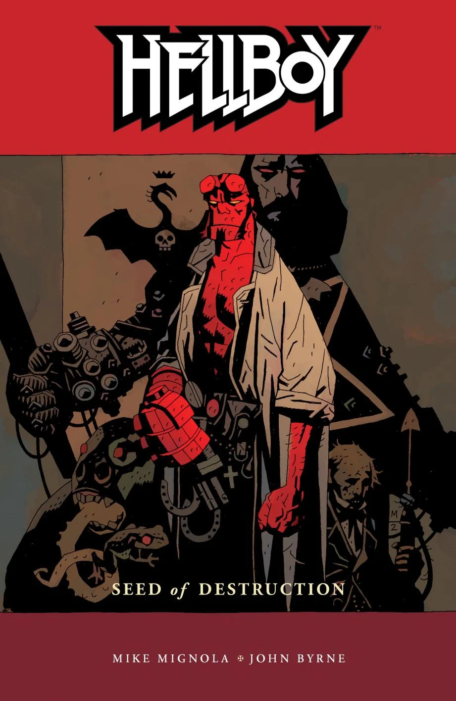MIKE MIGNOLA
[Volume 1](/entry/Hellboy_Library_Editions)

2
<em>Wake the Devil</em>
June 11, 1997
<ul>
<li><em>[Wake the Devil](/entry/Wake_the_Devil)</em> #1–5 &amp; Epilogue</li>
</ul>
<ul>
<li>Introduction by Alan Moore</li>
<li>Gallery featuring art by Bruce Timm, P. Craig Russell, Derek Thompson, Dave Cooper, Jay Stephens and Oliver Vatine (7 pages)</li>
</ul>
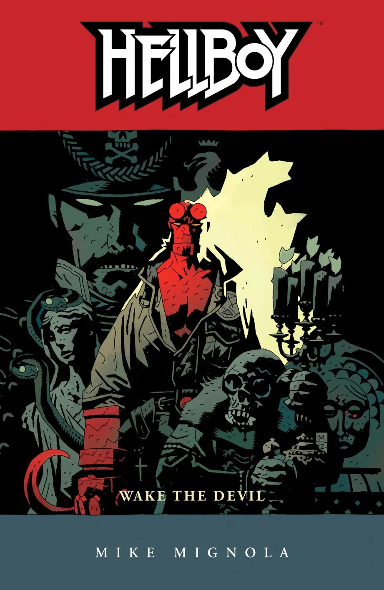MIKE MIGNOLA

3
<em>The Chained Coffin 
and Others</em>
August 5, 1998
<ul>
<li><em>[The Corpse](/entry/The_Corpse)</em></li>
<li><em>[The Iron Shoes](/entry/The_Iron_Shoes)</em></li>
<li><em>[The Baba Yaga](/entry/The_Baba_Yaga)</em></li>
<li><em>[A Christmas Underground](/entry/A_Christmas_Underground)</em></li>
<li><em>[The Chained Coffin](/entry/The_Chained_Coffin)</em></li>
<li><em>[The Wolves of Saint August](/entry/The_Wolves_of_Saint_August)</em></li>
<li><em>[Almost Colossus](/entry/Almost_Colossus)</em> #1–2</li>
</ul>
<ul>
<li>Introduction by P. Craig Russell</li>
<li>Gallery featuring art by [Kevin Nowlan](/entry/Kevin_Nowlan), [Matt Smith](/entry/Matthew_Dow_Smith), [Duncan Fegredo](/entry/Duncan_Fegredo), Dave Johnson, Thierry Robin and B.C. Boyer (7 pages)</li>
</ul>
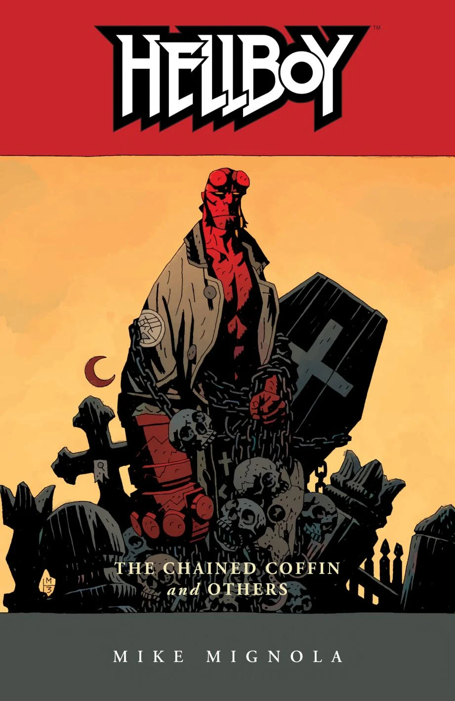MIKE MIGNOLA
[Volume 2](/entry/Hellboy_Library_Editions)

4
<em>The Right Hand of Doom</em>
April 26, 2000
<ul>
<li><em>[Pancakes](/entry/Pancakes)</em></li>
<li><em>[The Nature of the Beast](/entry/The_Nature_of_the_Beast)</em></li>
<li><em>[King Vold](/entry/King_Vold)</em></li>
<li><em>[Heads](/entry/Heads)</em></li>
<li><em>[Goodbye Mister Tod](/entry/Goodbye_Mister_Tod)</em></li>
<li><em>[The Vârcolac](/entry/The_V%C3%A2rcolac)</em></li>
<li><em>[The Right Hand of Doom](/entry/The_Right_Hand_of_Doom)</em></li>
<li><em>[Box Full of Evil](/entry/Box_Full_of_Evil)</em> #1–2 &amp; Epilogue</li>
</ul>
<ul>
<li>Sketchbook (19 pages)</li>
</ul>
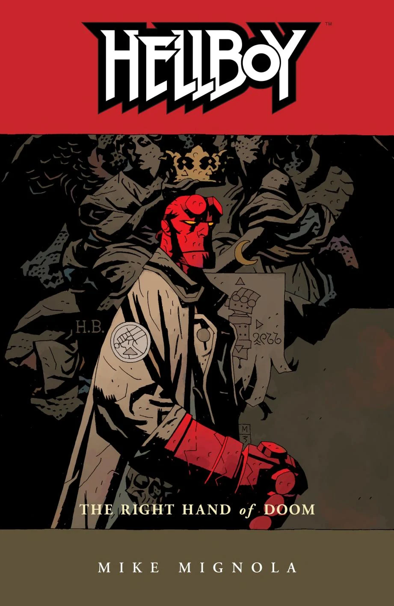MIKE MIGNOLA

5
<em>Conqueror Worm</em>
February 27, 2002
<ul>
<li><em>[Conqueror Worm](/entry/Conqueror_Worm_%28story%29)</em> #1–4 &amp; Epilogue</li>
</ul>
<ul>
<li>Introduction by [Guillermo del Toro](/entry/Guillermo_del_Toro)</li>
<li>Sketchbook (5 pages)</li>
</ul>
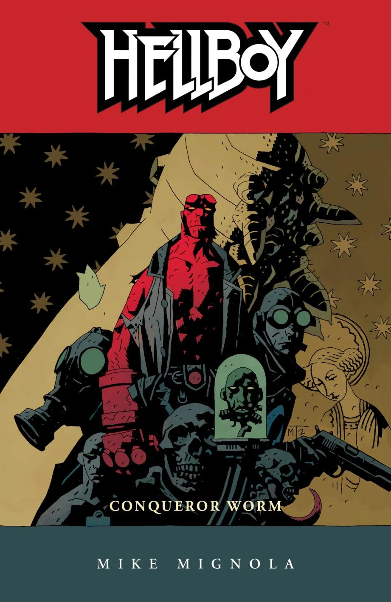MIKE MIGNOLA
[Volume 3](/entry/Hellboy_Library_Editions)

6
<em>Strange Places</em>
April 26, 2006
<ul>
<li><em>[The Third Wish](/entry/The_Third_Wish)</em> #1–2</li>
<li><em>[The Island](/entry/The_Island)</em> #1–2 &amp; Epilogue</li>
</ul>
<ul>
<li>Introduction by Gary Gianni</li>
<li>Unused opening for <em>The Island</em> (8 pages)</li>
<li>Unused alternative version of <em>The Island</em> pages 13–19</li>
<li>Sketchbook (4 pages)</li>
</ul>
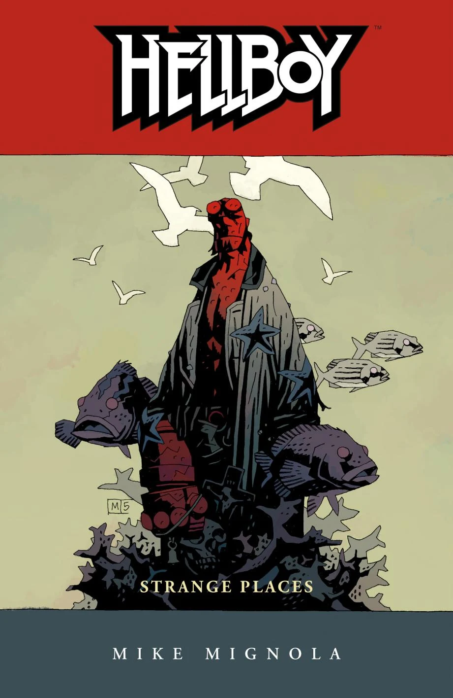MIKE MIGNOLA

7
<em>The Troll Witch 
and Others</em>
October 3, 2007
<ul>
<li><em>[The Penanggalan](/entry/The_Penanggalan)</em></li>
<li><em>[The Hydra and the Lion](/entry/The_Hydra_and_the_Lion)</em></li>
<li><em>[The Troll-Witch](/entry/The_Troll_Witch)</em></li>
<li><em>[The Vampire of Prague](/entry/The_Vampire_of_Prague)</em></li>
<li><em>[Dr. Carp's Experiment](/entry/Dr._Carp%26)</em></li>
<li><em>[The Ghoul](/entry/The_Ghoul)</em></li>
<li><em>[Makoma](/entry/Makoma_%28story%29)</em> #1–2</li>
</ul>
<ul>
<li>Introduction by Walter Simonson</li>
<li>Sketchbook (13 pages)</li>
</ul>
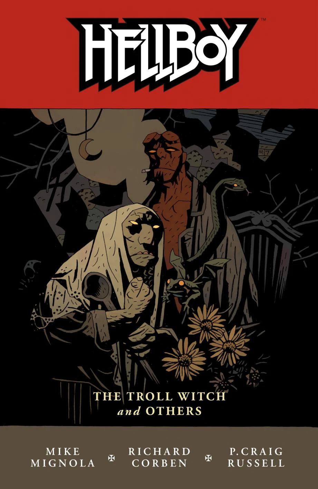MIKE MIGNOLA
[Volume 4](/entry/Hellboy_Library_Editions)

8
<em>Darkness Calls</em>
May 16, 2008
<ul>
<li><em>[Darkness Calls](/entry/Darkness_Calls)</em> #1–6 &amp; two Epilogues</li>
</ul>
<ul>
<li>Introduction by Jane Yolen</li>
<li>Sketchbook (18 pages)</li>
</ul>
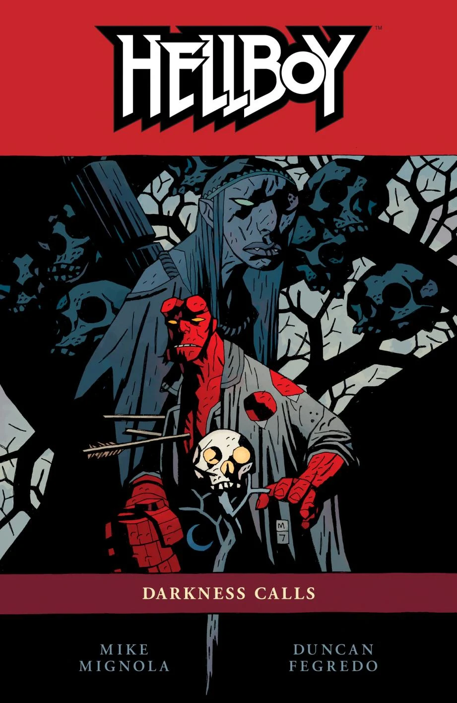MIKE MIGNOLA
[Volume 5](/entry/Hellboy_Library_Editions)

9
<em>The Wild Hunt</em>
March 10, 2010
<ul>
<li><em>[The Wild Hunt](/entry/The_Wild_Hunt)</em> #1–8</li>
</ul>
<ul>
<li>Introduction by Mark Chadbourn</li>
<li>Sketchbook (13 pages)</li>
</ul>
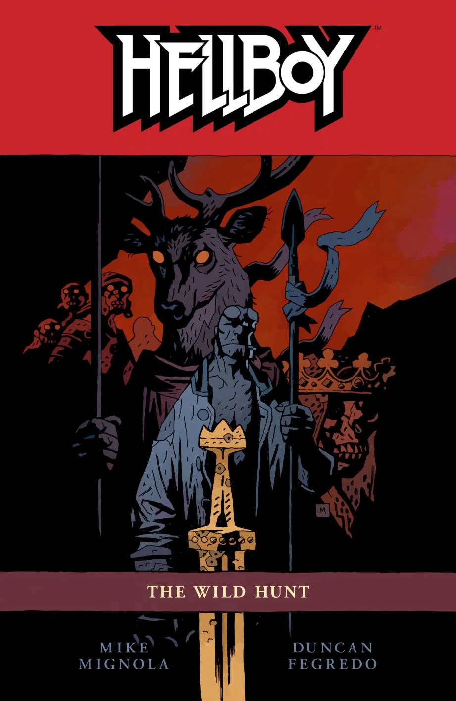MIKE MIGNOLA

10
<em>The Crooked Man 
and Others</em>
June 9, 2010
<ul>
<li><em>[The Crooked Man](/entry/The_Crooked_Man_%28comic_story%29)</em> #1–3</li>
<li><em>[They That Go Down to the Sea in Ships](/entry/They_That_Go_Down_to_the_Sea_in_Ships)</em></li>
<li><em>[In the Chapel of Moloch](/entry/In_the_Chapel_of_Moloch)</em></li>
<li><em>[The Mole](/entry/The_Mole)</em></li>
</ul>
<ul>
<li>Introduction by Gahan Wilson</li>
<li>Sketchbook (13 pages)</li>
<li>"Manly Wade Wellman: American Mythmaker" by John Pelan, a four-page text article</li>
</ul>
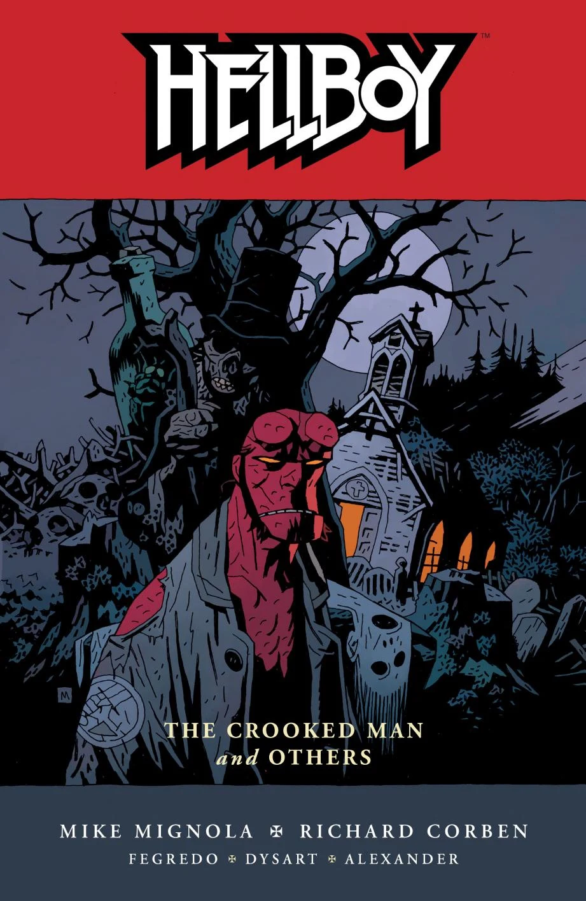MIKE MIGNOLA
[Volume 4](/entry/Hellboy_Library_Editions) 
(except <em>The Mole</em>, collected in [Volume 5](/entry/Hellboy_Library_Editions))

11
<em>The Bride of Hell 
and Others</em>
October 5, 2011
<ul>
<li><em>[Hellboy in Mexico](/entry/Hellboy_in_Mexico_%28story%29)</em></li>
<li><em>[Double Feature of Evil](/entry/Double_Feature_of_Evil)</em></li>
<li><em>[The Sleeping and the Dead](/entry/The_Sleeping_and_the_Dead)</em> #1–2</li>
<li><em>[The Bride of Hell](/entry/The_Bride_of_Hell)</em></li>
<li><em>[The Whittier Legacy](/entry/The_Whittier_Legacy)</em></li>
<li><em>[Buster Oakley Gets His Wish](/entry/Buster_Oakley_Gets_His_Wish)</em></li>
</ul>
<ul>
<li>Sketchbook (21 pages)</li>
</ul>
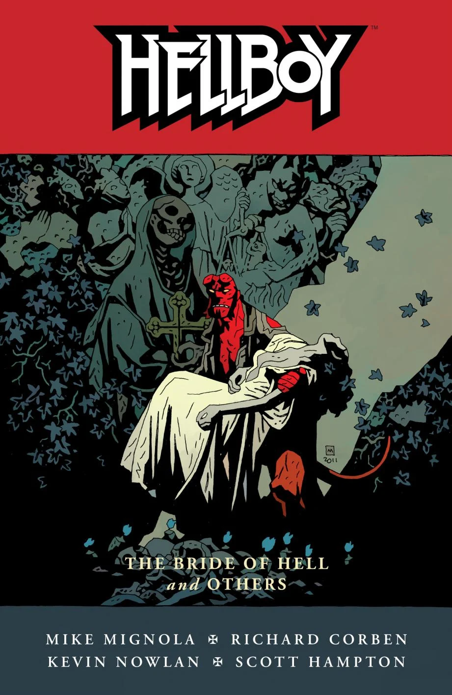MIKE MIGNOLA
[Volume 6](/entry/Hellboy_Library_Editions)

12
<em>The Storm and the Fury</em>
March 7, 2012
<ul>
<li><em>[The Storm](/entry/The_Storm)</em> #1–3</li>
<li><em>[The Fury](/entry/The_Fury)</em> #1–3 &amp; Epilogue</li>
</ul>
<ul>
<li>Introduction by Glen David Gold</li>
<li>Sketchbook (7 pages)</li>
<li>Two pages from <em>The Fury</em> #1, which recapped <em>The Storm</em>, were removed for the trade collection. They did not contain any new art.</li>
</ul>
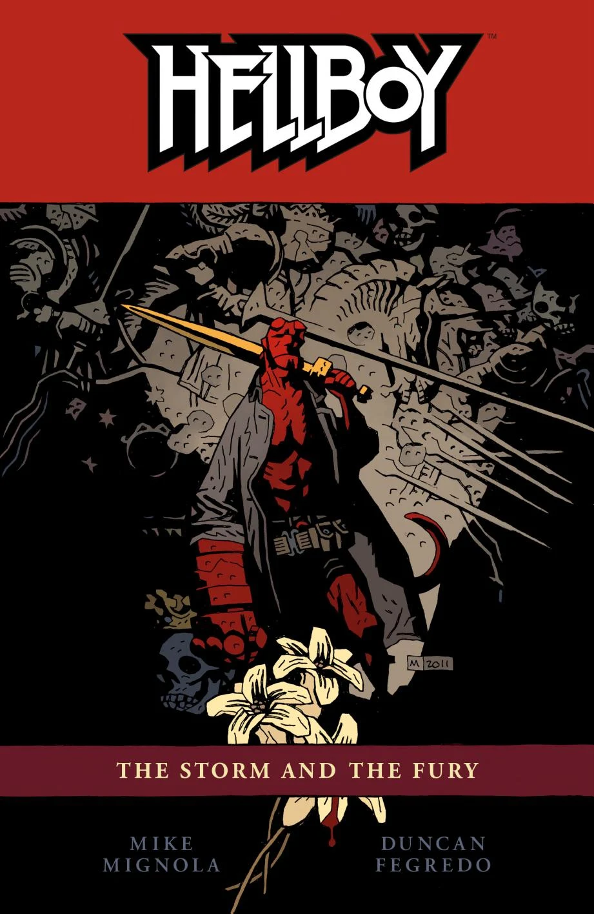MIKE MIGNOLA

N/A
<em>Hellboy in Mexico</em>
April 13, 2016
<ul>
<li>[<em>Hellboy in Mexico</em> (or <em>A Drunken Blur</em>)](/entry/Hellboy_in_Mexico_%28story%29)</li>
<li><em>[Hellboy versus the Aztec Mummy](/entry/Hellboy_versus_the_Aztec_Mummy)</em></li>
<li><em>[Hellboy Gets Married](/entry/Hellboy_Gets_Married)</em></li>
<li><em>[The Coffin Man](/entry/The_Coffin_Man)</em></li>
<li><em>[The Coffin Man 2: The Rematch](/entry/The_Coffin_Man_2__The_Rematch)</em></li>
<li><em>[House of the Living Dead](/entry/House_of_the_Living_Dead)</em></li>
</ul>
<ul>
<li>Sketchbook (17 pages)</li>
</ul>
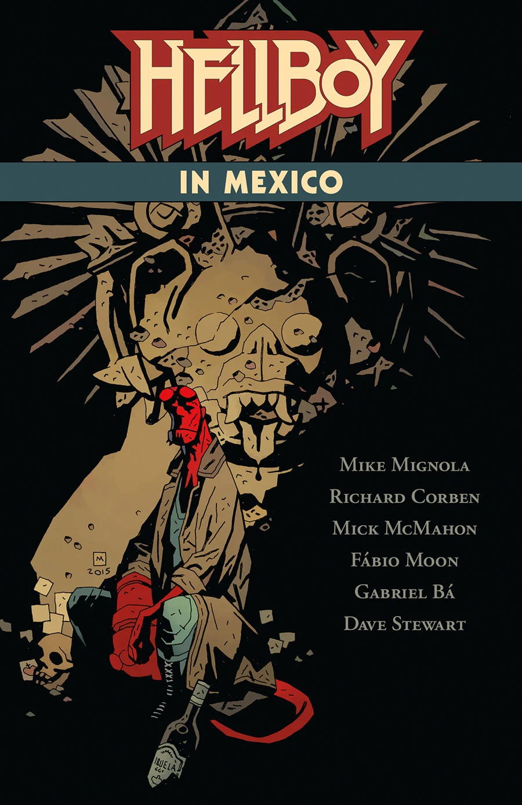MIKE MIGNOLA
N/A

N/A
<em>The Silver Lantern Club</em> 
(Hardcover)
September 7, 2022
<ul>
<li>[<em>The Silver Lantern Club</em>](/entry/The_Silver_Lantern_Club_%28story%29) #1–5</li>
</ul>
<ul>
<li>Sketchbook (20 pages)</li>
</ul>
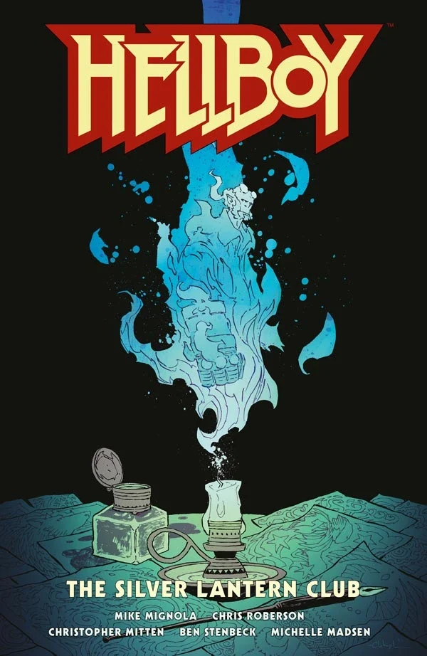CHRISTOPHER MITTEN
N/A

N/A
<em>The Bones of Giants</em> 
(Hardcover)
September 7, 2022
<ul>
<li>[<em>The Bones of Giants</em>](/entry/The_Bones_of_Giants_%28comic_miniseries%29) #1–4</li>
</ul>
<ul>
<li>Sketchbook (18 pages)</li>
</ul>
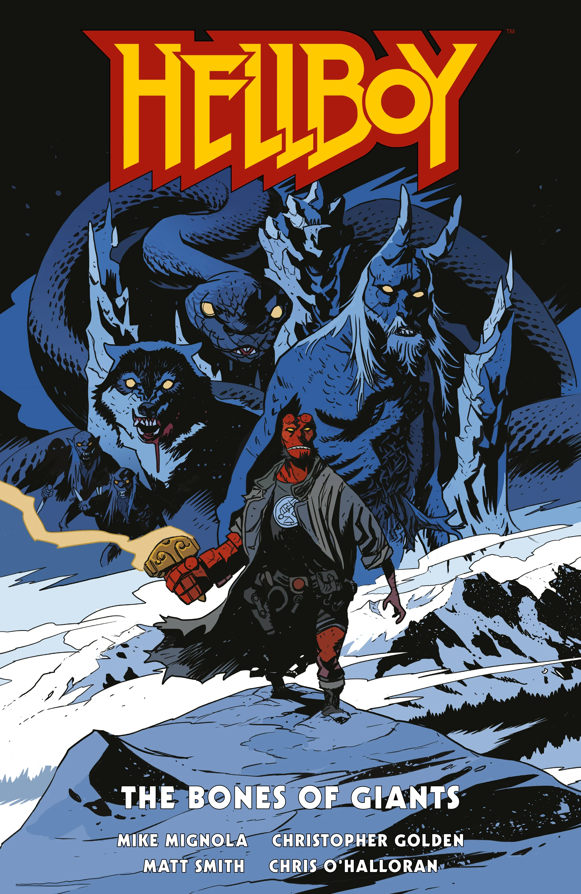MATT SMITH
N/A

N/A
<em>The Crooked Man &amp; The Return of Effie Kolb</em>
June 18, 2024
<ul>
<li>[<em>Hellboy: The Crooked Man</em>](/entry/The_Crooked_Man_%28comic_story%29) #1–3</li>
</ul>
N/A
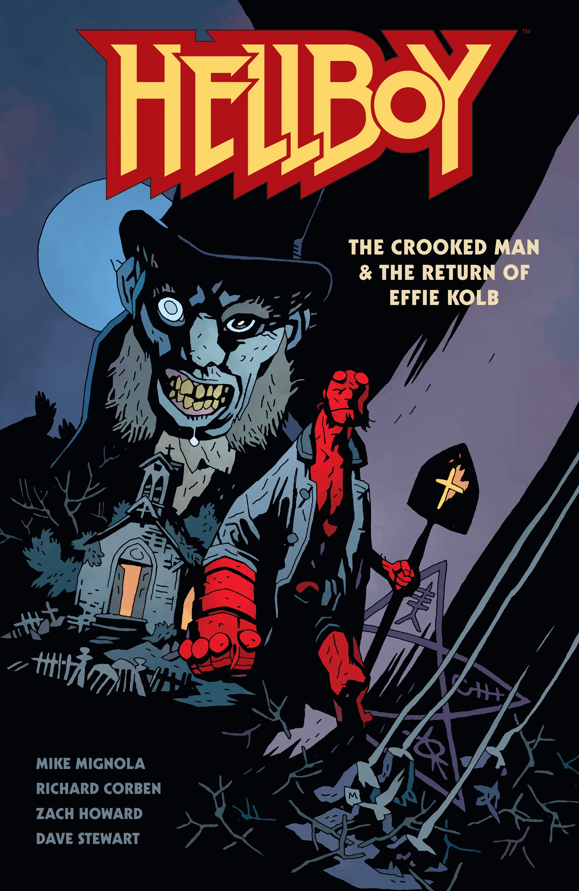MIKE MIGNOLA
[Volume 4](/entry/Hellboy_Library_Editions)

<ul>
<li><em>[Hellboy and the B.P.R.D.: The Return of Effie Kolb](/entry/The_Return_of_Effie_Kolb)</em> #1–2</li>
</ul>
N/A

</tbody>

#### *Hellboy* Original Graphic Novels

These original stories are released in hardcover trades. These trades contain none of the special features usually associated with Hellboy trades (no author's notes, no sketchbook/gallery).

Title
Date Published
Author
Artist
Cover
Collected in

<tbody>

<em>[House of the Living Dead](/entry/House_of_the_Living_Dead)</em>
November 2, 2011
[Mike Mignola](/entry/Mike_Mignola)
[Richard Corben](/entry/Richard_Corben)
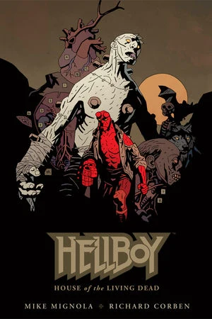MIKE MIGNOLA
[<em>Hellboy in Mexico</em>](/entry/TPB) 
— 
[<em>Hellboy: The Complete Short Stories – Volume 1</em> (omnibus edition)](/entry/Omnibus_Editions)

<em>[The Midnight Circus](/entry/The_Midnight_Circus)</em>
October 23, 2013
[Mike Mignola](/entry/Mike_Mignola)
[Duncan Fegredo](/entry/Duncan_Fegredo)
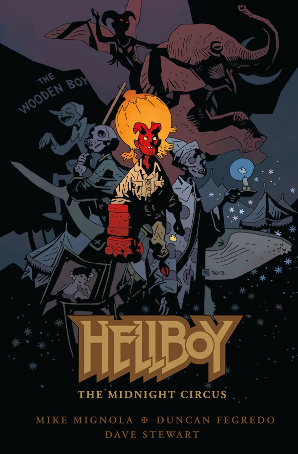MIKE MIGNOLA
[<em>Hellboy: The Complete Short Stories – Volume 1</em> (omnibus edition)](/entry/Omnibus_Editions)

<em>[Into the Silent Sea](/entry/Into_the_Silent_Sea)</em>
April 19, 2017
[Mike Mignola](/entry/Mike_Mignola) 
[Gary Gianni](/entry/Gary_Gianni)
[Gary Gianni](/entry/Gary_Gianni)
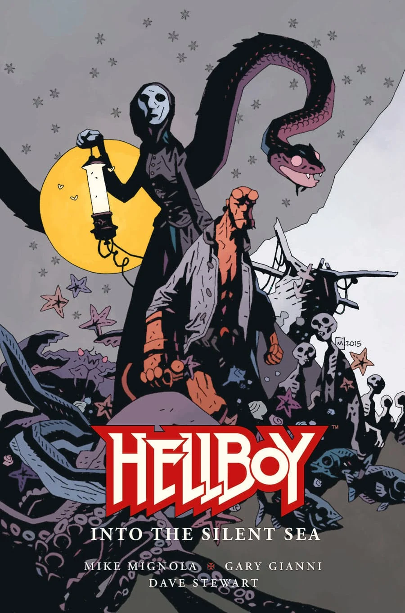MIKE MIGNOLA
[<em>Hellboy – Volume 2: Strange Places</em> (omnibus edition)](/entry/Omnibus_Editions)

</tbody>

#### Uncollected *Hellboy*

The following *Hellboy* stories are not currently collected in a trade collection:

- *[Giant Robot Hellboy](/entry/Giant_Robot_Hellboy_%28story%29)*
- *[Giant Robot Hellboy Returns](/entry/Giant_Robot_Hellboy_Returns)*

### *Hellboy in Hell*

#
Title
Date Published
Material collected
Additional Material
Cover
Library Edition
Omnibus

<tbody>

1
<em>The Descent</em>
May 21, 2014
<ul>
<li><em>[Hellboy in Hell](/entry/Hellboy_in_Hell_%28first_story_arc%29)</em> #1–4</li>
<li><em>[The Three Gold Whips](/entry/The_Three_Gold_Whips)</em></li>
</ul>
<ul>
<li>Sketchbook (24 pages)</li>
</ul>
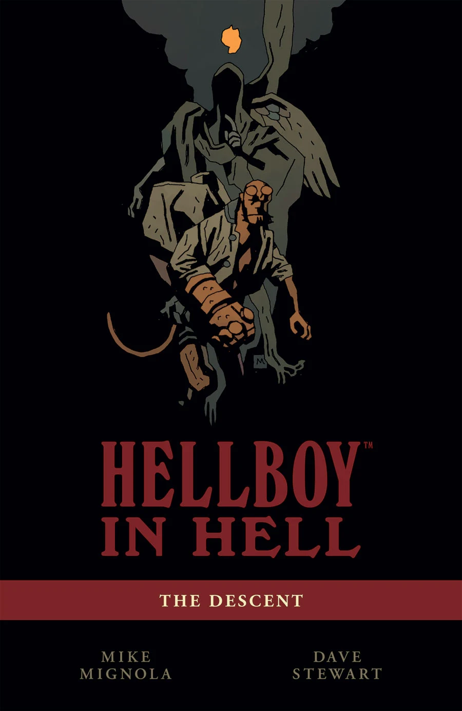MIKE MIGNOLA
[<em>Hellboy in Hell</em>](/entry/Hellboy_Library_Editions)
[<em>Hellboy – Volume 4: 
Hellboy in Hell</em>](/entry/Omnibus_Editions)

2
<em>The Death Card</em>
October 5, 2016
<ul>
<li><em>[The Death Card](/entry/The_Death_Card)</em> w/ prologue</li>
<li><em>[The Hounds of Pluto](/entry/The_Hounds_of_Pluto)</em></li>
<li><em>[The Spanish Bride](/entry/The_Spanish_Bride)</em></li>
<li><em>[For Whom the Bell Tolls](/entry/For_Whom_the_Bell_Tolls)</em></li>
<li><em>[The Exorcist of Vorsk](/entry/The_Exorcist_of_Vorsk)</em></li>
</ul>
<ul>
<li>Afterword by [Mike Mignola](/entry/Mike_Mignola)</li>
<li>Sketchbook (12 pages)</li>
</ul>
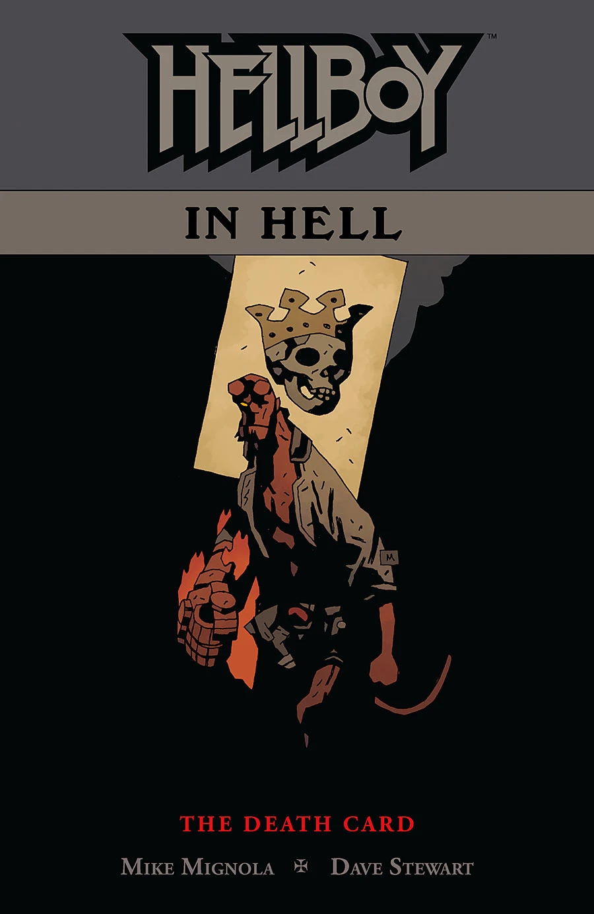MIKE MIGNOLA

</tbody>

#### Uncollected *Hellboy in Hell*

The following *Hellboy in Hell* story is not currently collected in a trade collection:

- *[Nothing But Blood](/entry/Nothing_But_Blood)*

### *[B.P.R.D.](/entry/B.P.R.D._%28series%29)*

#
Title
Date Published
Material collected
Additional Material
Cover
Omnibus

<tbody>

1
<em>Hollow Earth 
&amp; Other Stories</em>
January 29, 2003
<ul>
<li><em>[Hollow Earth](/entry/Hollow_Earth)</em> #1–3</li>
<li><em>[Lobster Johnson: The Killer in My Skull](/entry/The_Killer_in_My_Skull)</em></li>
<li><em>[Abe Sapien versus Science](/entry/Abe_Sapien_versus_Science)</em></li>
<li><em>[Abe Sapien: Drums of the Dead](/entry/Drums_of_the_Dead)</em></li>
<li><em>[Hollow Earth Dark Horse Extra](/entry/Hollow_Earth_Dark_Horse_Extra)</em></li>
</ul>
<ul>
<li>Sketchbook (9 pages)</li>
</ul>
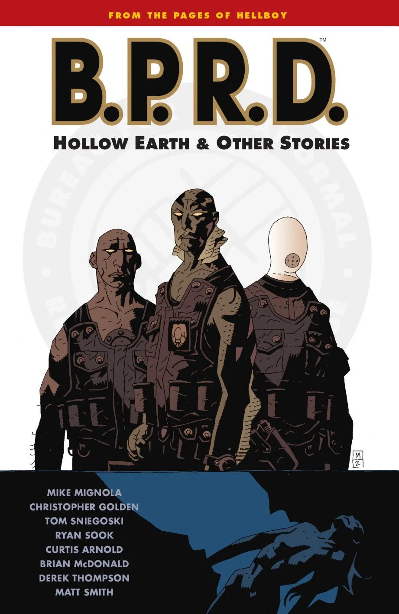MIKE MIGNOLA
[<em>B.P.R.D.: 
Plague of Frogs</em> 
Volume 1](/entry/Omnibus_Editions)

2
<em>The Soul of Venice 
&amp; Other Stories</em>
August 25, 2004
<ul>
<li><em>[The Soul of Venice](/entry/The_Soul_of_Venice)</em></li>
<li><em>[Dark Waters](/entry/Dark_Waters)</em></li>
<li><em>[Night Train](/entry/Night_Train)</em></li>
<li><em>[There's Something Under My Bed](/entry/There%26)</em></li>
<li><em>[Another Day at the Office](/entry/Another_Day_at_the_Office)</em></li>
</ul>
<ul>
<li>Sketchbook (13 pages)</li>
</ul>
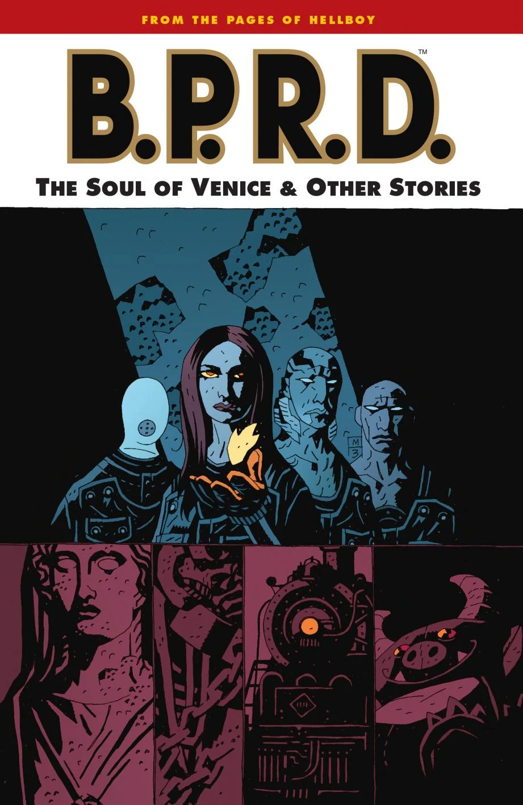MIKE MIGNOLA

3
<em>Plague of Frogs</em>
February 23, 2005
<ul>
<li><em>[Plague of Frogs](/entry/Plague_of_Frogs_%28story%29)</em> #1–5</li>
</ul>
<ul>
<li>Afterword by [Mike Mignola](/entry/Mike_Mignola)</li>
<li>Sketchbook (8 pages)</li>
</ul>
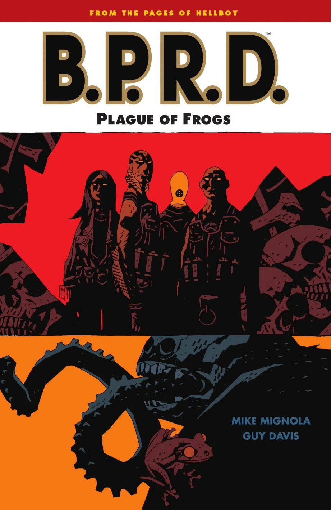MIKE MIGNOLA

4
<em>The Dead</em>
September 28, 2005
<ul>
<li><em>[Born Again](/entry/Born_Again)</em></li>
<li><em>[The Dead](/entry/The_Dead)</em> #1–5</li>
</ul>
<ul>
<li>Introduction by [John Arcudi](/entry/John_Arcudi)</li>
<li>Afterword by [Mike Mignola](/entry/Mike_Mignola)</li>
<li>Sketchbook (11 pages)</li>
</ul>
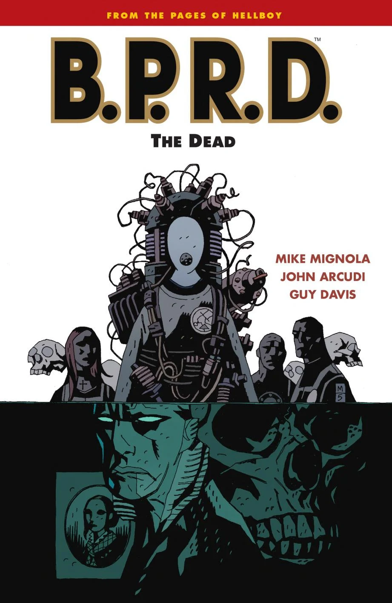MIKE MIGNOLA
[<em>B.P.R.D.: 
Plague of Frogs</em> 
Volume 2](/entry/Omnibus_Editions)

5
<em>The Black Flame</em>
July 12, 2006
<ul>
<li><em>[The Black Flame](/entry/The_Black_Flame_%28story%29)</em> #1–6</li>
</ul>
<ul>
<li>Afterword by [Mike Mignola](/entry/Mike_Mignola)</li>
<li>Sketchbook (6 pages)</li>
</ul>
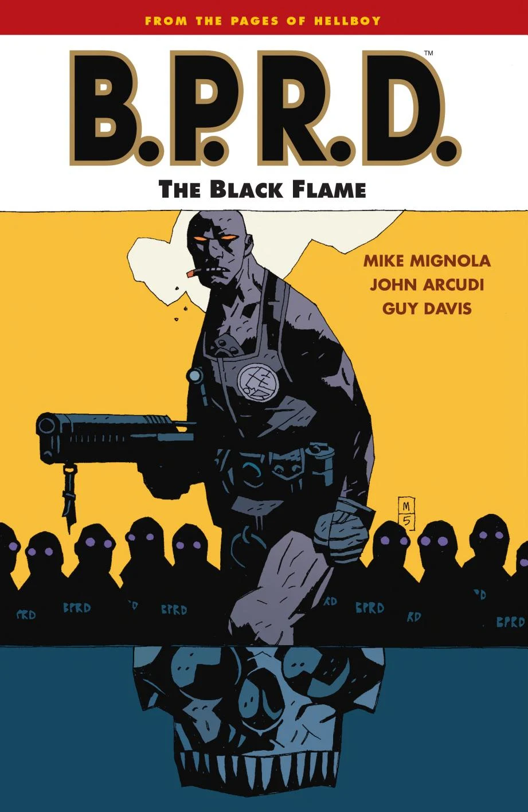MIKE MIGNOLA

6
<em>The Universal Machine</em>
January 17, 2007
<ul>
<li><em>[The Universal Machine](/entry/The_Universal_Machine)</em> #1–5</li>
</ul>
<ul>
<li>Afterword by [Mike Mignola](/entry/Mike_Mignola)</li>
<li>Sketchbook (7 pages)</li>
</ul>
MIKE MIGNOLA
[<em>B.P.R.D.: 
Plague of Frogs</em> 
Volume 3](/entry/Omnibus_Editions)

7
<em>Garden of Souls</em>
January 30, 2008
<ul>
<li><em>[Garden of Souls](/entry/Garden_of_Souls)</em> #1–5</li>
</ul>
<ul>
<li>Afterword by [John Arcudi](/entry/John_Arcudi)</li>
<li>Sketchbook (13 pages)</li>
</ul>
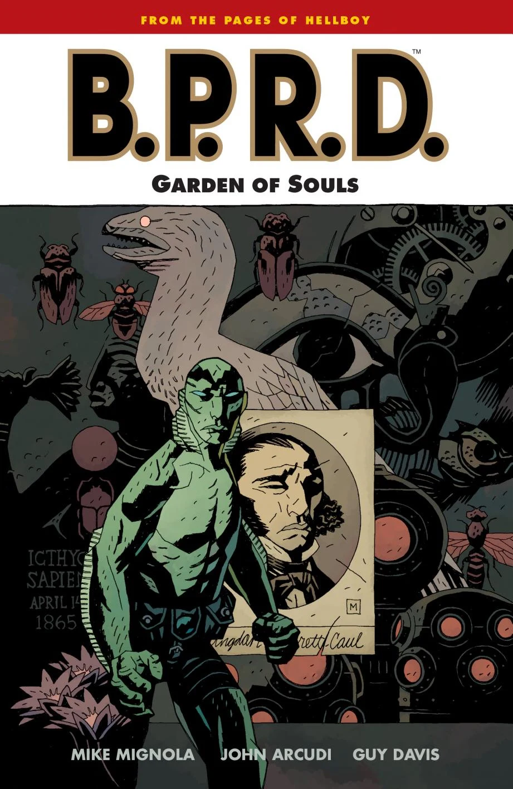MIKE MIGNOLA

8
<em>Killing Ground</em>
May 21, 2008
<ul>
<li><em>[Killing Ground](/entry/Killing_Ground)</em> #1–5</li>
</ul>
<ul>
<li>Afterword by [John Arcudi](/entry/John_Arcudi)</li>
<li>Sketchbook (8 pages)</li>
</ul>
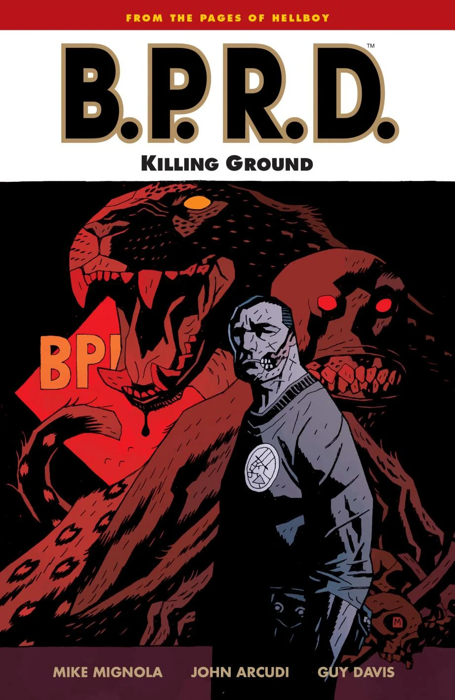MIKE MIGNOLA

9
<em>1946</em>
November 5, 2008
<ul>
<li><em>[1946](/entry/1946)</em> #1–5</li>
<li><em>[Bishop Olek's Devil](/entry/Bishop_Olek%26)</em></li>
</ul>
<ul>
<li>Afterword by [Joshua Dysart](/entry/Joshua_Dysart)</li>
<li>Sketchbook (8 pages)</li>
</ul>
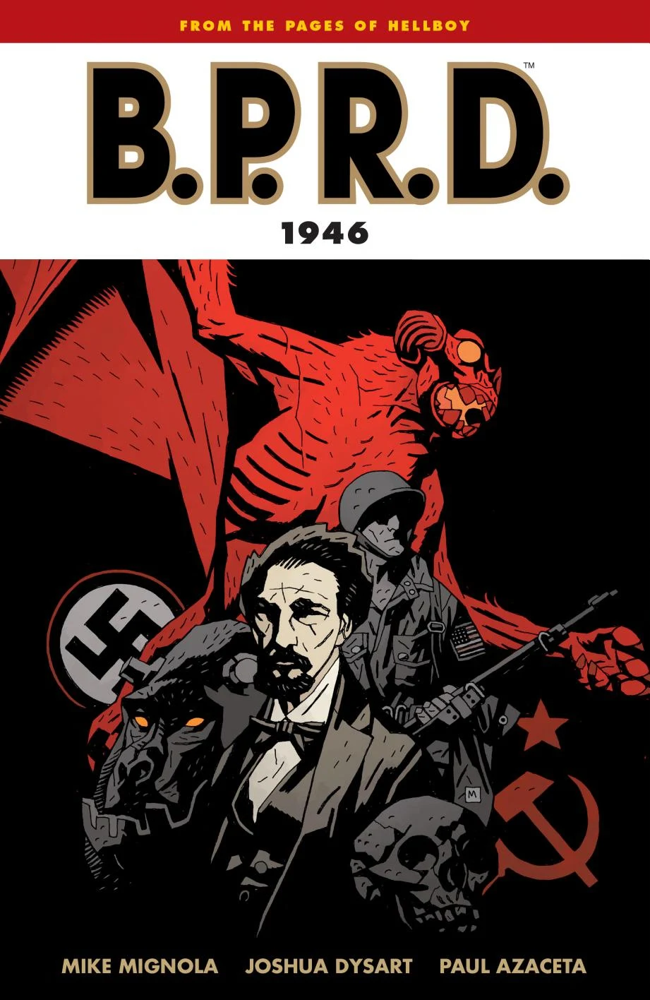MIKE MIGNOLA
[<em>B.P.R.D.: 
1946–1948</em>](/entry/Omnibus_Editions)

10
<em>The Warning</em>
April 15, 2009
<ul>
<li><em>[Out of Reach](/entry/Out_of_Reach)</em></li>
<li><em>[The Warning](/entry/The_Warning)</em> #1–5</li>
</ul>
<ul>
<li>Afterword by [John Arcudi](/entry/John_Arcudi)</li>
<li>Sketchbook (6 pages)</li>
</ul>
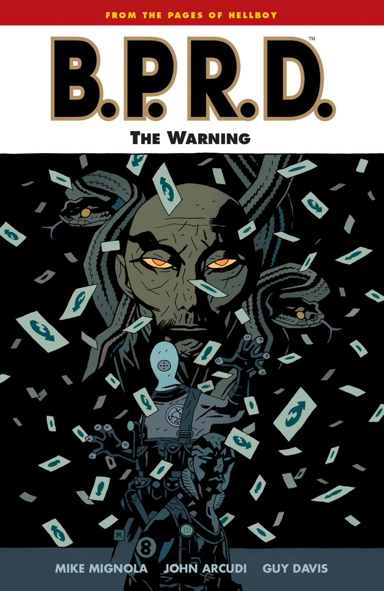MIKE MIGNOLA
[<em>B.P.R.D.: 
Plague of Frogs</em> 
Volume 4](/entry/Omnibus_Editions)

11
<em>The Black Goddess</em>
October 21, 2009
<ul>
<li><em>[The Black Goddess](/entry/The_Black_Goddess_%28story%29)</em> #1–5</li>
</ul>
<ul>
<li>Sketchbook (13 pages)</li>
<li>"Latchkey Memories from Crab Point" by [Guy Davis](/entry/Guy_Davis)</li>
</ul>
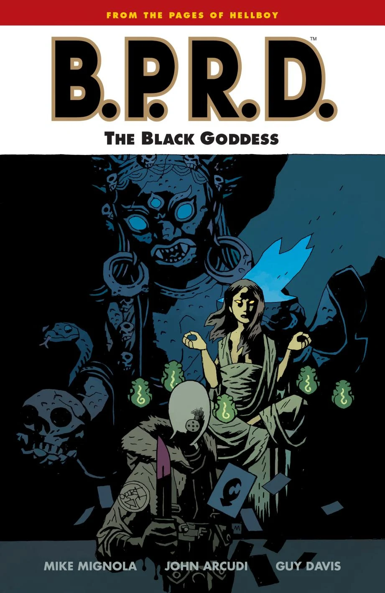MIKE MIGNOLA

12
<em>War on Frogs</em>
April 28, 2010
<ul>
<li><em>[War on Frogs](/entry/War_on_Frogs)</em> #1–4</li>
<li><em>[Revival](/entry/Revival)</em></li>
</ul>
<ul>
<li>Sketchbook (8 pages)</li>
</ul>
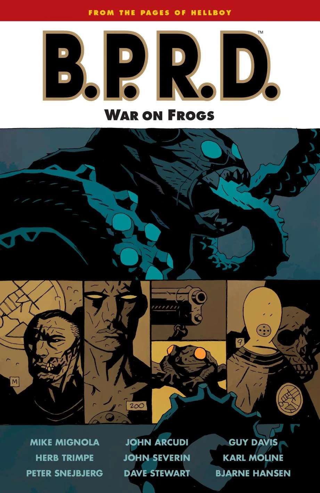MIKE MIGNOLA
[<em>B.P.R.D.: 
Plague of Frogs</em> 
Volume 2](/entry/Omnibus_Editions)

13
<em>1947</em>
July 7, 2010
<ul>
<li><em>[1947](/entry/1947)</em> #1–5</li>
<li><em>[And What Shall I Find There?](/entry/And_What_Shall_I_Find_There)</em></li>
</ul>
<ul>
<li>Afterword by [Mike Mignola](/entry/Mike_Mignola)</li>
<li>Sketchbook (15 pages)</li>
</ul>
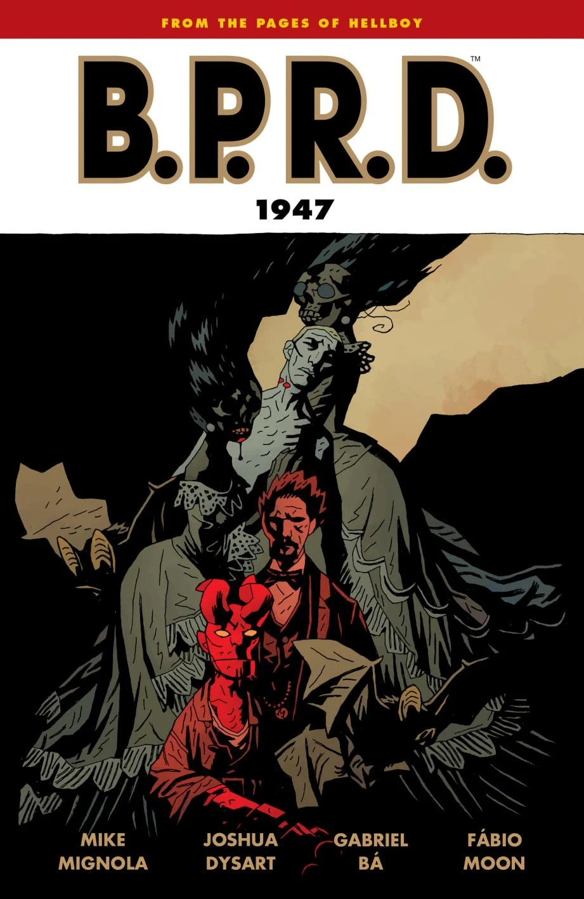MIKE MIGNOLA
[B.P.R.D.: 
1946 – 1948](/entry/Omnibus_Editions)

14
<em>King of Fear</em>
November 3, 2010
<ul>
<li><em>[King of Fear](/entry/King_of_Fear_%28story%29)</em> #1–5</li>
</ul>
<ul>
<li>Afterword by [Mike Mignola](/entry/Mike_Mignola)</li>
<li>Sketchbook (18 pages)</li>
</ul>
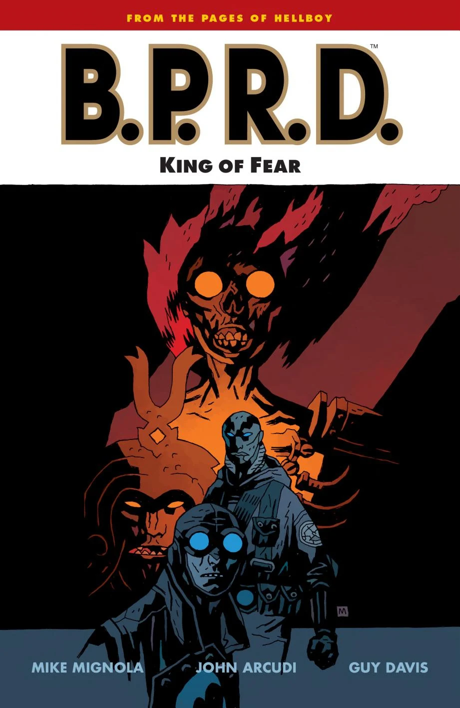MIKE MIGNOLA
[<em>B.P.R.D.: 
Plague of Frogs</em> 
Volume 4](/entry/Omnibus_Editions)

N/A
<em>Being Human</em>
November 30, 2011
<ul>
<li><em>[The Dead Remembered](/entry/The_Dead_Remembered)</em> #1–3</li>
</ul>
<ul>
<li>Sketchbook (12 pages)</li>
</ul>
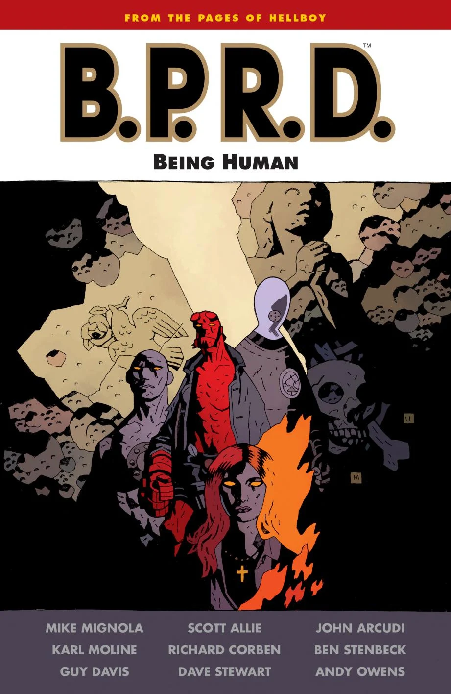MIKE MIGNOLA
N/A

<ul>
<li><em>[Casualties](/entry/Casualties)</em></li>
</ul>
[<em>Abe Sapien: 
The Drowning and Other Stories</em>](/entry/Omnibus_Editions)

<ul>
<li><em>[Being Human](/entry/Being_Human)</em></li>
</ul>
[<em>Hellboy – Volume 2: 
Strange Places</em>](/entry/Omnibus_Editions)

<ul>
<li><em>[The Ectoplasmic Man](/entry/The_Ectoplasmic_Man)</em></li>
</ul>
N/A

N/A
<em>1948</em>
September 11, 2013
<ul>
<li><em>[1948](/entry/1948)</em> #1–5</li>
</ul>
<ul>
<li>Sketchbook (18 pages)</li>
</ul>
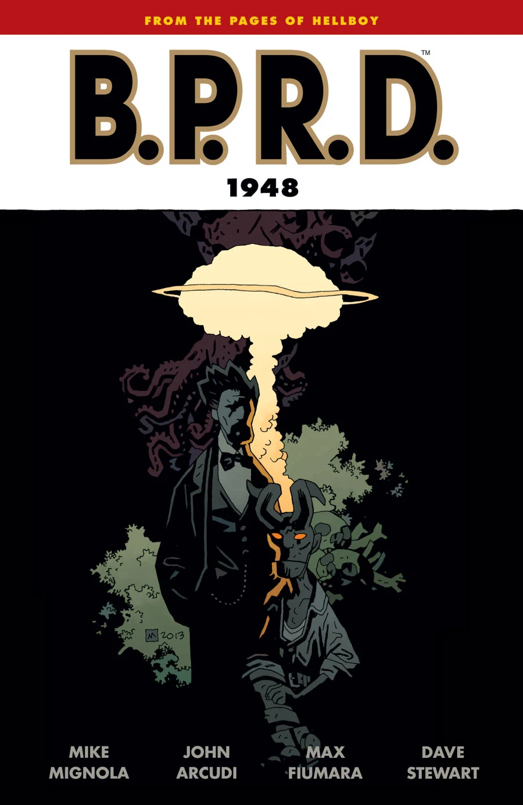MIKE MIGNOLA
[<em>B.P.R.D.: 
1946 – 1948</em>](/entry/Omnibus_Editions)

</tbody>

### *B.P.R.D.: Vampire*

#
Title
Date Published
Material collected
Additional Material
Cover

<tbody>

1
<em>Vampire</em>
<strong>1st EDITION</strong>
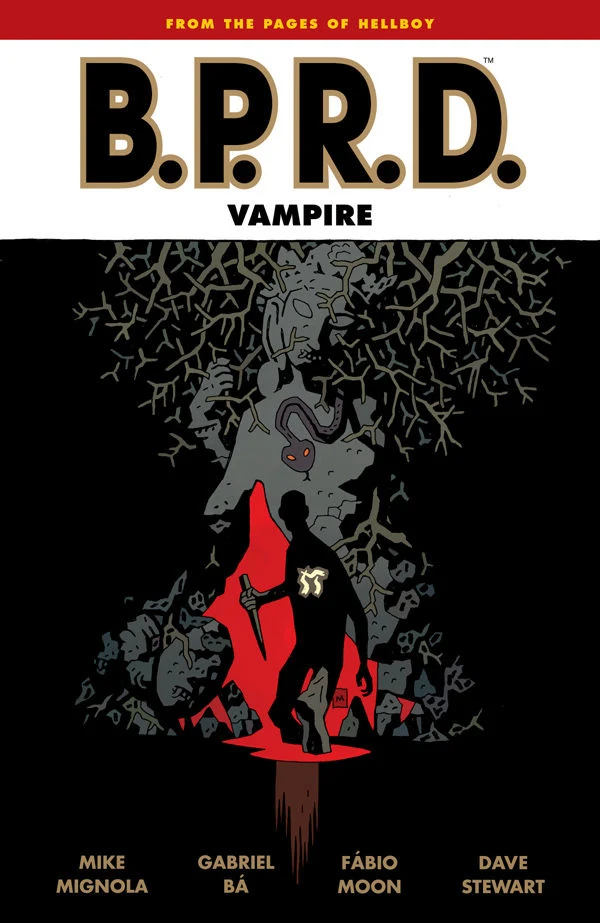MIKE MIGNOLA

November 27, 2013
<ul>
<li><em>[Vampire](/entry/Vampire_%28story%29)</em> #1–5</li>
</ul>
<ul>
<li>Sketchbook (17 pages)</li>
</ul>

<strong>2nd EDITION</strong>

February 27, 2019
<ul>
<li><em>[Vampire](/entry/Vampire_%28story%29)</em> #1–5</li>
<li><em>[Lost Ones](/entry/Lost_Ones)</em></li>
</ul>
<ul>
<li>Introduction by Gabriel Bá and Fábio Moon</li>
<li>Sketchbook (19 pages)</li>
</ul>

</tbody>

### *[B.P.R.D.: Hell on Earth](/entry/B.P.R.D._%28series%29)*

#
Title
Date Published
Material collected
Additional Material
Cover
Omnibus

<tbody>

1
<em>New World</em>
August 17, 2011
<ul>
<li><em>[New World](/entry/New_World_%28B.P.R.D._story_arc%29)</em> #1–5</li>
<li><em>[Seattle](/entry/Seattle)</em></li>
</ul>
<ul>
<li>Afterword by [Mike Mignola](/entry/Mike_Mignola)</li>
<li>Sketchbook (8 pages)</li>
</ul>
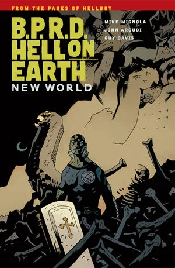MIKE MIGNOLA
[<em>B.P.R.D.: 
Hell on Earth</em> 
Volume 1](/entry/Omnibus_Editions)

2
<em>Gods and Monsters</em>
January 11, 2012
<ul>
<li><em>[Gods](/entry/Gods)</em> #1–3</li>
<li><em>[Monsters](/entry/Monsters)</em> #1–2</li>
</ul>
<ul>
<li>Sketchbook (19 pages)</li>
</ul>
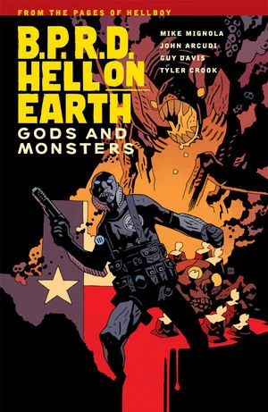MIKE MIGNOLA

3
<em>Russia</em>
August 15, 2012
<ul>
<li><em>[Russia](/entry/Russia)</em> #1–5</li>
<li><em>[An Unmarked Grave](/entry/An_Unmarked_Grave)</em></li>
</ul>
<ul>
<li>Sketchbook (24 pages)</li>
</ul>
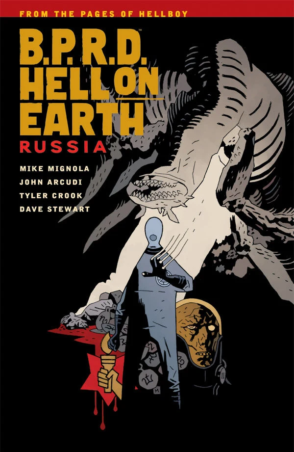MIKE MIGNOLA

4
<em>The Devil's Engine 
&amp; The Long Death</em>
December 5, 2012
<ul>
<li><em>[The Devil's Engine](/entry/The_Devil%26)</em> #1–3</li>
<li><em>[The Long Death](/entry/The_Long_Death)</em> #1–3</li>
</ul>
<ul>
<li>Sketchbook (27 pages)</li>
</ul>
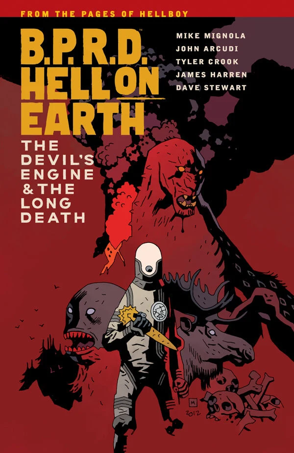MIKE MIGNOLA
[<em>B.P.R.D.: 
Hell on Earth</em> 
Volume 2](/entry/Omnibus_Editions)

5
<em>The Pickens County Horror 
and Others</em>
July 17, 2013
<ul>
<li><em>[The Pickens County Horror](/entry/The_Pickens_County_Horror)</em> #1–2</li>
<li><em>[The Transformation of J.H. O'Donnell](/entry/The_Transformation_of_J.H._O%26)</em></li>
<li><em>[The Abyss of Time](/entry/The_Abyss_of_Time)</em> #1–2</li>
</ul>
<ul>
<li>Sketchbook (30 pages)</li>
</ul>
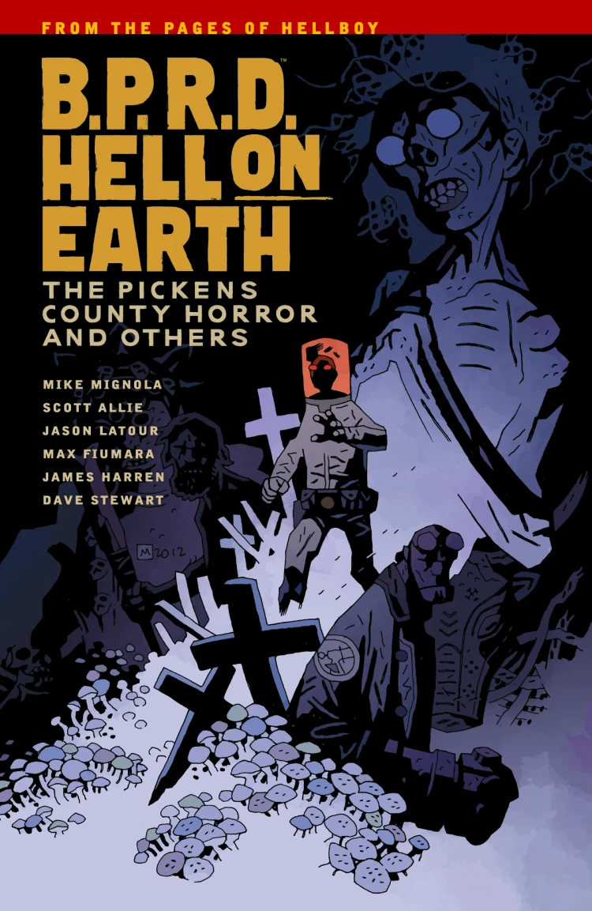MIKE MIGNOLA

6
<em>The Return of the Master</em>
August 7, 2013
<ul>
<li><em>[The Return of the Master](/entry/The_Return_of_the_Master)</em> #1–5</li>
</ul>
<ul>
<li>Sketchbook (34 pages)</li>
</ul>
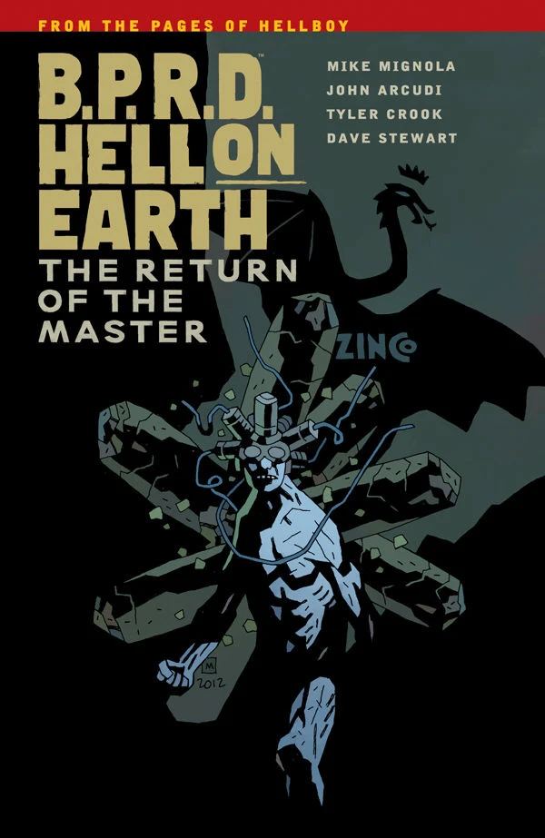MIKE MIGNOLA

7
<em>A Cold Day in Hell</em>
January 22, 2014
<ul>
<li><em>[Wasteland](/entry/Wasteland)</em> #1–3</li>
<li><em>[A Cold Day in Hell](/entry/A_Cold_Day_in_Hell)</em> #1–2</li>
</ul>
<ul>
<li>Sketchbook (18 pages)</li>
</ul>
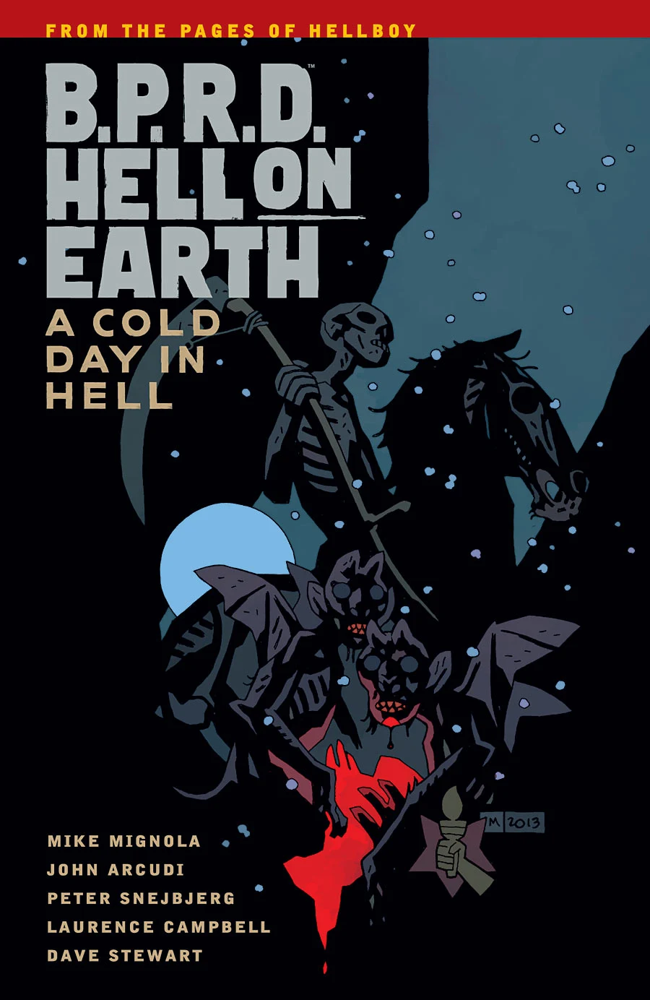MIKE MIGNOLA
[<em>B.P.R.D.: 
Hell on Earth</em> 
Volume 3](/entry/Omnibus_Editions)

8
<em>Lake of Fire</em>
April 9, 2014
<ul>
<li><em>[Lake of Fire](/entry/Lake_of_Fire)</em> #1–5</li>
</ul>
<ul>
<li>Sketchbook (18 pages)</li>
</ul>
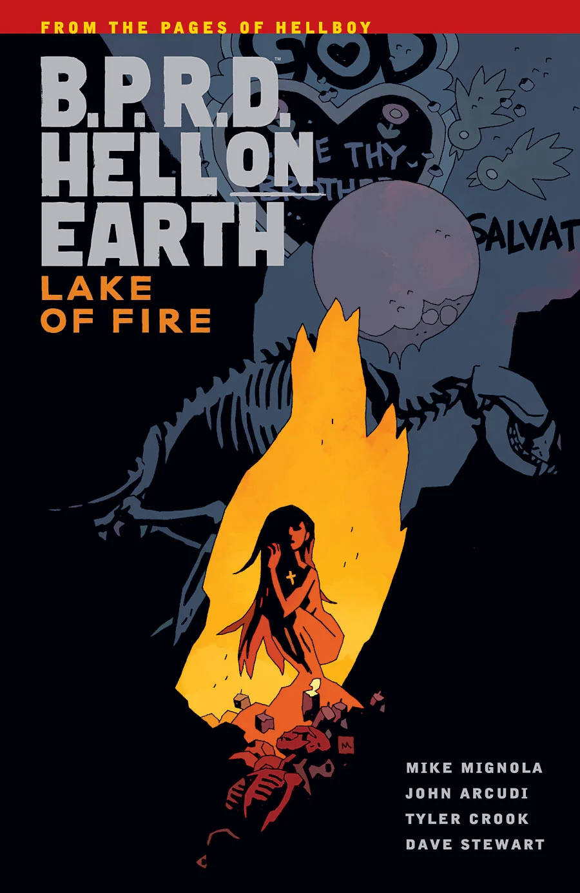MIKE MIGNOLA

9
<em>The Reign of the 
Black Flame</em>
September 10, 2014
<ul>
<li><em>[The Reign of the Black Flame](/entry/The_Reign_of_the_Black_Flame)</em> #1–5</li>
</ul>
<ul>
<li>Sketchbook (18 pages)</li>
</ul>
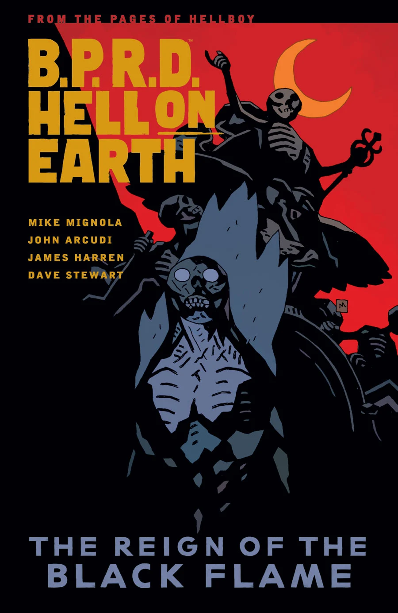MIKE MIGNOLA

10
<em>The Devil's Wings</em>
March 18, 2015
<ul>
<li><em>[The Devil's Wings](/entry/The_Devil%26)</em> #1–2</li>
<li><em>[The Broken Equation](/entry/The_Broken_Equation)</em> #1–2</li>
<li><em>[Grind](/entry/Grind)</em></li>
</ul>
<ul>
<li>Sketchbook (22 pages)</li>
</ul>
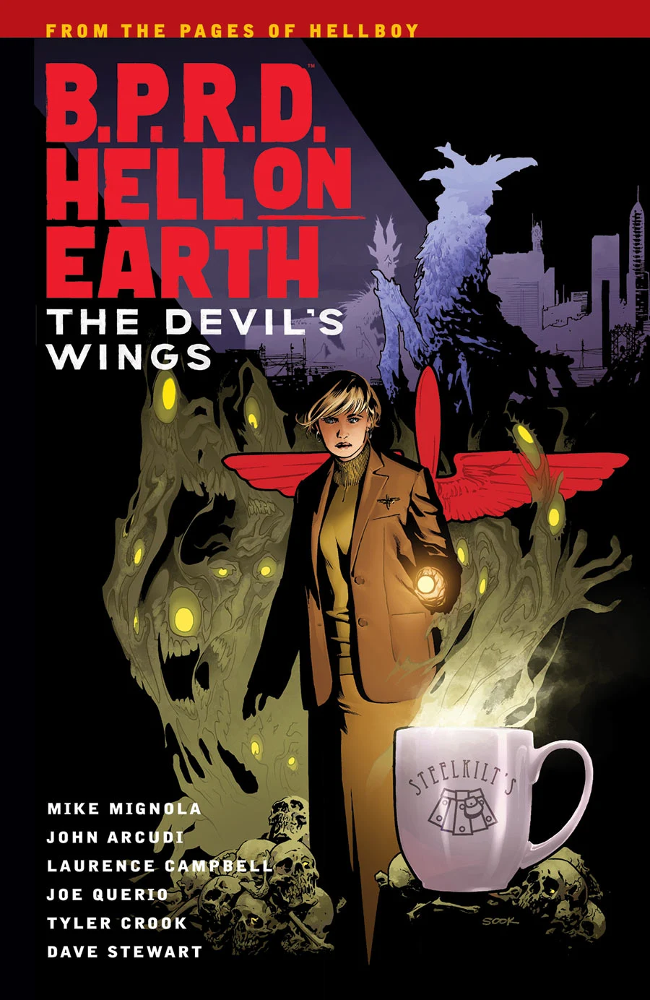RYAN SOOK
[<em>B.P.R.D.: 
Hell on Earth</em> 
Volume 4](/entry/Omnibus_Editions)

11
<em>Flesh and Stone</em>
September 23, 2015
<ul>
<li><em>[Flesh and Stone](/entry/Flesh_and_Stone)</em> #1–5</li>
</ul>
<ul>
<li>Sketchbook (18 pages)</li>
</ul>
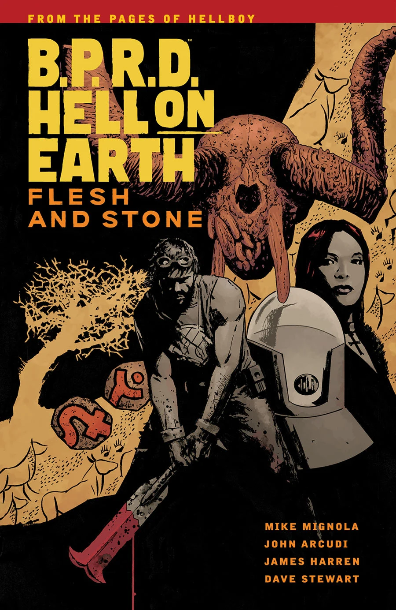LAURENCE CAMPBELL

12
<em>Metamorphosis</em>
December 23, 2015
<ul>
<li><em>[Nowhere, Nothing, Never](/entry/Nowhere%2C_Nothing%2C_Never)</em> #1–3</li>
<li><em>[Modern Prometheus](/entry/Modern_Prometheus)</em> #1–2</li>
</ul>
<ul>
<li>Sketchbook (18 pages)</li>
</ul>
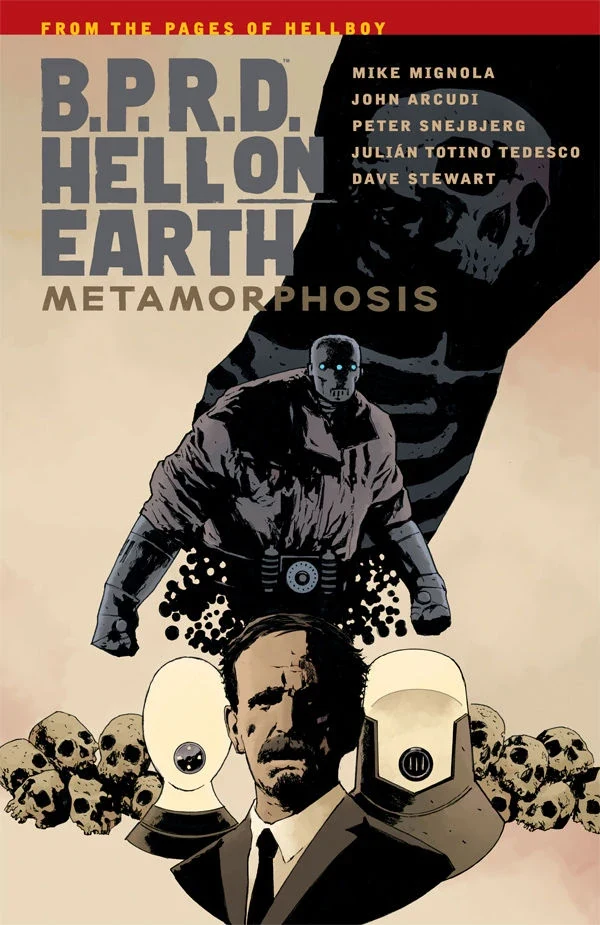LAURENCE CAMPBELL
[<em>B.P.R.D.: 
Hell on Earth</em> 
Volume 5](/entry/Omnibus_Editions)

13
<em>End of Days</em>
May 18, 2016
<ul>
<li><em>[End of Days](/entry/End_of_Days)</em> #1–5</li>
</ul>
<ul>
<li>Sketchbook (10 pages)</li>
</ul>
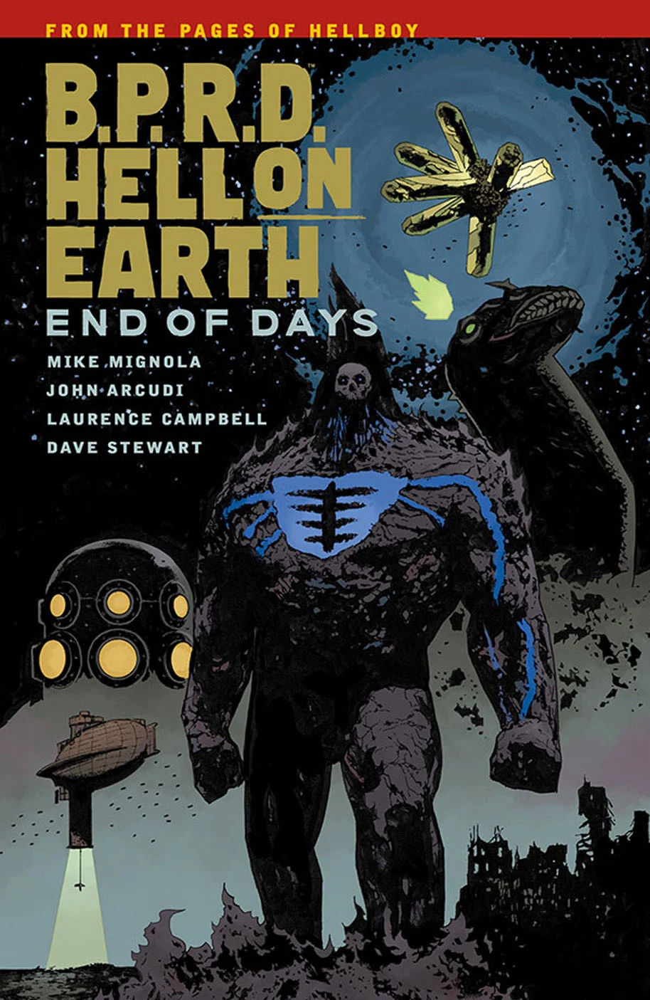LAURENCE CAMPBELL

14
<em>The Exorcist</em>
September 21, 2016
<ul>
<li><em>[Exorcism](/entry/Exorcism)</em> #1–2</li>
<li><em>[The Exorcist](/entry/The_Exorcist)</em> #1–3</li>
</ul>
<ul>
<li>Sketchbook (8 pages)</li>
</ul>
LAURENCE CAMPBELL
[<em>B.P.R.D.: 
Hell on Earth</em> 
Volume 4](/entry/Omnibus_Editions)

15
<em>Cometh the Hour</em>
March 29, 2017
<ul>
<li><em>[Cometh the Hour](/entry/Cometh_the_Hour)</em> #1–5</li>
</ul>
<ul>
<li>Sketchbook (13 pages)</li>
</ul>
LAURENCE CAMPBELL
[<em>B.P.R.D.: 
Hell on Earth</em> 
Volume 5](/entry/Omnibus_Editions)

</tbody>

### *[B.P.R.D.: The Devil You Know](/entry/B.P.R.D._%28series%29)*

#
Title
Date Published
Material collected
Additional Material
Cover
Omnibus

<tbody>

1
<em>Messiah</em>
April 11, 2018
<ul>
<li><em>[Messiah](/entry/Messiah)</em> #1–5</li>
<li><em>[Broken Vessels](/entry/Broken_Vessels)</em></li>
</ul>
<ul>
<li>Sketchbook (9 pages)</li>
</ul>
LAURENCE CAMPBELL
[<em>B.P.R.D.: 
The Devil You Know</em>](/entry/Omnibus_Editions)

2
<em>Pandemonium</em>
February 6, 2019
<ul>
<li>[<em>Pandemonium</em>](/entry/Pandemonium_%28story_arc%29) #1–5</li>
</ul>
<ul>
<li>Sketchbook (18 pages)</li>
</ul>
LAURENCE CAMPBELL

3
<em>Ragna Rok</em>
July 17, 2019
<ul>
<li>[<em>Ragna Rok</em>](/entry/Ragna_Rok_%28story_arc%29) #1–5</li>
</ul>
<ul>
<li>Afterword by [Mike Mignola](/entry/Mike_Mignola)</li>
<li>Sketchbook (14 pages)</li>
</ul>
LAURENCE CAMPBELL

</tbody>

### *[Lobster Johnson](/entry/Lobster_Johnson_%28series%29)*

#
Title
Date Published
Material collected
Additional Material
Cover
Omnibus

<tbody>

1
<em>The Iron Prometheus</em>
June 18, 2008
<ul>
<li><em>[The Iron Prometheus](/entry/The_Iron_Prometheus)</em> #1–5</li>
</ul>
<ul>
<li><em>The True History of Lobster Johnson</em></li>
<li>Sketchbook (17 pages)</li>
</ul>
MIKE MIGNOLA
[<em>Lobster Johnson</em> Volume 2](/entry/Omnibus_Editions)

2
<em>The Burning Hand</em>
November 14, 2012
<ul>
<li><em>[The Burning Hand](/entry/The_Burning_Hand)</em> #1–5</li>
</ul>
<ul>
<li>Sketchbook (18 pages)</li>
</ul>
MIKE MIGNOLA
[<em>Lobster Johnson</em> Volume 1](/entry/Omnibus_Editions)

3
<em>Satan Smells a Rat</em>
February 12, 2014
<ul>
<li><em>[Caput Mortuum](/entry/Caput_Mortuum)</em></li>
<li><em>[Satan Smells a Rat](/entry/Satan_Smells_a_Rat)</em></li>
<li><em>[Tony Masso's Finest Hour](/entry/Tony_Masso%26)</em></li>
<li><em>[A Scent of Lotus](/entry/A_Scent_of_Lotus)</em> #1–2</li>
<li><em>[The Prayer of Neferu](/entry/The_Prayer_of_Neferu)</em></li>
</ul>
<ul>
<li>Sketchbook (18 pages)</li>
</ul>
MIKE MIGNOLA

4
<em>Get the Lobster!</em>
December 10, 2014
<ul>
<li><em>[Get the Lobster](/entry/Get_the_Lobster)</em> #1–5</li>
</ul>
<ul>
<li>Sketchbook (18 pages)</li>
</ul>
TONCI ZONJIC

5
<em>The Pirate’s Ghost 
and 
Metal Monsters of Midtown</em>
December 13, 2017
<ul>
<li><em>[Metal Monsters of Midtown](/entry/Metal_Monsters_of_Midtown)</em> #1–3</li>
<li><em>[The Pirate's Ghost](/entry/The_Pirate%26)</em> #1–3</li>
</ul>
<ul>
<li>Afterword by [Clem Robins](/entry/Clem_Robins)</li>
<li>Sketchbook (16 pages)</li>
</ul>
TONCI ZONJIC
[<em>Lobster Johnson</em> Volume 2](/entry/Omnibus_Editions)

6
<em>A Chain Forged in Life</em>
March 7, 2018
<ul>
<li><em>[A Chain Forged in Life](/entry/A_Chain_Forged_in_Life)</em></li>
<li><em>[The Forgotten Man](/entry/The_Forgotten_Man)</em></li>
<li><em>[The Glass Mantis](/entry/The_Glass_Mantis)</em></li>
<li><em>[Garden of Bones](/entry/Garden_of_Bones)</em></li>
<li><em>[Mangekyō](/entry/Mangeky%C5%8D)</em></li>
</ul>
<ul>
<li>Sketchbook (18 pages)</li>
</ul>
TONCI ZONJIC

</tbody>

#### Uncollected *Lobster Johnson*

The following *Lobster Johnson* story is not currently collected in a trade collection:

- *[The Empty Chair](/entry/The_Empty_Chair)* (collected in the [*Lobster Johnson – Volume 1* omnibus edition](/entry/Omnibus_Editions))
- *[Kung Pao Lobster](/entry/Kung_Pao_Lobster)* (humor comic unlikely to be collected)

### *[Abe Sapien](/entry/Abe_Sapien_%28series%29)*

#
Title
Date Published
Material collected
Additional Material
Cover
Omnibus

<tbody>

1
<em>The Drowning</em>
September 17, 2008
<ul>
<li><em>[The Drowning](/entry/The_Drowning)</em> #1–5</li>
</ul>
<ul>
<li>Sketchbook (8 pages)</li>
</ul>
MIKE MIGNOLA
<em>[Abe Sapien: 
The Drowning 
and Other Stories](/entry/Omnibus_Editions)</em>

2
<em>The Devil Does Not Jest 
and Other Stories</em>
May 9, 2012
<ul>
<li><em>[The Haunted Boy](/entry/The_Haunted_Boy)</em></li>
<li><em>[The Abyssal Plain](/entry/The_Abyssal_Plain)</em> #1–2</li>
<li><em>[The Devil Does Not Jest](/entry/The_Devil_Does_Not_Jest)</em> #1–2</li>
</ul>
<ul>
<li>Sketchbook (20 pages)</li>
</ul>
MIKE MIGNOLA

3
<em>Dark and Terrible 
and 
The New Race of Man</em>
December 11, 2013
<ul>
<li><em>[Dark and Terrible](/entry/Dark_and_Terrible_%28story%29)</em> #1–3</li>
<li><em>[The New Race of Man](/entry/The_New_Race_of_Man)</em> #1–2</li>
</ul>
<ul>
<li>Sketchbook (24 pages)</li>
</ul>
MIKE MIGNOLA
[<em>Abe Sapien: 
Dark and Terrible</em> 
Volume 1](/entry/Omnibus_Editions)

4
<em>The Shape of 
Things to Come</em>
July 9, 2014
<ul>
<li><em>[The Shape of Things to Come](/entry/The_Shape_of_Things_to_Come)</em> #1–2</li>
<li><em>[To the Last Man](/entry/To_the_Last_Man)</em> #1–3</li>
</ul>
<ul>
<li>Sketchbook (18 pages)</li>
</ul>
MIKE MIGNOLA

5
<em>Sacred Places</em>
January 21, 2015
<ul>
<li><em>[The Garden (I)](/entry/The_Garden_%28I%29)</em></li>
<li><em>[The Healer](/entry/The_Healer)</em></li>
<li><em>[Visions, Dreams, and Fishin'](/entry/Visions%2C_Dreams%2C_and_Fishin%26)</em></li>
<li><em>[Sacred Places](/entry/Sacred_Places)</em> #1–2</li>
</ul>
<ul>
<li>Sketchbook (20 pages)</li>
</ul>
MAX FIUMARA &amp; SEBASTIÁN FIUMARA

6
<em>A Darkness 
So Great</em>
July 15, 2015
<ul>
<li><em>[A Darkness so Great](/entry/A_Darkness_so_Great)</em> #1–5</li>
</ul>
<ul>
<li>Sketchbook (18 pages)</li>
</ul>
MAX FIUMARA &amp; SEBASTIÁN FIUMARA
[<em>Abe Sapien: 
Dark and Terrible</em> 
Volume 2](/entry/Omnibus_Editions)

7
<em>The Secret Fire</em>
June 15, 2016
<ul>
<li><em>[The Shadow Over Suwanee](/entry/The_Shadow_Over_Suwanee)</em> #1–3</li>
<li><em>[The Garden (II)](/entry/The_Garden_%28II%29)</em> #1–2</li>
<li><em>[The Black School](/entry/The_Black_School)</em></li>
</ul>
<ul>
<li>Sketchbook (18 pages)</li>
</ul>
MAX FIUMARA &amp; SEBASTIÁN FIUMARA

8
<em>The Desolate Shore</em>
January 18, 2017
<ul>
<li><em>[Regressions](/entry/Regressions)</em> #1–2</li>
<li><em>[Dark and Terrible Deep](/entry/Dark_and_Terrible_Deep)</em></li>
<li><em>[The Garden (III)](/entry/The_Garden_%28III%29)</em></li>
<li><em>[The Desolate Shore](/entry/The_Desolate_Shore)</em></li>
</ul>
<ul>
<li>Sketchbook (19 pages)</li>
<li>Afterword by [Scott Allie](/entry/Scott_Allie)</li>
</ul>
MAX FIUMARA &amp; SEBASTIÁN FIUMARA

9
<em>Lost Lives 
and Other Stories</em>
June 7, 2017
<ul>
<li><em>[The Land of the Dead](/entry/The_Land_of_the_Dead)</em></li>
<li><em>[Witchcraft &amp; Demonology](/entry/Witchcraft_%26amp%3B_Demonology)</em></li>
<li><em>[The Ogopogo](/entry/The_Ogopogo)</em></li>
<li><em>[Subconscious](/entry/Subconscious)</em></li>
<li><em>[Lost Lives](/entry/Lost_Lives)</em></li>
<li><em>[Icthyo Sapien](/entry/Icthyo_Sapien)</em></li>
</ul>
<ul>
<li>Sketchbook (14 pages)</li>
</ul>
SEBASTIÁN FIUMARA
<em>[Abe Sapien: 
The Drowning 
and Other Stories](/entry/Omnibus_Editions)</em>

</tbody>

#### Uncollected *Abe Sapien*

The following *Abe Sapien* story is not currently collected in a trade collection:

- *[The Calm Before the Storm](/entry/The_Calm_Before_the_Storm)* (collected in the [*Abe Sapien: The Drowning and Other Stories*](/entry/Omnibus_Editions) omnibus)

### *[Sir Edward Grey: Witchfinder](/entry/Witchfinder)*

#
Title
Date Published
Material collected
Additional Material
Cover
Omnibus

<tbody>

1
<em>In the Service of Angels</em>
April 7, 2010
<ul>
<li><em>[In the Service of Angels](/entry/In_the_Service_of_Angels)</em> #1–5</li>
<li><em>[Murderous Intent](/entry/Murderous_Intent)</em></li>
<li>Henry Hood in <em>[The Burial of Katharine Baker](/entry/The_Burial_of_Katharine_Baker)</em></li>
</ul>
<ul>
<li>Afterword by [Mike Mignola](/entry/Mike_Mignola)</li>
<li>Sketchbook (10 pages)</li>
</ul>
MIKE MIGNOLA
[<em>Sir Edward Grey: Witchfinder</em> 
Volume 1](/entry/Omnibus_Editions)

2
<em>Lost and Gone Forever</em>
January 11, 2012
<ul>
<li><em>[Lost and Gone Forever](/entry/Lost_and_Gone_Forever)</em> #1–5</li>
</ul>
<ul>
<li>Afterword by [John Arcudi](/entry/John_Arcudi)</li>
<li>Sketchbook (9 pages)</li>
</ul>
MIKE MIGNOLA

3
<em>The Mysteries of Unland</em>
April 22, 2015
<ul>
<li><em>[The Mysteries of Unland](/entry/The_Mysteries_of_Unland)</em> #1–5</li>
<li><em>[Beware the Ape](/entry/Beware_the_Ape)</em></li>
</ul>
<ul>
<li>Sketchbook (18 pages)</li>
</ul>
MIKE MIGNOLA

4
<em>City of the Dead</em>
April 19, 2017
<ul>
<li><em>[City of the Dead](/entry/City_of_the_Dead)</em> #1–5</li>
</ul>
<ul>
<li>Sketchbook (10 pages)</li>
</ul>
JULIÁN TOTINO TEDESCO
[<em>Sir Edward Grey: Witchfinder</em> 
Volume 2](/entry/Omnibus_Editions)

5
<em>The Gates of Heaven</em>
January 2, 2019
<ul>
<li><em>[The Gates of Heaven](/entry/The_Gates_of_Heaven)</em> #1–5</li>
</ul>
<ul>
<li>Sketchbook (18 pages)</li>
</ul>
JULIÁN TOTINO TEDESCO

6
<em>The Reign of Darkness</em>
September 23, 2020
<ul>
<li><em>[The Reign of Darkness](/entry/The_Reign_of_Darkness)</em> #1–5</li>
</ul>
<ul>
<li>Sketchbook (18 pages)</li>
</ul>
JULIÁN TOTINO TEDESCO

</tbody>

#### Uncollected *Sir Edward Grey: Witchfinder*

The following *Sir Edward Grey: Witchfinder* story is not currently collected a trade collection:

- *[The Great Blizzard](/entry/The_Great_Blizzard)* (collected in the [*Sir Edward Grey: Witchfinder – Volume 2* omnibus edition](/entry/Omnibus_Editions))

### *[Sledgehammer 44](/entry/Sledgehammer_44_%28series%29)*

Title
Date Published
Material collected
Additional Material
Cover
Omnibus

<tbody>

<em>Sledgehammer 44</em>
May 28, 2014
<ul>
<li><em>[Sledgehammer 44](/entry/Sledgehammer_44_%28story%29)</em> #1–2</li>
<li><em>[Lightning War](/entry/Lightning_War)</em> #1–3</li>
</ul>
<ul>
<li>Afterword by [Scott Allie](/entry/Scott_Allie)</li>
<li>Sketchbook (17 pages)</li>
</ul>
MIKE MIGNOLA
[<em>Hellboy Universe: 
The Secret Histories</em> 
Volume 1](/entry/Omnibus_Editions)

</tbody>

### *[Hellboy and the B.P.R.D.](/entry/Hellboy_and_the_B.P.R.D.)*

Title
Date Published
Material collected
Additional Material
Cover
Omnibus

<tbody>

<em>1952</em>
August 12, 2015
<ul>
<li><em>[1952](/entry/1952)</em> #1–5</li>
</ul>
<ul>
<li>Sketchbook (18 pages)</li>
</ul>
MIKE MIGNOLA
[<em>Hellboy 
and the 
B.P.R.D.: 
1952–1954</em>](/entry/Omnibus_Editions)

<em>1953</em>
August 10, 2016
<ul>
<li><em>[The Phantom Hand](/entry/The_Phantom_Hand)</em></li>
<li><em>[Rawhead and Bloody Bones](/entry/Rawhead_and_Bloody_Bones)</em></li>
<li><em>[The Witch Tree](/entry/The_Witch_Tree)</em></li>
<li><em>[The Kelpie](/entry/The_Kelpie)</em></li>
<li><em>[Wandering Souls](/entry/Wandering_Souls)</em></li>
<li><em>[Beyond the Fences](/entry/Beyond_the_Fences)</em> #1–3</li>
</ul>
<ul>
<li>Sketchbook (24 pages)</li>
</ul>
MIKE MIGNOLA

<em>1954</em>
January 10, 2018
<ul>
<li><em>[Black Sun](/entry/Black_Sun)</em> #1–2</li>
<li><em>[The Unreasoning Beast](/entry/The_Unreasoning_Beast)</em></li>
<li><em>[Ghost Moon](/entry/Ghost_Moon)</em> #1–2</li>
<li><em>[The Mirror](/entry/The_Mirror)</em></li>
</ul>
<ul>
<li>Sketchbook (14 pages)</li>
</ul>
MIKE MIGNOLA

<em>1955</em>
June 6, 2018
<ul>
<li><em>[Secret Nature](/entry/Secret_Nature)</em></li>
<li><em>[Occult Intelligence](/entry/Occult_Intelligence)</em> #1–3</li>
<li><em>[Burning Season](/entry/Burning_Season)</em></li>
</ul>
<ul>
<li>Sketchbook (22 pages)</li>
</ul>
PAOLO RIVERA
[<em>Hellboy 
and the 
B.P.R.D.: 
1955–1957</em>](/entry/Omnibus_Editions)

<em>1956</em>
September 4, 2019
<ul>
<li><em>[1956](/entry/1956)</em> #1–5</li>
<li><em>[Hellboy vs. Lobster Johnson: 
The Ring of Death](/entry/Hellboy_vs._Lobster_Johnson__The_Ring_of_Death)</em></li>
<li><em>[Down Mexico Way](/entry/Down_Mexico_Way)</em></li>
</ul>
<ul>
<li>Sketchbook (18 pages)</li>
</ul>
ADAM HUGHES

<em>The Beast of Vargu 
and Others</em>
June 24, 2020
<ul>
<li><em>[The Beast of Vargu](/entry/The_Beast_of_Vargu)</em></li>
<li><em>[The Secret God of the Roma](/entry/The_Secret_God_of_the_Roma)</em></li>
<li><em>[Saturn Returns](/entry/Saturn_Returns)</em> #1–3</li>
<li><em>[Krampusnacht](/entry/Krampusnacht)</em></li>
<li><em>[Return of the Lambton Worm](/entry/Return_of_the_Lambton_Worm)</em></li>
</ul>
<ul>
<li>Sketchbook (30 pages)</li>
</ul>
ADAM HUGHES

<em>The Return of Effie Kolb 
and Others</em>
November 9, 2022
<ul>
<li><em>[The Return of Effie Kolb](/entry/The_Return_of_Effie_Kolb)</em> #1–2</li>
<li><em>[Long Night at Goloski Station](/entry/Long_Night_at_Goloski_Station)</em></li>
<li><em>[Her Fatal Hour](/entry/Her_Fatal_Hour)</em></li>
<li><em>[The Sending](/entry/The_Sending)</em></li>
<li><em>[The Seven Wives Club](/entry/The_Seven_Wives_Club)</em></li>
</ul>
<ul>
<li>Sketchbook (20 pages)</li>
</ul>
MIKE MIGNOLA

<em>The Secret of 
Chesbro House 
&amp; Others</em>
October 17, 2023
<ul>
<li><em>[Night of the Cyclops](/entry/Night_of_the_Cyclops)</em></li>
<li><em>[The Secret of Chesbro House](/entry/The_Secret_of_Chesbro_House)</em> #1–2</li>
<li><em>[Old Man Whittier](/entry/Old_Man_Whittier)</em></li>
<li><em>[The Miser's Gift](/entry/The_Miser%26)</em></li>
<li><em>[Time Is a River](/entry/Time_Is_a_River)</em></li>
</ul>
<ul>
<li>Sketchbook (26 pages)</li>
</ul>
MIKE MIGNOLA

<em>1957</em>
December 19, 2023
<ul>
<li><em>[Family Ties](/entry/Family_Ties_%28Hellboy_and_the_B.P.R.D._arc%29)</em></li>
<li><em>[Forgotten Lives](/entry/Forgotten_Lives)</em></li>
<li><em>[Fearful Symmetry](/entry/Fearful_Symmetry)</em></li>
<li><em>[Falling Sky](/entry/Falling_Sky)</em></li>
<li><em>[From Below](/entry/From_Below)</em></li>
<li><em>[Happy New Year, Ava Galluci](/entry/Happy_New_Year%2C_Ava_Galluci)</em></li>
</ul>
<ul>
<li>Sketchbook (13 pages)</li>
</ul>
MIKE MIGNOLA
[<em>Hellboy 
and the 
B.P.R.D.: 
1955–1957</em>](/entry/Omnibus_Editions)

<em>The Ghost Ships 
of Labrador 
and Other Stories</em>
October 27, 2026
<ul>
<li><em>[The Ghost Ships of Labrador](/entry/The_Ghost_Ships_of_Labrador)</em> #1–2</li>
<li><em>[Professor Harvey Is Gone](/entry/Professor_Harvey_Is_Gone)</em></li>
<li><em>[The Monster of Nivola](/entry/The_Monster_of_Nivola)</em></li>
<li><em>[The Yule Cat](/entry/The_Yule_Cat)</em></li>
<li><em>[The Fortune Teller](/entry/The_Fortune_Teller)</em></li>
</ul>
<ul>
<li>TBD</li>
</ul>
BEN STENBECK

</tbody>

### *[Frankenstein](/entry/Frankenstein_%28series%29)*

Title
Date Published
Material Collected
Additional Material
Cover

<tbody>

<em>Frankenstein Underground</em>
November 25, 2015
<ul>
<li><em>[Frankenstein Underground](/entry/Frankenstein_Underground)</em> #1–5</li>
</ul>
<ul>
<li>Sketchbook (18 pages)</li>
</ul>
MIKE MIGNOLA

</tbody>

#### *[Frankenstein: New World](/entry/New_World_%28Frankenstein_story_cycle%29)*

#
Title
Date Published
Material Collected
Additional Material
Cover

<tbody>

1
<em>New World</em> 
(Hardcover)
May 10, 2023
<ul>
<li><em>[Frankenstein: New World](/entry/New_World_%28Frankenstein_story_arc%29)</em> #1–4</li>
</ul>
<ul>
<li>Sketchbook (16 pages)</li>
</ul>
PETER BERGTING

2
<em>The Sea of Forever</em> 
(Hardcover)
December 2, 2025
<ul>
<li><em>[Frankenstein: New World—The Sea of Forever](/entry/The_Sea_of_Forever)</em> #1–4</li>
</ul>
<ul>
<li>Sketchbook (18 pages)</li>
</ul>
PETER BERGTING

3
<em>The Speed of Darkness</em> 
(Hardcover)
<em>scheduled for</em> 
January 12, 2027
<ul>
<li><em>[Frankenstein: New World—The Speed of Darkness](/entry/The_Speed_of_Darkness)</em> #1–4</li>
</ul>
<ul>
<li>TBD</li>
</ul>
PETER BERGTING

</tbody>

#### Uncollected *Frankenstein*

The five-issue miniseries *[Frankenstein Undone](/entry/Frankenstein_Undone)* will not be collected. It was canceled after issue \#2 and retroactively deemed non-canonical.

### *[Rise of the Black Flame](/entry/Rise_of_the_Black_Flame)*

Title
Date Published
Material Collected
Additional Material
Cover
Omnibus

<tbody>

<em>Rise of the Black Flame</em>
May 3, 2017
<ul>
<li><em>[Rise of the Black Flame](/entry/Rise_of_the_Black_Flame)</em> #1–5</li>
</ul>
<ul>
<li>Sketchbook (10 pages)</li>
</ul>
LAURENCE CAMPBELL
[<em>Hellboy Universe: 
The Secret Histories</em> 
Volume 2](/entry/Omnibus_Editions)

</tbody>

### *[The Visitor: How & Why He Stayed](/entry/The_Visitor__How_%26_Why_He_Stayed)*

Title
Date Published
Material Collected
Additional Material
Cover
Omnibus

<tbody>

<em>The Visitor: 
How &amp; Why He Stayed</em>
October 17, 2017
<ul>
<li><em>[The Visitor: How &amp; Why He Stayed](/entry/The_Visitor%3A_How_%26amp%3B_Why_He_Stayed)</em> #1–5</li>
<li><em>[God Rest Ye Merry](/entry/God_Rest_Ye_Merry)</em></li>
</ul>
<ul>
<li>Afterword by Chris Roberson</li>
<li>Sketchbook (7 pages)</li>
</ul>
PAUL GRIST
[<em>Hellboy Universe: 
The Secret Histories</em> 
Volume 1](/entry/Omnibus_Editions)

</tbody>

### *[Rasputin: The Voice of the Dragon](/entry/Rasputin__The_Voice_of_the_Dragon)*

Title
Date Published
Material Collected
Additional Material
Cover
Omnibus

<tbody>

<em>Rasputin: 
The Voice of the Dragon</em>
July 25, 2018
<ul>
<li><em>[Rasputin: The Voice of the Dragon](/entry/Rasputin__The_Voice_of_the_Dragon)</em> #1–5</li>
</ul>
<ul>
<li>Sketchbook (10 pages)</li>
</ul>
MIKE MIGNOLA
[<em>Hellboy Universe: 
The Secret Histories</em> 
Volume 1](/entry/Omnibus_Editions)

</tbody>

### *[Koshchei](/entry/Koshchei_%28series%29)*

Title
Date Published
Material Collected
Additional Material
Cover
Omnibus

<tbody>

<em>Koshchei the Deathless</em>
September 12, 2018
<ul>
<li><em>[Koshchei the Deathless](/entry/Koshchei_the_Deathless_%28story%29)</em> #1–6</li>
</ul>
<ul>
<li>Sketchbook (18 pages)</li>
</ul>
MIKE MIGNOLA
[<em>Koshchei 
the Deathless</em>](/entry/Omnibus_Editions)

<em>Koshchei in Hell</em> 
(Hardcover)
September 5, 2023
<ul>
<li>[<em>Sir Edward Grey: Acheron</em>](/entry/Acheron_%28story%29)</li>
<li><em>[Koshchei in Hell](/entry/Koshchei_in_Hell)</em> #1–4 &amp; Epilogue</li>
</ul>
<ul>
<li>Sketchbook (12 pages)</li>
</ul>
MIKE MIGNOLA

</tbody>

### *[Crimson Lotus](/entry/Crimson_Lotus_%28story%29)*

Title
Date Published
Material Collected
Additional Material
Cover

<tbody>

<em>Crimson Lotus</em>
July 3, 2019
<ul>
<li><em>[Crimson Lotus](/entry/Crimson_Lotus_%28story%29)</em> #1–5</li>
</ul>
<ul>
<li>Sketchbook (18 pages)</li>
</ul>
TONCI ZONJIC

</tbody>

### *[Young Hellboy](/entry/Young_Hellboy)*

Title
Date Published
Material Collected
Additional Material
Cover

<tbody>

<em>The Hidden Land</em> 
(Hardcover)
October 13, 2021
<ul>
<li><em>[The Hidden Land](/entry/The_Hidden_Land)</em> #1–4</li>
</ul>
<ul>
<li>Sketchbook (18 pages)</li>
</ul>
MATT SMITH

<em>Assault on Castle Death</em> 
(Hardcover)
July 4, 2023
<ul>
<li><em>[Assault on Castle Death](/entry/Assault_on_Castle_Death)</em> #1–4</li>
</ul>
<ul>
<li>Sketchbook (10 pages)</li>
</ul>
MATT SMITH

<em>Thrilling Sky Adventures</em> 
(Hardcover)
<em>scheduled for</em> 
January 12, 2027
<ul>
<li><em>[Thrilling Sky Adventures](/entry/Thrilling_Sky_Adventures)</em> #1–4</li>
</ul>
<ul>
<li>TBD</li>
</ul>
CRAIG ROUSSEAU

</tbody>

### *[The Sarah Jewell Mysteries](/entry/The_Sarah_Jewell_Mysteries)*

Title
Date Published
Material Collected
Additional Material
Cover
Omnibus

<tbody>

<em>The House of Lost Horizons: 
A Sarah Jewell Mystery</em> 
(Hardcover)
February 9, 2022
<ul>
<li><em>[The House of Lost Horizons](/entry/The_House_of_Lost_Horizons)</em> #1–5</li>
<li><em>[The Longest Night](/entry/The_Longest_Night)</em></li>
</ul>
<ul>
<li>Sketchbook (12 pages)</li>
</ul>
CHRISTOPHER MITTEN
[<em>Hellboy Universe: 
The Secret Histories</em> 
Volume 2](/entry/Omnibus_Editions)

</tbody>

### *[The Sword of Hyperborea](/entry/The_Sword_of_Hyperborea_%28story%29)*

Title
Date Published
Material Collected
Additional Material
Cover

<tbody>

<em>The Sword of Hyperborea</em> 
(Hardcover)
September 14, 2022
<ul>
<li><em>[The Sword of Hyperborea](/entry/The_Sword_of_Hyperborea_%28story%29)</em> #1–4</li>
</ul>
<ul>
<li>Introduction by [Laurence Campbell](/entry/Laurence_Campbell)</li>
<li>Introduction by [Rob Williams](/entry/Rob_Williams)</li>
<li>Sketchbook (18 pages)</li>
</ul>
LAURENCE CAMPBELL

</tbody>

### *[The British Paranormal Society](/entry/The_British_Paranormal_Society_%28series%29)*

Title
Date Published
Material Collected
Additional Material
Cover
Omnibus

<tbody>

<em>Time Out of Mind</em> 
(Hardcover)
March 22, 2023
<ul>
<li><em>[Time Out of Mind](/entry/Time_Out_of_Mind)</em> #1–4</li>
</ul>
<ul>
<li>Sketchbook (18 pages)</li>
</ul>
SEBASTIÁN FIUMARA
[<em>Hellboy Universe: 
The Secret Histories</em> 
Volume 2](/entry/Omnibus_Editions)

</tbody>

### *[Castle Full of Blackbirds](/entry/Castle_Full_of_Blackbirds)*

Title
Date Published
Material Collected
Additional Material
Cover

<tbody>

<em>Castle Full of Blackbirds</em> 
(Hardcover)
July 25, 2023
<ul>
<li><em>[Castle Full of Blackbirds](/entry/Castle_Full_of_Blackbirds)</em> #1–4</li>
</ul>
<ul>
<li>Sketchbook (18 pages)</li>
</ul>
WYLIE BECKERT

</tbody>

### *[Hellboy in Love](/entry/Hellboy_in_Love)*

The *Hellboy in Love* hardcover has a printing issue; the colors in the collection are all much darker than they are in the single issues.

#
Title
Date Published
Material Collected
Additional Material
Cover

<tbody>

1
<em>Hellboy in Love</em> 
(Hardcover)
December 5, 2023
<ul>
<li><em>[Goblin Night](/entry/Goblin_Night)</em> #1–2</li>
<li><em>[Shadow Theater](/entry/Shadow_Theater)</em> #1–2</li>
<li><em>[The Key to It All](/entry/The_Key_to_It_All)</em></li>
</ul>
<ul>
<li>Sketchbook (23 pages)</li>
</ul>
MATT SMITH

</tbody>

#### Uncollected *Hellboy in Love*

The following *Hellboy in Love* story is not currently collected in a trade collection:

- *[The Art of Fire](/entry/The_Art_of_Fire)*
- *[Black Eyes](/entry/Black_Eyes)*

### *[Miss Truesdale](/entry/Miss_Truesdale_%28series%29)*

Title
Date Published
Material Collected
Additional Material
Cover

<tbody>

<em>Miss Truesdale and the Fall of Hyperborea</em> 
(Hardcover)
January 30, 2024
<ul>
<li><em>[Miss Truesdale and the Fall of Hyperborea](/entry/Miss_Truesdale_and_the_Fall_of_Hyperborea)</em> #1–4</li>
</ul>
<ul>
<li>Sketchbook (26 pages)</li>
</ul>
JESSE LONERGAN

<em>Miss Truesdale and the Rise of Man</em> 
(Hardcover)
<em>scheduled for</em> 
August 18, 2026
<ul>
<li><em>[Miss Truesdale and the Rise of Man](/entry/Miss_Truesdale_and_the_Rise_of_Man)</em> #1–4</li>
</ul>
<ul>
<li>TBD</li>
</ul>
JESSE LONERGAN

</tbody>

### *[Panya](/entry/Panya_%28series%29)*

Title
Date Published
Material Collected
Additional Material
Cover

<tbody>

<em>Panya: The Mummy's Curse</em> 
(Hardcover)
April 2, 2024
<ul>
<li><em>[The Mummy's Curse](/entry/The_Mummy%26)</em> #1–4</li>
</ul>
<ul>
<li>Sketchbook (18 pages)</li>
</ul>
CHRISTOPHER MITTEN

</tbody>

### *[The Serpent in the Garden: Ed Grey and the Last Battle for England](/entry/The_Serpent_in_the_Garden__Ed_Grey_and_the_Last_Battle_for_England)*

Title
Date Published
Material Collected
Additional Material
Cover
Omnibus

<tbody>

<em>The Serpent in the Garden: 
Ed Grey and the Last Battle for England</em> 
(Hardcover)
September 2, 2025
<ul>
<li><em>[The Serpent in the Garden](/entry/The_Serpent_in_the_Garden__Ed_Grey_and_the_Last_Battle_for_England)</em> #1–3 &amp; two-part Epilogue</li>
</ul>
<ul>
<li>Sketchbook (11 pages)</li>
</ul>
BEN STENBECK
[<em>Koshchei 
the Deathless</em>](/entry/Omnibus_Editions)

</tbody>

### *[Shadow of the Golden Crane](/entry/Shadow_of_the_Golden_Crane)*

Title
Date Published
Material Collected
Additional Material
Cover

<tbody>

<em>Shadow of the Golden Crane</em> 
(Hardcover)
November 11, 2025
<ul>
<li><em>[Shadow of the Golden Crane](/entry/Shadow_of_the_Golden_Crane)</em> #1–4</li>
</ul>
<ul>
<li>TBA</li>
</ul>
MICHAEL AVON OEMING

</tbody>

### *[Captain Henry and the Graveyard of Time](/entry/Captain_Henry_and_the_Graveyard_of_Time)*

Title
Date Published
Material Collected
Additional Material
Cover

<tbody>

<em>Captain Henry and the Graveyard of Time</em> 
(Hardcover)
<em>Scheduled for</em> 
July 21, 2026
<ul>
<li><em>[Captain Henry and the Graveyard of Time](/entry/Captain_Henry_and_the_Graveyard_of_Time)</em> #1–4</li>
</ul>
<ul>
<li>TBA</li>
</ul>
BRUCE ZICK

</tbody>

### *Carmen Redclaw*

Title
Date Published
Material Collected
Additional Material
Cover

<tbody>

<em>Carmen Redclaw: 
Belly of the Beast</em> 
(Hardcover)
<em>Scheduled for</em> 
September 29, 2026
<ul>
<li><em>[Carmen Redclaw: Belly of the Beast](/entry/Belly_of_the_Beast)</em> #1–4</li>
</ul>
<ul>
<li>TBA</li>
</ul>
RAE ALLEN

</tbody>

### *Hellboy Universe Essentials*

In October of 2020 [Dark Horse Comics](https://en.wikipedia.org/wiki/Dark_Horse_Comics) announced[1], a new line of trade paperbacks dubbed *Hellboy Universe Essentials.* Each volume will center around an existing publishing line. The first four will focus on [*Hellboy*](/entry/Hellboy_%28series%29), [*B.P.R.D.*](/entry/B.P.R.D._%28series%29), [*Lobster Johnson*](/entry/Lobster_Johnson_%28series%29), and *[Witchfinder](/entry/Witchfinder)*. These books are designed for casual readers that wish to read the comics without having to worry about the broader continuity and ongoing plot lines, similar to Dark Horse's Essential line for *Aliens* and *Predators*.

Title
Date Published
Material Collected
Additional Material
Cover

<tbody>

<em>Hellboy</em>
July 7, 2021
<ul>
<li><em>[Pancakes](/entry/Pancakes)</em></li>
<li><em>[The Nature of the Beast](/entry/The_Nature_of_the_Beast)</em></li>
<li><em>[The Corpse](/entry/The_Corpse)</em></li>
<li><em>[The Troll Witch](/entry/The_Troll_Witch)</em></li>
<li><em>[The Baba Yaga](/entry/The_Baba_Yaga)</em></li>
<li><em>[A Christmas Underground](/entry/A_Christmas_Underground)</em></li>
<li><em>[The Ghoul](/entry/The_Ghoul)</em></li>
<li><em>[The Chained Coffin](/entry/The_Chained_Coffin)</em></li>
<li><em>[The Third Wish](/entry/The_Third_Wish)</em></li>
</ul>
<ul>
<li>Foreword by Mike Mignola</li>
</ul>
MIKE MIGNOLA

<em>B.P.R.D.</em>
November 10, 2021
<ul>
<li>[<em>B.P.R.D.: Plague of Frogs</em> #1–5](/entry/Plague_of_Frogs_%28story%29)</li>
</ul>
<ul>
<li>Introduction by Mike Mignola</li>
</ul>
MIKE MIGNOLA

<em>Lobster Johnson</em>
March 9, 2022
align="left|
<ul>
<li>[<em>Lobster Johnson: The Burning Hand</em> #1–5](/entry/The_Burning_Hand)</li>
</ul>
<ul>
<li>Introduction by Katii O'Brien</li>
</ul>
MIKE MIGNOLA

<em>Witchfinder</em>
August 10, 2022
align="left|
<ul>
<li>[<em>Witchfinder: In the Service of Angels</em> #1–5](/entry/In_the_Service_of_Angels)</li>
</ul>
<ul>
<li>Introduction by Ben Stenbeck</li>
</ul>
MIKE MIGNOLA

</tbody>

### Orphaned Stories

The following stories have not yet been collected, nor are they specifically tied to any pre-existing series.

- *[Mood Swings](/entry/Mood_Swings)*
- *[The Last Witch of Fairfield](/entry/The_Last_Witch_of_Fairfield)*
- *[The Beast of Ingelheim](/entry/The_Beast_of_Ingelheim)* (likely would have been collected with *[The Last Knight of St. Hagan](/entry/The_Last_Knight_of_St._Hagan)* had the series not been canceled)
- *[The Crown: A Tale of Hell](/entry/The_Crown__A_Tale_of_Hell)*

## Out of Continuity Collections

In addition to the main, canonical *Hellboy* Universe trades a number of non-canonical books have also been published.

### *Hellboy: Weird Tales*

*Hellboy: Weird Tales* was collected first as a series of two trade paperbacks. Later, it was collected in a [hardback omnibus](/entry/Omnibus_Editions) along with two canonical stories, *[How Koshchei Became Deathless](/entry/How_Koshchei_Became_Deathless)* and *[Baba Yaga's Feast](/entry/Baba_Yaga%27s_Feast)*.

Title
Date Published
Material Collected
Cover

<tbody>

<em>[Hellboy: Weird Tales – Volume 1](/entry/Hellboy__Weird_Tales)</em>
December 17, 2003
<ul>
<li><em>Hellboy: Weird Tales</em> #1–4</li>
</ul>
MIKE MIGNOLA

<em>[Hellboy: Weird Tales – Volume 2](/entry/Hellboy__Weird_Tales)</em>
October 27, 2004
<ul>
<li><em>Hellboy: Weird Tales</em> #5–8</li>
</ul>
MIKE MIGNOLA

</tbody>

### Crossovers

Title
Date Published
Material Collected
Cover
Additional Material

<tbody>

<em>[Masks and Monsters](/entry/Masks_and_Monsters)</em>
October 13, 2010
<ul>
<li><em>[Batman/Hellboy/Starman](/entry/Batman/Hellboy/Starman)</em></li>
<li><em>[Ghost/Hellboy](/entry/Ghost/Hellboy)</em></li>
</ul>
MIKE MIGNOLA
<ul>
<li>Sketchbook (6 pages)</li>
<li>Pin-up of the French version of the Ghost #5 cover by Claire Wendling</li>
</ul>

</tbody>

#### Orphaned Stories

Hellboy has also crossed over with the following comics, though these stories have not been collected in *Hellboy* trades.

- *[John Byrne's Next Men](/entry/Next_Men__Faith_%E2%80%93_Part_3)*
- *[Madman](/entry/Madman_Comics)*
- *[Savage Dragon](/entry/Savage_Dragon/Hellboy)*
- *[Painkiller Jane](/entry/Painkiller_Jane/Hellboy)*
- *[The Goon](/entry/The_Goon_7)*
- *[Beasts of Burden](/entry/Hellboy_/_Beasts_of_Burden%3A_Sacrifice)*
- *[Fearless Dawn](/entry/Fearless_Dawn_Meets_Hellboy)*

### Humor Publications

Title
Date Published
Material Collected
Cover

<tbody>

<em>[Hellboy Junior](/entry/Hellboy_Junior)</em>
January 21, 2004
<ul>
<li><em>Hellboy Junior: Halloween Special</em></li>
<li><em>Hellboy Junior</em> #1–2</li>
</ul>
BILL WRAY

<em>[Itty Bitty Hellboy](/entry/Itty_Bitty_Hellboy)</em>
April 16, 2014
<ul>
<li><em>Itty Bitty Hellboy</em> #1–5</li>
</ul>
ART BALTAZAR

<em>[Itty Bitty Hellboy: The Search for the Were-Jaguar!](/entry/Itty_Bitty_Hellboy__The_Search_for_the_Were-Jaguar%21)</em>
May 18, 2016
<ul>
<li><em>Itty Bitty Hellboy: The Search for the Were-Jaguar</em> #1–4</li>
</ul>
ART BALTAZAR

</tbody>

#### Uncollected Humor Stories

The following humor story has not been collected in a trade collection:

- *[Itty Bitty Hellboy: The Chained Coughin'](/entry/Itty_Bitty_Hellboy)*

## Omnibus and Library Editions

As enough material accumulates, *Hellboy* and its spinoffs have been recollected in [omnibus editions](/entry/Omnibus_Editions), first available in hardcover and later paperback. The *Hellboy* publication line is also available in oversized hardcover volumes called [library editions](/entry/Hellboy_Library_Editions). Both formats frequently offer different/expanded additional materials; namely, sketchbook sections.

## References

<references>
</references>

[1] <https://io9.gizmodo.com/these-new-collections-are-the-perfect-place-to-start-re-1845507353>
