The Omnibus Editions are collections of material previously released in trade paperbacks. It was kicked off when most of the *[B.P.R.D.](/entry/B.P.R.D._%28series%29)* trades were collected as part of their rebranding of the series, calling that cycle of books "*[Plague of Frogs](/entry/Plague_of_Frogs_%28story_cycle%29)*".

Initially the volumes were only available in hardcover, but beginning late 2014 paperback versions of the omnibuses were released. In 2014, an omnibus collecting *[Hellboy: Weird Tales](/entry/Hellboy__Weird_Tales)* was released, followed by a release of [*B.P.R.D. 1946–1948*](/entry/1946%E2%80%931948_%28story_cycle%29) in 2015, followed by *[B.P.R.D. Hell on Earth](/entry/BPRD%3F%E4%BA%BA%E9%97%B4%E5%9C%B0%E7%8B%B1))* and *[Abe Sapien](/entry/Abe_Sapien_%28series%29)* in 2017, and a line of *[Hellboy](/entry/Hellboy_%28series%29)* omnibuses with a new reading order in 2018.

## *B.P.R.D.*

### *Plague of Frogs*

In January 2011, two months after the final trade paperback in [the *Plague of Frogs* cycle](/entry/Plague_of_Frogs_%28story_cycle%29) had been released, Dark Horse began releasing the *B.P.R.D. Plague of Frogs* omnibuses, a total of four volumes, one coming out every eight to nine months. Each volume contains the material from three *B.P.R.D.* trade paperbacks with additional sketchbook material.

The omnibuses collect the *B.P.R.D.* trade paperback volumes 1–8, 10–12, and 14.[1] Dark Horse Comics began releasing paperback versions of the omnibuses in 2014.

Cover
Date Published
Contents

<tbody>

<em>Volume 1</em>
Collects

MIKE MIGNOLA
January 19, 2011 (HC) October 22, 2014 (TPB)
<ul>
<li>[<em>B.P.R.D. – Volume 1: Hollow Earth &amp; Other Stories</em>](/entry/Trade_Collections)</li>
<li>[<em>B.P.R.D. – Volume 2: The Soul of Venice &amp; Other Stories</em>](/entry/Trade_Collections)</li>
<li>[<em>B.P.R.D. – Volume 3: Plague of Frogs</em>](/entry/Trade_Collections)</li>
</ul>

Additional Material

<ul>
<li><strong>Introduction by [Scott Allie](/entry/Scott_Allie)</strong></li>
<li><strong>Afterword by [Mike Mignola](/entry/Mike_Mignola)</strong> (originally published in <em>B.P.R.D. – Volume 3: Plague of Frogs</em>. It appears here with minor modifications.)</li>
<li><strong>Expanded Sketchbook</strong>
<ul>
<li>9 pages for <em>The Hollow Earth and Other Stories</em></li>
<li>15 pages for <em>The Soul of Venice and Other Stories</em></li>
<li>13 pages for <em>Plague of Frogs</em></li>
</ul></li>
</ul>

<em>Volume 2</em>
Collects

MIKE MIGNOLA
August 17, 2011 (HC) January 21, 2015 (TPB)
<ul>
<li>[<em>B.P.R.D. – Volume 4: The Dead</em>](/entry/Trade_Collections)</li>
<li>[<em>B.P.R.D. – Volume 12: War on Frogs</em>](/entry/Trade_Collections)</li>
<li>[<em>B.P.R.D. – Volume 5: The Black Flame</em>](/entry/Trade_Collections)</li>
</ul>

Additional Material

<ul>
<li><strong>Introduction by [Scott Allie](/entry/Scott_Allie)</strong></li>
<li><strong>Afterword by [Mike Mignola](/entry/Mike_Mignola)</strong> (cobbled together from the afterwords in <em>B.P.R.D. – Volume 4: The Dead</em> and <em>B.P.R.D. – Volume 5: The Black Flame</em> with minor modifications.)</li>
<li><strong>Expanded Sketchbook</strong>
<ul>
<li>16 pages for <em>The Dead</em></li>
<li>8 pages for <em>The Black Flame</em></li>
<li>6 pages for <em>War on Frogs</em></li>
</ul></li>
</ul>

Additional Notes

The stories were re-ordered for this volume for a better reading order, as explained by [Scott Allie](/entry/Scott_Allie) in the introduction:
<ol>
<li><em>[The Dead](/entry/The_Dead)</em> #1-5</li>
<li><em>[The Black Flame](/entry/The_Black_Flame_%28story%29)</em> #1 (retitled <em>War on Frogs: Chapter 1</em>)</li>
<li><em>[War on Frogs](/entry/War_on_Frogs)</em> #1 (retitled <em>War on Frogs: Chapter 2</em>)</li>
<li><em>[Revival](/entry/Revival)</em> (retitled <em>War on Frogs: Chapter 3</em>)</li>
<li><em>[War on Frogs](/entry/War_on_Frogs)</em> #2 (retitled <em>War on Frogs: Chapter 4</em>)</li>
<li><em>[War on Frogs](/entry/War_on_Frogs)</em> #4 (retitled <em>War on Frogs: Chapter 5</em>)</li>
<li><em>[The Black Flame](/entry/The_Black_Flame_%28story%29)</em> #2–6 (retitled <em>The Black Flame: Chapters 1–5</em>)</li>
<li><em>[War on Frogs](/entry/War_on_Frogs)</em> #3 (retitled <em>The Black Flame: Epilogue</em>)</li>
</ol>

<em>Volume 3</em>
Collects

MIKE MIGNOLA
March 21, 2012 (HC) March 25, 2015 (TPB)
<ul>
<li>[<em>B.P.R.D. – Volume 6: The Universal Machine</em>](/entry/Trade_Collections)</li>
<li>[<em>B.P.R.D. – Volume 7: Garden of Souls</em>](/entry/Trade_Collections)</li>
<li>[<em>B.P.R.D. – Volume 8: Killing Ground</em>](/entry/Trade_Collections)</li>
</ul>

Additional Material

<ul>
<li><strong>Introduction by [Scott Allie](/entry/Scott_Allie)</strong></li>
<li><strong>Afterword by [John Arcudi](/entry/John_Arcudi)</strong> (originally published in <em>B.P.R.D. – Volume 8: Killing Ground</em>. It appears here with minor modifications.)</li>
<li><strong>Expanded Sketchbook</strong>
<ul>
<li>12 pages for <em>The Universal Machine</em></li>
<li>14 pages for <em>Garden of Souls</em></li>
<li>6 pages for <em>Killing Ground</em></li>
</ul></li>
</ul>

<em>Volume 4</em>
Collects

MIKE MIGNOLA
November 7, 2012 (HC) May 20, 2015 (TPB)
<ul>
<li>[<em>B.P.R.D. – Volume 10: The Warning</em>](/entry/Trade_Collections)</li>
<li>[<em>B.P.R.D. – Volume 11: The Black Goddess</em>](/entry/Trade_Collections)</li>
<li>[<em>B.P.R.D. – Volume 14: King of Fear</em>](/entry/Trade_Collections)</li>
</ul>

Additional Material

<ul>
<li><strong>Introduction by [Scott Allie](/entry/Scott_Allie)</strong></li>
<li><strong>Afterword by [John Arcudi](/entry/John_Arcudi)</strong></li>
<li><strong>Expanded Sketchbook</strong>
<ul>
<li>6 pages for <em>The Warning</em></li>
<li>13 pages for <em>The Black Goddess</em></li>
<li>29 pages for <em>King of Fear</em></li>
</ul></li>
<li><strong><em>“Latchkey Memories From Crab Point”</em> by Guy Davis</strong></li>
</ul>

</tbody>

### *1946–1948*

A cover for a new omnibus was revealed at the San Diego Comic Convention 2014. The hardcover version came out June 2015.

Cover
Date Published
Contents

<tbody>

MIKE MIGNOLA
June 10, 2015 (HC) February 26, 2020 (TPB)
Collects

<ul>
<li>[<em>B.P.R.D.: 1946</em>](/entry/Trade_Collections) (formerly Volume 9 of [<em>B.P.R.D.</em>](/entry/B.P.R.D._%28series%29))</li>
<li>[<em>B.P.R.D.: 1947</em>](/entry/Trade_Collections) (formerly Volume 13 of [<em>B.P.R.D.</em>](/entry/B.P.R.D._%28series%29))</li>
<li>[<em>B.P.R.D.: 1948</em>](/entry/Trade_Collections)</li>
</ul>

Additional Material

<ul>
<li><strong>Introduction by [Scott Allie](/entry/Scott_Allie)</strong></li>
<li><strong>Afterword by [Chris Roberson](/entry/Chris_Roberson)</strong></li>
<li><strong>Expanded Sketchbook</strong>
<ul>
<li>9 pages for <em>1946</em></li>
<li>31 pages for <em>1947</em></li>
<li>20 pages for <em>1948</em></li>
</ul></li>
</ul>

Additional Notes

The stories were re-ordered for this volume in chronological order:
<ol>
<li><em>[And What Shall I Find There?](/entry/And_What_Shall_I_Find_There)</em></li>
<li><em>[Bishop Olek's Devil](/entry/Bishop_Olek%26)</em></li>
<li><em>[1946](/entry/1946)</em></li>
<li><em>[1947](/entry/1947)</em></li>
<li><em>[1948](/entry/1948)</em></li>
</ol>

</tbody>

### *Hell on Earth*

The first of five omnibuses was announced on [Crave Online](http://www.craveonline.com/entertainment/1231813-dark-horse-reveals-mike-mignolas-hellboy-hell-library-edition), March 15, 2017.

Cover
Date Published
Contents

<tbody>

<em>Volume 1</em>
Collects

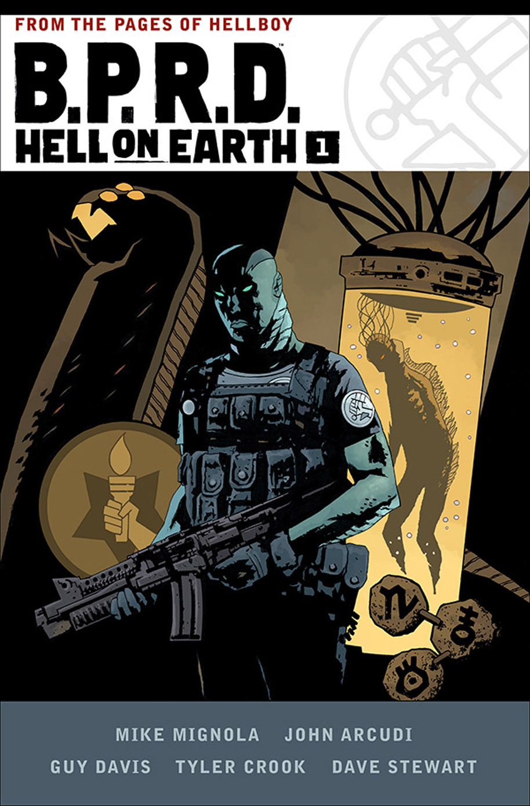LAURENCE CAMPBELL
December 27, 2017 (HC) 
March 24, 2021 (TPB)
<ul>
<li>[<em>B.P.R.D.: Hell on Earth – Volume 1: New World</em>](/entry/Trade_Collections)</li>
<li>[<em>B.P.R.D.: Hell on Earth – Volume 2: Gods and Monsters</em>](/entry/Trade_Collections)</li>
<li>[<em>B.P.R.D.: Hell on Earth – Volume 3: Russia</em>](/entry/Trade_Collections)</li>
</ul>

Additional Material

<ul>
<li><strong>Introduction by [John Arcudi](/entry/John_Arcudi)</strong></li>
<li><strong>Foreword by [Mike Mignola](/entry/Mike_Mignola)</strong> (originally published in <em>B.P.R.D.: Hell on Earth – Volume 1: New World</em>)</li>
<li><strong>Expanded Sketchbook</strong>
<ul>
<li>8 pages for <em>New World</em></li>
<li>22 pages for <em>Gods and Monsters</em></li>
<li>26 pages for <em>Russia</em></li>
</ul></li>
</ul>

<em>Volume 2</em>
Collects

LAURENCE CAMPBELL
April 18, 2018 (HC) 
August 1, 2018 (corrected HC) 
August 4, 2021 (TPB)
<ul>
<li>[<em>B.P.R.D.: Hell on Earth – Volume 4: The Devil's Engine &amp; The Long Death</em>](/entry/Trade_Collections)</li>
<li>[<em>B.P.R.D.: Hell on Earth – Volume 5: The Pickens County Horror &amp; Others</em>](/entry/Trade_Collections)</li>
<li>[<em>B.P.R.D.: Hell on Earth – Volume 6: The Return of the Master</em>](/entry/Trade_Collections)</li>
</ul>

Additional Material

<ul>
<li><strong>Introduction by [Scott Allie](/entry/Scott_Allie)</strong></li>
<li><strong>Expanded Sketchbook</strong>
<ul>
<li>24 pages for <em>The Devil's Engine &amp; The Long Death</em></li>
<li>30 pages for <em>The Pickens County Horror &amp; Others</em></li>
<li>33 pages for <em>The Return of the Master</em></li>
<li>3 pages for trade covers</li>
</ul></li>
</ul>

Additional Notes

The original print run had an error: <em>The Long Death</em> was missing its last page. A corrected print run was released August 1, 2018.

<em>Volume 3</em>
Collects

LAURENCE CAMPBELL
October 24, 2018 (HC) 
December 1, 2021 (TPB)
<ul>
<li>[<em>B.P.R.D.: Hell on Earth – Volume 7: A Cold Day in Hell</em>](/entry/Trade_Collections)</li>
<li>[<em>B.P.R.D.: Hell on Earth – Volume 8: Lake of Fire</em>](/entry/Trade_Collections)</li>
<li>[<em>B.P.R.D.: Hell on Earth – Volume 9: The Reign of the Black Flame</em>](/entry/Trade_Collections)</li>
</ul>

Additional Material

<ul>
<li><strong>Introduction by [Scott Allie](/entry/Scott_Allie)</strong></li>
<li><strong>Expanded Sketchbook</strong>
<ul>
<li>16 pages for <em>A Cold Day in Hell</em></li>
<li>18 pages for <em>Lake of Fire</em></li>
<li>17 pages for <em>The Reign of the Black Flame</em></li>
<li>3 pages for trade covers</li>
</ul></li>
</ul>

<em>Volume 4</em>
Collects

LAURENCE CAMPBELL
January 2, 2019 (HC) 
March 23, 2022 (TPB)
<ul>
<li>[<em>B.P.R.D.: Hell on Earth – Volume 10: The Devil's Wings</em>](/entry/Trade_Collections)</li>
<li>[<em>B.P.R.D.: Hell on Earth – Volume 11: Flesh and Stone</em>](/entry/Trade_Collections)</li>
<li>[<em>B.P.R.D.: Hell on Earth – Volume 14: The Exorcist</em>](/entry/Trade_Collections)</li>
</ul>

Additional Material

<ul>
<li><strong>Introduction by [Scott Allie](/entry/Scott_Allie)</strong></li>
<li><strong>Expanded Sketchbook</strong>
<ul>
<li>22 pages for <em>The Devil's Wings</em></li>
<li>17 pages for <em>Flesh and Stone</em></li>
<li>10 pages for <em>The Exorcist</em></li>
<li>3 pages for trade covers</li>
</ul></li>
</ul>

<em>Volume 5</em>
Collects

LAURENCE CAMPBELL
March 20, 2019 (HC) 
September 7, 2022 (TPB)
<ul>
<li>[<em>B.P.R.D.: Hell on Earth – Volume 12: Metamorphosis</em>](/entry/Trade_Collections)</li>
<li>[<em>B.P.R.D.: Hell on Earth – Volume 13: End of Days</em>](/entry/Trade_Collections)</li>
<li>[<em>B.P.R.D.: Hell on Earth – Volume 15: Cometh the Hour</em>](/entry/Trade_Collections)</li>
</ul>

Additional Material

<ul>
<li><strong>Introduction by [John Arcudi](/entry/John_Arcudi)</strong></li>
<li><strong>Expanded Sketchbook</strong>
<ul>
<li>13 pages for <em>Metamorphosis</em>1</li>
<li>11 pages for <em>End of Days</em></li>
<li>14 pages for <em>Cometh the Hour</em></li>
<li>3 pages for trade covers</li>
</ul></li>
</ul>

</tbody>

**1** This sketchbook is five pages shorter than the original trade. Two pages have been condensed to one, five have been removed, and a new page has been added.

### *The Devil You Know*

Horror DNA announced an omnibus collecting *The Devil You Know* on January 22, 2020.[2]

Cover
Date Published
Contents

<tbody>

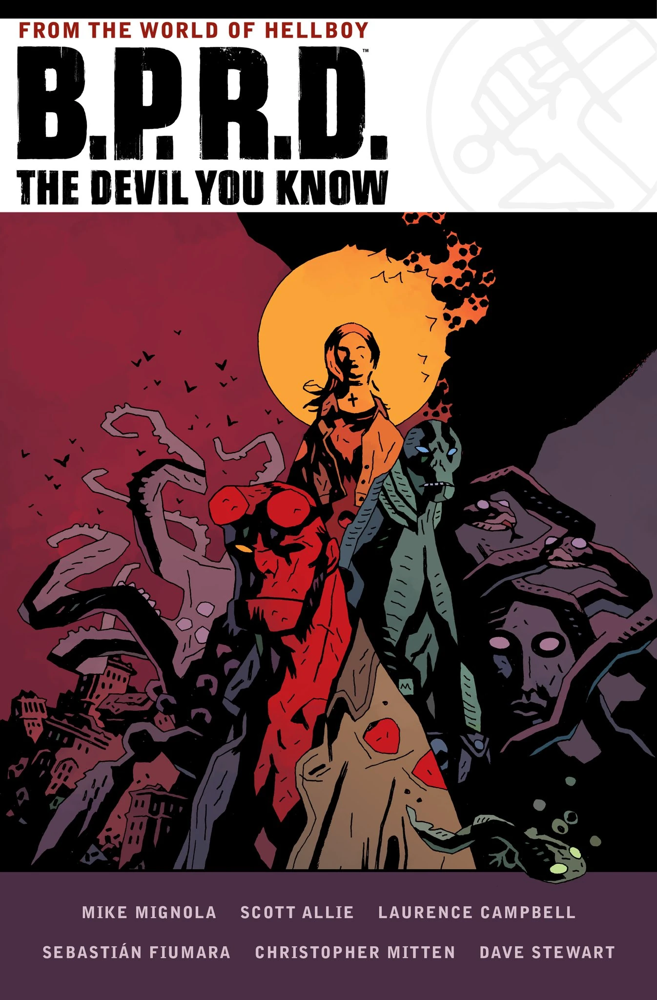MIKE MIGNOLA
March 10, 2021 (HC) 
May 25, 2022 (TPB)
Collects

<ul>
<li>[<em>B.P.R.D.: The Devil You Know – Volume 1: Messiah</em>](/entry/Trade_Collections)</li>
<li>[<em>B.P.R.D.: The Devil You Know – Volume 2: Pandemonium</em>](/entry/Trade_Collections)</li>
<li>[<em>B.P.R.D.: The Devil You Know – Volume 3: Ragna Rok</em>](/entry/Trade_Collections)</li>
</ul>

Additional Material

<ul>
<li><strong>Introduction by [Laurence Campbell](/entry/Laurence_Campbell)</strong></li>
<li><strong>Afterword by [Mike Mignola](/entry/Mike_Mignola)</strong> (from <em>B.P.R.D.: The Devil You Know</em> #15)</li>
<li><strong>Expanded Sketchbook</strong>
<ul>
<li>10 pages for <em>Messiah</em></li>
<li>18 pages for <em>Pandemonium</em></li>
<li>13 pages for <em>Ragna Rok</em>1</li>
<li>3 pages for trade covers</li>
</ul></li>
</ul>

</tbody>

**1** While this is one page less than the original trade paperback sketchbook, no material has been removed; it has simply been condensed.

### Rebranding

In 2022, Dark Horse rebranded the omnibus editions of *B.P.R.D.: Plague of Frogs*, *B.P.R.D.: Hell on Earth* and *B.P.R.D.: The Devil You Know*, removing the cycle titles. These editions feature new covers.

Cover
Date Published
Originally Published as

<tbody>

<em>B.P.R.D. Omnibus Volume 1</em>

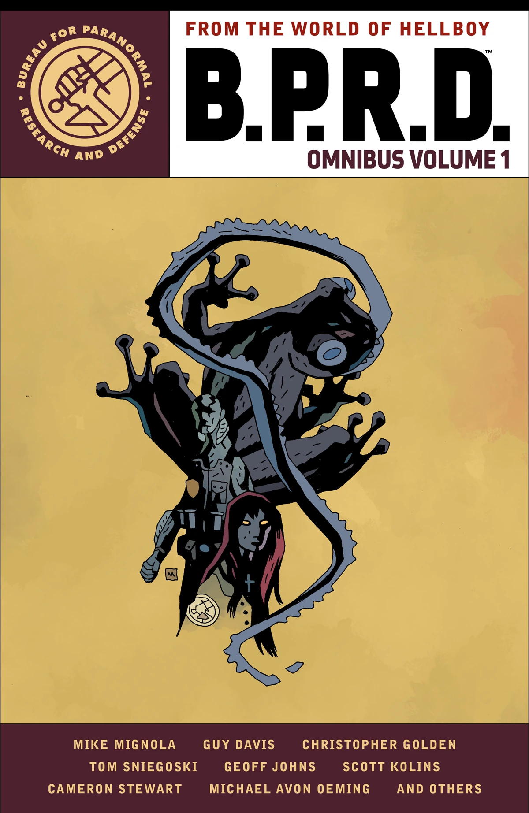MIKE MIGNOLA
September 14, 2022 (TPB)
<em>B.P.R.D.: Plague of Frogs – Volume 1</em> 
(excluding <em>[The Killer in My Skull](/entry/The_Killer_in_My_Skull)</em>, which is recollected in [the <em>Lobster Johnson</em> omnibuses](/entry/Omnibus_Editions))

<em>B.P.R.D. Omnibus Volume 2</em>

MIKE MIGNOLA
November 2, 2022 (TPB)
<em>B.P.R.D.: Plague of Frogs – Volume 2</em>

<em>B.P.R.D. Omnibus Volume 3</em>

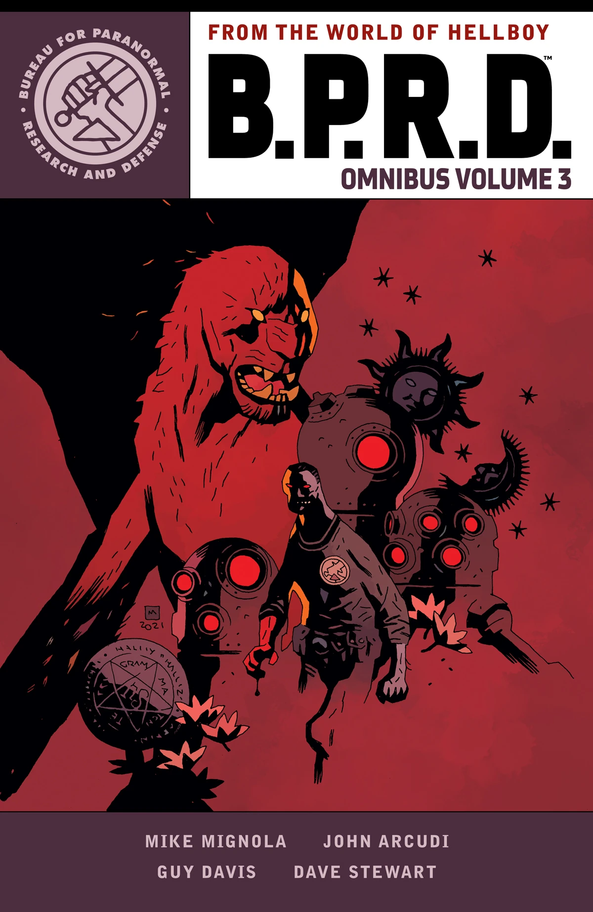MIKE MIGNOLA
December 21, 2022 (TPB)
<em>B.P.R.D.: Plague of Frogs – Volume 3</em>

<em>B.P.R.D. Omnibus Volume 4</em>

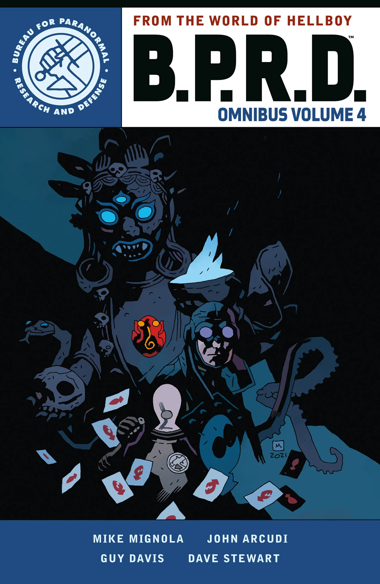MIKE MIGNOLA
February 22, 2023 (TPB)
<em>B.P.R.D.: Plague of Frogs – Volume 4</em>

<em>B.P.R.D. Omnibus Volume 5</em>

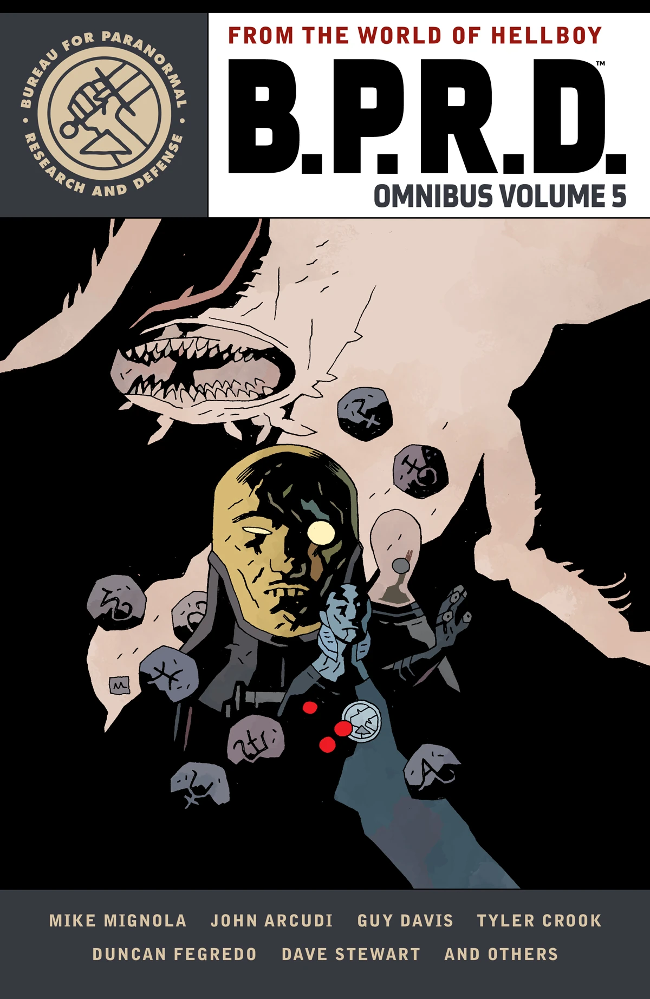MIKE MIGNOLA
April 19, 2023 (TPB)
<em>B.P.R.D.: Hell on Earth – Volume 1</em>

<em>B.P.R.D. Omnibus Volume 6</em>

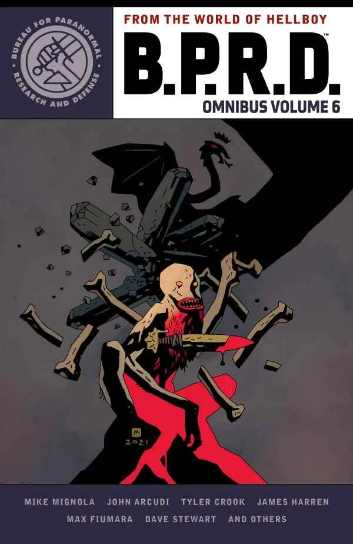MIKE MIGNOLA
August 1, 2023 (TPB)
<em>B.P.R.D.: Hell on Earth – Volume 2</em>

<em>B.P.R.D. Omnibus Volume 7</em>

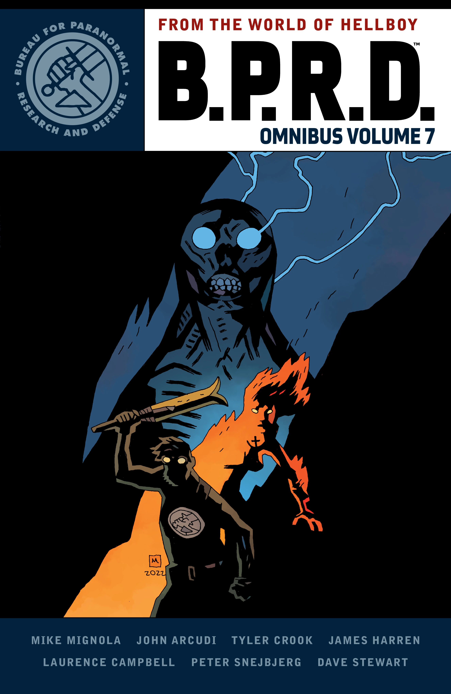MIKE MIGNOLA
October 3, 2023 (TPB)
<em>B.P.R.D.: Hell on Earth – Volume 3</em>

<em>B.P.R.D. Omnibus Volume 8</em>

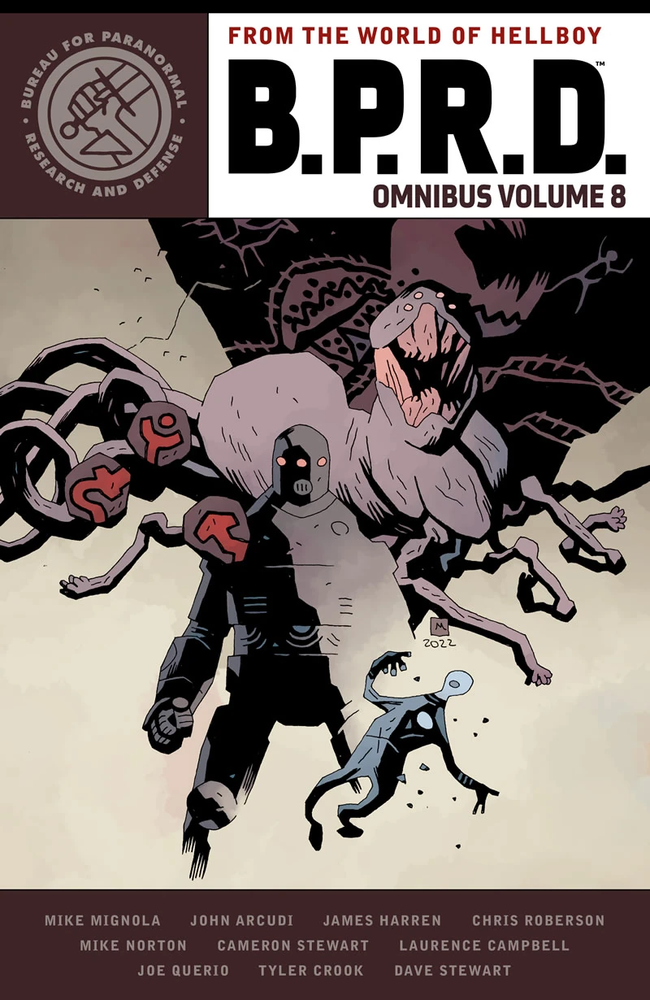MIKE MIGNOLA
November 14, 2023 (TPB)
<em>B.P.R.D.: Hell on Earth – Volume 4</em>

<em>B.P.R.D. Omnibus Volume 9</em>

MIKE MIGNOLA
January 2, 2024 (TPB)
<em>B.P.R.D.: Hell on Earth – Volume 5</em>

<em>B.P.R.D. Omnibus Volume 10</em>

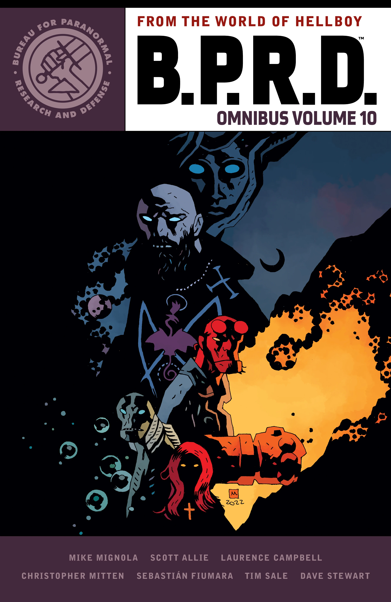MIKE MIGNOLA
March 5, 2024 (TPB)
<em>B.P.R.D.: The Devil You Know</em>

</tbody>

## *Abe Sapien*

A pair of *Dark and Terrible* omnibuses were announced on [Freak Sugar](http://www.freaksugar.com/abe-sapien-dark-and-terrible-hardcovers-covers-first-look-dark-horse-max-fiumara/), April 12, 2017. This was later followed by a third omnibus in 2018 collecting all the flashback material from *[Abe Sapien](/entry/Abe_Sapien_%28series%29)*.

Cover
Date Published
Contents

<tbody>

<em>Dark and Terrible – Volume 1</em>
Collects

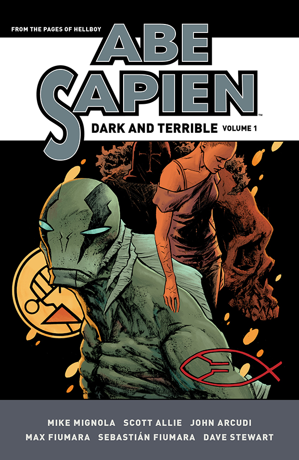SEBASTIÁN FIUMARA
November 8, 2017 (HC) 
November 16, 2022 (TPB)
<ul>
<li>[<em>Abe Sapien – Volume 3: Dark and Terrible and The New Race of Man</em>](/entry/Trade_Collections)</li>
<li>[<em>Abe Sapien – Volume 4: The Shape of Things to Come</em>](/entry/Trade_Collections)</li>
<li>[<em>Abe Sapien – Volume 5: Sacred Places</em>](/entry/Trade_Collections)</li>
</ul>

Additional Material

<ul>
<li><strong>Introduction by [Scott Allie](/entry/Scott_Allie)</strong></li>
<li><strong>Expanded Sketchbook</strong>
<ul>
<li>30 pages for <em>Dark and Terrible and The New Race of Man</em></li>
<li>17 pages for <em>The Shape of Things to Come</em></li>
<li>33 pages for <em>Sacred Places</em></li>
</ul></li>
</ul>

<em>Dark and Terrible – Volume 2</em>
Collects

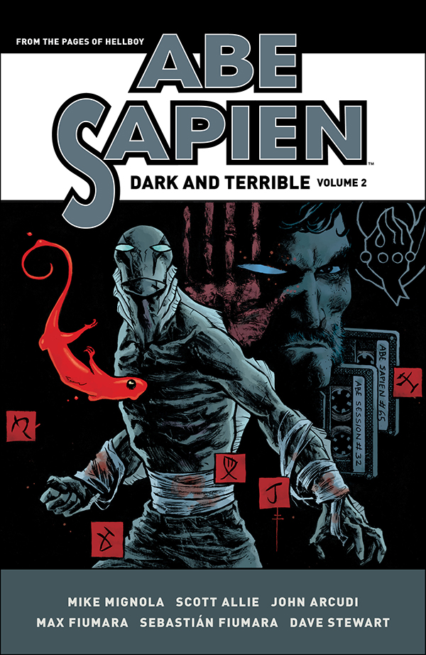SEBASTIÁN FIUMARA
March 21, 2018 (HC) 
April 12, 2022 (TPB)
<ul>
<li>[<em>Abe Sapien – Volume 6: A Darkness so Great</em>](/entry/Trade_Collections)</li>
<li>[<em>Abe Sapien – Volume 7: The Secret Fire</em>](/entry/Trade_Collections)</li>
<li>[<em>Abe Sapien – Volume 8: The Desolate Shore</em>](/entry/Trade_Collections)</li>
</ul>

Additional Material

<ul>
<li><strong>Introduction by [Scott Allie](/entry/Scott_Allie)</strong></li>
<li><strong>Afterword by [Scott Allie](/entry/Scott_Allie)</strong> (originally published in <em>Abe Sapien – Volume 8: The Desolate Shore</em>.)</li>
<li><strong>Expanded Sketchbook</strong>
<ul>
<li>17 pages for <em>A Darkness so Great</em></li>
<li>26 pages for <em>The Secret Fire</em></li>
<li>17 pages for <em>The Desolate Shore</em></li>
<li>9 pages for commissions</li>
</ul></li>
</ul>

<em>The Drowning and Other Stories</em>
Collects

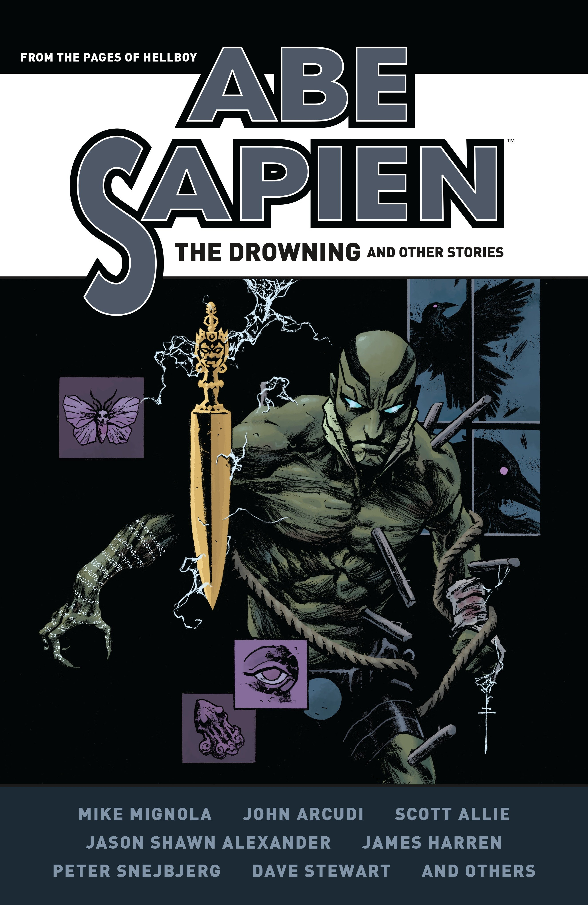SEBASTIÁN FIUMARA
July 11, 2018 (HC) 
August 1, 2023 (TPB)
<ul>
<li>[<em>Abe Sapien – Volume 1: The Drowning</em>](/entry/Trade_Collections)</li>
<li>[<em>Abe Sapien – Volume 2: The Devil Does Not Jest and Other Stories</em>](/entry/Trade_Collections)</li>
<li>[<em>Abe Sapien – Volume 9: Lost Lives and Other Stories</em>](/entry/Trade_Collections)</li>
<li><em>[Casualties](/entry/Casualties)</em></li>
<li><em>[The Calm Before the Storm](/entry/The_Calm_Before_the_Storm)</em> (in sketchbook)</li>
</ul>

Additional Material

<ul>
<li><strong>Introduction by [Scott Allie](/entry/Scott_Allie)</strong></li>
<li><strong>Expanded Sketchbook</strong>
<ul>
<li>8 pages for <em>The Drowning</em></li>
<li>20 pages for <em>The Devil Does Not Jest and Other Stories</em></li>
<li>12 pages for <em>Lost Lives and Other Stories</em></li>
<li>9 pages for covers</li>
</ul></li>
</ul>

Additional Notes

The stories were re-ordered for this volume for a better reading order, as explained by [Scott Allie](/entry/Scott_Allie) in the introduction:
<ol>
<li><em>[The Drowning](/entry/The_Drowning)</em></li>
<li><em>[Casualties](/entry/Casualties)</em></li>
<li><em>[The Haunted Boy](/entry/The_Haunted_Boy)</em></li>
<li><em>[The Land of the Dead](/entry/The_Land_of_the_Dead)</em></li>
<li><em>[Witchcraft &amp; Demonology](/entry/Witchcraft_%26amp%3B_Demonology)</em></li>
<li><em>[The Abyssal Plain](/entry/The_Abyssal_Plain)</em></li>
<li><em>[The Devil Does Not Jest](/entry/The_Devil_Does_Not_Jest)</em></li>
<li><em>[The Ogopogo](/entry/The_Ogopogo)</em></li>
<li><em>[Subconscious](/entry/Subconscious)</em></li>
<li><em>[Lost Lives](/entry/Lost_Lives)</em></li>
<li><em>[Icthyo Sapien](/entry/Icthyo_Sapien)</em> (extended for the omnibus)</li>
<li><em>[The Calm Before the Storm](/entry/The_Calm_Before_the_Storm)</em> (in sketchbook)</li>
</ol>

</tbody>

## *Hellboy*

*Hellboy* is collected across a series of omnibus editions, four following his story from 1994 onwards (the primary storyline), and two additional volumes collecting the short flashback stories from the 1940s through to 1993. These six omnibuses will be paperback editions.

The *Hellboy* omnibuses collect the trade paperbacks [*Hellboy: Volumes 1–12*](/entry/Trade_Collections), [*Hellboy in Hell: Volumes 1–2*](/entry/Trade_Collections), [*Hellboy in Mexico*](/entry/Trade_Collections), the original graphic novels [*Hellboy: The Midnight Circus*](/entry/Trade_Collections), [*Hellboy: Into the Silent Sea*](/entry/Trade_Collections), and the one-shot story *[Being Human](/entry/Being_Human)* from [*B.P.R.D.: Being Human*](/entry/Trade_Collections).

Cover
Date Published
Contents

<tbody>

<em>Volume 1: Seed of Destruction</em>
Collects

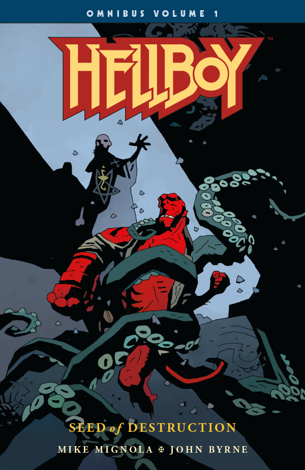MIKE MIGNOLA
May 9, 2018 (TPB)
<ul>
<li><em>[Seed of Destruction](/entry/Seed_of_Destruction)</em></li>
<li><em>[The Wolves of Saint August](/entry/The_Wolves_of_Saint_August)</em></li>
<li><em>[The Chained Coffin](/entry/The_Chained_Coffin)</em></li>
<li><em>[Wake the Devil](/entry/Wake_the_Devil)</em></li>
<li><em>[Almost Colossus](/entry/Almost_Colossus)</em></li>
<li>[1993 Promotional Comic](/entry/World%26)</li>
<li>[1994 Promotional Comic](/entry/World%26)</li>
</ul>

Additional Material

<ul>
<li><strong>Sketchbook</strong> (17 pages)</li>
</ul>

<em>Volume 2: Strange Places</em>
Collects

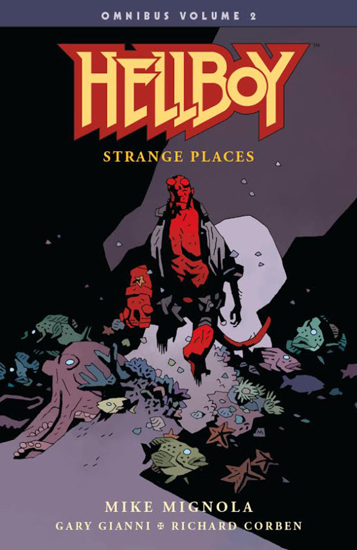MIKE MIGNOLA
June 20, 2018 (TPB)
<ul>
<li><em>[The Right Hand of Doom](/entry/The_Right_Hand_of_Doom)</em></li>
<li><em>[Box Full of Evil](/entry/Box_Full_of_Evil)</em></li>
<li><em>[Being Human](/entry/Being_Human)</em></li>
<li><em>[Conqueror Worm](/entry/Conqueror_Worm)</em></li>
<li><em>[The Third Wish](/entry/The_Third_Wish)</em></li>
<li><em>[The Island](/entry/The_Island)</em></li>
<li><em>[Into the Silent Sea](/entry/Into_the_Silent_Sea)</em></li>
</ul>

Additional Material

<ul>
<li><strong>Sketchbook</strong> (13 pages)</li>
</ul>

<em>Volume 3: The Wild Hunt</em>
Collects

MIKE MIGNOLA
July 18, 2018 (TPB)
<ul>
<li><em>[The Mole](/entry/The_Mole)</em></li>
<li><em>[Darkness Calls](/entry/Darkness_Calls)</em></li>
<li><em>[The Wild Hunt](/entry/The_Wild_Hunt)</em></li>
<li><em>[The Storm](/entry/The_Storm) and [the Fury](/entry/The_Fury)</em></li>
</ul>

Additional Material

<ul>
<li><strong>Sketchbook</strong> (9 pages)</li>
</ul>

<em>Volume 4: Hellboy in Hell</em>
Collects

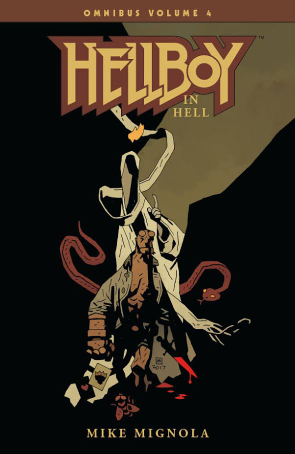MIKE MIGNOLA
September 5, 2018 (TPB)
<ul>
<li><em>[The Descent](/entry/Hellboy_in_Hell_%28first_story_arc%29)</em></li>
<li><em>[Pandemonium](/entry/Hellboy_in_Hell_%28first_story_arc%29)</em></li>
<li><em>[Family Ties](/entry/Hellboy_in_Hell_%28first_story_arc%29)</em></li>
<li><em>[Death Riding an Elephant](/entry/Hellboy_in_Hell_%28first_story_arc%29)</em></li>
<li><em>[The Three Gold Whips](/entry/The_Three_Gold_Whips)</em></li>
<li><em>[The Death Card](/entry/The_Death_Card)<strong>1</strong></em></li>
<li><em>[The Trials of Dr. Hoffmann](/entry/The_Hounds_of_Pluto)</em></li>
<li><em>[The Hounds of Pluto](/entry/The_Hounds_of_Pluto)</em></li>
<li><em>[The Spanish Bride](/entry/The_Spanish_Bride)</em></li>
<li><em>[For Whom the Bell Tolls](/entry/For_Whom_the_Bell_Tolls)</em></li>
<li><em>[The Magician and the Snake](/entry/The_Magician_and_the_Snake)</em></li>
<li><em>[The Exorcist of Vorsk](/entry/The_Exorcist_of_Vorsk)</em></li>
</ul>

Additional Material

<ul>
<li><strong>Sketchbook</strong> (24 pages)</li>
</ul>

<em>Hellboy Omnibus Boxed Set</em>

 
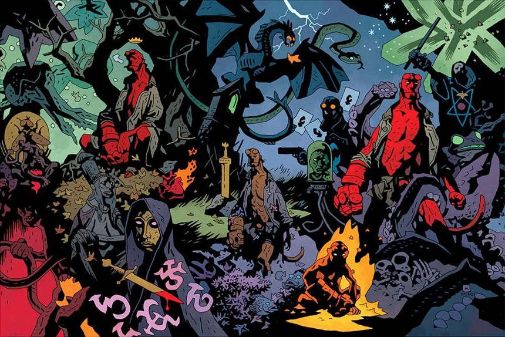MIKE MIGNOLA

Date Published
Contents

October 13, 2021
<ul>
<li><em>Hellboy Omnibus – Volume 1: Seed of Destruction</em></li>
<li><em>Hellboy Omnibus – Volume 2: Strange Places</em></li>
<li><em>Hellboy Omnibus – Volume 3: The Wild Hunt</em></li>
<li><em>Hellboy Omnibus – Volume 4: Hellboy in Hell</em></li>
</ul>

</tbody>

**1** The prologue from the trade paperback collection that recaps the previous issues isn't included.

### *The Complete Short Stories*

Cover
Date Published
Contents

<tbody>

<em>Volume 1</em>
Collects

MIKE MIGNOLA
June 13, 2018 (TPB)
<ul>
<li><em>[Pancakes](/entry/Pancakes)</em></li>
<li><em>[The Midnight Circus](/entry/The_Midnight_Circus)</em></li>
<li><em>[The Nature of the Beast](/entry/The_Nature_of_the_Beast)</em></li>
<li><em>[King Vold](/entry/King_Vold)</em></li>
<li><em>[Hellboy in Mexico](/entry/Hellboy_in_Mexico)</em></li>
<li><em>[Hellboy versus the Aztec Mummy](/entry/Hellboy_versus_the_Aztec_Mummy)</em></li>
<li><em>[Hellboy Gets Married](/entry/Hellboy_Gets_Married)</em></li>
<li><em>[The Coffin Man](/entry/The_Coffin_Man)</em></li>
<li><em>[The Coffin Man 2: The Rematch](/entry/The_Coffin_Man_2__The_Rematch)</em></li>
<li><em>[House of the Living Dead](/entry/House_of_the_Living_Dead)</em></li>
<li><em>[The Crooked Man](/entry/The_Crooked_Man_%28comic_story%29)</em></li>
<li><em>[The Penanggalan](/entry/The_Penanggalan)</em></li>
<li><em>[The Corpse](/entry/The_Corpse)</em></li>
<li><em>[Double Feature of Evil](/entry/Double_Feature_of_Evil)</em></li>
<li><em>[The Iron Shoes](/entry/The_Iron_Shoes)</em></li>
</ul>

Additional Material

<ul>
<li><strong>Sketchbook</strong> (23 pages)</li>
</ul>

<em>Volume 2</em>
Collects

MIKE MIGNOLA
August 15, 2018 (TPB)
<ul>
<li><em>[The Hydra and the Lion](/entry/The_Hydra_and_the_Lion)</em></li>
<li><em>[The Troll-witch](/entry/The_Troll_Witch)</em></li>
<li><em>[The Baba Yaga](/entry/The_Baba_Yaga)</em></li>
<li><em>[The Sleeping and the Dead](/entry/The_Sleeping_and_the_Dead)</em></li>
<li><em>[Heads](/entry/Heads)</em></li>
<li><em>[Goodbye Mister Tod](/entry/Goodbye_Mister_Tod)</em></li>
<li><em>[The Vampire of Prague](/entry/The_Vampire_of_Prague)</em></li>
<li><em>[The Vârcolac](/entry/The_V%C3%A2rcolac)</em></li>
<li><em>[The Bride of Hell](/entry/The_Bride_of_Hell)</em></li>
<li><em>[The Whittier Legacy](/entry/The_Whittier_Legacy)</em></li>
<li><em>[Buster Oakley Gets His Wish](/entry/Buster_Oakley_Gets_His_Wish)</em></li>
<li><em>[They That Go Down to the Sea in Ships](/entry/They_That_Go_Down_to_the_Sea_in_Ships)</em></li>
<li><em>[A Christmas Underground](/entry/A_Christmas_Underground)</em></li>
<li><em>[Dr. Carp's Experiment](/entry/Dr._Carp%26)</em></li>
<li><em>[The Ghoul](/entry/The_Ghoul)</em></li>
<li><em>[In the Chapel of Moloch](/entry/In_the_Chapel_of_Moloch)</em></li>
<li><em>[Makoma](/entry/Makoma_%28story%29)</em></li>
</ul>

Additional Material

<ul>
<li><strong>Sketchbook</strong> (25 pages)</li>
</ul>

</tbody>

### *Weird Tales*

An omnibus collecting the non-canonical *[Weird Tales](/entry/Hellboy__Weird_Tales)* stories, as well as two canonical short stories.

Unlike most other omnibuses, *Hellboy: Weird Tales* received new cover art and trade dress when rereleased in paperback. The story "[Toy Soldier](/entry/Toy_Soldier)" was removed from this version, possibly because it was written by C. B. Cebulski under his controversial pseudonym "Akira Yoshida". The introduction by Scott Allie was also removed.

Cover
Date Published
Contents

<tbody>

MIKE MIGNOLA 
(Hardcover)
November 26, 2014
Collects

<ul>
<li><em>[How Koshchei Became Deathless](/entry/How_Koshchei_Became_Deathless)</em></li>
<li><em>[Baba Yaga's Feast](/entry/Baba_Yaga%26)</em></li>
<li>[<em>Hellboy: Weird Tales – Volume 1</em>](/entry/Trade_Collections)</li>
<li>[<em>Hellboy: Weird Tales – Volume 2</em>](/entry/Trade_Collections)</li>
</ul>

Additional Material

<ul>
<li><strong>Introduction by Scott Allie</strong></li>
<li><strong>Gallery</strong> (16 pages)</li>
</ul>

MIKE MIGNOLA 
(Paperback)
November 9, 2022
Collects

<ul>
<li><em>[How Koshchei Became Deathless](/entry/How_Koshchei_Became_Deathless)</em></li>
<li><em>[Baba Yaga's Feast](/entry/Baba_Yaga%26)</em></li>
<li>[<em>Hellboy: Weird Tales – Volume 1</em>](/entry/Trade_Collections)</li>
<li>[<em>Hellboy: Weird Tales – Volume 2</em>](/entry/Trade_Collections) (Except "<em>Toy Soldier</em>")</li>
</ul>

Additional Material

<ul>
<li><strong>Gallery</strong> (16 pages)</li>
</ul>

</tbody>

## *Sir Edward Grey: Witchfinder*

On March 18th, 2019, [Multiversity Comics](http://www.multiversitycomics.com) exclusively announced the details for the first *Witchfinder* omnibus.[3]

Cover
Date Published
Contents

<tbody>

<em>Volume One</em>
Collects

MIKE MIGNOLA
November 27, 2019 (HC) 
April 2, 2024 (TPB)
<ul>
<li>[<em>Witchfinder – Volume 1: In the Service of Angels</em>](/entry/Trade_Collections)</li>
<li>[<em>Witchfinder – Volume 2: Lost and Gone Forever</em>](/entry/Trade_Collections)</li>
<li>[<em>Witchfinder – Volume 3: The Mysteries of Unland</em>](/entry/Trade_Collections)</li>
</ul>

Additional Material

<ul>
<li><strong>Introduction by [Mike Mignola](/entry/Mike_Mignola)</strong></li>
<li><strong>Expanded Sketchbook</strong>
<ul>
<li>10 pages for <em>In the Service of Angels</em></li>
<li>9 pages for <em>Lost and Gone Forever</em></li>
<li>17 pages for <em>The Mysteries of Unland</em>1</li>
<li>7 pages for covers and pin-ups</li>
</ul></li>
</ul>

Additional Notes

The stories were re-ordered for this volume:
<ol>
<li><em>[Murderous Intent](/entry/Murderous_Intent)</em></li>
<li><em>[In the Service of Angels](/entry/In_the_Service_of_Angels)</em></li>
<li><em>[Lost and Gone Forever](/entry/Lost_and_Gone_Forever)</em></li>
<li><em>[Beware the Ape](/entry/Beware_the_Ape)</em></li>
<li><em>[The Mysteries of Unland](/entry/The_Mysteries_of_Unland)</em></li>
<li><em>[The Burial of Katharine Baker](/entry/The_Burial_of_Katharine_Baker)</em></li>
</ol>

<em>Volume Two</em>
Collects

BEN STENBECK
November 17, 2021 (HC) 
August 6, 2024 (TPB)
<ul>
<li>[<em>Witchfinder – Volume 4: City of the Dead</em>](/entry/Trade_Collections)</li>
<li>[<em>Witchfinder – Volume 5: The Gates of Heaven</em>](/entry/Trade_Collections)</li>
<li>[<em>Witchfinder – Volume 6: The Reign of Darkness</em>](/entry/Trade_Collections)</li>
<li><em>[The Great Blizzard](/entry/The_Great_Blizzard)</em></li>
</ul>

Additional Material

<ul>
<li><strong>Introduction by [Chris Roberson](/entry/Chris_Roberson)</strong></li>
<li><strong>Expanded Sketchbook</strong>
<ul>
<li>10 pages for <em>City of the Dead</em></li>
<li>18 pages for <em>The Gates of Heaven</em></li>
<li>16 pages for <em>The Reign of Darkness</em>2</li>
<li>2 pages for covers</li>
</ul></li>
</ul>

</tbody>

**1** While this is one page less than the original trade paperback sketchbook, no material has been removed; it has simply been condensed.
**2** While this is two pages less than the original trade paperback sketchbook, no material has been removed; it has simply been condensed.

## *Hellboy and the B.P.R.D.*

On June 6, 2018, editor [Katii O’Brien](/entry/Katii_O%E2%80%99Brien) confirmed Dark Horse had begun early planning for the *Hellboy and the B.P.R.D.* omnibus editions, and that the first volume would collect *[1952](/entry/1952)* to [*1954*](/entry/Trade_Paperback_Collections).[4] Unlike previous series, which didn't go to omnibuses until they were finished, *Hellboy and the B.P.R.D.* will be going to omnibuses as the series progresses.

Cover
Date Published
Contents

<tbody>

<em>1952–1954</em>
Collects

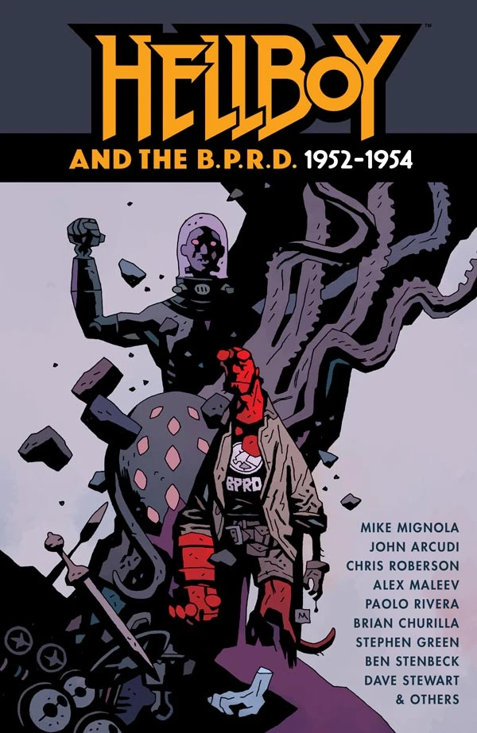MIKE MIGNOLA
June 9, 2021 (HC) 
October 1, 2024 (TPB)
<ul>
<li>[<em>Hellboy and the B.P.R.D.: 1952</em>](/entry/Trade_Collections)</li>
<li>[<em>Hellboy and the B.P.R.D.: 1953</em>](/entry/Trade_Collections)</li>
<li>[<em>Hellboy and the B.P.R.D.: 1954</em>](/entry/Trade_Collections)</li>
</ul>

Additional Material

<ul>
<li><strong>Introduction by [Mike Mignola](/entry/Mike_Mignola)</strong></li>
<li><strong>Afterword by [Chris Roberson](/entry/Chris_Roberson)</strong></li>
<li><strong>Expanded Sketchbook</strong>
<ul>
<li>24 pages for <em>1952</em></li>
<li>25 pages for <em>1953</em></li>
<li>13 pages for <em>1954</em>1</li>
<li>4 pages for covers</li>
</ul></li>
</ul>

<em>1955–1957</em>
Collects

MIKE MIGNOLA
December 3, 2024 (HC)
<ul>
<li>[<em>Hellboy and the B.P.R.D.: 1955</em>](/entry/Trade_Collections)</li>
<li>[<em>Hellboy and the B.P.R.D.: 1956</em>](/entry/Trade_Collections)</li>
<li>[<em>Hellboy and the B.P.R.D.: 1957</em>](/entry/Trade_Collections)</li>
</ul>

Additional Material

<ul>
<li><strong>TBD</strong></li>
</ul>

</tbody>

**1** While this is one page less than the original trade paperback sketchbook, no material has been removed; it has simply been condensed.

## *Hellboy Universe*

Hellboy editor [Katii O’Brien](/entry/Katii_O%E2%80%99Brien) had mentioned in January 2019 that she had plans to collect some of the one-shot series in omnibuses.[5] The *Hellboy Universe* line was announced November 2020.

Cover
Date Published
Contents

<tbody>

<em>The Secret Histories – Volume One</em> 1
Collects

MIKE MIGNOLA
June 2, 2021 (HC) 
 
<em>scheduled for</em> 
March 24, 2026 (TPB)
<ul>
<li>[<em>Rasputin: The Voice of the Dragon</em>](/entry/Trade_Collections)</li>
<li>[<em>Sledgehammer 44</em>](/entry/Trade_Collections)</li>
<li>[<em>The Visitor: How &amp; Why He Stayed</em>](/entry/Trade_Collections)</li>
</ul>

Additional Material

<ul>
<li><strong>Introduction by [Chris Roberson](/entry/Chris_Roberson)</strong></li>
<li><strong>Afterword by [Chris Roberson](/entry/Chris_Roberson)</strong> (from <em>The Visitor: How &amp; Why He Stayed</em>)
<ul>
<li>Extract from <em>Hellboy: Seed of Destruction</em> #4</li>
<li>Extract from <em>Hellboy: Conqueror Worm</em> #2</li>
</ul></li>
<li><strong>Expanded Sketchbook</strong>
<ul>
<li>11 pages for <em>Rasputin: The Voice of the Dragon</em></li>
<li>16 pages for <em>Sledgehammer 44</em>2</li>
<li>8 pages for <em>The Visitor: How &amp; Why He Stayed</em></li>
<li>2 pages for trade covers</li>
<li>Mignola's black and white cover</li>
</ul></li>
</ul>

<em>The Secret Histories – Volume Two</em>
Collects

MIKE MIGNOLA
<em>scheduled for</em> 
September 22, 2026 (HC)
<ul>
<li>[<em>Rise of the Black Flame</em>](/entry/Trade_Collections)</li>
<li>[<em>The House of Lost Horizons: A Sarah Jewell Mystery</em>](/entry/Trade_Collections)</li>
<li>[<em>The British Paranormal Society: Time Out of Mind</em>](/entry/Trade_Collections)</li>
<li>[<em>Hellboy: The Silver Lantern Club</em>](/entry/Trade_Collections)</li>
</ul>

Additional Material

<ul>
<li>TBD</li>
</ul>

</tbody>

**1** "Volume One" was added to the title for the trade paperback edition.
**2** Scott Allie's dedication to John Severin and Severin's pages from the original trade paperback were not included in this collection.

## *Lobster Johnson*

Cover
Date Published
Contents

<tbody>

<em>Volume I</em>
Collects

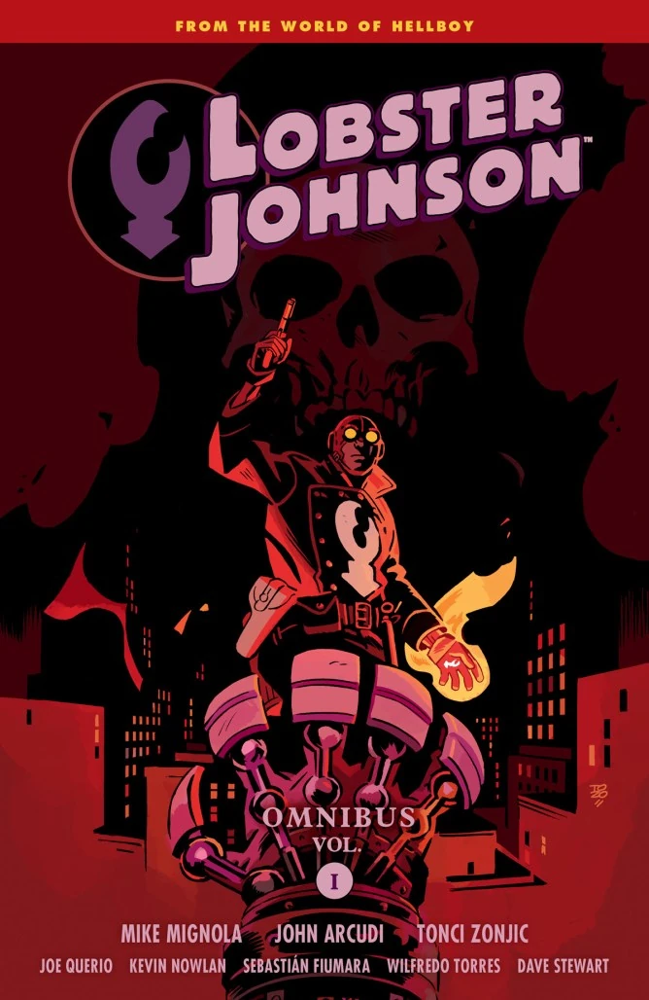TONCI ZONJIC
February 16, 2022 (HC)
<ul>
<li><em>[The Empty Chair](/entry/The_Empty_Chair)</em></li>
<li>[<em>Lobster Johnson – Volume 2: The Burning Hand</em>](/entry/Trade_Collections)</li>
<li>[<em>Lobster Johnson – Volume 3: Satan Smells A Rat</em>](/entry/Trade_Collections)</li>
<li>[<em>Lobster Johnson – Volume 4: Get the Lobster!</em>](/entry/Trade_Collections)</li>
</ul>

Additional Material

<ul>
<li><strong>TBD</strong></li>
</ul>

<em>Volume II</em>
Collects

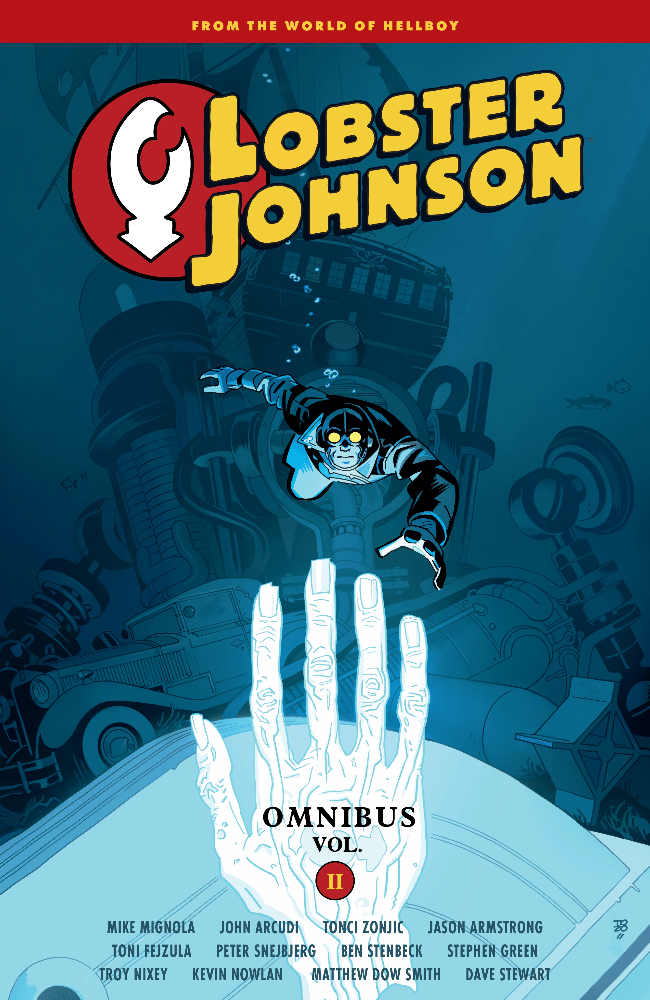TONCI ZONJIC
August 22, 2023 (HC)
<ul>
<li>[<em>Lobster Johnson – Volume 6: A Chain Forged in Life</em>](/entry/Trade_Collections)</li>
<li>[<em>Lobster Johnson – Volume 5: The Pirate's Ghost and Metal Monsters of Midtown</em>](/entry/Trade_Collections)</li>
<li>[<em>Lobster Johnson – Volume 1: The Iron Prometheus</em>](/entry/Trade_Collections)</li>
<li><em>[The Killer in My Skull](/entry/The_Killer_in_My_Skull)</em></li>
</ul>

Additional Material

<ul>
<li><strong>TBD</strong></li>
</ul>

Additional Notes

Some printings of the first edition mistakenly swapped pages 252 and 253 in the omnibus.

</tbody>

## *Koshchei the Deathless*

Cover
Date Published
Contents

<tbody>

<em>Koshchei the Deathless</em>
Collects

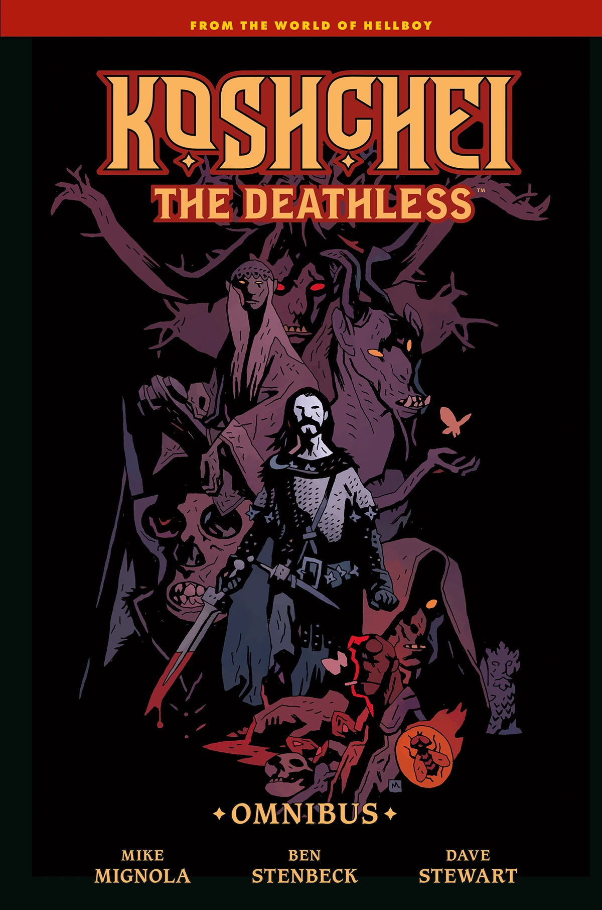MIKE MIGNOLA
<em>scheduled for</em> 
June 16, 2026 (HC)
<ul>
<li>[<em>Koshchei the Deathless</em>](/entry/Trade_Collections)</li>
<li>[<em>Koshchei in Hell</em>](/entry/Trade_Collections)</li>
<li>[<em>The Serpent in the Garden: Ed Grey and the Last Battle for England</em>](/entry/Trade_Collections)</li>
</ul>

Additional Material

<ul>
<li><strong>TBD</strong></li>
</ul>

</tbody>

## External Links

Dark Horse entries:

- [*B.P.R.D.: Plague of Frogs – Volume 1* (hardcover)](http://www.darkhorse.com/Books/17-169/B-P-R-D-Plague-of-Frogs-Hardcover-Collection-Vol-1) / [(paperback)](http://www.darkhorse.com/Books/17-975/B-P-R-D-Plague-of-Frogs-Volume-1-TPB) / [*B.P.R.D. – Volume 1* (paperback)](https://www.darkhorse.com/Books/3009-921/B-P-R-D-Omnibus-Volume-1-TPB)
- [*B.P.R.D.: Plague of Frogs – Volume 2* (hardcover)](http://www.darkhorse.com/Books/17-524/B-P-R-D-Plague-of-Frogs-Volume-2-hardcover-collection) / [(paperback)](http://www.darkhorse.com/Books/17-976/B-P-R-D-Plague-of-Frogs-Volume-2-TPB) / [*B.P.R.D. – Volume 2* (paperback)](https://www.darkhorse.com/Books/3009-922/B-P-R-D-Omnibus-Volume-2-TPB)
- [*B.P.R.D.: Plague of Frogs – Volume 3* (hardcover)](http://www.darkhorse.com/Books/18-141/B-P-R-D-Plague-of-Frogs-Volume-3-HC) / [(paperback)](http://www.darkhorse.com/Books/18-143/B-P-R-D-Plague-of-Frogs-Volume-3-TPB) / [*B.P.R.D. – Volume 3* (paperback)](https://www.darkhorse.com/Books/3009-923/B-P-R-D-Omnibus-Volume-3-TPB)
- [*B.P.R.D.: Plague of Frogs – Volume 4* (hardcover)](http://www.darkhorse.com/Books/18-142/B-P-R-D-Plague-of-Frogs-Volume-4-HC) / [(paperback)](http://www.darkhorse.com/Books/18-144/B-P-R-D-Plague-of-Frogs-Volume-4-TPB) / [*B.P.R.D. – Volume 4* (paperback)](https://www.darkhorse.com/Books/3009-924/B-P-R-D-Omnibus-Volume-4-TPB)
- [*B.P.R.D.: 1946 – 1948* (hardcover)](http://www.darkhorse.com/Books/22-957/B-P-R-D-1946-1948-HC) / [(paperback)](https://www.darkhorse.com/Books/3004-949/B-P-R-D-1946-1948-TPB)
- [*B.P.R.D.: Hell on Earth – Volume 1* (hardcover)](https://www.darkhorse.com/Books/3001-039/B-P-R-D-Hell-on-Earth-Volume-1-HC) / [(paperback)](https://www.darkhorse.com/Books/3006-939/B-P-R-D-Hell-on-Earth-Volume-1-TPB) / [*B.P.R.D. – Volume 5* (paperback)](https://www.darkhorse.com/Books/3009-925/B-P-R-D-Omnibus-Volume-5-TPB)
- [*B.P.R.D.: Hell on Earth – Volume 2* (hardcover)](https://www.darkhorse.com/Books/3001-040/B-P-R-D-Hell-on-Earth-Volume-2-HC) / [(paperback)](https://www.darkhorse.com/Books/3007-879/B-P-R-D-Hell-on-Earth-Volume-2-TPB)
- [*B.P.R.D.: Hell on Earth – Volume 3* (hardcover)](https://www.darkhorse.com/Books/3001-041/B-P-R-D-Hell-on-Earth-Volume-3-HC) / [(paperback)](https://www.darkhorse.com/Books/3007-880/B-P-R-D-Hell-on-Earth-Volume-3-TPB)
- [*B.P.R.D.: Hell on Earth – Volume 4* (hardcover)](https://www.darkhorse.com/Books/3001-042/B-P-R-D-Hell-on-Earth-Volume-4-HC) / [(paperback)](https://www.darkhorse.com/Books/3007-881/B-P-R-D-Hell-on-Earth-Volume-4-TPB)
- [*B.P.R.D.: Hell on Earth – Volume 5* (hardcover)](https://www.darkhorse.com/Books/3001-043/B-P-R-D-Hell-on-Earth-Volume-5-HC) / [(paperback)](https://www.darkhorse.com/Books/3007-882/B-P-R-D-Hell-on-Earth-Volume-5-TPB)
- [*B.P.R.D.: The Devil You Know* (hardcover)](https://www.darkhorse.com/Books/3006-940/B-P-R-D-The-Devil-You-Know-Omnibus-HC) / [(paperback)](https://www.darkhorse.com/Books/3009-350/B-P-R-D-The-Devil-You-Know-TPB)
- [*Abe Sapien: Dark and Terrible – Volume 1* (hardcover)](https://www.darkhorse.com/Books/3001-045/Abe-Sapien-Dark-and-Terrible-Volume-1-HC) / [(paperback)](https://www.darkhorse.com/Books/3011-092/Abe-Sapien-Dark-and-Terrible-Volume-1-TPB)
- [*Abe Sapien: Dark and Terrible – Volume 2* (hardcover)](https://www.darkhorse.com/Books/3001-046/Abe-Sapien-Dark-and-Terrible-Volume-2-HC)
- [*Abe Sapien: The Drowning and Other Stories* (hardcover)](https://www.darkhorse.com/Books/3001-047/Abe-Sapien-The-Drowning-and-Other-Stories-HC)
- [*Hellboy Omnibus – Volume 1: Seed of Destruction* (paperback)](https://www.darkhorse.com/Books/3002-363/Hellboy-Omnibus-Volume-1-Seed-of-Destruction-TPB)
- [*Hellboy Omnibus – Volume 2: Strange Places* (paperback)](https://www.darkhorse.com/Books/3002-364/Hellboy-Omnibus-Volume-2-Strange-Places-TPB)
- [*Hellboy Omnibus – Volume 3: The Wild Hunt* (paperback)](https://www.darkhorse.com/Books/3002-365/Hellboy-Omnibus-Volume-3-The-Wild-Hunt-TPB)
- [*Hellboy Omnibus – Volume 4: Hellboy in Hell* (paperback)](https://www.darkhorse.com/Books/3002-366/Hellboy-Omnibus-Volume-4-Hellboy-in-Hell-TPB)
- [*Hellboy Omnibus Boxed Set* (paperback)](https://www.darkhorse.com/Books/3008-474/Hellboy-Omnibus-Boxed-Set-TPB)
- [*Hellboy: The Complete Short Stories – Volume 1* (paperback)](https://www.darkhorse.com/Books/3002-361/Hellboy-The-Complete-Short-Stories-Volume-1-TPB)
- [*Hellboy: The Complete Short Stories – Volume 2* (paperback)](https://www.darkhorse.com/Books/3002-362/Hellboy-The-Complete-Short-Stories-Volume-2-TPB)
- [*Hellboy: Weird Tales* (hardcover)](http://www.darkhorse.com/Books/24-712/Hellboy-Weird-Tales-HC) / [(paperback)](https://www.darkhorse.com/Books/3011-095/Hellboy-Weird-Tales-TPB)
- [*Sir Edward Grey: Witchfinder – Volume 1* (hardcover)](https://www.darkhorse.com/Books/3005-258/Witchfinder-Omnibus-Volume-1-HC)
- [*Sir Edward Grey: Witchfinder – Volume 2* (hardcover)](https://www.darkhorse.com/Books/3008-581/Witchfinder-Omnibus-Volume-2-HC)
- [*Hellboy and B.P.R.D.: 1952–1954* (hardcover)](https://www.darkhorse.com/Books/3008-404/Hellboy-and-the-B-P-R-D-1952-1954-HC)
- [*Hellboy Universe: The Secret Histories* (hardcover)](https://www.darkhorse.com/Books/3008-410/Hellboy-Universe-The-Secret-Histories-HC)
- [*Lobster Johnson – Volume 1* (hardcover)](https://www.darkhorse.com/Books/3008-428/Lobster-Johnson-Omnibus-Volume-1-HC)

## Notes

<references />

[1] Stated by [Scott Allie](/entry/Scott_Allie) in the [Hellmail](/entry/Hellmail) of *[Lost and Gone Forever](/entry/Lost_and_Gone_Forever)* \#1

[2] <https://www.horrordna.com/features/exclusive-b-p-r-d-the-devil-you-know-omnibus-cover-revealed>

[3] <http://www.multiversitycomics.com/news/witchfinder-omnibus-volume-1/>

[4] <https://www.youtube.com/watch?v=0VCS7AWbOi4&feature=youtu.be&t=759>

[5] <https://www.mignolaverse.com/news/2019/1/28/katii-obrien1>
