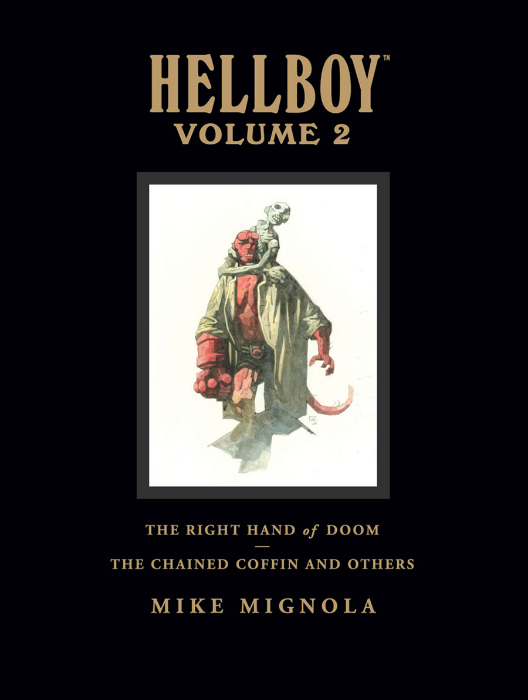

In addition to [Trade Paperback Collections](/entry/Trade_Paperback_Collections), the line of Hellboy comics is also collected in large over-sized Library Editions. Each volume contains the equivalent of two trade paperbacks as well as additional sketch book material. The books are published as Hardcovers and measure in at 9" by 12" (as compared to the trade paperback's 7" by 10"). Seven volumes have been published to date.

## *Hellboy*

#
Cover
Date Published
Contents

<tbody>

<strong>1</strong>

Hellboy_Library_1.jpg

May 7, 2008
Collect

<ul>
<li>[<em>Hellboy – Volume 1: Seed of Destruction</em>](/entry/Trade_Collections)</li>
<li>[<em>Hellboy – Volume 2: Wake the Devil</em>](/entry/Trade_Collections)</li>
</ul>

Additional Material

<ul>
<li><strong>LE Introduction by Scott Allie1</strong></li>
<li><strong><em>Seed of Destruction</em> Introduction by Robert Bloch</strong></li>
<li><strong><em>Wake the Devil</em> Introduction by Alan Moore</strong></li>
<li><strong>LE Afterword by Mike Mignola</strong></li>
<li><strong>Expanded Sketchbook</strong> (33 pages)</li>
</ul>

<strong>2</strong>

Hellboy_Library_2.jpg

October 8, 2008
Collects

<ul>
<li>[<em>Hellboy – Volume 3: The Chained Coffin and Others</em>](/entry/Trade_Collections)</li>
<li>[<em>Hellboy – Volume 4: The Right Hand of Doom</em>](/entry/Trade_Collections)</li>
</ul>

Additional Material

<ul>
<li><strong>LE Introduction by Scott Allie1</strong></li>
<li><strong>LE Afterword by Mike Mignola</strong></li>
<li><strong>Story Notes</strong></li>
<li><strong>Expanded Sketchbook</strong> (39 pages)</li>
</ul>

Additional Notes

The stories were re-ordered for this volume into chronological order:
<ol>
<li><em>[Pancakes](/entry/Pancakes)</em></li>
<li><em>[The Nature of the Beast](/entry/The_Nature_of_the_Beast)</em></li>
<li><em>[King Vold](/entry/King_Vold)</em></li>
<li><em>[The Corpse](/entry/The_Corpse)</em></li>
<li><em>[The Iron Shoes](/entry/The_Iron_Shoes)</em></li>
<li><em>[The Baba Yaga](/entry/The_Baba_Yaga)</em></li>
<li><em>[Heads](/entry/Heads)</em></li>
<li><em>[Goodbye Mister Tod](/entry/Goodbye_Mister_Tod)</em></li>
<li><em>[The Vârcolac](/entry/The_V%C3%A2rcolac)</em></li>
<li><em>[A Christmas Underground](/entry/A_Christmas_Underground)</em></li>
<li><em>[The Wolves of Saint August](/entry/The_Wolves_of_Saint_August)</em></li>
<li><em>[The Chained Coffin](/entry/The_Chained_Coffin)</em></li>
<li><em>[Almost Colossus](/entry/Almost_Colossus)</em></li>
<li><em>[The Right Hand of Doom](/entry/The_Right_Hand_of_Doom)</em></li>
<li><em>[Box Full of Evil](/entry/Box_Full_of_Evil)</em></li>
</ol>

<strong>3</strong>

Hellboy_Library_3.jpg

September 23, 2009
Collects

<ul>
<li>[<em>Hellboy – Volume 5: Conqueror Worm</em>](/entry/Trade_Collections)</li>
<li>[<em>Hellboy – Volume 6: Strange Places</em>](/entry/Trade_Collections)</li>
</ul>

Additional Material

<ul>
<li><strong>LE Introduction by Scott Allie1</strong></li>
<li><strong><em>Conqueror Worm</em> Introduction by Guillermo del Toro</strong></li>
<li><strong><em>Strange Places</em> Introduction by Gary Gianni</strong></li>
<li><strong>LE Afterword by Mike Mignola</strong></li>
<li><strong>Unused Pages</strong></li>
<li><strong>Expanded Sketchbook</strong> (38 pages)</li>
</ul>

<strong>4</strong>

Hellboy_Library_4.jpg

June 15, 2011
Collects

<ul>
<li>[<em>Hellboy – Volume 10: The Crooked Man and Others</em>](/entry/Trade_Collections)</li>
<li>[<em>Hellboy – Volume 7: The Troll Witch and Others</em>](/entry/Trade_Collections)</li>
</ul>

Additional Material

<ul>
<li><strong>LE Introduction by Scott Allie1</strong></li>
<li><strong><em>The Crooked Man and Others</em> Introduction by Gahan Wilson</strong></li>
<li><strong>LE Afterword by Mike Mignola</strong></li>
<li><strong>Story Notes</strong></li>
<li><strong>Expanded Sketchbook</strong> (47 pages)</li>
</ul>

Additional Notes

The stories were re-ordered for this volume into chronological order:
<ol>
<li><em>[The Crooked Man](/entry/The_Crooked_Man_%28comic_story%29)</em></li>
<li><em>[The Penanggalan](/entry/The_Penanggalan)</em></li>
<li><em>[The Hydra and the Lion](/entry/The_Hydra_and_the_Lion)</em></li>
<li><em>[The Troll Witch](/entry/The_Troll_Witch)</em></li>
<li><em>[The Vampire of Prague](/entry/The_Vampire_of_Prague)</em></li>
<li><em>[They That Go Down to the Sea in Ships](/entry/They_That_Go_Down_to_the_Sea_in_Ships)</em></li>
<li><em>[Dr. Carp's Experiment](/entry/Dr._Carp%26)</em></li>
<li><em>[The Ghoul](/entry/The_Ghoul)</em></li>
<li><em>[In the Chapel of Moloch](/entry/In_the_Chapel_of_Moloch)</em></li>
<li><em>[Makoma](/entry/Makoma_%28story%29)</em></li>
</ol>
<strong>Note:</strong> <em>[The Mole](/entry/The_Mole)</em> is not included in this volume.

<strong>5</strong>

Hellboy_Library_5.jpg

July 11, 2012
Collects

<ul>
<li><em>[The Mole](/entry/The_Mole)</em> (from <em>[Hellboy – Volume 10: The Crooked Man and Others](/entry/Trade_Collections)</em>)</li>
<li>[<em>Hellboy – Volume 8: Darkness Calls</em>](/entry/Trade_Collections)</li>
<li>[<em>Hellboy – Volume 9: The Wild Hunt</em>](/entry/Trade_Collections)</li>
</ul>

Additional Material

<ul>
<li><strong>LE Introduction by Scott Allie1</strong></li>
<li><strong><em>Darkness Calls</em> Introduction by Jane Yolen</strong></li>
<li><strong><em>The Wild Hunt</em> Introduction by Mark Chadbourn</strong></li>
<li><strong>LE Afterword by Mike Mignola</strong></li>
<li><strong>Expanded Sketchbook</strong> (66 pages)</li>
</ul>

Additional Notes

<em>[The Mole](/entry/The_Mole)</em> was included in this volume as a prologue for <em>[Darkness Calls](/entry/Darkness_Calls)</em>.

<strong>6</strong>

Hellboy_Library_6.jpg

June 5, 2013
Collects

<ul>
<li>[<em>Hellboy – Volume 12: The Storm and the Fury</em>](/entry/Trade_Collections)</li>
<li>[<em>Hellboy – Volume 11: The Bride of Hell and Others</em>](/entry/Trade_Collections)</li>
</ul>

Additional Material

<ul>
<li><strong>LE Introduction by Scott Allie1</strong></li>
<li><strong><em>The Storm and the Fury</em> Introduction by Glen David Gold</strong></li>
<li><strong><em>The Bride of Hell and Others</em> Story Notes</strong></li>
<li><strong>LE Afterword by Mike Mignola</strong></li>
<li><strong>Expanded Sketchbook</strong> (73 pages)</li>
</ul>

</tbody>

**1** Editions published after 2020 have Scott Aliie's introductions removed.

## *Hellboy in Hell*

Cover
Date Published
Contents

<tbody>

Hellboy_in_Hell_Library_1.jpg

October 11, 2017
Collects

<ul>
<li>[<em>Hellboy in Hell – Volume 1: The Descent</em>](/entry/Trade_Collections)</li>
<li>[<em>Hellboy in Hell – Volume 2: The Death Card</em>](/entry/Trade_Collections)<strong>2</strong></li>
<li><em>[The Magician and the Snake](/entry/The_Magician_and_the_Snake)</em></li>
</ul>

Additional Material

<ul>
<li><strong>LE Introduction by Scott Allie3</strong></li>
<li><strong>LE Afterword by Mike Mignola</strong></li>
<li><strong>Expanded Sketchbook</strong> (84 pages)</li>
</ul>

</tbody>

**2** Including the prologue from the trade paperback collection, which was left out of the Omnibus Edition, it's included at the back of the collection instead of as a prologue.
**3** Editions published after 2020 have Scott Aliie's introduction removed.
