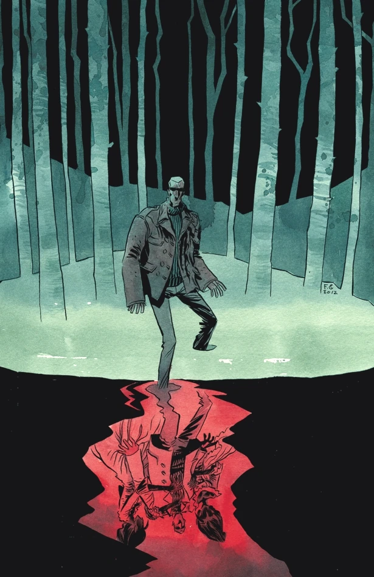
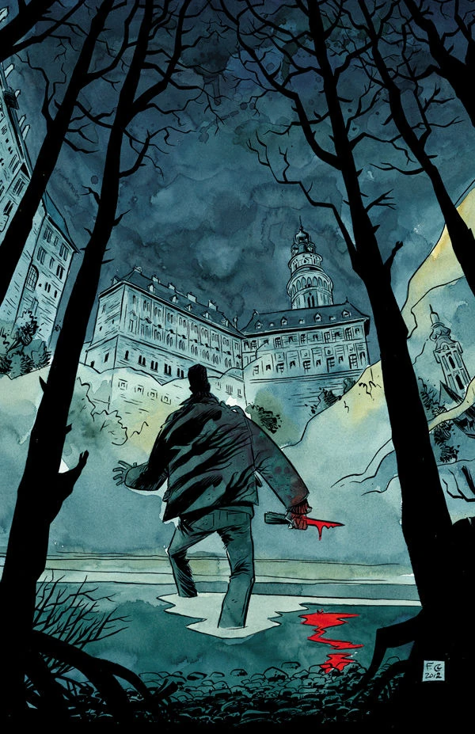
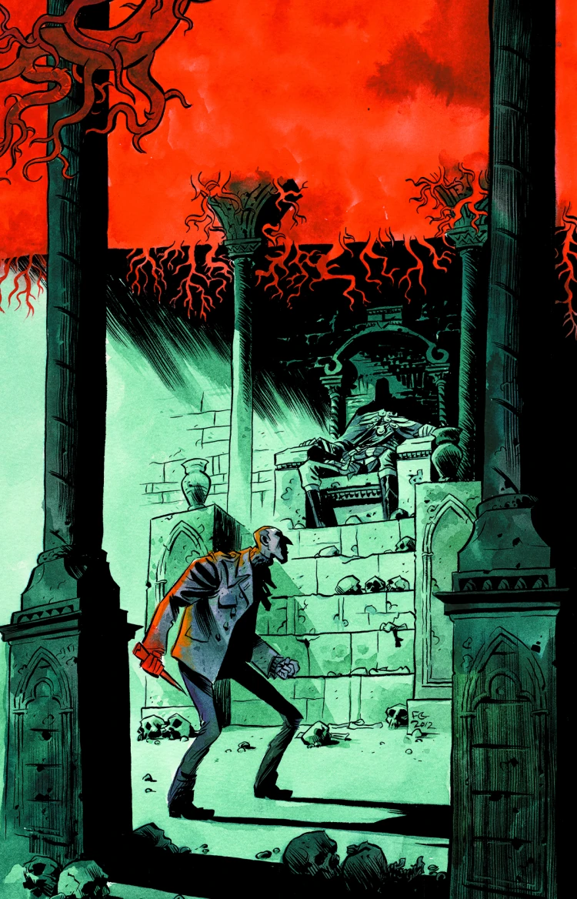
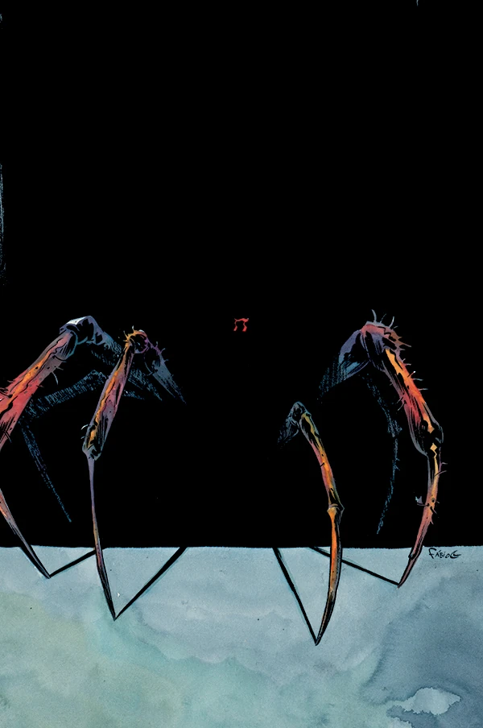
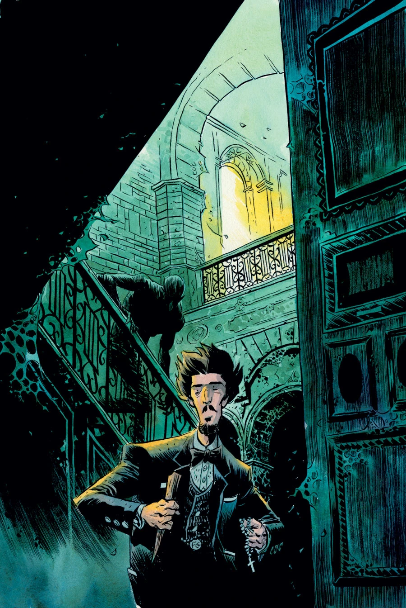

***Vampire*** is a five-issue miniseries published in March 2013 with art by brothers Gabriel Bá and Fábio Moon. It is a continuation from *[B.P.R.D.: 1948](/entry/1948)*. It is the first story in the [*Vampire* cycle](/entry/Vampire_%28story_cycle%29) of [*B.P.R.D.*](/entry/B.P.R.D._%28series%29)

## Synopsis

### Part One

Following the horrific events of *[B.P.R.D.: 1948](/entry/1948)*, we follow one doomed agent's quest for revenge against a clan of [vampires](/entry/vampires) and their gorgon-eyed queen.

### Part Two

On the hunt for the vampire clan that cursed him, [Simon Anders](/entry/Simon_Anders) finds his answers in a small Czech town plagued by a horrific family’s past.

### Part Three

A nobleman vampire’s life is spared after a horrific bargain made with the evil goddess [Hecate](/entry/Hecate), and now the bloodthirsty Simon Anders will put that deadly deal to rest.

### Part Four

Plagued with two vampires trapped inside his chest, Simon Anders struggles to keep them under control before they can throw him into a bloodbath with an army of [witches](/entry/witches).

### Part Five

After the bloody encounter in the woods, only [Professor Bruttenholm](/entry/Trevor_Bruttenholm) himself can put an end to this vampire hunt and get to the bottom of the mystery of the undead of Český Krumlov.

## Gallery

