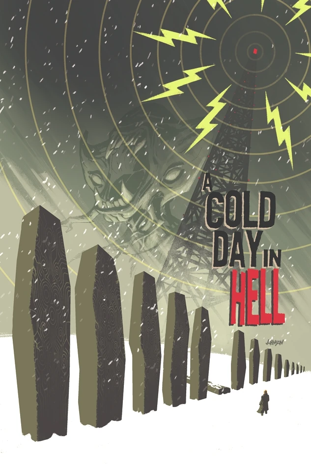
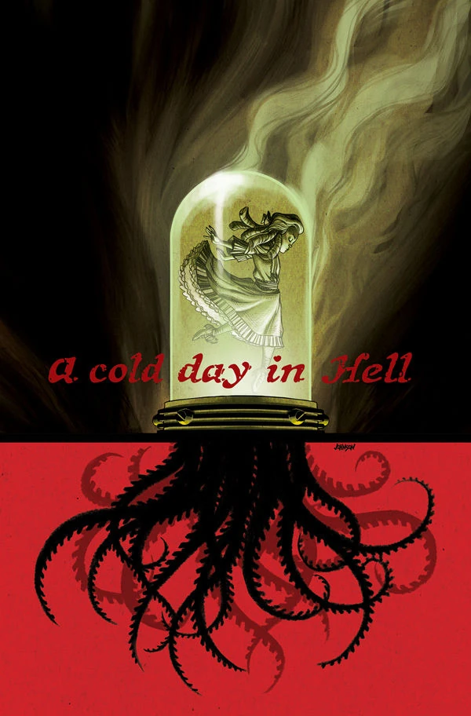

***A Cold Day in Hell*** is a two-issue arc published in 2013 with art by [Peter Snejbjerg](/entry/Peter_Snejbjerg) and covers by [Dave Johnson](/entry/Dave_Johnson).

## Synopsis

### Part One

Following the deadly events of *[The Return of the Master](/entry/The_Return_of_the_Master)*, the zombie director of the Russian occult sciences division leads a rescue mission through a blizzard as the B.P.R.D. engage in battle with more bat-faced monsters. Why are the Russians obsessed with a fallen radio tower in the middle of nowhere?

### Part Two

Paranormal activity in Russia heats up as demons from Hell participate in the battle against the zombie director of the Russian occult sciences service in order to free a high-ranking devil imprisoned on Earth.

## Gallery

 \#2
