*This page is about the character. For the comic serial, see*[Hellboy (series)](/entry/Hellboy_%28series%29).

**Hellboy** is a half-demon half-human paranormal investigator. Destined to bring about the end of the world, he was summoned to Earth in the twilight of World War II and was raised by the forces of good. Though his demonic heritage grants him longevity, great physical strength, and a distinctive appearance, he rejects his apocalyptic destiny and serves as a force for good, combating paranormal threats large and small during his fifty-year career as an agent of the [Bureau for Paranormal Research and Defense](/entry/Bureau_for_Paranormal_Research_and_Defense) or on his own solo travels.

Created by, and most frequently written and drawn by, [Mike Mignola](/entry/Mike_Mignola), Hellboy serves as the protagonist of [the comic book series that bears his name](/entry/Hellboy_%28series%29) as well as an expansive body of work referred to as the "Hellboy Universe". The character has also been adapted to film, video games, and other media, typically with some involvement from Mignola.

## History

### Conception and birth

On April 30 ([Walpurgis Night](/entry/wikipedia%3AWalpurgisnacht)) 1574, a witches' sabbath was held. Sixteen-year-old witch [Sarah Hughes](/entry/Sarah_Hughes) summoned the demon [Azzael](/entry/Azzael) – asking for and receiving power from him, unknowingly conceiving his son as well.[1][2]

On October 5, 1617,[3] Hughes lay on her deathbed. Accompanied by her two adult children, both members of the clergy, she confessed her sins before death and was interred in a chained coffin; her son and daughter were to keep watch for three days to protect her soul from being claimed by the demon she had previously sworn allegiance to. But Azzael would not be denied, incinerating the two and reclaiming Sarah, telling her she carried his "favorite son" who was still waiting to be born. Declaring she was his forever, supernatural flaming chains were hooked into Hughes as she was dragged down to [Hell](/entry/Hell).[4]

Azzael's fondness was not for Hughes, however; rather than restoring her to youth and sharing his love with her as he had promised, he simply watched dispassionately as hellfire destroyed the witch, leaving only his newborn son. The half-demon infant's right hand was removed and an [oversized stone forearm](/entry/Right_Hand_of_Doom) affixed in its place, with which to usher in the end of days.[5] The other princes of [Pandemonium](/entry/Pandemonium_%28location%29), incensed by what Azzael planned to do, summoned angels of destruction to punish him. Just before meeting his fate, Azzael cast the infant away from Hell.[6]

#### The mortal plane

 The night of December 23, 1944 would see the infernal child's appearance on Earth. The evil mystic [Grigori Rasputin](/entry/Grigori_Rasputin), partnered with the Third Reich under their [Project Ragna Rok](/entry/Project_Ragna_Rok), performed a ritual as part of a process to awaken the [Ogdru Jahad](/entry/Ogdru_Jahad). Though nothing appeared to have happened, he was confident that something had been set in motion.

In East Bromwich, miles away from Rasputin's ritual, British psychic [Lady Cynthia Eden-Jones](/entry/Lady_Cynthia_Eden-Jones) (accompanied by Professor [Trevor Bruttenholm](/entry/Trevor_Bruttenholm) of the [British Paranormal Society](/entry/The_British_Paranormal_Society_%28organization%29) and Professor [Malcolm Frost](/entry/Malcolm_Frost) from Blackfriars College) had led a group of Allied forces (under the leadership of 1st Sgt. [George Whitman](/entry/George_Whitman), and accompanied by costumed hero [the Torch of Liberty](/entry/the_Torch_of_Liberty)) to the ruins of a church in East Bromwich – the very same church where Sarah Hughes had been claimed centuries earlier. At the same moment the ritual took place, the half-demon infant appeared in the courtyard in a ball of fire. Despite the intial shock of all present, the Torch and Eden-Jones opined that the childlike creature did not seem dangerous; a stunned Bruttenholm uttered "Hellboy", and the name stuck.[7]

The idea that Hellboy had been drawn to the church by the hallowed souls of Hughes' human children (his half-siblings), rather than intentionally sent there by Azzael or mistakenly summoned there by Rasputin, was held by both Eden-Jones[8] and [Astaroth](/entry/Astaroth).[9]

### With the B.P.R.D.

#### Childhood

.").") The infant Hellboy was taken to an air force base in New Mexico. Soon after, the [Bureau for Paranormal Research and Defense](/entry/Bureau_for_Paranormal_Research_and_Defense) was founded by Bruttenholm (who served as its first director) and other paranormal experts; the fledgling B.P.R.D. was granted custody of Hellboy. The lad was raised under the guidance of Trevor Bruttenholm and the fledgling B.P.R.D., interacting with personnel at the base such as U.S. General [Norton Ricker](/entry/Norton_Ricker) and the dog [Mac](/entry/Mac). Bruttenholm, who had quickly become fond of the child, officially adopted Hellboy in March of 1946.[10]

Hellboy was initially raised in secret, primarily viewed as a research subject by Army higher-ups; academic minds such as Oppenheimer,[11] Feynman, and Einstein were invited to study the lad. Word of Hellboy eventually leaked out and by 1947 he was revealed to the world, briefly becoming a media darling of the Atomic Age;[12] a three-year-old Hellboy was featured in the May 1948 issue of *LIFE* magazine.[13] Hellboy was typically regarded as little more than a curiousity, those like Frost who saw him as a threat were rare and largely written off as paranoid.[14]

Hellboy had matured physically and mentally (if not emotionally) more rapidly than a human child.[15] He learned to crawl within a week, and was walking and talking at a month old.[16] He appeared fully-grown by the age of eight, and did not appreciably age further over the following sixty-plus years. On August 6, 1952, a special act of the United Nations officially granted Hellboy honorary human status.[17][18]

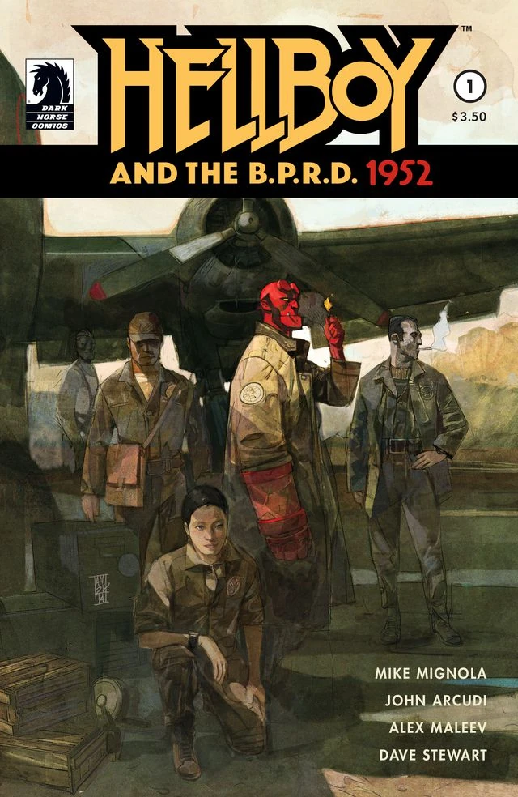

#### Early Career

 In 1952, a week after being granted honorary human status, Hellboy officially joined the Bureau for Paranormal Research and Defense as a full time agent.[19][20]

Though physically an adult, Hellboy had matured somewhat less in mind: he still had the rebellious fire and attitude of an adolescent. Under the tutelage of Bruttenholm, he became adept in many supernatural and paranormal subjects such as possession, haunting, exorcism, enchantments, holy amulets, and sacred artifacts.

In the years following World War II and the demise of the Nazi regime, Hellboy traveled the world, encountering and defeating numerous supernatural beings and disturbances such as [werewolves](/entry/werewolves), [vampires](/entry/Vampire_%28creature%29), and encounters with the deranged Nazi scientist [Herman Von Klempt](/entry/Herman_Von_Klempt) *(see [World's Greatest Paranormal Investigator](/entry/World%27s_Greatest_Paranormal_Investigator_%28CBG%29))* Hellboy also encounters minor deities, mythological creatures, and beings of folklore.

Two years later, Hellboy was approached by the [Osiris Club](/entry/Osiris_Club) to slay the Saint Leonard worm, an alligator-like monster. This battle was in fact a test of Hellboy's true virtue, resulting in lilies that grew from his spilled blood, which seemed to confirm his good nature *(see [The Nature of the Beast](/entry/The_Nature_of_the_Beast))*. A short time later, Professor Bruttenholm sent Hellboy to help a Professor [Edmond Aickman](/entry/Edmond_Aickman) with the [King Vold](/entry/King_Vold_%28character%29) myth. Aickman was obsessed with a possible reward, and manipulated Hellboy into begrudgingly completing Vold's chosen tasks *(see [King Vold](/entry/King_Vold))*.

In 1959 Hellboy was in Ireland and embarked on a mission to rescue a baby, [Alice Monaghan](/entry/Alice_Monaghan). In order to do so, he had to bear a corpse to its final resting place. Overseeing the assignment was the King of the [Daoine Sidhe](/entry/Daoine_Sidhe), who would harbor interest in Hellboy in the near future *(see [The Corpse](/entry/The_Corpse))*.

##### 1960s

He had a notable encounter with [the Baba Yaga](/entry/Baba_Yaga_%28character%29), the first of several, in 1964 (see *[The Baba Yaga](/entry/The_Baba_Yaga)*).

##### 1970s

In 1979 Hellboy was sent to aid a once famous physical medium, [Mister Tod](/entry/Mister_Tod). Tod, using drugs to enter a trance, accidentally released a cosmic monster which created a body for itself with Tod’s ectoplasm *(see [Goodbye Mister Tod](/entry/Goodbye_Mister_Tod))*. This was Hellboy's first encounter with the spirit of an [Ogdru Hem](/entry/Ogdru_Hem); he was able to defeat the creature with an herb.

##### 1980s

In 1982 tracked down the infamous Countess [Ilona Kakosy](/entry/Ilona_Kakosy), a vampire. Hellboy slayed her after she tried to distract him with a disturbing vision *(see [The Vârcolac](/entry/The_V%C3%A2rcolac))*.

##### 1990s

In 1991, Hellboy is called in to assist fellow Bureau agent Pauline Raskine. The B.P.R.D. was investigating a newly discovered hidden basement in a mansion owned by former a Doctor Carp. Carp was a Grand Master of the Golden Lodge, a temple of the [Heliopic Brotherhood of Ra](/entry/Heliopic_Brotherhood_of_Ra) located in New York. Hellboy has knowledge of the H.B.R. and refers to them as crazy. Upon entering the room Hellboy was magically warped through time to the year 1902, where he had to contend with the sadistic Doctor. Carp managed to get a sample of Hellboy’s demonic blood to use on a chimpanzee, turning the ape into a bloodthirsty monster *(see [Dr. Carp's Experiment](/entry/Dr._Carp%27s_Experiment))*.

#### Later B.P.R.D. Career

##### Cavendish Hall affair

However, it wasn’t until the groundbreaking Cavendish Hall mission that Hellboy truly met a challenge which posed an extreme threat to him or his fellow agents Abe Sapien and [Elizabeth Sherman](/entry/Elizabeth_Sherman), a woman with uncontrollable pyrokinetic abilities. It began when Hellboy met with his mentor [Trevor Bruttenholm](/entry/Trevor_Bruttenholm), who was trying to tell Hellboy a crucial memory disturbing the Professor. Suddenly, Bruttenholm was mysteriously killed when a spawning of frogs entered the room, and an angry Hellboy faced off with a humanoid [frog monster](/entry/frog_monster).

A mission was sent to the haunted Cavendish Hall mansion, consisting of Hellboy, Abe and Liz to question the elderly [Mrs. Cavendish](/entry/Emma_Cavendish), whose well-known family heritage Bruttenholm mentioned as he tried to remember what to tell Hellboy seconds before his death. Mrs. Cavendish was a widow who lost her three sons a few months before, when they, along with Trevor Bruttenholm, together explored the Arctic in search of a legendary temple. She said it was her family's curse that every male in the line, starting with Elihu Cavendish, became obsessed with retrieving something from the Arctic. Many would never came back.

In truth, the Cavendish boys along with Bruttenholm, made it to a secret temple in the Arctic. There they had come across Grigori Rasputin, who had been hibernating for years in service to a terrible cosmic monstrosity, the [Ogdru Jahad](/entry/Ogdru_Jahad). Rasputin had become the creatures’ only hope of entering our world in order for them to unleash the Apocalypse on Earth. A dormant [Ogdru Hem](/entry/Ogdru_Hem), [Sadu-Hem](/entry/Sadu-Hem) was accidentally awoken by the team. Its breath transformed the three Cavendish brothers and their guide while Bruttenholm was spared by Rasputin, who read his mind and discovered his link with Hellboy. They boarded a ship and when they arrived in America, Bruttenholm was allowed to escape with a fragile memory in order to lure Hellboy to Cavendish Hall.

Hellboy and his partners elected to stay the night at Cavendish Hall, to further explore any possible clues. Unbeknownst to the agents, the revived Rasputin had been manipulating events in order to draw Hellboy closer to him, intent on forcing the demon to fulfill his purpose as the Harbinger of Armageddon. Rasputin was the one who had summoned Hellboy to this world back in 1944, and had been patiently waiting for his chance to return and retake control of his ‘son.’ Upon discovering the presence of Rasputin, who had willingly revealed himself that evening in a vain attempt to coerce Hellboy’s loyalty, Hellboy refused this destiny.

Abe Sapien managed to kill Rasputin by throwing a harpoon through his chest. However, he was actually being possessed by the spirit of Elihu Cavendish. The ghost of Cavendish desired vengeance against Rasputin for the murder of his family. Liz Sherman awoke from her trance and summoned a firestorm that killed Sadu-Hem. Hellboy succeeded in rejecting his purpose and delaying the End of Days. Rasputin’s body was destroyed and his spirit was forced to flee, vowing that Hellboy would fulfill his purpose in the end, whether he wanted to or not.

###### More Career Highlights

What follows are a few worthy-of-note adventures of Hellboy and his partners following the Cavendish Hall incident:

- **1994, East Bromwich, England**: Hellboy returned to the ruined church where he first appeared in the world, and had a dream-vision of his origin: His mother, as a young woman, had cavorted with the demon Prince [Azzael](/entry/Azzael), and on Walpurgisnacht (a night of great significance to witches) conceived Hellboy. *(see [The Chained Coffin](/entry/The_Chained_Coffin))*
- **1994, Griart, The Balkans**: Hellboy and [Kate Corrigan](/entry/Kate_Corrigan) visited a town decimated by the angry ghosts of [werewolves](/entry/werewolves). It became a revenge mission after [Father Kelly](/entry/Father_Kelly), Hellboy's associate, was murdered by a living werewolf. Kate's first sighting of a ghost occurred during this mission. *(see [The Wolves of Saint August](/entry/The_Wolves_of_Saint_August))*
- **1998, Lizarza, Spain**: Hellboy met with [Adrian Frost](/entry/Adrian_Frost), the son of [Malcolm Frost](/entry/Malcolm_Frost). Hellboy related his life story to Frost, and the two realized that Hellboy's stone right hand was the key to triggering the Apocalypse. Hellboy has decided keep the hand lest someone else retrieve it and use it. *(see [The Right Hand of Doom](/entry/The_Right_Hand_of_Doom))*

##### The Giurescu Affair

In 1997, the second major turning point in Hellboy’s journey of discovery regarding his original purpose on Earth began as a mission to Romania, to investigate the theft of an ancient box containing the corpse of [Vladimir Giurescu](/entry/Vladimir_Giurescu), a Napoleonic officer who was in fact a vampire.

The legend went that whenever Giurescu was injured in battle, his servants would bring his body back to his home castle, where the rays of the full moon would mystically revive him back to full health. In 1882, Giurescu, posing as a foreign nobleman, attempted to start a secret evil empire to conquer England. This caught the attention of the Nazi party during the 1940s, who then sent a delegation lead by [Ilsa Haupstein](/entry/Ilsa_Haupstein) to recruit the immortal vampire to their cause. The meeting went badly, resulting in Hitler ordering the arrest and murder of Giurescu’s vampiric brides. He and his family were beheaded and stabbed through the heart with stakes, and then burned; their ashes sent to Hitler.

However, this was not the end for [Vladimir Giurescu](/entry/Vladimir_Giurescu). In 1997, a former Nazi named [Howard Steinman/Hans Ubler](/entry/Hans_Ubler) was shot to death inside his own museum, and a crate marked “Giurescu Lot \#666” was taken. It is assumed that Ubler had stolen the remains of Giurescu during his Nazi days and had hidden the deceased vampire inside the museum for the last few decades. Now it appeared that Giurescu’s followers, lead by Ilsa Haupenstein, had come to rescue their master and bring his remains to Castle Giurescu, where the next full moon would revive him.

The problem was that Castle Giurescu had never been found, for its location has always been hidden. B.P.R.D. agent Kate Corrigan made three rough guesses at possible locations of the castle, and three groups of agents were sent to each location in case one of them is the real deal. Hellboy went solo to the first site, while [Agent Clark](/entry/Clark) and Abe Sapien went to the second site, and Liz Sherman, [Bud Waller](/entry/Bud_Waller), and rookie agent [Sidney Leach](/entry/Sidney_Leach) investigated the third site.

Hellboy arrived in time to discover that Ilsa had already prepared for the resurrection ceremony, but he was distracted by an encounter with the harpy-like Women of Thessaly. Meanwhile, Rasputin’s spirit had returned, and he succeeded in transforming Ilsa into the reincarnation of the goddess [Hecate](/entry/Hecate), who battled with Hellboy. When Hellboy was captured and left to die chained to a pole, the revived Giurescu charged him, only to be killed in an explosion when Hellboy cracked the pole in half and struck the vampire’s horse. In fury, the iron maiden which formerly was Ilsa Haupenstein swallowed up Hellboy, trapping him within an alternate dimension.

He encountered a group of beings who claim to be Chaos itself, and told Hellboy that the time had finally come for him to embrace his purpose. They used what they believed to be his true name, “Anung Un Rama” (Destroyer of Worlds), to bind him and the two sawed-off horns atop Hellboy’s forehead began to regrow as a crown of fire appeared above him.

However, Hellboy rejected the name amd managed to overcome the transformation, telling the spirits, “Screw you!” and snapping off his newly-regrown horns; an act which represents Hellboy’s devotion to the cause of good and that he truly is a well-meaning being, despite his origins or purpose. This moment of defiance instantly returned him back to our world, where he met Kate Corrigan. Backup never arrived due to an accident at the airport, and Kate revealed to a shocked Hellboy that during his adventures the other two teams had met their own misfortunes.

Liz Sherman accidentally revived a [human-sized homunculus](/entry/Roger) which drained her power and killed Bud Waller before fleeing. Liz felt extreme guilt over the incident. At the same time, Abe Sapien and Agent Clark had visited a church in the belief that they would meet Hellboy there due to the presence of his tracking device.

But it was revealed to be a trap set up by Rasputin, who wanted revenge against Abe for stabbing the mystic through the chest in their last encounter during the Cavendish Hall affair. Clark was killed in the process, but Abe managed to survive. The skeletal remains of [Vladimir Giurescu](/entry/Vladimir_Giurescu) were recovered by the B.P.R.D. while Hellboy and his fellow agents were airlifted home, exhausted by their recent mission.

Meanwhile, Rasputin's other henchmen [Karl Ruprect Kroenen](/entry/Karl_Ruprect_Kroenen) and [Leopold Kurtz](/entry/Leopold_Kurtz) attempted to follow the will of Rasputin in castle in Norway. The two Nazi scientiests had been entrusted with the task of creating an Army for Giurescu to lead in a campaign to destroy mankind, thus bringing about Rasputin’s planned “Ragna Rok” apocalypse. However due to Kroenen's disobedience in resurrecting Nazi scientist Herman Von Klempt, whom Rasputin despised, and the accidental killing of Kurtz the undead mystic struck the C.E.O. of the [Zinco Corporation](/entry/Zinco_Corporation), [Roderick Zinco](/entry/Roderick_Zinco) blind. While Zinco panicked, he accidentally hit a button which destroyed the fortress. However, Kurtz and Kroenen were somehow able to survive, probably thanks to Rasputin, and recently reappeared in the B.P.R.D. story [Russia](/entry/Russia).

##### Almost Colossus

After losing her powers to the homunculus, Liz Sherman underwent treatment by Dr. Olasz at the Wauer Institute. Meanwhile, Hellboy and Kate Corrigan investigate a missing cross and several missing corpses. The culprit was the homunculus, praying for God to kill him. Instead, the homunculus met his older brother, who told him of his creator and of their plans to overthrow mankind. Hellboy and Kate discovered the homunculus' lair where they were attacked by his brother's crude homunculi henchmen. Kate was captured and the homunculus's brother planned to use her to build an enormous homunculus body for him to inhabit. Kate was rescued, but the evil brother used the giant body to attack Hellboy. The first homunculus then seemingly gave in to his brother's wishes, becoming part of the giant body. But he used the pyrokinesis taken from Liz to destroy his evil brother's new body. They rushed to the Wauer Institute and arrived just moments after Liz died. Then the homunculus, now dubbed "[Roger](/entry/Roger)", returned Liz's pyrokinetic powers to her, restoring her life at the cost of his own.

##### The Little Box of Evil

In 1999, Hellboy and Abe investigated the castle of Count Guarino after a mysterious attack. On this mission, the warlock [Igor Bromhead](/entry/Igor_Bromhead) released [Ualac](/entry/Ualac), a minor demon trapped in a box by St. Dunstan. Ualac was able to teach Bromhead part of Hellboy's secret name, "Anung Un Rama," and temporarily paralyze him. Abe was shot by a chimpanzee, the former count now transformed. Ualac claimed the Crown of the Apocalypse (which sits invisibly on Hellboy's head) before attempting to take Hellboy's stone right hand. Hellboy was able to break free thanks to advice from the Daoine Sidhe and killed his enemy’s mortal body. Bromhead and Ualac were claimed by the demon [Astaroth](/entry/Astaroth), who also took Hellboy's crown down to Hell.

##### The Conqueror Worm Affair

This was a landmark moment in Hellboy’s multi-layered career. With the help of fellow agents Roger and Abe Sapien, among others, he faced off against an unprecedented threat: a cosmic entity bound with a Nazi scientist who had been floating through space for decades and was now the vessel for the monstrous creature’s arrival on Earth. This beast was an alleged offspring of the Ogdru-Jahad, which the Nazis had tried to communicate with back in the 40’s. This mission to stop the ‘worm,’ now controlled by Grigori Rasputin, culminated in an intense sacrifice from Roger the Homunculus, who risked his very life to try and imprison the worm’s spirit within himself. With assistance from the ghost of famed television-serial hero Lobster Johnson, Hellboy managed to drive away the Worm’s consciousness, and a wounded Roger was given aid by B.P.R.D. agents.

![In the wake of the Conqueror Worm Affair, Hellboy resigned from the B.P.R.D. on February 5, 2001.[21]](/content/images/Conqueror_Worm_4.jpg "In the wake of the Conqueror Worm Affair, Hellboy resigned from the B.P.R.D. on February 5, 2001.") Hellboy now felt deep guilt over his profession, due to him having been given by Manning prior to the mission a device to kill Roger, should he become dangerous again. Then, with a heavy heart, Hellboy announced his resignation to Kate Corrigan, before leaving to try and find out once and for all the truth behind the supposed fate that would always haunt him.

### Post-B.P.R.D.

#### Hellboy Alone

Main article: *[The Third Wish](/entry/The_Third_Wish), [The Island](/entry/The_Island)*

Hellboy went to Africa in 2004, where he met with an African witch-doctor named [Mohlomi](/entry/Mohlomi). When the spirits of Africa warned him that he had one last night to sleep in their land, Mohlomi brought him to the coast where he claimed that the sea was calling to Hellboy. He ended up being captured by a trio of mermaids who drive a magic nail into his forehead and bring him to the [Bog Roosh](/entry/Bog_Roosh), a powerful sea witch who meant to prevent the Apocalypse by dismembering Hellboy and hiding the Right Hand of Doom. Hellboy is traded to Bog Roosh in exchange for granting the three mermaids, her granddaughters, their wishes. Although the first two are killed by their wishes, the third lives as she wished only to return the spear of her deceased father. The ghost of the mermaid's father returns and admonishes her for kidnapping Hellboy, an innocent man, in exchange for attempting to redeem his honor. Feeling guilty, she returns in secret to rescue Hellboy. Hellboy kills the Bog Roosh and disperses the source of her power, the captured souls of drowned sailors. However her granddaughter becomes the new Bog Roosh to replace her. The granddaughter removes the magic nail from Hellboy's forehead, but he is plunged into a coma and ends up adrift at sea for two years.

Two years later, Hellboy washed up on an unknown deserted island. There, he accidentally resurrected an ancient mystic and learned the secret history of the universe. Through the mystic's blood, [Urgo-Hem](/entry/Urgo-Hem) was resurrected and briefly killed Hellboy, before the latter returned to life and defeated the monster. After rebuking [Hecate](/entry/Hecate) one more time on embracing his destiny, he set sail away from the island and headed for England.

#### The Baba Yaga's Revenge

*Main article:* *[Darkness Calls](/entry/Darkness_Calls)*

In 2007, Hellboy returned to England and stayed with his friend [Harry Middleton](/entry/Harry_Middleton), who had died years before. While out on a walk, he was accosted by witches who took him to Italy. They explained that [Igor Bromhead](/entry/Igor_Bromhead) had subdued Hecate in an attempt to become the king of witches, but they refused and wanted Hellboy to lead them instead. Hellboy rejects them and leaves.

The infuriated witches then accept the [Baba Yaga](/entry/Baba_Yaga_%28character%29)'s bargain to turn him over to her, and he is plunged into her Russian dimension to be tormented and killed as revenge for shooting out her eye back in 1964. As Hellboy battles the witch's minions, he receives aid from other Russian supernatural beings such as the Leshii, Perun, a domovoi, and a little girl named [Vasilisa](/entry/Vasilisa). Frustrated, the Baba Yaga sends her champion, [Koshchei the Deathless](/entry/Koshchei_%28character%29), to kill Hellboy in exchange for giving him the death he had longed for. Vasilisa shows Hellboy the way out of the Baba Yaga's world, but Koshchei kills her and she leaves behind two gifts to aid Hellboy's escape. The Baba Yaga expends all her magical power to enhance Koschei's strength and finally kill Hellboy, but she ultimately fails and is left virtually powerless.

Once Hellboy returns to the real world, he tracks down Igor Bromhead. There, he finds the warlock transformed into a monster as the power of Hecate proved too much for him to control. Bromhead begs him to put him out of his misery and Hellboy obliges, killing him.

#### A Secret Legacy

*Main article: [The Wild Hunt](/entry/The_Wild_Hunt)*

Hellboy is staying at the house of the deceased Capobianco sisters when he receives an invitation from the Osiris Club to meet with him in England. They invite him to join them on the Wild Hunt, a hunting party composed of British elites, as a band of rogue giants have begun terrorizing the British countryside. This turns out to be a trap as the Wild Hunt turns on Hellboy in the middle of their expedition, claiming they would never allow the Devil to sit on the throne of England. After awakening from the attempted assassination, Hellboy encounters the giants, who had killed the Wild Hunt while he was unconscious. Although a bird offers him a chance to escape stealthily, Hellboy rejects it and deliberately picks a fight with the giants to vent out his frustration and anger at being assassinated. In his bloodlust he massacres the giants and awakened his latent demonic powers. Shocked that he enjoyed brutalising the giants, he flees.

Forty-seven hours later, Hellboy moves to Ireland and reunites with Alice Monaghan, a woman who he had saved from the fey folk when she was still a baby in 1963. Hellboy and Alice had met in a dream prior to his invitation, attending the funeral of the fairy king [Dagda](/entry/Dagda). Alice then takes Hellboy to meet with Queen Mab, who tells Hellboy that she sees one chance for him to escape his apocalyptic destiny and warns him that the [Gruagach of Lough Leane](/entry/Gruagach) had resurrected [Nimue](/entry/Nimue), [Merlin](/entry/Merlin)'s former apprentice and the Queen of Blood, to rule over the leaderless witches. It was Gruagach's conspirators who had murdered King Dagda, and with the Queen of Blood they plan to wage war on the human race, amassing an army of forgotten magical beings to take back the surface world. After Mab leaves, Hellboy and Alice are led into a trap of goblins, one of whom manages to poison Alice. A trio of bird spirits arrive and take the two of them to a mysterious castle beseiged by demons. The birds direct Hellboy to kill [Eligos](/entry/Eligos), the demon knight guarding the bridge, so that they could enter. Hellboy and Eligos do battle, but Hellboy is on the backfoot until he receives aid from an imp who tells him of Eligos' weakness. With Eligos beaten, Hellboy and his company finally enter the castle and Alice is cured. They then learn that the castle belonged to the witch [Morgan le Fay](/entry/Morgan_Le_Fay).

Hellboy and Alice learn from Morgan le Fay that Hellboy's witch mother Sarah Hughes was a direct descendant of her and Arthur's son Mordred, thus making Hellboy the rightful king of England. Morgan presents Hellboy with Excalibur and urges him to pull it out, thus raising an army of Britain's noble dead in order to combat the Queen of Blood's forces. Hellboy is reluctant to accept another heavy destiny on his shoulders and takes some time to think, but [Astaroth](/entry/Astaroth) appears and attempts to goad Hellboy into pulling out the sword as well, but for his own motives. Astaroth believes in a prophecy that Hellboy would usurp Hell's ruling class and awaken its sleeping army to break down the walls of Hell, allowing the liberated slaves of demonkind to reign on Earth. After battling another twisted illusion of himself, Vasilisa appears and urges Hellboy to believe in Alice's faith in him, as opposed to all the dark portents that his enemies have told him. Hellboy at last pulls Excalibur from the stone, transporting himself and Alice back to Ireland.

### Death and afterlife

#### The Final Battle

*Main articles: [The Storm](/entry/The_Storm), [The Fury](/entry/The_Fury)*

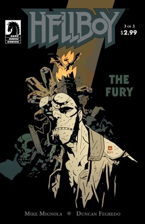 With Excalibur claimed, Hellboy and Alice follow reports of dead noble men rising from their graves, confirming Morgan's prophecy. On the road they are attacked by a monstrous knight, a champion of the Queen of Blood who boasts that Nimue had murdered Queen Mab and her allies. After Hellboy kills him, the two stumble upon a tavern in the woods and rest. A storm builds outside as Nimue gathers her forces for the war against mankind, and the army of the noble dead masses outside the tavern awaiting Hellboy's command. Hellboy rejects leading them and goes off into the woods alone to face Nimue his way. On the way there he stumbles upon Gruagach, who was cast out by Nimue, hanging from a noose as Merlin cursed him with immortality to witness the Apocalypse. Astaroth appears again, mocking Hellboy for rejecting his destiny one last time before disappearing. Finally, the Baba Yaga appears and offers to transport Hellboy past Nimue's vast army of monsters at the cost of his eye, payment at last for him shooting her eye out.

Hellboy arrives at Nimue's tower just in time to witness her being possessed by the [Ogdru Jahad](/entry/Ogdru_Jahad), transforming her into a dragon. The Ogdru Jahad spreads the storm across all of Great Britain, wreaking havoc to prepare for the end times. Hellboy and the Ogdru Jahad do battle, but he slowly loses to the dragon. Vasilisa appears to him one last time and asks if he is ready to meet his end. Hellboy admits that he is ready, and Vasilisa hands him a sword made from Nimue's crown to slay the dragon. Meanwhile at the tavern, Alice hands Excalibur to a blessed World War I soldier named George Washbrook, who regains his youth and uses the Holy Grail to invigorate the army of the noble dead and lead them to battle against the Queen of Blood's army at Vigrid, the prophesied battlefield of Ragnarok at the base of Nimue's tower. Alice flees into the forest, encountering the supernatural Wild Hunt led by [King Vold](/entry/King_Vold_%28character%29), only to be transported to Vigrid after the two armies had slaughtered each other. The tavern barkeep reveals herself to be Mab's spirit and points Alice to the tower where Hellboy fights the Ogdru Jahad and delay the Apocalypse. Alice reaches the top of the tower just in time to witness Hellboy defeat Nimue and the Ogdru Jahad. Before the two could celebrate, Nimue's ghost appears and tears out Hellboy's heart, killing him as she is dragged into Hell. Alice weeps for Hellboy, but England is saved from annihilation.

#### In Hell

*Main article: [Hellboy in Hell (series)](/entry/Hellboy_in_Hell_%28series%29)*

### Pandemonium

*Main article: [The Devil You Know (story cycle)](/entry/The_Devil_You_Know_%28story_cycle%29)*

## Characterization

")

### Personality

Hellboy is often described as a likeable, gruff person with much panache and dry humor in his attitude. He is easily angered by the (often defective) gadgets he uses, but has a genuinely good heart and love for other humans, despite his demonic origins.

A living oxymoron, Hellboy is a force for good, with an iron will and a desire to do the right thing. He has continuously stated his disinterest in his supposed ‘purpose,’ and tries to hide his conflicted feelings beneath the wisecracking facade of an adventurous tough-guy.

### Appearance

Hellboy cuts a formidable figure, standing taller than the average human (even with his typically slumped posture) and with a solid muscular build (his torso usually going uncovered by a shirt). His demonic heritage is clear from his appearance: bright red skin, solid yellow eyes, pointed ears, cloven hooves, and a tail. His facial features are not quite human as well, with a short nose and an oversized lantern jaw.

Arguably Hellboy's most striking feature is his horns, which he keeps cut down to large circular stumps. He began this practice as a small child, largely out of a desire to feel less "different",[24] and keeps them trimmed through adulthood. On occasions, when outside forces attempt to awaken his diabolical destiny, his horns swiftly grow to their full length (well over a foot), but Hellboy is quick to reject this and breaks them off.

His hair recedes from the top of his head (and has since his youth), usually pulled back in a simple tight bun. Facial hair is shaved into shaggy sideburns and a trim, narrow goatee.

##### The ‘Right Hand of Doom’

*Main article: [Right Hand of Doom](/entry/Right_Hand_of_Doom)*

Another one of Hellboy's most recognizable attributes is a large stone forelimb and three-fingered hand, attached in place of his right arm. It is made out of unearthly materials and resists damage and analysis both.[25]

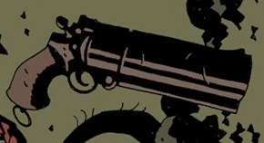

#### Weapons and Equipment

 In addition to his natural gifts, Hellboy carries a variety of items, some B.P.R.D.-issue and others from his personal collection.

- Hellboy typically arms himself with [a handgun](/entry/Hellboy%27s_gun), though he is a poor shot and prefers to fight with his fists.
 - Hellboy's primary weapon for many years was a large single-shot revolver, given to him by the 1940s superhero [The Torch of Liberty](/entry/The_Torch_of_Liberty). This gun was lost in the ocean in the early 2000s.
 - In 2007, the ghost of [Harry Middleton](/entry/Harry_Middleton) provided Hellboy with a replacement gun: a 1941 US Army-issue M1911A1 .45 caliber pistol.
- Hellboy often carries many charms and knick-knacks on his belt or in the pouches within, which he often uses as either tools to resurrect the dead, protect him or his friends from evil entities, heal, etc.
 - A Catholic rosary and an iron horseshoe are frequently seen tied to his belt.
 - A large red circle near the buckle functions as a B.P.R.D. tracker, emitting a signal in case of emergencies.[26]
 - The pouches of his utility belt are filled with relics, herbs, and other artifacts, as well as a variety of grenades and other demolition tools; these often come in handy when fighting supernatural beasts.
- Hellboy is almost always seen wearing a large and heavy Trench Coat.
 - The pockets of this Trench Coat are typically filled with many of the charms and totems mentioned above, granting him even greater paranormal protection.
 - His original Trench Coat bore the B.P.R.D. logo on its sleeve, but after he quit the Bureau this logo vanished, indicating that he either removed it or the Trench Coat he is currently wearing is a new one altogether.
 - His Trench Coat has been heavily damaged many times, yet it always shows up repaired with each new story, indicating that Hellboy might have some skill in weaving.
- On the Giurescu mission, Hellboy used a rocket pack to make a tricky landing over the Castle. However, this “new and improved” model proved to be a wash when, upon ignition, exploded and engulfed a predictably pissed Hellboy.
- Hellboy briefly wielded the sword [Excalibur](/entry/Excalibur), from Arthurian Legend. Supposedly, wielding this sword marks him as the rightful King of England, and will allow him to lead an army of England's noble dead. He was able to draw the sword from the stone due to being a direct descendant of [King Arthur](/entry/King_Arthur).

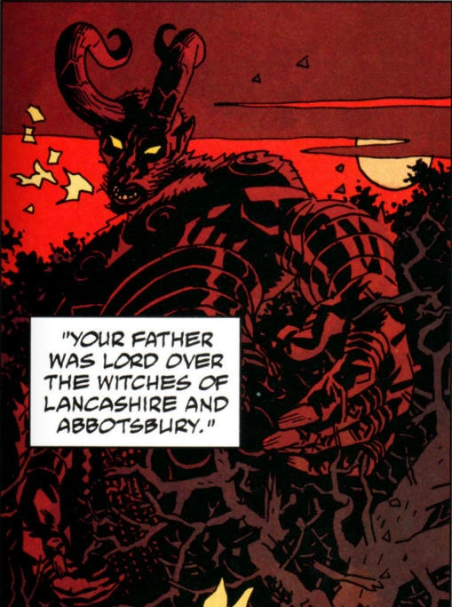

### Origins and Destiny

 Hellboy's destiny has been a common and persistent theme in the series, and becomes more and more complicated with every story arc. The first thing we knew about Hellboy was that he was destined to be the Beast of the Apocalypse. Bearing the Right Hand of Doom, which came from one of the [Watchers](/entry/Greater_spirits) who made the Ogdru Jahad, Hellboy possesses the one thing capable of waking the terrible beasts from their prison and unleashing them to end the days of man. For a long time, this has been the main focus of his destiny, and the thing he has constantly avoided.

During the Wild Hunt story arc, however, his destiny took another interesting turn: his mother, Sarah Hughes, was a descendant of the traitor [Sir Mordred](/entry/Mordred); Mordred, who died while slaying [King Arthur](/entry/King_Arthur), was himself the bastard son of King Arthur and [Morgana Le Fay](/entry/Morgan_Le_Fey), who was Arthur's half sister. Mordred had three sons, who were all executed, and a daughter who was hidden away. Through this daughter, Mordred's bloodline continued up to Sarah, her human children, and Hellboy himself. This makes Hellboy a descendant of King Arthur, and thus, the rightful King of England. Through this, it has been said that he was destined to wear a crown all along, be it in Hell or on Earth, and that his destiny as Arthur's descendant is to pull the sword [Excalibur](/entry/Excalibur) from the stone, and lead Britain's army of the dead - another part of Hellboy's destiny of which he doesn't seem too sure about.

## Allies and Enemies

### Allies

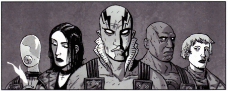
Hellboy's B.P.R.D. allies (L–R: [Johann Kraus](/entry/Johann_Kraus), [Liz Sherman](/entry/Liz_Sherman), [Abe Sapien](/entry/Abe_Sapien), [Roger](/entry/Roger), [Kate Corrigan](/entry/Kate_Corrigan)).

- **[Abraham Sapien](/entry/Abraham_Sapien)**: An amphibious humanoid of mysterious origin, this fellow agent can breathe underwater thanks to a set of gills. Hellboy first sympathized with Abe and saved him from dissection by the B.P.R.D. scientists, after which the two became best friends with a brotherly relationship. During field work, Abe often acted as a sidekick to Hellboy until becoming an equal in the Bureau.
- **[Elizabeth Sherman](/entry/Elizabeth_Sherman)**: A pyrokinetic, brooding, somber woman has the psychic ability to create and manipulate fire. However, she suffers from guilt and a lack of self-confidence over her unstable and often downright dangerous ability. When she was a child, she accidentally killed her parents with her powers, and has since always been haunted by her failures and mistakes.
 - In the [2004 film](/entry/Hellboy_%282004_film%29), she is portrayed as as having a romantic relationship with Hellboy and is pregnant with his twin children in [the sequel](/entry/Hellboy_II__The_Golden_Army). However, in the comics, they have a brother-sister relationship.
- **[Johann Kraus](/entry/Johann_Kraus)**: A German medium who was displaced from his body, although his body was destroyed his ectoplasmic form remained.
- **[Benjamin Daimio](/entry/Benjamin_Daimio)**
- **[Alice Monaghan](/entry/Alice_Monaghan)**
- **Sidney Leach:**
- **[Roger](/entry/Roger)**: An abnormally large, artificial man created from blood and herbs mixed in a jar with horse manure. Roger was discovered by Liz Sherman’s party during the Guirescu Affair, and was accidentally revived inside the secret laboratory he was built in by Sherman, who had curiously reached into a hole in his chest. Her fiery abilities sparked the creature to life, and the startled, frightened and confused homunculus lashed out and killed Agent Waller. However, at a later time the creature, to be named Roger eventually, was confronted by Hellboy and the beast helped revive a seriously injured Liz Sherman. Roger was rewarded with Agent status, and became a close partner of Hellboy during the Conqueror Worm mission.
- **[Trevor Bruttenholm](/entry/Trevor_Bruttenholm)**: Hellboy’s mentor and adoptive father. Pronounced “Broom,” the Professor was killed by a plague of frogs summoned by Grigori Rasputin, as a way to entice Hellboy into investigating the strange murder and falling right into the deranged mystic’s plans.
- **[Thomas Manning](/entry/Thomas_Manning)**: The head of the B.P.R.D. and Hellboy’s boss. He is the one who usually briefs Hellboy and his fellow agents on their new missions.
- **[Kate Corrigan](/entry/Kate_Corrigan)**: One of Hellboy’s most beloved teammates, Kate is an expert agent and motherly figure of the B.P.R.D. She is often on hand to give support and strong-willed advice, as well as criticism. An expert of the occult, Kate is a very dear friend and partner of Hellboy.
- Angel the Vampire (apocryphal): In the Angel/Buffy comic The City of Despair, Hellboy and a Predator make cameos as gladiators in another dimension where Buffy and Angel have to fight each other in the end. Hellboy also makes appearances in two other Angel comics: *Past Lives, The Book of Carthage*. ([Dark Horse Comics](/entry/w%3Ac%3ABuffy%3ADark_Horse_Comics))

### Enemies

- **[Grigori Rasputin](/entry/Grigori_Rasputin)**: The former infamous "Mad Monk" of Tsarist Russia, he is now an undead mystic who claims to be the official messenger of the terrible cosmic entity, the Ogdru Jahad, and is completely devoted to bringing about the end of days, by any means. He was under the employ of the Nazis in the mid-forties when he summoned Hellboy to Earth, intending him to be the leader of Rasputin’s forces in the coming apocalypse. He and his ‘creation’ first met during the Cavendish mission, and has since been manipulating numerous events, to further his motives. He had a romantic relationship with Ilsa Haupenstein. He is considered to be Hellboy's archenemy.
- **[Herman von Klempt](/entry/Herman_von_Klempt)**: A deranged Nazi scientist who is in fact a disembodied head which is kept alive inside a jar of liquid. His gruesome experiments with helpless village girls introduced him to Hellboy, who would become his greatest adversary in his twisted plans. Under his control is an army of gigantic gorillas, controlled through a mental device implanted within the ape's brains. They do the brunt of Von Klempt’s work, and are in fact slightly sympathetic creatures, due to their mindless control under the mad Von Klempt.
- **[The Baba Yaga](/entry/Baba_Yaga_%28character%29)**: This powerful and ancient witch, who resides in a chicken-legged house, has been on this Earth for centuries, and has a personal hatred for Hellboy after he shot out her left eye. Rasputin refers to Baba Yaga as his grandmother, and she has a tender, maternal relationship with the mystic.
- **[Ilsa Haupstein](/entry/Ilsa_Haupstein)**: This Nazi woman was a deeply loyal follower of Grigori Rasputin, and had a romantic attraction to him. Seduced into believing Rasputin’s prophecy of the Ogrdu Jahad’s complete destruction of Earth and rebirth as a beautiful paradise free of conflict or moral sins, she was convinced to enter a metal torture device, which transformed Ilsa into the malevolent goddess Hecate. This evil entity swallowed up Hellboy, transporting him to an eerie realm where he confronted his purpose and experienced the re-growth of his horns.
- **[Hecate](/entry/Hecate)**: Hellboy first encounters the witch goddess Hecate after defeating [Vladimir Giurescu](/entry/Vladimir_Giurescu) for the first time. Hecate informs Hellboy that they are tied to the apocalypse and that they will either die together or live through it together to see the new world. Hellboy defeats Hecate, but she lives on in an iron body fueled by the blood and bones of Ilsa Haupstein.

## In Other Media

*See also: [List of alternative versions of Hellboy](/entry/%3ACategory%3AAlternative_versions_of_Hellboy)*

### Film

#### 2004–2008 film series

*See [Hellboy (2004–2008 film character)](/entry/Hellboy_%282004%E2%80%932008_film_character%29)*

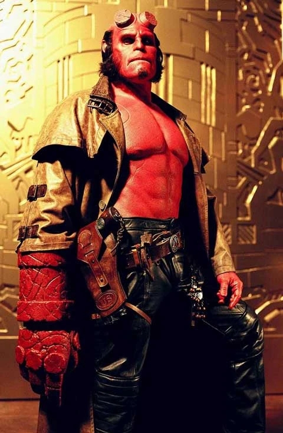 [The 2004 film](/entry/Hellboy_%282004_film%29) directed by [Guillermo del Toro](/entry/Guillermo_del_Toro) helped bring a larger awareness of the character into the public eye, and resulted in the birth of many more fans.

The plot focused primarily on the origin of Hellboy, depicting in a prologue his summoning to Earth by Grigori Rasputin and his rescue from the forces of evil by a young Trevor Bruttenholm. In the modern day, Hellboy is now a paranormal investigator for the Bureau for Paranormal Research and Defense. He finds himself not only having to battle an army of multiplying Sammael creatures which threaten to overtake mankind, but to also face the temptations of the resurrected Rasputin, who has come to finally fulfill Hellboy’s purpose...

The sequel, titled *[Hellboy II: The Golden Army](/entry/Hellboy_II__The_Golden_Army)*, was released in July 2008, and features the return of many cast members such as Ron Perlman, Selma Blair, Doug Jones, Jeffrey Tambor and John Hurt (in a flashback sequence as Professor Trevor Bruttenholm). The film concerns the secret communities of fairy tale creatures (who have been rejected and ignored by an increasingly science-minded humanity), who then start a rebellion against humankind, and the B.P.R.D. is the only hope to stop this growing war.

Early plans were made for a third film, but these never came to fruition.

#### *[Hellboy Animated](/entry/Hellboy_Animated)*

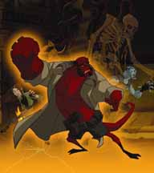 Hellboy has also enjoyed success in animated medium, starring in a series of feature-length animated movies released directly to DVD, and starring the voice talents of the live-action movie’s actors (Ron Perlman, Selma Blair and Doug Jones being the most prominent). To date only two films have been released: *[Hellboy Animated: Sword of Storms](/entry/Hellboy_Animated%3A_Sword_of_Storms)* and *[Hellboy Animated: Blood & Iron](/entry/Hellboy_Animated%3A_Blood_%26_Iron)*, while a third feature titled *Hellboy Animated: The Phantom Claw* was developed but ultimately cancelled. This animated continuity of the Hellboy universe is also expanded on in a short graphic-novella series published by Dark Horse Comics, consisting (so far) of the comic collections *Hellboy Animated: Phantom Legs* (exclusive to the Sword of Storms DVD), *Hellboy Animated: The Black Wedding* and *Hellboy Animated: The Judgement Bell*.

#### [2019 film](/entry/Hellboy_(2019_film))

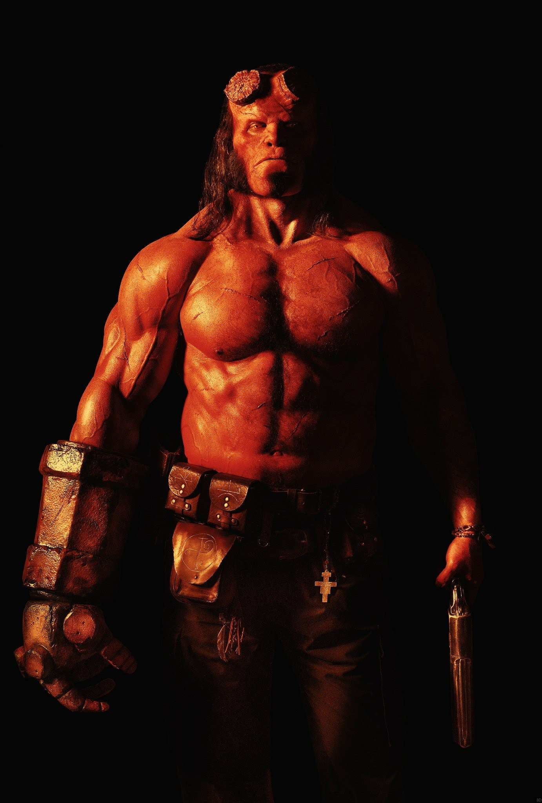 [The 2019 film](/entry/Hellboy_(2019_film)) is an R-rated reboot directed by [Neil Marshall](/entry/Neil_Marshall) and starring [David Harbour](/entry/David_Harbour) as Hellboy (Guillermo del Toro was not offered the full writer-director capacity he had in the first two films, and Ron Perlman refused to return without del Toro's involvement); the film is primarily an adaptation of the *[Darkness Calls](/entry/Darkness_Calls)*, *[The Wild Hunt](/entry/The_Wild_Hunt)*, *[The Storm](/entry/The_Storm)*, and *[The Fury](/entry/The_Fury)* arcs, and features Hellboy combating [Nimue](/entry/Nimue).

David Harbour described the film as a "character piece, and feature mature themes and complicated subjects that will warrant the R-rating", and, to better prepare for the role of Hellboy, has been not only researching the character, but also texting Mike Mignola about his history, as well as what he might think about certain subjects; Harbour has also refrained from imitating Ron Perlman's depiction of Hellboy by depicting him as a "teenager", describing him as "younger, rougher and struggling with the idea of whether or not he's a good person". Mignola also described Harbour's take on Hellboy as "being more dramatic, gritty and emotionally explosive than Perlman's".

For the horned version of Hellboy, makeup designer Joel Harlow decided to make it an "amped up version" of Hellboy's normal look: "we gave him a larger jaw, a heavier brow, more vibrant yellow eyes, larger teeth and, of course, extremely large horns".

#### *[The Crooked Man](/entry/Hellboy__The_Crooked_Man_%28film%29)*

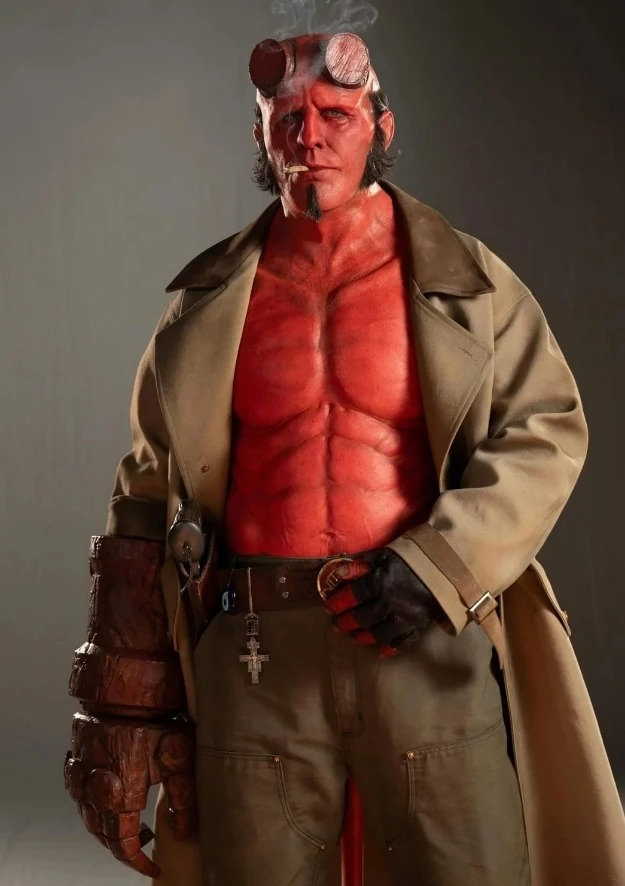 [Jack Kesy](/entry/Jack_Kesy) plays Hellboy in 2024's *Hellboy: The Crooked Man*.

### Video Games

#### *Dogs of the Night* / *Asylum Seeker*

Hellboy stars in the 2000 PC game *[Hellboy: Dogs of the Night](/entry/Hellboy__Dogs_of_the_Night)*, voiced by [David Gasman](/entry/David_Gasman).

In 2003, this game was ported to PlayStation as *Hellboy: Asylum Seeker*.

#### *The Science of Evil*

*[Hellboy: The Science of Evil](/entry/Hellboy__The_Science_of_Evil)* is a 2008 video game released for PS3, Xbox 360, and PSP. Adapted from the 2004 film and released to promote its sequel *The Golden Army*, Ron Perlman provides the voice of Hellboy.

#### *The Stench of Evil*

*[Hellboy: The Stench of Evil](/entry/Hellboy%3A_The_Stench_of_Evil)* is a 2008 game developed for mobile phones.

#### *[Injustice 2](/entry/Injustice_2)*

[Hellboy](/entry/Hellboy_%28Injustice%29) appears in NetherRealm Studios' 2017 game *Injustice 2* as a DLC character voiced by [Bruce Barker](/entry/Bruce_Barker). In his single-player ending, it is revealed that Brainiac had brought him to the DC universe in order to add him to his "special collection", to which Hellboy responds by beating him down. After that, his popularity rises after defeating Braniac, and he is offered positions from numerous individuals but quickly becomes bored, stating that 'it's not his thing'. When he returned back to his universe and the Bureau, it wasn't the same. Hellboy soon decided to retire from his job and takes refuge in Africa.

This iteration of Hellboy also appears in *[Injustice 2 Mobile](/entry/w%3Ac%3Ainjustice%3AInjustice_2_Mobile)*.

#### *[Brawlhalla](/entry/Brawlhalla)*

The Blue Mammoth Games fighting game *Brawlhalla* added several skins designed to resemble *Hellboy* characters as a cross-promotion for [the 2019 film](/entry/Hellboy_(2019_film)). [Hellboy](/entry/Hellboy_%28Brawlhalla%29) appears as an Epic Crossover skin for the character [Cross](/entry/w%3Ac%3Abrawlhalla%3ACross).

#### *[Hellboy Web of Wyrd](/entry/Hellboy_Web_of_Wyrd)*

Hellboy stars in the 2023 Good Shepherd Entertainment video game *Hellboy Web of Wyrd*, voiced by [Lance Reddick](/entry/Lance_Reddick) as one of the actor's final roles.

#### Gallery

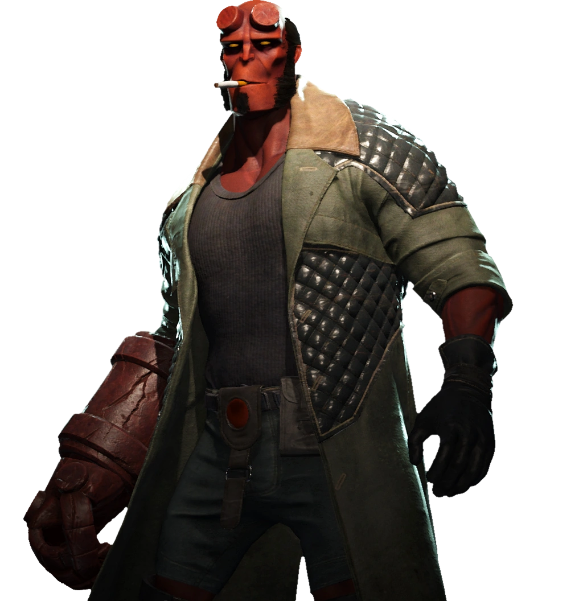

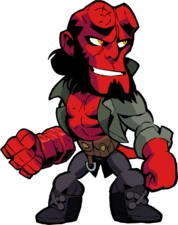

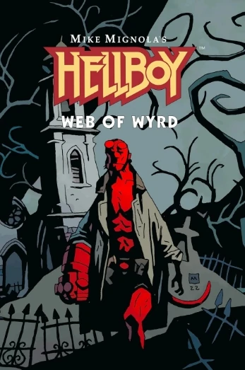

## Behind the Scenes

Hellboy was created by comic artist [Mike Mignola](/entry/Mike_Mignola), and is published in comic books by [Dark Horse Comics](/entry/Dark_Horse_Comics).

The character was well-received by comic readers and critics alike, and the character’s popularity has risen tremendously due to his appearances in other media, most notably the two live-action films [*Hellboy* (2004)](/entry/Hellboy_%282004_film%29) and *[Hellboy II: The Golden Army](/entry/Hellboy_II__The_Golden_Army)*, both directed by [Guillermo del Toro](/entry/Guillermo_del_Toro), a devoted fan of the comic. To date, Hellboy remains Mignola’s most beloved and recognizable creation.

### Pre-history

There are at least five different illustrations that can be considered a "first appearance" of Hellboy, as Mignola refined the character's design and story and he was published in increasingly prominent publications.

The first drawing of a demonic character called "Hellboy" by Mike Mignola was in 1991. Drawn for the '91 Great Salt Lake Comic Convention booklet,[27] the illustration depicts a snarling, muscular demon with "Hell Boy" printed on his belt that bears little resemblance to the final character design. Decades later, Mignola reflected that "I added the Hellboy name at the last minute, and it made me laugh. I wasn't trying to create a character. I just wanted to draw a monster."[28] Another sketch of this prototype-Hellboy character was drawn for a local comic shop owner at the convention.[29]

The first illustration resembling the character "Hellboy" was his next appearance in May 1993,[30] drawn by Mignola for the cover of Italian fanzine *Dime Press* \#4.[31] The character is now recognizably approaching his final design - sporting the recognizable horn stumps, topknot, utility belt, and large irregular stone right forelimb - though he has gray skin and many other details differ from the finalized design. A prototypical B.P.R.D. emblem appears to be attached to his bare chest.

The first narrative comic featuring Hellboy was a four-page story in [*San Diego Comic-Con Comics* \#2](/entry/World%27s_Greatest_Paranormal_Investigator_%28SDCC%29), released in August 1993.[32] [John Byrne](/entry/John_Byrne) scripted the comic, based on a story by Mignola; by this point, Hellboy is a paranormal investigator and his design has been refined further and includes his recognizable trench coat. This comic was produced in black-and-white, and distributed in a small print run primarily to promote SDCC.

The first appearance of Hellboy in a full-length, nationally-distributed comic was in December 1993, in [*John Byrne's Next Men* \#21](/entry/Next_Men__Faith_%E2%80%93_Part_3). This was also his first depiction with red skin.[33] Hellboy appears in a sequence drawn by Mignola, encountered in abandoned subway tunnels by two children who recognize him as a comic book character; he protects them from a monster, disappearing as they find an exit to the surface (at which point Byrne resumes art duties). A *Hellboy* poster had been depicted in this comic several months prior (in *Next Men* issue \#14, April 1993).

The first standalone, self-titled *[Hellboy](/entry/Hellboy_%28series%29)* comic was the four-issue miniseries *[Seed of Destruction](/entry/Seed_of_Destruction)*, which launched March of 1994. Byrne once again scripted this comic, though Mignola would no longer require his assistance after the conclusion of this series.

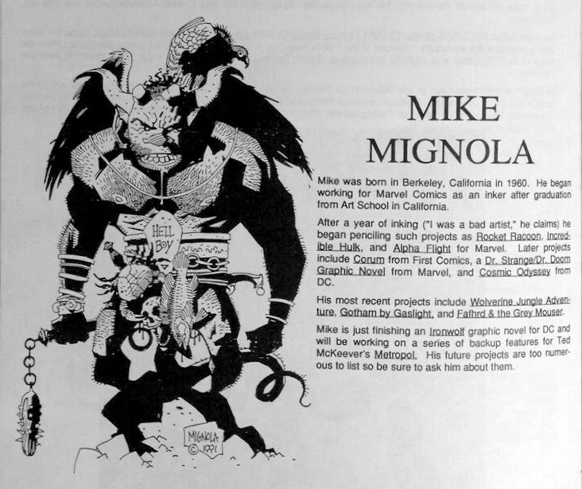

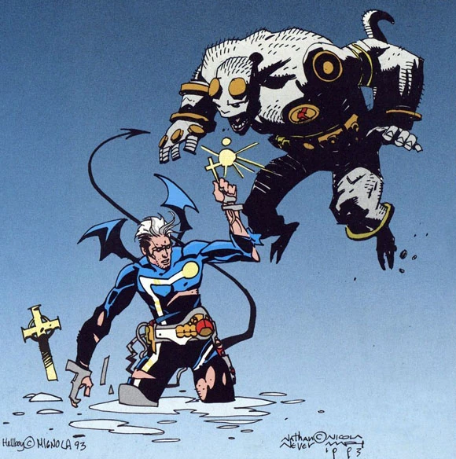

|*Dime Press* \#4 (May 1993)

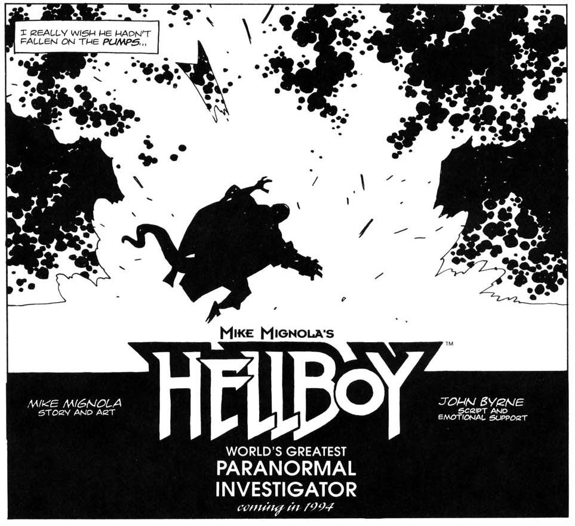

|[*San Diego Comic-Con Comics* \#2](/entry/World%27s_Greatest_Paranormal_Investigator_%28SDCC%29) (Aug 1993)

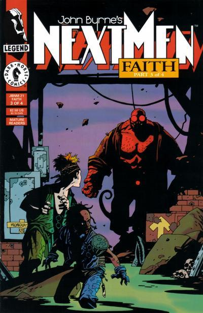

|[*John Byrne's Next Men* \#21](/entry/Next_Men__Faith_%E2%80%93_Part_3) (Dec 1993)

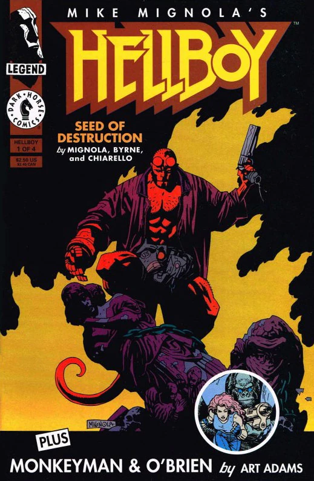

## Trivia

- According to [Mignola](/entry/Mike_Mignola), Hellboy's personality was primarily based off of his father, a worker who often came home with many injuries, but always shrugged them off with dry humor.
- The Hellboy comic books, as well as the general artistic style of Mignola's work, was tremendously influenced by the art of famed comic-book illustrator Jack Kirby, as well as influences by Gustav Dore, H. P. Lovecraft, and even Bram Stoker’s famed novel *Dracula*, which is one of Mignola's favorites.
- Originally, Hellboy was to be a member of a superhero team Mignola conceived, but the artist abandoned the team-concept when he failed to come up with suitable names for the other heroes. This concept would eventually evolve into the *[B.P.R.D.](/entry/B.P.R.D._%28series%29)* series.
- Prior to directing two *Hellboy* films, [Guillermo del Toro](/entry/Guillermo_del_Toro) wrote the introduction to the hardcover edition of the *Conqueror Worm* arc.
- Hellboy's aim with guns is terrible, but his throwing one is perfect.
- Though many believe Hellboy's true name is "Anung Un Rama" (Destroyer of Worlds), his true name is actually "Anung Un Rama, Urush An Rama" (Destroyer of Worlds, Creator of Worlds).
- Hellboy does not have a belly button,[34] likely because he was not "born" in a traditional sense.

## External Links

- [Hellboy/B.P.R.D. Zone](https://www.darkhorse.com/Zones/Hellboy) on the Dark Horse Comics website
- [Hellboy](/entry/wikipedia%3AHellboy) Wikipedia article
 - [Hellboy](/entry/w%3Ac%3Ahero%3AHellboy_%28Hellboy%29) on the Heroes Wiki

## References

<references responsive="0" />

[`pt-br:Hellboy`](/entry/pt-br%3AHellboy)` `

[1]

[2]

[3] [*Hellboy in Hell*](/entry/Hellboy_in_Hell) \#2

[4]

[5]

[6]

[7] *[Seed of Destruction](/entry/Seed_of_Destruction)* \#1

[8]

[9] *Hellboy in Hell* \#3

[10] *[Hellboy: The Companion](/entry/Hellboy__The_Companion)*

[11] *[The Chained Coffin](/entry/The_Chained_Coffin)*

[12]

[13] *[Hellboy: The Crooked Man](/entry/The_Crooked_Man_%28comic_story%29)* \#1

[14]

[15] *[B.P.R.D.](/entry/B.P.R.D._%28series%29): [1947](/entry/1947)* \#4

[16]

[17]

[18] ["Hi, My Name's Hellboy"](/entry/Hi%2C_My_Name%27s_Hellboy)

[19]

[20]

[21]

[22]

[23] *[Box Full of Evil](/entry/Box_Full_of_Evil)* (epilogue)

[24] *[B.P.R.D.](/entry/B.P.R.D._%28series%29) [1948](/entry/1948)* \#5

[25]

[26] *[Wake the Devil](/entry/Wake_the_Devil)* \#5

[27] Johnston, Rich. ["Mike Mignola's First Hellboy From 1991 Sells For $5000 on eBay"](https://bleedingcool.com/comics/mike-mignolas-first-hellboy-from-1991-sells-for-5000-on-ebay/). *Bleeding Cool*. 22 Oct 2019

[28] [Omnibus](/entry/Omnibus_Editions) Volume 1: *Seed of Destruction*

[29] ["Original Hellboy from 1991 by Mike Mignola"](https://www.flickr.com/photos/40432378@N04/9473412545/in/photostream/) on Flickr.

[30] ["When Was Hellboy’s First Appearance? Well…"](https://www.comicsonline.com/2016/01/origins-of-hellboy/). *Comics Online*. 11 Jan 2016.

[31] ["SDCC-Comics \#2 & Dime Press \#4"](https://recalledcomics.com/SDCC-Comics2andDimePress4.php) *Recalled Comics*

[32]

[33]

[34] [*Hellboy and the B.P.R.D.: 1952–1954*](/entry/Omnibus_Editions). Pg. 403. ([Paolo Rivera](/entry/Paolo_Rivera): "I always wondered if Hellboy had a belly button—I have since discovered that he does not.")
