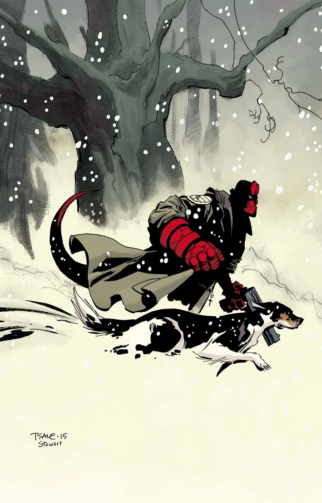
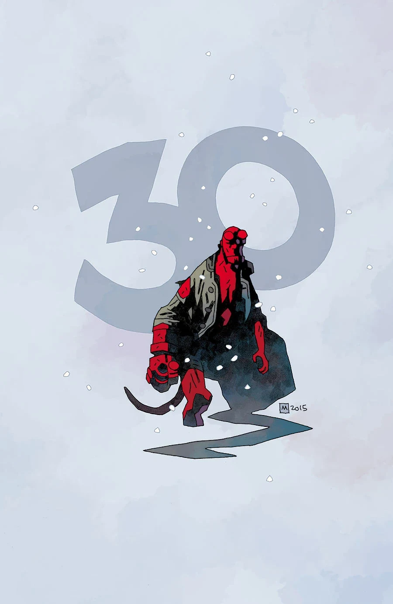
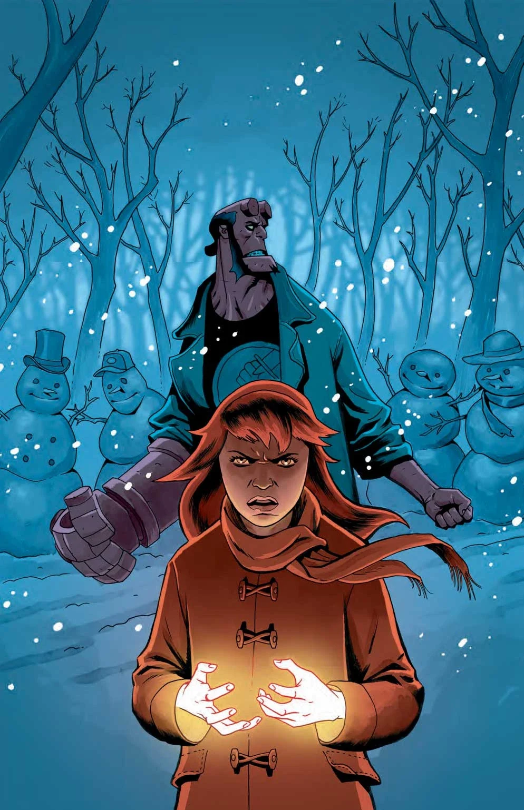
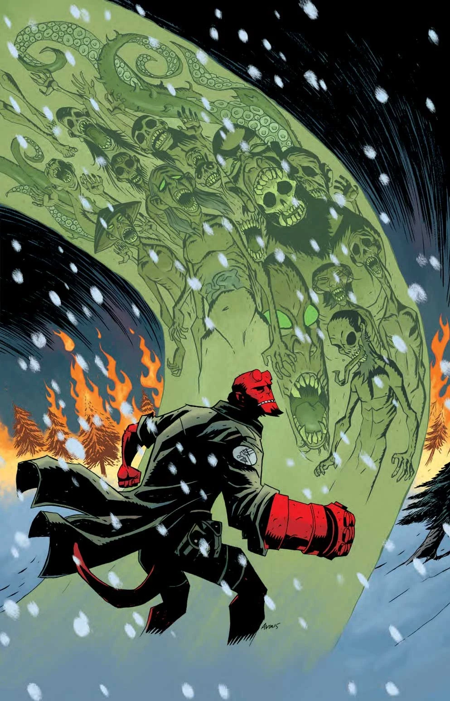

A comic special containing four stories. This comic is the Hellboy Universe debut of Tim Sale, Michael Walsh, Chris Roberson, and Chelsea Cain. This was the first issue of the annual *[Hellboy Winter Special](/entry/Hellboy_Winter_Special)* anthology.

## Solicitation

Best-selling novelist Chelsea Cain writes and Michael Avon Oeming draws the first of three snowbound stories. Then Tim Sale visits Mignola’s prehistoric mythology, and in a lead-in to the upcoming issues of *[Hellboy and the B.P.R.D.: 1953](/entry/Beyond_the_Fences)*, Hellboy explores a haunted mine in the barren wastes of Wyoming.

## Featuring

- *[Broken Vessels](/entry/Broken_Vessels)* written by Mike Mignola and Scott Allie with art by Tim Sale
- *[Wandering Souls](/entry/Wandering_Souls)* written by Mike Mignola and Chris Roberson with art by Michael Walsh
- *[Mood Swings](/entry/Mood_Swings)* written by Chelsea Cain with art by Michael Avon Oeming
- *[Kung Pao Lobster](/entry/Kung_Pao_Lobster)* by Dean Rankine

## Gallery

 Stenbeck variant cover

 Avon Oeming variant cover
