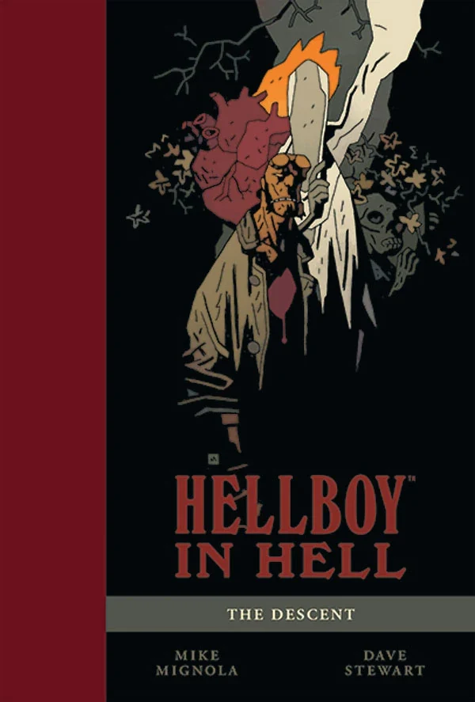
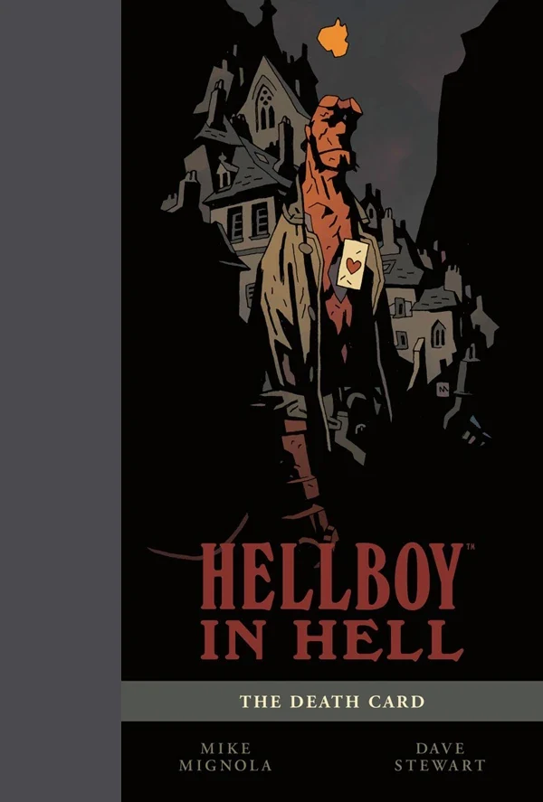

 ***Hellboy in Hell*** is a line of comic books about the character [Hellboy](/entry/Hellboy_%28character%29), a continuation of the original [*Hellboy* series](/entry/Hellboy_%28series%29).

## Publication History

*Hellboy in Hell* began in December 2012 picking up where *[Hellboy: The Fury](/entry/The_Fury)* left off. Unlike the previous series, *Hellboy in Hell* is an ongoing series. The first four issues came out monthly as a part of a single arc, but going forward the series will have a sporadic release date with many arcs only being a single issue in length. Multiple-issue arcs will come out on a monthly schedule though.

*Hellboy in Hell* also marks the return of Mike Mignola as the ongoing artist for the character. He will write and draw all *Hellboy in Hell* stories himself.

In December 2015, Mike Mignola announced *Hellboy in Hell* would conclude at issue 10.

## Numbering

*Hellboy in Hell* is an ongoing series with a clear numbering on its covers. It does not continue the internal numbering of its parent series.

1.  *[The Descent](/entry/Hellboy_in_Hell_%28first_story_arc%29)*
2.  *[Pandemonium](/entry/Hellboy_in_Hell_%28first_story_arc%29)*
3.  *[Family Ties](/entry/Hellboy_in_Hell_%28first_story_arc%29)*
4.  *[Death Riding an Elephant](/entry/Hellboy_in_Hell_%28first_story_arc%29)*
5.  *[The Three Gold Whips](/entry/The_Three_Gold_Whips)*
6.  *[The Death Card](/entry/The_Death_Card)*
7.  [*The Hounds of Pluto* (Part 1)](/entry/The_Hounds_of_Pluto) (also known as *The Trials of Dr. Hoffmann*)
8.  *The Hounds of Pluto* (Part 2)
9.  [*The Spanish Bride*](/entry/The_Spanish_Bride)
10. [*For Whom the Bell Tolls*](/entry/For_Whom_the_Bell_Tolls)

## Unnumbered stories

Following the conclusion of the original run of *Hellboy in Hell*, Mignola returned to the series in 2026, working with other artists, including [Cyrille Pomés](/entry/Cyrille_Pom%C3%A9s) and [Márk László](/entry/M%C3%A1rk_L%C3%A1szl%C3%B3).

> Yes, I too thought *Hellboy in Hell* was a closed book—but a while back I discovered the work of Cyrille Pomés and instantly fell in love with it. We actually met and when he said he'd like to do a Hellboy story, well, how could I say no to that? I still had half an idea for a Hell story rattling around in my head and invited him to flesh that out, so now what you have is a true collaboration on the story and his absolutely wonderful art and storytelling.[1]

- [*Nothing But Blood*](/entry/Nothing_But_Blood)
- [*Parade of Horrors*](/entry/Parade_of_Horrors)

## Collections

### Trade Paperbacks

*see also [Hellboy in Hell Trade Paperback Collections](/entry/TPB)*
 

*Hellboy in Hell* is collected as its own line of trades.

### Library Editions

*see also [Hellboy Library Editions](/entry/Hellboy_Library_Editions)*

*Hellboy in Hell* is collected in a library edition, similar to the *[Hellboy](/entry/Hellboy_%28series%29)* library editions.

### SDCC Exclusive Editions

*Hellboy in Hell* was collected hardcover editions for the San Diego Comic Convention of 2014 and 2016. These editions didn't include any new content, but presented the same material as the trade paperbacks in an oversized deluxe format, released in book design matching the *[Hellboy: The First 20 Years](/entry/Hellboy__The_First_20_Years)* art book.

#
Date Published
Cover
ISBN

<tbody>

1
July 24, 2014
MIKE MIGNOLA
[ISBN 978-1-61655-545-0](/entry/Special%3ABooksources/978-1-61655-545-0)

2
July 21, 2016
MIKE MIGNOLA
[ISBN 978-1-5067-0243-8](/entry/Special%3ABooksources/978-1-5067-0243-8)

</tbody>

## Characters

- [Baba Yaga](/entry/Baba_Yaga)
- [Edward Grey](/entry/Edward_Grey)
- [Hellboy](/entry/Hellboy_%28character%29)
- [Eligos](/entry/Eligos)
- [Satan](/entry/Satan)
- [Astaroth](/entry/Astaroth)
- [Azzael](/entry/Azzael) (flashback & frozen)
- [Sarah Hughes](/entry/Sarah_Hughes) (flashback)
- [Gamon](/entry/Gamon)
- [Lusk](/entry/Lusk)
- [Leviathan](/entry/Leviathan)
- [Amdusias](/entry/Amdusias) (flashback)
- [Vampire of Prague](/entry/Vampire_of_Prague)
- [Izar Hoffman](/entry/Izar_Hoffman)
- [Erinyes](/entry/Erinyes)
- [Gamori](/entry/Gamori)
- [Shax](/entry/Shax) (corpse)
- [Rumael](/entry/Rumael) (corpse)
- [Hellboy's wife](/entry/Hellboy%27s_wife)
- [Beelzebub](/entry/Beelzebub)
- [Pluto](/entry/Pluto)
- [Behemoth](/entry/Behemoth)

[1] [Hellboy returns (to Hell) in new event from creator Mike Mignola — here's a first look](https://www.polygon.com/hellboy-in-hell-nothing-but-blood-announcement)
