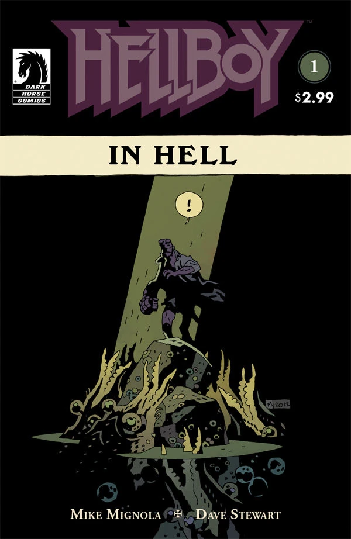
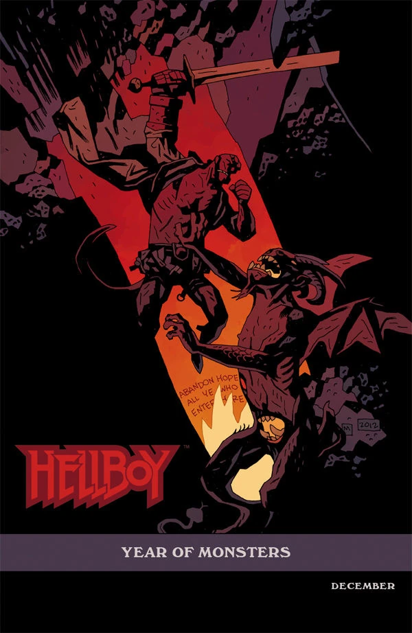
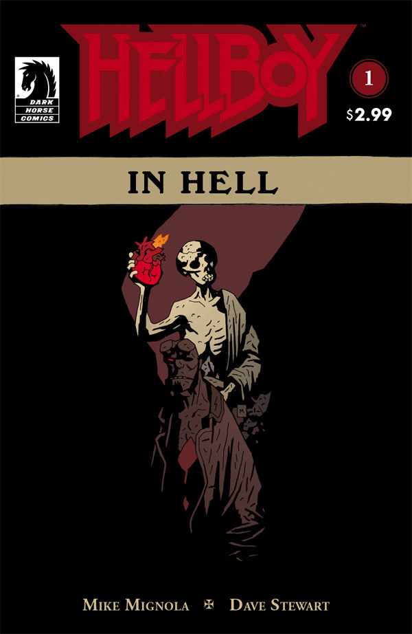
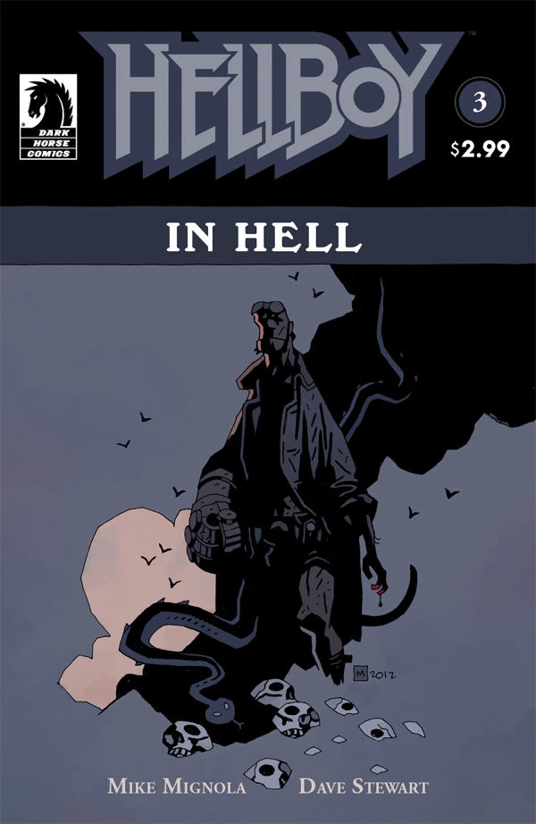

***Hellboy in Hell*** tells the stories of Hellboy's journey through Hell after the events of *[The Fury](/entry/The_Fury)*. This article is about the first story arc of the series, sometimes referred to as "The Descent," the name of the trade paperback collection the first five issues of *Hellboy in Hell.* Officially the arc doesn't have a title, but curiously each individual chapter of the arc does. This form of titling is unique among the various *Hellboy* lines.

## Publication History

This arc marks a major shift for the *Hellboy* stories from the series of miniseries format to an ongoing series. The first four issues of *Hellboy in Hell* are the first arc of the series and came out monthly.

## Synopsis

### Chapter 1: *The Descent*

Though he saved the world in *[The Storm](/entry/The_Storm)* and *[The Fury](/entry/The_Fury)*, Hellboy ends up being killed by a dying [Nimue](/entry/Nimue) as she dragged his heart into Hell with her.

The issue starts with [Edward Grey](/entry/Edward_Grey) talking to [the Baba Yaga](/entry/Baba_Yaga_%28character%29), and stating his wish to save Hellboy and help him shoulder the burdens of his destiny.

Hellboy arrives in The Abyss; a place that isn't quite hell, but is certainly on the way. He is surrounded by giant shrimp-like monsters. Edward Grey arrives, and protects Hellboy from the creatures. However, while Grey is distracted, Hellboy is attacked by [Eligos](/entry/Eligos), the demon bridge guard from Morgan Le Fey's castle who wants revenge for Hellboy killing him in *[The Wild Hunt](/entry/The_Wild_Hunt)*.

Hellboy takes a beating, but eventually Grey comes to his rescue again. After Grey traps the demon, Eligos warns that if Grey sides with his enemy against him, then he will be destroyed. Eligos escapes the trap, but at this point Grey, feeling outmatched, teleports himself and Hellboy to a safe haven, leaving the demon alone in the dark.

At the haven, Grey states that the demon will be pursuing them but his intention is to trap and hopefully destroy Eligos here when he arrives. Hellboy says he remembers seeing Edward Grey (though he doesn't know who he is) at the tower during the events of *[The Fury](/entry/The_Fury).*Grey tells him he's been watching him a long time and hoped they could speak a little, but before they get the chance, Eligos crashes the party again, and Grey ejects Hellboy from the haven to protect him while he fights the demon.

Hellboy tumbles down some stairs, and when he lands, is greeted by a puppet show version of the meeting of Scrooge and Marley from a *Christmas Carol*. A spirit dressed in white arrives. Hellboy asks the spectre if it is The Ghost of Christmas Past, to which the spirit replies "Hardly." The spirit then carries Hellboy off in to the sky.

### Chapter 2: *Pandemonium*

The spirit carries Hellboy away from the cities of Hell and across the Stygian sea to Pandemonium, Satan's great city at the heart of Hell. The spirit reveals that Hellboy need not worry about being attacked here, since all save one of the princes, ministers, dukes, marquis, earls and knights fled Pandemonium with their armies upon hearing that Hellboy was on his way.

Hellboy is then led to the Citadel of the Fly, the beating heart of Pandemonium, where the spirit shows him to his throne, his crown, [his father](/entry/Azzael)'s sword and ring of office, which are rightfully Hellboy's to take. Hellboy refuses these things, to which the spirit shows no surprise.

The spirit then leads Hellboy to the one demon who stayed in Pandemonium; [Satan](/entry/Satan). The spirit tells Hellboy that Satan has been sleeping in the bowels of Pandemonium for two thousand years, alone and unguarded, while Hell was governed by his lesser creatures, and then points out that it would be a simple matter to kill him. The spirit then hands Hellboy a dagger, which then clatters to the floor, soaked in blood. Hellboy asks why the demons ran when they heard he was coming. The spirit avoids the question and suddenly Hellboy is transported to the river Cocytus, where a second spirit greets him.

Hellboy is shown the souls of the common damned, who swim as fish in the river Cocytus to be caught and forged into Hell's soldiers by The Fisher of Souls. The spirit informs Hellboy that this army would be his to command, and that his [Right Hand of Doom](/entry/Right_Hand_of_Doom) is the thing that would breathe life in to this army, that will break down the walls that separate Hell from Heaven and Earth. Hellboy again states that he doesn't want any of it.

A third spirit grabs his arm, and Hellboy is immediately drawn to the place of his birth on October 5th 1617. Hellboy sees his mother, [Sarah Hughes](/entry/Sarah_Hughes) hung on a hook before Hellboy's demon father [Azzael](/entry/Azzael), his uncle [Astaroth](/entry/Astaroth), and two older brothers, [Gamon](/entry/Gamon) and [Lusk](/entry/Lusk). As she burns, a baby Hellboy appears from the flames. His father cuts off the baby's right hand, and a skeletal spirit dressed all in white replaces the removed hand with The Right Hand of Doom.

Hellboy is brought back to the present, where Astaroth is waiting to greet him with the words "welcome home."

### Chapter 3: *Family Ties*

Hellboy's uncle Astaroth tries to convince Hellboy to claim the power he is entitled to, while explaining what happened to Azzael and the place of Hellboy's birth. The other princes discovered that Azzael had the hand and that Hellboy had been born, so they evoked angels of destruction to bring ruin to the family. They were too late, however and before they could be destroyed Azzael sent Hellboy away, to be inadvertently brought to Earth by [Rasputin](/entry/Rasputin) or the ghosts of his human siblings during the opening events of [Seed of Destruction](/entry/Seed_of_Destruction).

He further explains that as a punishment for creating Hellboy, Azzael was stripped of all of his power and imprisoned in ice forever. Hellboy asks Astaroth "Why me?" It is at this moment that Azzael's other sons (but not his [daughter](/entry/Gamori), who declined to come) arrive. They both feel more worthy of Hellboy's throne and power, and Astaroth reveals that he is tired of waiting for Hellboy to claim his birthright. The brothers attack Hellboy, trying to kill him so they can claim the Hand for themselves. The fight is hard, and Astaroth reveals that whichever brother claims the Hand, he will be there to guide them. He then says it would be better that Azzael had died than see Hellboy as he is now.

Gamon pipes up at this point, saying that Azzael was an old fool, for picking Hellboy over him, to which Astaroth takes exception and promptly cuts off Gamon's head, for showing a lack of respect. Lusk expresses his shock at Astaroth's actions, and Astoroth calls him weak. After a final attempted manipulation, [Leviathan](/entry/Leviathan), an enormous dragon like demon bursts from the ice beneath Astaroth, Gamon and Lusk and eats them all.

The small flying demon who helped Hellboy in his battle against Eligos at the bridge in *The Wild Hunt* appears and tells Hellboy that Astaroth and Leviathan had some old grudge, which is now settled. The demon expresses his annoyance that Hellboy couldn't keep his promise to remember the demon's help when he came in to his kingdom, because there is no kingdom. The demon then tells Hellboy somebody had stolen in to Satan's chamber and cut his throat.

We then see Hellboy entering Satan's chamber, and once again, the bloody blade clattering to the ground. Hellboy has no recollection of these events. The small demon tells Hellboy that now Satan is dead and Pandemonium is a tomb, Hellboy is not important anymore. With this, Hellboy is returned to the Abyss.

### Chapter 4: *Death Riding an Elephant*

Hellboy is floating in The Abyss, until Edward Grey brings him via magic through a mirror in to his home in Hell. Edward reveals that he trapped Eligos, back where they fought, hopefully forever.

Hellboy is drawn to a painting in the room they are in called "Death Riding an Elephant." Hellboy recalls seeing it on his first trip to London, when he went to a now burned down pub in Whitechapel, where Edward used to conduct his business. Edward says he couldn't bear to let the painting burn, so he brought it back here. At this point Hellboy makes the connection, and realises he is talking with the legendary Edward Grey.

Hellboy asks how Grey ended up in Hell if he was one of the good guys, to which Grey responds that life isn't always fair, and that Hellboy should understand that better than most. Grey tells Hellboy that he knows he killed Satan, and that it doesn't matter that Hellboy doesn't want or need to remember performing the deed, just that it was done.

Grey then recounts how he came to disappear in 1916 and end up in hell. After breaking up a [Heliopic Brotherhood of Ra](/entry/Heliopic_Brotherhood_of_Ra) ritual to summon the demon [Amdusias](/entry/Amdusias), one of the greater dukes of hell, the half summoned creature dragged Edward back to hell with him, cursed him to live forever, and then tore him to pieces and scattered him along the rocks on the banks of the Acheron.

He was stitched back together by strange creatures who lived in those rocks, and now lives in the shape they remade him. His early regret for his fate has now faded, since he has seen amazing things in his long life.

The house they have been talking in, is revealed to be the house of a warlock called [Angus Weir](/entry/Angus_Weir), who sold his soul, but sought to cheat his masters out of their prize. They snatched him up in his house and brought it to hell. Weir died, repenting his evil actions and inscribing the house with runes that would prevent any demon from entering. The fact Hellboy is allowed inside stands as testament to the fact that he is much more than just a demon.

Hellboy states that no, he is just the dead version of whatever he was, but Grey tells him to consider the fact that in death, he is finally free, and that there is nobody left who wants his right hand. Hellboy seems to accept this and leaves.

Grey then talks to what appears to be the spirit of Angus Weir, who accuses him of lying to Hellboy about the fact that he is free. Hellboy is still bound to do three more things at least, though Grey says he will take the first of these burdens upon himself, despite the damning cost to himself, and expresses hope that the other things will be a long way off yet, to allow Hellboy to have his time and feel free for a while.

## Gallery

Covers by [Mike Mignola](/entry/Mike_Mignola).

 \#1

 \#1 variant

 \#1 reprint

 \#2

 \#3

 \#4

[pt-br:Hellboy in Hell (primeiro arco da história)](/entry/pt-br%3AHellboy_in_Hell_%28primeiro_arco_da_hist%C3%B3ria%29)
