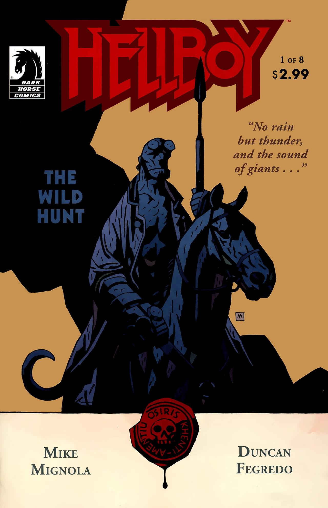
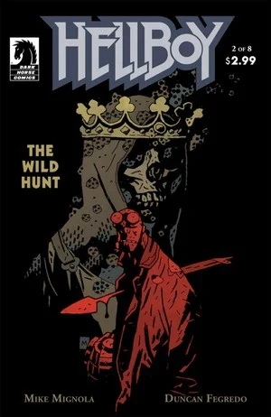
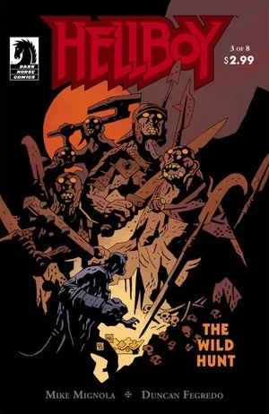
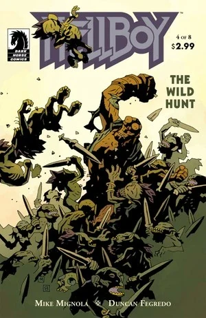
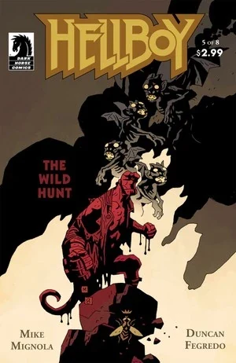
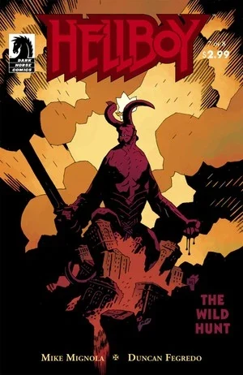
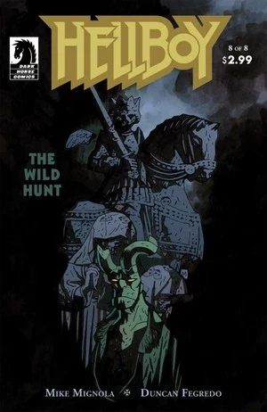

In ***The Wild Hunt***, [Hellboy](/entry/Hellboy) is called back to England by the [Osiris Club](/entry/Osiris_Club), is reunited with [Alice Monaghan](/entry/Alice_Monaghan), and learns more about his origin and destiny. Meanwhile [Gruagach](/entry/Gruagach) raises the [Queen of Blood](/entry/Queen_of_Blood) and she begins to raise her army and prepare for war.

## Publication History

*The Wild Hunt* was published as an eight-issue miniseries. It was released in two four-month blocks from December 2008 to March 2009, then from August to November 2009.

Issues \#2–7 each contained a six-page backup story;

- *[How Koshchei Became Deathless](/entry/How_Koshchei_Became_Deathless)* in issues \#2–3
- *[Baba Yaga's Feast](/entry/Baba_Yaga%27s_Feast)* in issue \#4
- The [MonsterMen](/entry/MonsterMen) in *O Sinner Beneath Us!* in issues \#5–6
- [Henry Hood](/entry/Henry_Hood) in *[The Burial of Katharine Baker](/entry/The_Burial_of_Katharine_Baker)* in issue \#7

## Synopsis

### Part One

Following the events of *[Darkness Calls](/entry/Darkness_Calls)*, [Hellboy](/entry/Hellboy) has been in Italy, with the two Capobianco sisters. While there he dreams.

Hellboy is in a clearing watching the funeral of King [Dagda](/entry/Dagda). He is told that Dagda was the last king of the Tuatha de Danann, and that soon all of his kind will leave the world forever. Hellboy sees [Alice Monaghan](/entry/Alice_Monaghan), who last appeared as a baby in *[The Corpse](/entry/The_Corpse)*, but wakes up.

The sisters give Hellboy a letter, and we see that the sister, like [Harry Middleton](/entry/Harry_Middleton) from *[Darkness Calls](/entry/Darkness_Calls)*, are in fact dead. The letter is from the [Osiris Club](/entry/Osiris_Club), and Hellboy promptly heads back to England. In a ruined building he meets three men from the club. They say it has been hard keeping track of him, and briefly recount his adventures from *[The Island](/entry/The_Island)* to *[Darkness Calls](/entry/Darkness_Calls)*. They tell Hellboy that from time to time giants rise from their graves and that a hunt is setup to kill them again. This time six have appeared. They invite Hellboy to join them on the hunt, and he agrees.

Elsewhere in England, [Gruagach](/entry/Gruagach) has taken the box to the top of a hill in the midst of the fey creatures. He says that when the time is right the Queen will speak to the assembled army and gather a great host.

The hunt charges out on horseback to a bridge. One of the men in the hunt impales Hellboy on a spear and he tumbles into the river. The hunt master tells Hellboy that he should not have returned, and that a Demon will never sit on the throne of England. He then activates the spear and it electrifies Hellboy.[1]

### Part Two

Hellboy lies impaled in the river bank. He yells out in pain and suddenly finds himself in a room full of dead knights. In the center sits a figure with a crown on his head and a red dragon on his mantel.

Hellboy wakes up in the river surrounded by the hunters now dead. A bird tells him that he was made invisible by a flower from the bird's mistress. Hellboy travels back to the giants, throws down the flower and attacks the giants.

[Gruagach](/entry/Gruagach) is approached by [Astaroth](/entry/Astaroth), in the guise of an old man. Astaroth asks him why he is in the form of a boar. Gruagach tells his story including the events of *[The Corpse](/entry/The_Corpse)*. Astaroth gives him a covered gold cup filled with the blood of an entire village. Gruagach pours the blood into the box, and a blood covered woman rises out.

### Part Three

[Hellboy](/entry/Hellboy) travels to [Alice Monaghan](/entry/Alice_Monaghan)'s house in Ireland. Alice says that she started to see the fairies again. Hellboy says that he meant to come sooner after [Dagda](/entry/Dagda)'s funeral, but that he ran into trouble. Alice says that they have to go meet someone.

The woman sits on the box that once held her body. A witch approaches her and tells the Queen that the witches are hiding until they know what she will do. The Queen harms two witch who betrayed her, and forgives all other witches for leaving her in the box. She calls for an army of forgotten peoples to rise with her.

Hellboy and Alice travel to meet with Queen [Mab](/entry/Mab). Alice tells Hellboy that there is going to be a war. She explains that it is Hellboy's fault because he wronged [Gruagach](/entry/Gruagach), destroyed [Hecate](/entry/Hecate), and refused to be king of the witches, so that Gruagach raised a new queen. Mab appears and tells them that the new queen of witches only wants war and bloodshed. She explains that while on *[The Island](/entry/The_Island)* the dead man took his blood and became the thing Hellboy was meant to be. Hellboy was sent to destroy the world, even if he rejects it. Mab says he cannot escape it, but his only chance is through his mother, and that he is bound to wear a crown and raise an army to oppose the [Queen of Blood](/entry/Queen_of_Blood). A small creature appears as the issue ends.

### Part Four

[Hellboy](/entry/Hellboy) remembers back to the hunt when he slaughtered the giants and in the moment his horns grew back.

The creature introduces himself as Edmund and leads [Alice](/entry/Alice_Monaghan) and Hellboy between the worlds. On the way Alice asks Hellboy what it was like to be dead, but Hellboy does not really have an answer. Edmund asks Hellboy about a goddess who one lived under a tree in Leicestershire. Hellboy killed the creature in 1962 and her followers, small men, rise from the ground and attack Hellboy. Edmund calls Hellboy murderer and asks how many beings of power he has killed. The little men throw small poison spears and one hit Alice in the hand. Three birds arrive and scare away the creatures. The birds transform into three women say that their lady has medicine that can help and transport them to the outside of a castle surrounded by a moat of fire.

### Part Five

[Gruagach](/entry/Gruagach) sits with his head resting in the [Queen of Blood](/entry/Queen_of_Blood)'s lap. She sees that her army is beginning to assemble. Gruagach says that he could serve her better if he was restored to his former power. She says that when the time is right he will be strong again and [Hellboy](/entry/Hellboy) will be his.

The bird women tell Hellboy that the castle has been under siege by demons for five hundred years. Hellboy goes to defeat the [demon guarding the bridge](/entry/Eligos). The demon throws Hellboy around, until one of the lesser demons in the moat of fire tells Hellboy his secret. Hellboy cracks the demon's ring and the assembled legions disappear.

Once inside an old man gives [Alice](/entry/Alice_Monaghan) a cup of medicine. Helboy turns around to see the lady of the castle, [Morgan Le Fey](/entry/Morgan_Le_Fey).

The Queen of Blood greets an ambassador from Jutland. He says that on the day of battle his king will fight at her side, and gives her a crown. She orders the ambassador to hammer the crown into a knife to kill his king and to make her an iron helmet in the form of three ravens. She says she will be known not as the Queen of Witches but as Goddess of War.

### Part Six

[Hellboy](/entry/Hellboy), [Alice](/entry/Alice_Monaghan) and [Morgan Le Fay](/entry/Morgan_Le_Fey) sit at a table and talk. Morgan asks Hellboy if he knows who she is. Hellboy answers that Morgan is King Arthur's half-sister, and mother of Arthur's only son, Mordred. Mordred and Arthur killed each other in battle, and Arthur's remaining knights killed Mordred's three sons. However Mordred also had a daughter, and she lived producing a line of daughters, witches all. Morgan says that the final daughter was Sarah Hughes, Hellboy's mother. She explains that Hughes married the demon [Azzael](/entry/Azzael) in 1574, and though she tried to repent on her deathbed, (as seen in [The Chained Coffin](/entry/The_Chained_Coffin), her human children were killed and only Hellboy remains as the heir to King Arthur and rightful King of Britain.

Morgan takes Hellboy through a door and into a hilly meadow. In the center in a small pool lies a sword in a stone. She tells him that because he died and lived again the noble dead of Britain will follow him into battle.

Hellboy asks who the [Queen of Blood](/entry/Queen_of_Blood) really is. Morgan explains that she is Vivienne, also called [Nimue](/entry/Nimue), who charmed Merlin and took his power. She heard the call of the [Ogdru Jahad](/entry/Ogdru_Jahad) and it drove her mad. The other witches killed her, but now she lives again, and only wants blood.

Hellboy has a flashback to when he killed the giants. He sees his potential to become the beast of the Apocalypse, but breaks off his horns denying that path. She tells him that with the sword he can save his people. Hellboy asks Morgan, now clearly a dead corpse, why she cares about the world. She responds that her son, Mordred, should have been king, but that Hellboy will be.

### Part Seven

Hellboy walks through [Morgan](/entry/Morgan_Le_Fay)'s castle thinking about what he has learned. He enters [Alice](/entry/Alice_Monaghan)'s room only to see [Vasilisa](/entry/Vasilisa) standing beside Alice sleeping. Vasilisa admonishes Hellboy to be careful. Alice wakes up and asks Hellboy about the sword Excalibur, and why Hellboy did not take it. She asks him if something happened before he came to her house. He remembers the giants, but says nothing. Alice tells Hellboy about her dream. She stood in a room of noble knights waiting, in the center King Arthur stood and told her that she was bound to the sword and that she would be the first to see the new king crowned. She tells Hellboy that all will be ok if he takes the sword.

Hellboy hears howling and leaves Alive. [Astaroth](/entry/Astaroth) appears and tells him it is the wild hunt. The Demon mentions that some think [King Vold](/entry/King_Vold) rides at its head. Hellboy replies that some say it is the Devil, but Astaroth says Satan has been asleep for almost two thousand years. He tells Hellboy that one day he will travel to Hell, kill Satan and claim the crown of Hell. He will take up his father's sword and lead the army of Hell. He will break down the walls of Hell and create a paradise for them on earth.

Hellboy's shadow grows telling him that all this will happen. The shadow wears the crown of Hell and bears the sword of Hell. Hellboy fights his shadow, all the while Astaroth tells him he must take up [Excalibur](/entry/Excalibur) to prevent [Nimue](/entry/Nimue)'s holocaust of blood, and that the one sword will lead him to the other. His shadow grows to enormous size and beats Hellboy. Suddenly fire shoots out of Hellboy and in an instant Astaroth and the Shadow are gone. The fire disappears and Hellboy stands in the smoldering castle.

### Part Eight

[Hellboy](/entry/Hellboy) walks through the smoking castle looking for [Alice](/entry/Alice_Monaghan). He enters her room to see her smoking corpse in what is left of her bed. [Vasilisa](/entry/Vasilisa) appears again and asks why he did not pull out the sword. Hellboy tells her he is afraid of his own love of bloodshed. Vasilisa responds that Alice believed the sword would save him. Slowly Hellboy approaches the sword. Many creatures from Hellboy's past look on. [Mab](/entry/Mab) comments that [Dagda](/entry/Dagda) should have lived to see this. [Astaroth](/entry/Astaroth), [Sir Edward Grey](/entry/Sir_Edward_Grey), [Mohlomi](/entry/Mohlomi), [the Baba Yaga](/entry/Baba_Yaga_%28character%29) and [Koku](/entry/Koku) all look on as Hellboy pulls the sword from the stone.

Suddenly Hellboy stands, sword in hand, with Alice. She remembers nothing of their trip to Morgan's castle. Morgan sits at a table with playing pieces on it. Two skeleton armies face each other one black one white with a red figure in the center.

The [Queen of Blood](/entry/Queen_of_Blood) challenges Hellboy saying that even with the sword he is no match for her. [Gruagach](/entry/Gruagach) asks to be restored to his former power but says that she cannot do it. Enraged she rejects him and throws him out of the camp.

The members of the [Osiris Club](/entry/Osiris_Club) stand around a crystal ball watching Hellboy. Two try to call the Prime Minister but are shot by other members. The men explain that they are the original seven members from the club's founding in 1866 when [Larzod](/entry/Larzod) appeared to them and told them to await the coming of a king. In the end they plan to cut off his right hand and use it elevate themselves. The original seven kill the remaining 'new' members.

In the mountains the sound of hammers are heard. A King is dead stabbed by a jeweled knife. A short man hammers at a mighty forge. Crying he lifts a helmet in the form of three ravens.

## Symbolism

### Reverse Communion

The revival of the [Queen of Blood](/entry/Queen_of_Blood), in part two, is a sort of reversal of the Christian ritual of communion. [Astaroth](/entry/Astaroth) brings the blood in a Ciborium, a covered goblet traditionally used as part of communion. In Christian tradition, Jesus freely gave his blood to save humanity. Christians symbolically drink his blood as part of celebrating that salvation. Here, a Demon murders an entire town and takes their blood to revive the Queen. While Christ gave his blood to grant eternal life and peace, the Queen of Blood took the blood of others to bring death and war.

### The Kingdom

While fighting on the bridge, in part five, a lesser demon offers to help Hellboy but says "remember me—when you come into your kingdom." This is a reference to the Gospel of Luke 23:42. While Jesus is on the cross two criminals are also being crucified. One mocks Jesus, but the other rebukes him saying that they as criminals deserve their punishment, but that Jesus is innocent. The criminal ask Jesus, "remember me when you come into your kingdom."[2]

Previously, in *[Darkness Calls](/entry/Darkness_Calls)* \#6, [Igor Bromhead](/entry/Igor_Bromhead) also asked Hellboy to remember him when he leads the army of hell.

## Content

### Characters

#### General

- Mailman
- [Hellboy](/entry/Hellboy_%28character%29)
- [Alice Monaghan](/entry/Alice_Monaghan)
  - Mr. and Mrs. Monaghan (Photographs)
- Capobianco Sisters
- [Osiris Club](/entry/Osiris_Club) Members
- [Harry Middleton](/entry/Harry_Middleton) (Flashback)
- [Trevor Bruttenholm](/entry/Trevor_Bruttenholm) (Photograph)
- Wild Hunt Members
  - Richard Ashtree
- Herne (Mural)
- Giant Slug
- [King Arthur](/entry/King_Arthur)
- [Koshchei](/entry/Koshchei_%28character%29) (Flashback)
- [Sarah Hughes](/entry/Sarah_Hughes)'s Children (Flashback)
- [Ogdru Jahad](/entry/Ogdru_Jahad)
- [King Vold](/entry/King_Vold_%28character%29)
- [Vasilisa](/entry/Vasilisa)
- [Edward Grey](/entry/Edward_Grey)
- [Mohlomi](/entry/Mohlomi)
- Russian Representation of Death[3]

#### [Demons](/entry/Demon), [Witches](/entry/Witches) & [Wizards](/entry/Witches)

- [Demons](/entry/Demon)
  - [Astaroth](/entry/Astaroth)
  - Little Demons
  - [Eligos](/entry/Eligos)
  - [Azzael](/entry/Azzael) (Vision)
  - Old Spaniard (Former Priest)
- [Witches & Wizards](/entry/Witches)
  - [Nimue](/entry/Nimue)
  - Helaine
  - Ganeida
  - [Bog Roosh](/entry/Bog_Roosh) (Vision)
  - [Igor Bromhead](/entry/Igor_Bromhead) (Flashback)
  - [Morgan Le Fay](/entry/Morgan_Le_Fay)
    - Bird Ladies
  - [Sarah Hughes](/entry/Sarah_Hughes) (Flashback)
  - [Baba Yaga](/entry/Baba_Yaga_%28character%29)
    - [Koku](/entry/Koku)
  - [Rasputin](/entry/Rasputin) (Vision)
  - [Hecate](/entry/Hecate) (Vision)
  - Other Witches

#### [Daoine Sidhe](/entry/Daoine_Sidhe)

- [Dagda](/entry/Dagda)
- [Giants](/entry/Giant)
- Hedgehog
- [Gruagach](/entry/Gruagach)
  - [Graugach's](/entry/Gruagach) Lover (Flashback)
- [Grom (Fomorian)](/entry/Grom_%28Fomorian%29)
- [Queen Mab](/entry/Queen_Mab)
- "Edmund Duke of Gloucester"[4]
- Black Annis (Flashback)
- Black Annis's people
- Unnamed Goblin with Pipe
- Other Daoine Sidhe
- Ambassador from King Undvik

### Locations

- Italy
  - Capobianco Sisters' House
- England
  - Wild Hunt's Meeting Place
  - [Harry Middleton's](/entry/Harry_Middleton) House (Flashback)
  - [Morgan Le Fay's](/entry/Morgan_Le_Fay) Castle
- Island off the Coast of Portugal (Flashback)
  - Castle (Flashback)
- Ireland
  - Monaghan Residence
- [Hell](/entry/Hell)
  - [Pandemonium](/entry/Pandemonium_%28location%29)
- The Elsewhere
- [Yggdrasil](/entry/Yggdrasil)

### Noteworthy artifacts

- Blood Chalice
- "House of the Fly" Ring
- [Excalibur](/entry/Excalibur)
- [Nimue's](/entry/Nimue) Helmet

## Gallery

All covers by [Mike Mignola](/entry/Mike_Mignola).

 \#1

 \#2

 \#3

 \#4

 \#5

 \#6

 \#7

 \#8

## Notes

<references/>

[1] A similar spear was seen in *[Dr. Carp's Experiment](/entry/Dr._Carp%27s_Experiment)*

[2] Luke 23:42, New International Version

[3] *According to Duncan Fegredo (Hellboy Book Club Episode 21 - Hellboy: Darkness Calls 1:48:05)*

[4] *"Hob Noggins" in the Sketchbook*
