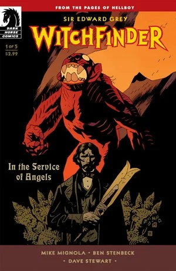
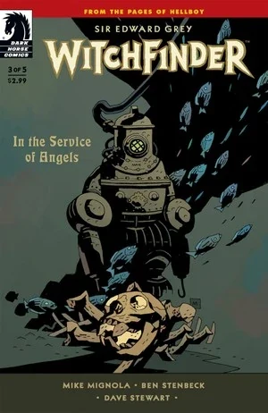
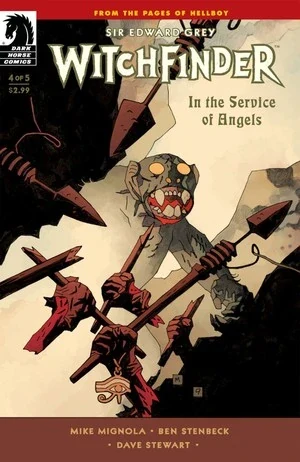
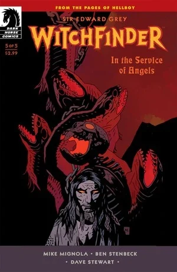

***In the Service of Angels*** is a five-issue miniseries published from July to November 2009. It is the first *[Witchfinder](/entry/Witchfinder)* miniseries.

## Synopsis

### Part One

In London of 1879, [Edward Grey](/entry/Edward_Grey) is investigating a series of grisly murders where the victims appear to be mauled. He visits with Lord Wellington who has a connection with each of the victims.

Lord Wellington has been part of an expedition to an old [Hyperborean](/entry/Hyperboreans) city, possibly Urrasan or Hypos. Deep underground in the ruins they found a complete skeleton of a [creature](/entry/Servants_of_the_Left_Hand) that was similar to a man. They decided to take the skeleton back to England.

Soon after, expedition members began to die of mysterious causes. The two surviving members of the expedition realized it was related to the skeleton and hired a laborer to dispose of it.

Lord Wellington suddenly stops speaking as he tries to remember the laborer's name. Grey turns to see Lord Wellington's desiccated corpse, with the creature perched above it.

Grey is attacked by the creature but is able to hold it off after he picks up a Hyperborean blade from Lord Wellington's collection. He commands the creature to speak its name, but instead Wellington's corpse utters the name Donald Blackwood.

The creature flees and Grey gives chase. He shoots the creature, though it seems to have no effect, and the creature fades away into mist.

Grey seeks to find Blackwood, but he is not listed in the London registry. A mysterious messenger then delivers a card with Blackwood's name and address. Despite the fact the address is in the notoriously rough East End, Grey insists on visiting the address, only to find a dismembered corpse inside.

### Part Two

Still at the scene of the murder in the East End, Grey is approached by Robert Salt. He tells Grey that he has information about the murders and asks that Grey follow him alone. Salt leads Grey to the Captain, a man who has had his eye on Grey for a long time.

While knowing much about Grey's past, the Captain does not seem to know anything additional about the murders, but he offers to bring Grey to someone who can help. He leads Grey to Mary Wolf, a medium whom through her spirit guide, Zora, can speak to the recently departed.

Mary closes herself into a closet and uses her life energy to summon forth Zora. Grey is unsure whether to trust Zora, believing she is perhaps an agent of the devil. He insists on looking into the closet, where he sees Mary, her body looking much like Wellington's after the creature attacked him. Zora tells Edward that he labors in the service of angels, to beware due to the fate of those that do, and that a phantom walks behind him with the name Archeron written on its brow.

Zora then calls forth Blackwood, who was the laborer hired to dispose of the bag. He states he threw it in the river. At that instant the creature bursts in and attacks.

### Part Three

The creature is much larger and apparently more powerful. It kills Salt and attacks the closet with Mary inside. Once again Grey is able to drive it off using the Hyperborian blade. Mary believes it attacked her because she knows where its bones lie in the river.

While waiting for a crew to retrieve the bones, Grey surmises that the creature initially fed off its victims life energy until it was able to take physical form. It also seems to be targeting those that know its origin or where its bones may be.

The crew is able to bring up the bones and Grey is immediately approached by a representative of the [Heliopic Brotherhood of Ra](/entry/Heliopic_Brotherhood_of_Ra) who offers to buy them. Grey refuses and the representative leaves with a warning.

Unsure of where to go to next, Mary has a feeling they should visit the Church of the Inner World. Upon entering they find the entire congregation seated in the pews, dead and drained of blood. They find Reverend Blum in a back room, still alive.

Blum explained that the creature had appeared to Blum, who mistook it for an angel. The creature had been a slave of those Hyperborians that had fled underground. After the slaves rose up a slaughtered the Hyperborians, the creature had made its way to the surface where it was killed by primitive man. The creature arose again, this time undead. Presently, the creature would visit Blum's congregation when weakened and they would provide of their life's blood to help it grow stronger. Finally, it drained them completely.

Asked where it was, Blum said it was in the cellar.

### Part Four

A [horrific monster](/entry/Servants_of_the_Left_Hand) rampages through the streets of Victorian London, but not everyone wants to see the menace dead. The Heliopic Brotherhood of Ra wishes to capture the creature for their own dark purposes, and if Edward Grey is to have any hope of killing the beast before it falls into their hands, he'll have to seek aid in the most unlikely of places—a lunatic asylum.

### Part Five

Deep inside an asylum, Edward Grey faces a final confrontation with the mysterious beast that has been terrorizing the streets of Victorian London. Grey learns that sometimes you must use the devil's own tools to fight him when he meets up with the young [Memnan Saa](/entry/Memnan_Saa).

## Gallery

All covers by [Mike Mignola](/entry/Mike_Mignola).

 \#1

 \#2

 \#3

 \#4

 \#5
