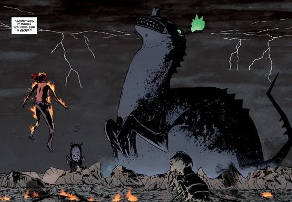
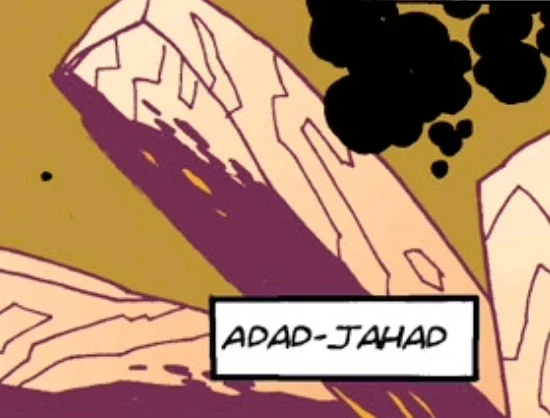
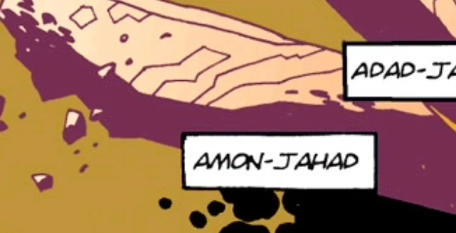
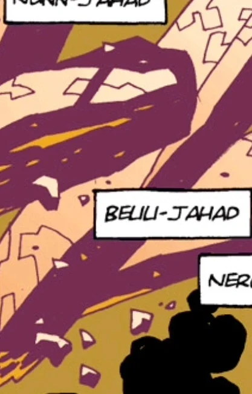
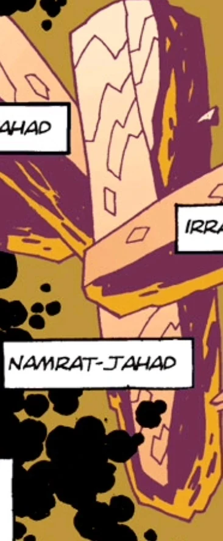
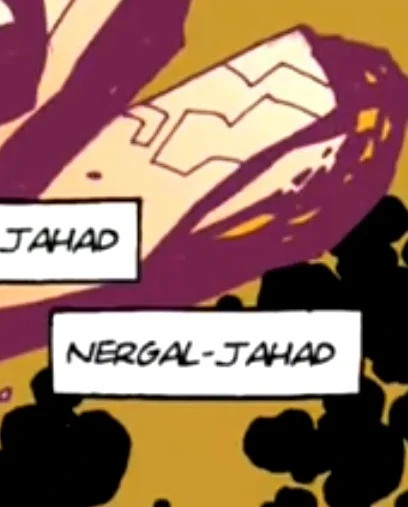

The **Ogdru Jahad**, also sometimes called the Ogdru eb Jurhad[1], are monstrous supernatural entities and main antagonists in Mike Mignola's *Hellboy* comic book series. They are the Dragon from the Book of Revelation and are destined to bring about [Ragnarok](/entry/Ragna_Rok_%28event%29), the end of the world.

Alongside Grigori Rasputin, they and their progeny are arguably Hellboy's archenemies. They were imprisoned in golden cocoons by the [Right Hand of Doom](/entry/Right_Hand_of_Doom) shortly after the creation of Earth, but not before they spawned 369 children, known as the [Ogdru Hem](/entry/Ogdru_Hem). They are the main antagonists of the Hellboy series.

## Overview

Mostly inspired by the [Great Old Ones](/entry/%3Awikipedia%3AGreat_Old_One) of [H. P. Lovecraft's](/entry/%3Awikipedia%3AH._P._Lovecraft) [Cthulhu Mythos](/entry/%3Awikipedia%3ACthulhu_Mythos) (with overt ancient Egyptian and Babylonian influences as well), the Ogdru Jahad are titanic primordial draconic entities which once resided on Earth. They are listed as follows:

- *[Adad-Jahad](/entry/Adad-Jahad)*
- *[Amon-Jahad](/entry/%E5%A5%A5%E5%8F%A4%C2%B7%E6%A1%80%E5%93%88))*
- *[Beuu-Jahad](/entry/Beuu-Jahad)*
- *[Irra-Jahad](/entry/Irra-Jahad)*
- *[Namrat-Jahad](/entry/Namrat-Jahad)*
- *[Nergal-Jahad](/entry/Nergal-Jahad)*
- *[Nunn-Jahad](/entry/Nunn-Jahad)*

Although introduced in [*Seed of Destruction*](/entry/Seed_of_Destruction), the true appearance of the Ogdru Jahad was always withheld, merely showing their opaque crystalline prisons floating in the void of deep space. Thus, many icons of worship dedicated to them used archetypal emblems of serpents or dragons, often with seven heads. It wasn't until [*The Island*](/entry/The_Island) that their designs were revealed.

The seven Dragons are similar in shape and size. They have wingless, stocky, dinosaur-like bodies with thin, almost stunted forelimbs. Their most distinct features being their unique head shapes and ornamentation (horns, fins, etc.). Floating above their heads are eerie crowns of green flame. Being as tall as a mountain range and easily exceeding the heights of their Ogdru Hem spawn, the Ogdru Jahad are the largest creatures seen in the series.

## Personality

What little of the Dragon's personality is known is derived from its climactic battle with Hellboy. There, the Dragon spoke to Hellboy as a singular entity and regarded him with a modicum of respect for choosing to face it in combat- given how Hellboy chose to live his life as a man, the Ogdru Jahad expressed concern that Hellboy would choose otherwise. Besides its respect for Hellboy as its destined opponent, the Ogdru Jahad spoke arrogantly of its own role as destroyer, a role it admits to share solely with Hellboy. It claimed to hold no special hatred for humanity and saw the world and all things on it as dust for it to blow away into endless space.

When Nunn-Jahad arrived on Earth alone, it held no trace of personality and ignored the vast majority of the world around it. It can be surmised that this is the result of its separation from the other six since they appear to operate as a collective with one consciousness. Its sole concern was to produce more Ogdru Hem.

Rasputin as the Avatar of the Dragon retained his personality, likely because he accepted it and wanted it, unlike Nimue.

## History

The Ogdru Jahad's cocoon-like prison.

In the beginning of time, [God](/entry/God) created an order of spirits. Of these, many of the greater spirits were sent to the newborn Earth to oversee it as Watchers. One of these spirits, [Anum](/entry/Anum), boldly took [fire](/entry/Vril) from the air and created the Ogdru Jahad from mud. The other spirits proceeded to set spells and wards about the Dragon, and even infused it with fire once again, but still the being remained lifeless. However, when nighttime came, the Ogdru Jahad awoke and was instilled with purpose and function by the darkness, giving birth to the [Ogdru Hem](/entry/Ogdru_Hem) who become Earth's first life forms (the Ogdru Jahad's monologue during their battle against Hellboy suggests that *it* actually is the darkness, with the seven dragons commonly called the Ogdru Jahad being merely the physical bodies it inhabits). The watchful spirits, upon seeing the creation of these abominations, went to war with them. The Ogdru Hem were eventually all disposed of, with many of them barely clinging to existence in some fashion, and the Ogdru Jahad sealed by their creator in a prison of crystal and placed in the heart of the Abyss. The other Watchers, however, no longer trusted Anum and so they struck him down and destroyed all his remnants, save for one: [his right hand](/entry/Right_Hand_of_Doom). God looked down in fury on what had happened and exacted his retribution on the Watchers for botching their task: some were cast down into the pit, while others were stranded on the Earth to breed monsters.

Of the original spirits, many of the lesser ones were now given substance by God and took up residence on Earth as the [Hyperboreans](/entry/Hyperboreans), the first race of men who predate humanity. Finding Anum's hand, they took it to the land of Hyperborea where it became a holy object and, at the request of their king [Thoth](/entry/Thoth), was attached to a great statue. The statue stood for ten thousand years, until finally Hyperborea became corrupted as a result of [Hecate](/entry/Hecate) exposing what Thoth kept from his people. This leads to multiple cults dedicated to Hecate, and the horrific acts of these cults caused the statue to leave its place in Thoth's garden and slaughter the people before finally hurling itself over a cliff. The Hyperborean people soon faded into legends during the Ice Age, with some passing their knowledge to the second race of men (humanity) that emerged.

Despite the loss of Anum's right hand, the Ogdru Jahad continuously reached out to any sensitive minds that would hear their voice, be they men, spirits, or demons. Prehistoric humans began creating cults of worshipers that would conduct various sacrificial rituals, intending to feed the Dragon souls in vain attempts to help it escape, though they were defeated by shamans who fought them with the knowledge passed on by the First Race of Men. Certain ancient cultures such as the Egyptians and Aztecs were among those to fall prey to worshiping the Ogdru Jahad on some level, interpreting them as dragons or gods in their myths and legends. One of the most significant agents they ensnared was the witch [Nimue](/entry/Nimue). After seducing and betraying the wizard [Merlin](/entry/Merlin) for all his secret knowledge, she went mad and heard the voice of the Dragon. Even the other witches began to fear her madness, and so they killed her and cut her up into pieces, placing them into a box and burying it deep underground.

The hand of Anum, later renamed the "*Right Hand of Doom*" as it is the key to freeing the Ogdru Jahad from their prison and thus triggering the apocalypse, ended up in Hell where the demon [Azzael](/entry/Azzael) had it grafted onto the arm of his newborn son [Anung Un Rama](/entry/Hellboy_%28character%29), However, he was imprisoned in ice for his actions.

Then in 1916, the Ogdru Jahad found their newest agent in [Grigori Rasputin](/entry/Grigori_Rasputin). Assassinated and tossed into the Neva River, he heard the Dragon's voice and was revived to help free them. The Nazis found him and recruited him, believing that his occultism could help turn the tide of war in their favor. He would eventually summon Anung Un Rama to Earth in 1944, and though he wasn't completely aware of where his harbinger of the Apocalypse had appeared, he was certain that he set events into motion that would change the world forever. The Mad Monk and his followers went into hiding as World War II ended, only to resume their plans in 1994. Now that the demon child, now known as Hellboy, was all grown up, Rasputin attempted to free the Ogdru Jahad during the events of *[Seed of Destruction](/entry/Seed_of_Destruction)*. Though the attempt failed, he did manage to crack the walls of the Dragon's prison. This event causes Hellboy to learn about his right hand and make him aware that he must keep the hand as it would be more dangerous to try to rid himself of it. Attempts have already been made to separate Hellboy from his arm, both to protect the world and to hasten its destruction. Hellboy believes he is the best protection the arm can have.

While certain events have made it clear that the Right Hand of Doom is the Key to releasing the Ogdru Jahad, despite there being failures, the actions of [Herman von Klempt](/entry/Herman_von_Klempt) summoning the [Conqueror Worm](/entry/Conqueror_Worm) and the [frog monsters](/entry/frog_monster) in conjuring [Katha-Hem](/entry/Katha-Hem) suggested that there are other conditions needed to be fulfilled for the Ogdru Jahad to make their return.

During the events of *[The Fury](/entry/The_Fury)*, the Ogdru Jahad were able to reach out through the crack in their prison made by Rasputin and possessed the body of Nimue, now styling herself as the [Queen of Blood](/entry/Queen_of_Blood), in order for the woman to serve as their host through which they intended to prematurely return. The Queen of Blood transformed into a huge dragon and ignited a terrible storm over the Isle of Britain, with hundreds of lightning strikes devastating the land. The dragon fought Hellboy in single combat before their host was killed in battle. Though greatly devastated, all Britain was saved from certain destruction. But that event was revealed to be how the end of the world will begin and that the Ogdru Jahad have only been wounded by Hellboy's triumph.

In *[End of Days](/entry/End_of_Days),* an Ogdru Jahad (later identified to be [Nunn-Jahad](/entry/Nunn-Jahad)), is freed from its crystal prison ahead of the other six and crash-lands in Argent, Kansas, decimating the surrounding region for miles. Nunn-Jahad immediately spawns a number of Ogdru Hem as both the SSS and the B.P.R.D. mobilize. [Elizabeth Sherman](/entry/Elizabeth_Sherman) and [Johann Kraus](/entry/Johann_Kraus) destroy the Ogdru Hem but are unable to damage the dragon itself, forcing a retreat. The Dragon's arrival also links it to the psychic network that powers [The Black Flame](/entry/The_Black_Flame_%28character%29), the entity who summoned it. When the Black Flame is defeated, Nunn-Jahad begins moving, bringing with it a storm of fire and lightning. It spits out dozens more Ogdru Hem by the hour, overwhelming Liz and Johann's attempts to stymie the tide. In *[Cometh the Hour](/entry/Cometh_the_Hour)*, the army fires every available nuclear warhead at it and it survives unscathed. It eventually passes by B.P.R.D. headquarters and destroys it with a fireball that kills [Kate Corrigan](/entry/%E5%87%AF%E7%89%B9%C2%B7%E8%80%83%E7%91%9E%E6%A0%B9)) and [Panya](/entry/Panya_%28character%29). Afterwards it is confronted by several Watchers from Hell, who have been summoned by the demon [Varvara](/entry/Yomyael). Despite the Watchers' combined attack, Nunn-Jahad kills them all. The dragon is finally destroyed when Johann channels the infinite power of [Vril](/entry/Vril) to shatter it and banish its remains into the void, sacrificing his soul in the process. With its death, Ogdru Hem around the globe cease moving or showing any signs of life, giving the world a small respite.

Nunn-Jahad's spirit, as well as the spirits of the other six, later possessed a revived Rasputin, causing the reanimation of every living Ogdru Hem. However, Rasputin was killed by Hellboy for good in a climactic battle.

The remaining Ogdru Jahad are finally killed when the Osiris Club harnesses the power of the Right Hand of Doom to pull their crystal prison out of the Abyss, which they hurled onto the Earth like an asteroid. The resulting impact wiped out the Ogdru Hem, who at that point in time ruled the planet. Their life force was drained by the Hand and the Osiris Club planned to use that power to become gods, but the ghost of Hellboy arrived to reclaim the Hand and destroyed them.

A thousand years into the future, on a primordial earth the Ogdru Jahad are remembered as the Ughdra-Hesh, benevolent gods, who seeded the world and gave birth to the [Bonji](/entry/Bonji).

Nunn-Jahad on Earth |centre

## Plans of the Ogdru Jahad

As an immortal and vastly powerful entity whose true nature defies description, with even its nature as a singular being or multiple beings being ambiguous, the motivations of the Ogdru Jahad may not be possible to represent in human terms. As such, the human and quasi-human inhabitants of the Hellboy universe have expressed a variety of opinions on what the Ogdru Jahad wants beyond freedom, which it desires above all other things.

From the varied attempts of [Rasputin](/entry/Rasputin) and [Project Ragna Rok](/entry/Project_Ragna_Rok) to free the Ogdru Jahad, it is readily apparent that their release is closely tied to the fall of mankind. But the question of mankind's fall varies: [Herman von Klempt](/entry/Herman_von_Klempt) believing the Ogdru Jahad would be released by the freed Ogdru Hem once man has been destroyed. A common vision all share is that the Ogdru Jahad will do something akin to "burning the earth to a cinder" so it is possible they are all referring to some common vision of the dragon's release but are guessing at how the prophecy is fulfilled.

Beyond that, there is much dissent as to precisely what the Ogdru Jahad will do upon release. The aliens that watch the cosmic prison of the Ogdru Jahad apparently perceive Earth as a focal point necessary to maintaining the prison. If the Ogdru Jahad are released, they will destroy Earth and then the entire Universe. Rasputin, is given the notion that desire of the Ogdru Jahad is to create a new, perfect world out of the ashes of the old one, where the final race of man will live. Both Hecate, who sees herself by Hellboy's side as the world ends, and the [Daoine Sidhe](/entry/Daoine_Sidhe) concur that humanity will be replaced by a new race. The Ogdru Jahad, through the Ogdru Hem, make attempts to create the new race in the form of [Frog monsters](/entry/Frog_monster), though they are a flawed form compared to [Abraham Sapien](/entry/Abraham_Sapien).

## Physical Appearance

The Ogdru Jahad's physical appearance resembles that of theropod dinosaurs, with some amphibious traits on them as well.

## Ogdru Jahad-chant

The following chant has been performed by [Rasputin](/entry/Grigori_Rasputin) and [Nimue](/entry/Nimue), with Rasputin adding in other portions during his ritual with Liz and Sadu-Hem (in bold):

*"Chained in Heaven they are. Seven is their number. Bred in the depths of ocean, neither male nor female are They. They are as the howling wind, which knoweth not mercy, which knoweth not pity. **Nunn-Jahad!** Heedless are they to pray and supplication. They are the Serpent. They are the furious Beast. The Windstorm. **Adad-Jahad!** Evil winds they are. The evil breath that heraldeth the baneful storm. They are mighty children. Herald of Pestilence. Throne Bearers of Ereshigal, **who is queen and lord over the great darkness between worlds. Amon-Jahad!** They are the flood which rusheth through the land. Seven Gods of might. Seven demons of oppression. Seven in heaven and Seven on Earth. **Irra-Jahad!** Of giant strength and tread they are. Knowing no care they grind the land like corn. **Beuu-Jahad!** Knowing no mercy they rage against Mankind, to spill blood like rain and devour flesh. **Nergal-Jahad!** Let the seven now rise from the Abyss. Away be cast all chains. Freedom is to them. Power is to them. **Namrat-Jahad! Enormous serpents, merciless in slaughter, seven dragons with glittering scales. Tempest monsters. They are the rising wind which casteth darkness over the blighted land.**"*

## Names

*Note: The individual Ogdru-Jahad appear to be named after Mesopotamian and Egyptian deities, and are explained below.*

### Adad-Jahad

 Adad-Jahad is likely named after Adad (𒀭𒅎), a Mesopotamian god of storms, destruction, fertility, and divination. He was praised throughout old Mesopotamia as someone who brought weather to the fields as well as feared as a someone who could cause great destruction through storms. Adad also had a more spiritual side to himself: he was associated with divination and oracles, and was one of the gods who was invoked during exorcisms, alongside those of Enki, Marduk and Ninurta. He was sometimes connected to Canaanite deity Baal-Hadad, who interestingly mentioned by Ota Benga in an exorcism [B.P.R.D.: 1947](/entry/1947) as a good spirit.

Adad-Jahad was one of the six killed by the Osiris Club.

### Amon-Jahad

 Amon-Jahad was likely named after the Egyptian god Amon, the god of the sun and creation. His worship was most common in the city of Thebes, where it had replaced the worship of the falcon-headed war-god Montu by the 21st century BC. From there his worship spread across Egypt and after the rebellion of Thebes against the Hyksos and with the rule of Ahmose I, Amon was fused with [Ra](/entry/Ra), becoming Amon-Ra and became an important deity, often seen as a creator god and having the title "The Invisible One". The figure of Amon-Ra was also often invoked by members of the [Heliopic Brotherhood of Ra](/entry/Heliopic_Brotherhood_of_Ra) during their rituals and ceremonies.

Amon-Jahad was one of the six killed by the Osiris Club

### Beuu-Jahad/Belili-Jahad (name sometimes unclear)

 Belili is a goddess from Mesopotamian mythologies, who might be connected to either the goddess Geshtinanna or Ninsun. According to some sources the she was also sometimes called the doorkeeper of Anu and consort of Gizzida/Gishzida.

Beuu appears to have no known mythological connection.

Beuu-Jahad/Belili-Jahad was one of the six killed by the Osiris Club.

### Irra-Jahad

 Irra was a Mesopotamian god of the underworld and plagues, who might have been just another name for the god Nergal, while others claim he was a servant of Nergal.

His name was sometimes also spelled "Erra".

Irra-Jahad was one of the six killed by the Osiris Club

### Namrat-Jahad

 Namrat (meaning the shining one) was the consort of the Mesopotamian god Numušda, patron deity of the city of Kazallu and son of the more famous moon god Sin.

Namrat-Jahad was one of the six killed by the Osiris Club.

### Nergal-Jahad

 Nergal was the Mesopotamian god of of war, plague, death, and disease, who also had connections to the sun, and later the underworld, being the consort of the goddess Ereshkigal.

A god named Nergal was mentioned in *[Rise of the Black Flame](/entry/Rise_of_the_Black_Flame)*. He was the consort of [Ereshkigal](/entry/Ereshkigal), implied to be the goddess of [Shakti](/entry/Shakti), a power equal to and opposite that of [Vril](/entry/Vril). This is the basis for various theories on the corrupter of the Ogdru Jahad, and whether or not [God](/entry/God) has an evil counterpart.

In the [2004 movies adaptation](/entry/Hellboy_%282004_film%29) of Hellboy he was also seen as the parent of [Samael](/entry/Sammael), being mentioned by [Abe Sapien](/entry/Abe_Sapien).

Nergal-Jahad was one of the six killed by the Osiris Club.

## Quotes

> Obdith Yug Jahood.

> Anung Jahood Un Rama.

> Ogdru Sug Abal. Ogdru Rama.

## In other media

### Film

In the 2004 film *[Hellboy](/entry/Hellboy_%282004_film%29)*, the Ogdru Jahad serve as the over-arching enemy of the film, mentioned only a few times by name. They appear as vaguely cephalopod-like, resembling more their Lovecraftian influence. They are encased in their crystal shells somewhere in outer space. [Rasputin](/entry/Rasputin), [Karl Ruprect Kroenen](/entry/Karl_Ruprect_Kroenen), and [Ilsa Haupstein](/entry/Ilsa_Haupstein) managed to get [Hellboy](/entry/Hellboy_%282004%E2%80%932008_film_character%29) to use his Right Hand of Doom to start the End Times, by holding Liz Sherman. Agent [John Myers](/entry/John_Myers) still managed to get Hellboy back to his senses and he decided to stop before opening the final lock. The Seven Gods of Chaos were trapped again, but one of their offspring, [Behemoth](/entry/Behemoth), managed to enter the world, but Hellboy managed to kill him as well.

The creatures were designed by [Wayne Barlowe](/entry/Wayne_Barlowe) with Mike Mignola. This is the first time the actual creatures within the crystals were given any design, before the Ogdru Jahad's true forms were revealed in the comics.

### Animated

In *[Hellboy: Sword of Storms](/entry/Hellboy__Sword_of_Storms)*, the Ogdru Jahad (or possibly Ogdru Hem) made a cameo as the brothers of [Thunder](/entry/Thunder) and [Lightning](/entry/Lightning). Though not mentioned by name, they were referred to as the "Dragons".

## Gallery

## Links

- [Ogdru Jahad](https://villains.fandom.com/wiki/Ogdru-Jahad_(Hellboy)) - [Villians Wiki](https://villains.fandom.com/)
- [Ogdru Jahad](https://moviecomicswhoswho.wordpress.com/2019/06/17/adad-jahad-amon-jahad-belili-jahad-irra-jahad-namrat-jahad-nergal-jahad-nunn-jahad-ogdru-jahad/) - Who's Who
- [Ogdru Jahad](https://lovecraft.fandom.com/wiki/Ogdru_Jahad) - [The H.P. Lovecraft Wiki](https://lovecraft.fandom.com/)
- [Ogdru Jahad](https://comiccrossroads.fandom.com/wiki/Ogdru_Jahad_(Earth-5180)) - Comic Crossroads Wiki

## Notes

<references/>

[1] *[The Third Wish](/entry/The_Third_Wish)* \#2
