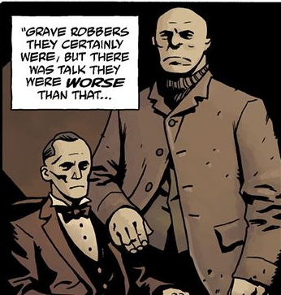

**Rawhead**and **Bloody Bones**or **Dr. Tolliver** and **Mr. Stump** as they were called in lifewere a pair of grave robbers that haunted Yorkshire, England.

## Background

 Dr. Tolliver and Mr. Stump were a pair of grave robbers that prowled Yorkshire in the late 1900s. They were town mascots, due to their shady background, with children inventing songs about them calling them Rawhead and Bloody Bones. On June 11, 1892, they were caught with freshly dug corpse of a girl by a mob that beat them to death, burying their corpses deep in the woods.

## History

### [Rawhead and Bloody Bones](/entry/Rawhead_and_Bloody_Bones)

In March 1953, the ghosts of Rawhead and Bloody Bones began haunting the grounds of the Whistling Pig, a pub the duo frequented in life. The owners of the pub wishing to attract youngsters into their pub decided to change the name to the infamous ghouls. However strange things began to occur at night, noises, claw marks, etc. It was only until they owners found their dog torn to pieces that they contacted the [B.P.R.D.](/entry/B.P.R.D.)

Professor [Trevor Bruttenholm](/entry/Trevor_Bruttenholm) and [Hellboy](/entry/Hellboy) learned of the bloody history of the two ghouls and were bewildered by the ghosts appearances as it was unheard of for a ghosts to be invoked by simply changing the name of their favorite pub.

The agents decided it was best to burn the sign, as a symbolic gesture before contacting a priest in the morning. Just as the group were about to burn the sign, Rawhead and Bloody Bones appeared demanding to know what they were doing. Shocked by the sudden appearances of the specters, the ghost burned in flames as a stray match lit the sign board in an inferno.
