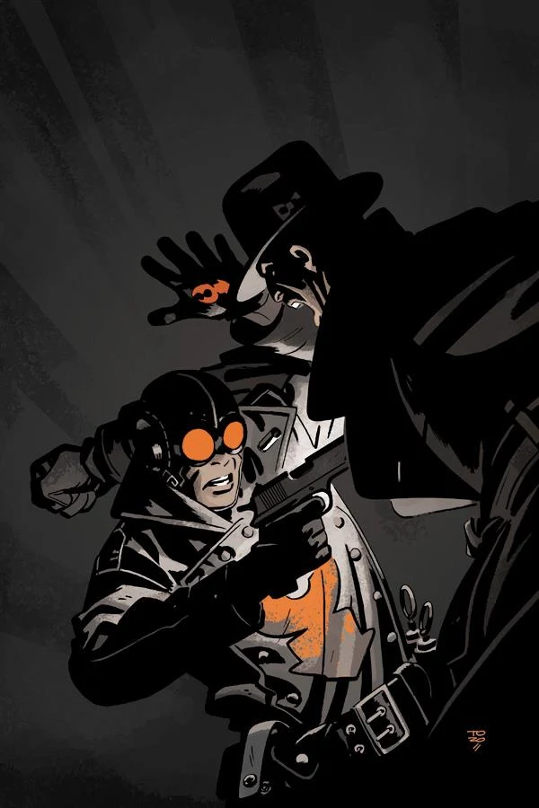

***The Prayer of Neferu*** takes place early in [the Lobster's](/entry/The_Lobster) career as a crime fighter in the 1930s.

## Publication History

This one-shot was published in August 2012, featuring a cover by Tonči Zonjić.

## Synopsis

The [Heliopic Brotherhood of Ra](/entry/Heliopic_Brotherhood_of_Ra) hold a Victorian themed party complete with the unrolling of a mummy, with decidedly unexpected results, including a gun-blazing vigilante promising justice!

## Gallery

