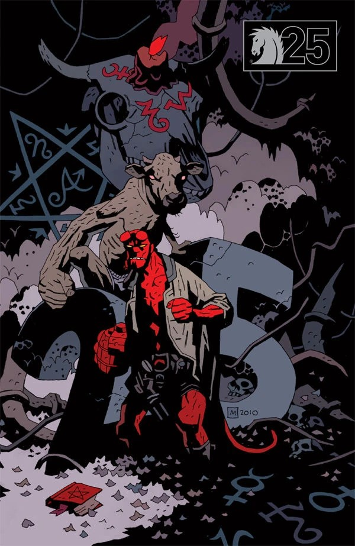

***Buster Oakley Gets His Wish*** is a *[Hellboy](/entry/Hellboy_%28series%29)* one-shot written by [Mike Mignola](/entry/Mike_Mignola) with art by [Kevin Nowlan](/entry/Kevin_Nowlan).

## Synopsis

Buster Oakley a young teen calls on [Demons](/entry/Demon) to come visit him and his friends. A bright flash engulfs them and they disappear in a flash. [Hellboy](/entry/Hellboy_%28character%29) swings by to check on things when a farmer complains about his missing cows. Wandering the farm, Hellboy is sucked into a giant spacecraft full of mutated livestock. After some poking and prodding by aliens, Hellboy starts swinging. He is joined by a cow standing on two legs in underpants. They fight the aliens, who eventually are worn down and release them in Nebraska.

## Story Chronology

The story takes place in Rooks County, Kansas in [1985](/entry/Hellboy_Universe_timeline).

## Gallery

|Dark Horse 25th anniversary variant by Mike Mignola
## Notes

- This story plays heavily on the stereotypical tropes about aliens including, [flying saucers](https://tvtropes.org/pmwiki/pmwiki.php/Main/FlyingSaucer), [gray aliens](https://tvtropes.org/pmwiki/pmwiki.php/Main/TheGreys) with large heads, aliens [abducting people](https://tvtropes.org/pmwiki/pmwiki.php/Main/AlienAbduction) and, among other farm animals, [cattle](https://tvtropes.org/pmwiki/pmwiki.php/Main/AliensStealCattle), gruesome experiments and off course [anal probes](https://tvtropes.org/pmwiki/pmwiki.php/Main/AnalProbing).
- One alien in a pod appears to be from the [same race](/entry/Aliens) as [the Visitor](/entry/The_Visitor_%28character%29).
