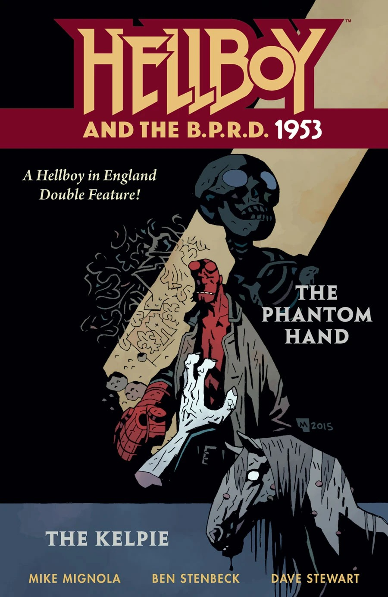

***The Phantom Hand*** is a short story written by Mike Mignola and illustrated by Ben Stenbeck. It is one of several stories making up *[Hellboy and the B.P.R.D.](/entry/Hellboy_and_the_B.P.R.D.): 1953*.

## Synopsis

In February of 1953 [Hellboy](/entry/Hellboy_%28character%29) travels to England with [Trevor Bruttenholm](/entry/Trevor_Bruttenholm) to see [Harry Middleton](/entry/Harry_Middleton) and investigate a phantom hand haunting a house. Harry tells the two about how in 1748 several children were reported missing, the killer was tracked down by Lord Albert who cut off the killer's hand. Lord Albert lived in the house until his death in 1782. After Harry finishes, the phantom hand appears, Hellboy throws it in the fireplace causing an explosion and turning the hand into a large demon like creature. The creature tackles Hellboy out the window and Hellboy chases the creature to the graves of the children. Hellboy hits the creature with a tombstone and it transforms into a hand. Afterwords, Harry and Trevor discuss Hellboy's future while he sleeps.

## Gallery

|*1953* \#1

|1953 #1
