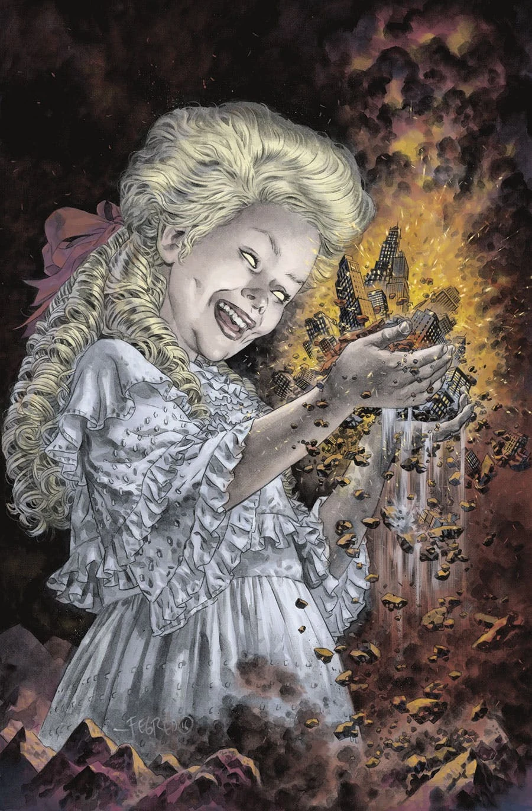
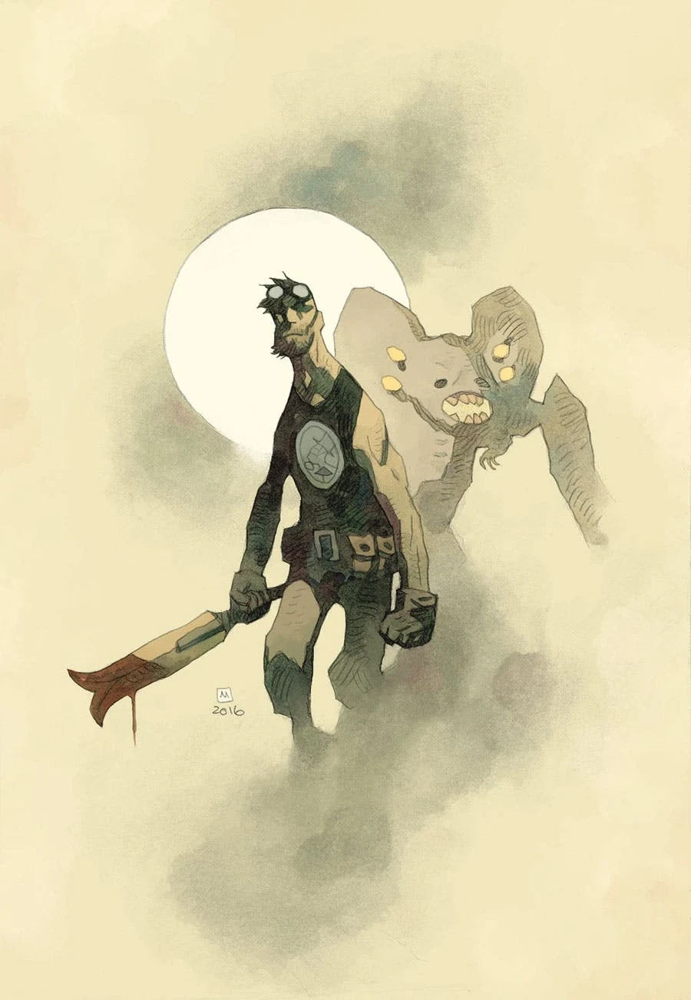
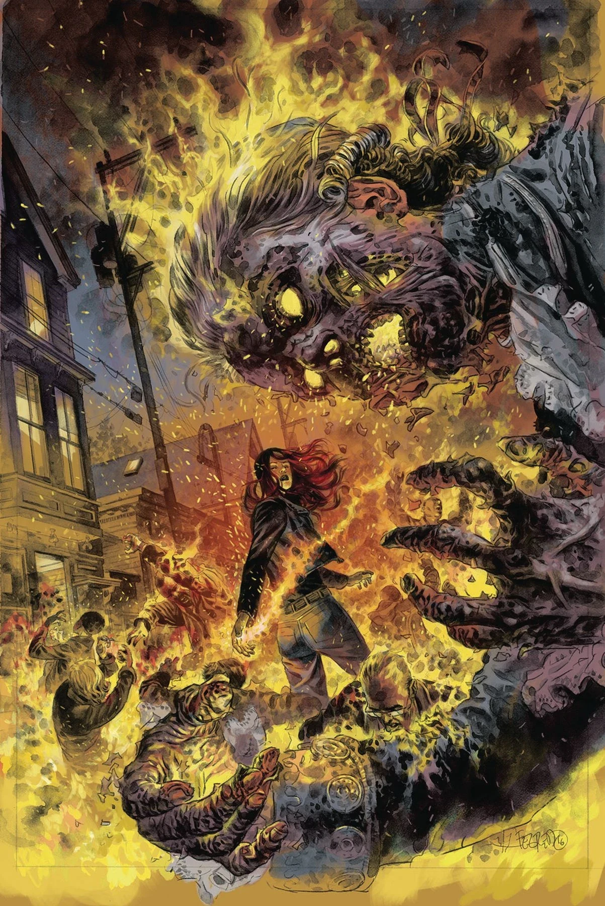
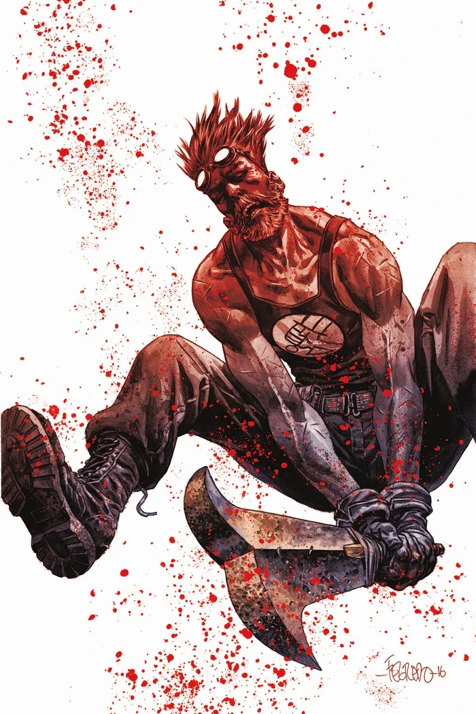
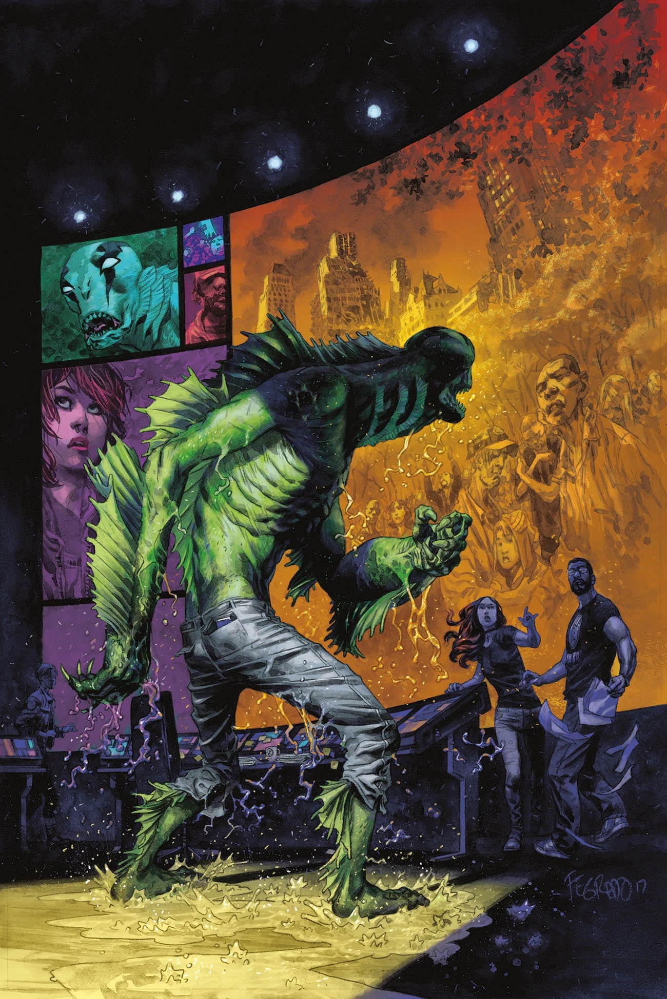
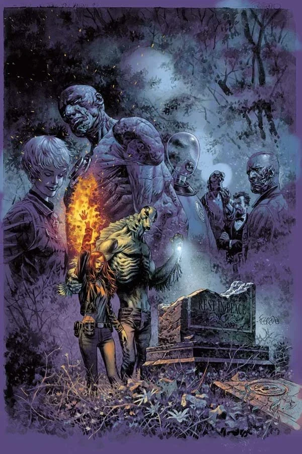

***Messiah*** is the first arc of [*The Devil You Know* story cycle](/entry/The_Devil_You_Know_%28story_cycle%29).

## Publication History

This five-issue arc started in July 2017. The final issue had a major reveal, which explained the reason for *"The Devil You Know"* title of the final [B.P.R.D.](/entry/B.P.R.D._%28series%29) story cycle.

## Synopsis

### Part One

Before they were vanquished by the BPRD, Lovecraftian monsters created a Hell on Earth. Now Liz Sherman leads a crew through monster-infested ruins on the most important rescue mission of her life. As society tries to rebuild, strange cults vie for influence, and a demon emerges to lead the way…

### Part Two

With the apocalypse narrowly averted, the cults that sprang up in response to the worldwide crisis are left with idle hands.

### Part Three

Bound to a prehistoric weapon, an ancient spirit wages an eternal war against the creatures that seek to destroy the world, and their human servants.

### Part Four

Exorcist Ashley Strode directs the BPRD toward a deadly cult leader while Fenix pushes for a return to the site of Kate’s death.

### Part Five

A return to the demolished headquarters, the site of Kate’s death, reunites old team members as Abe pursues a demon and Varvara reveals her terrifying plans.

At the end of the issue, agents of the Bureau for Paranormal Research and Defense make a genuinely unexpected discovery at the site of their former headquarters, which were destroyed in last year’s Cometh The Hour series: A coffin containing what seems to be the body of none other than Hellboy, who appears to be opening his eye…

## *The Endless Mystery: A Brief History of Agent Howards*

This two-page back-up feature written and drawn by [Matt Strackbein](/entry/Matt_Strackbein) appeared in *B.P.R.D.: The Devil You Know—Messiah* \#3. It recapped the history of [Ted Howards](/entry/Ted_Howards)/[Gall Dennar](/entry/Gall_Dennar). It is not included any any collections.

## Gallery

Covers by [Duncan Fegredo](/entry/Duncan_Fegredo) unless otherwise stated.

 \#1

 \#1 variant
by [Mike Mignola](/entry/Mike_Mignola)

 \#2

 \#3

 \#4

 \#5
