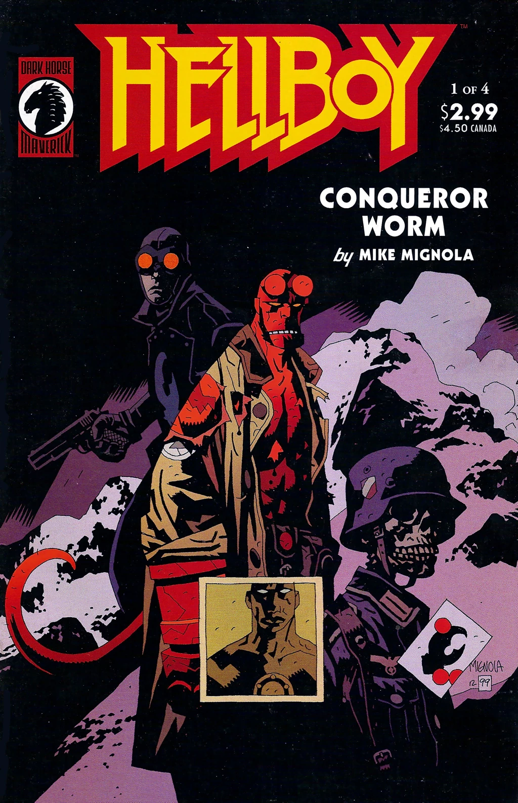
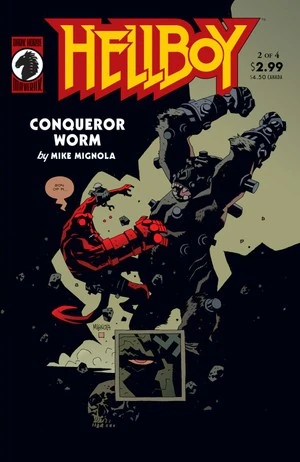
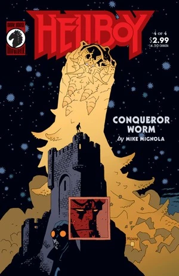

In ***Conqueror Worm***, [Hellboy](/entry/Hellboy_%28character%29) and [Roger](/entry/Roger) confront [Herman von Klempt](/entry/Herman_von_Klempt) and an otherworldly menace in Austria.

## Publication History

*Conqueror Worm* was first published as a four issues mini-series from May to August 2001. The story was later reprinted with a new nine page epilogue in [*Hellboy – Volume 5: Conqueror Worm*](/entry/Trade_Collections) in February of 2002.

## Synopsis

### Part One

The story opens with a flashback to **"1939. Hunte Castle, Austria."** [Lobster Johnson](/entry/Lobster_Johnson) leads a group of U.S. Soldiers in an attack on the secret Nazi space program. The Americans arrive just as the Nazis prepare to launch a rocket carrying [Ernst Oeming](/entry/Ernst_Oeming). The soldiers shoot the Nazi scientists and the Castle burns.

61 years later, [Thomas Manning](/entry/Thomas_Manning) briefs [Hellboy](/entry/Hellboy_%28character%29) and [Roger](/entry/Roger) on the events of that night so many years ago. Oeming, one of the Nazis' leading scientists, was killed on January 1, 1939, and his body was taken to Hunte Castle. The American attack took place on March 20th 1939. Hellboy mentions that he heard this was the last Lobster Johnson mission, but Manning replies that 'The Lobster' was only a fictional character. When Hellboy asks what this has to do with their current mission, Manning shows them a satellite photograph taken by NASA: Oeming's capsule, on a reentry course to land at Hunte Castle.

Manning introduces them to Laura Karnstein, their local guide, and sends Laura and Roger out, so he can talk to Hellboy alone. Manning tells Hellboy that Roger was fitted with a small bomb, just large enough to kill him. Hellboy is appalled, but Manning says that Roger must not be allowed to kill any other agents, and that Hellboy is to detonate Roger if necessary.

Laura, Hellboy and Roger begin the walk up to the castle. On the way they run into an old man. The man says the castle is haunted, and opens his coat revealing a Nazi uniform. Hellboy hits the man, but Laura tells them she will deal him. After Hellboy and Roger have left, she shoots the old man and pushes him off the nearby ledge. The old man stands back up, his coat blown open revealing the Lobster Claw. Laura walks ahead into the castle and then calls for help. As they approach, Hellboy and Roger are shot by sniper fire, knocking Roger off the cliff. Hellboy grabs him, but Roger lets himself drop so Hellboy can save Laura. Hellboy rushes the sniper's positions, but finds only remotely operated guns. He falls through a trapdoor in the floor and finds himself in an underground room. The ghost of a U.S. Soldier tells him the castle is a trap, but Hellboy climbs out of the hole only to be knocked out by [Herman von Klempt](/entry/Herman_von_Klempt) and one of his [Kriegaffen](/entry/Kriegaffe). "Laura" - in reality von Klempt's granddaughter [Inger](/entry/Inger_von_Klempt) - stands by his side and asks if she did well.

### Part Two

Hellboy wakes up in an electroshock harness, with von Klempt, Inger, and the Kriegaffe standing over him. Von Klempt reminds Hellboy of [their last encounter in South America](/entry/World%27s_Greatest_Paranormal_Investigator_%28CBG%29), and von Klempt's small role in the aftermath of [Vladimir Giurescu](/entry/Vladimir_Giurescu)'s [resurrection](/entry/Wake_the_Devil).

Outside, [Roger](/entry/Roger) meets with Lobster Johnson. Johnson reveals Inger's true identity, and that Herman was the only survivor of the Hunte Castle disaster. The two enter the caves under the castle and find a room full of Nazi-created humanoid machines. Feeling Roger's electric power, the machines begin to come to life. Roger absorbs the power of the Nazi generator, de-powering the machines and leaving the castle without electricity.

With the harness depowered, Hellboy is able to overpower the Kriegaffe. As he walks away he sees a man chained to the wall, with three gunshot wounds in his chest. Hellboy asks how the man can still be alive, and the man says he is not a man at all, just disguised as one. The man says he was there at [Hellboy's birth](/entry/Seed_of_Destruction) and watched him in [St. Leonard's Wood](/entry/The_Nature_of_the_Beast). The man explains that during the war, the Nazis somehow managed to make contact with [ancient evil beings](/entry/Ogdru_Hem) in space, one of which has inhabited Ernst Oeming's dead body and will return to Earth aboard the Nazi capsule. He gives Hellboy a small device that can trap the creature, then dies of its wounds, transforming back to his true form. Roger meets up with Hellboy, but the Lobster is nowhere to be seen.

### Part Three

Von Klempt tells Inger to put on a gas mask as the Nazi space ship lands in the castle. Gas streams out of the ship and transforms Inger's men into mindless [Frog monsters](/entry/Frog_monster). Inger realizes what is happening and flees the launch pad, but is stopped by the ghosts of U.S. soldiers. Von Klempt attacks Hellboy, leaving [Roger](/entry/Roger) to deal with the capsule. Lobster Johnson appears and tells Roger that he must face the monster alone. Some of the frog monsters jump Roger.

Hellboy knocks off von Klempt's robotic head, revealing his real one to be preserved in a jar inside the chest of his robot body. The head shoots Hellboy and flies off, as Hellboy falls through the floor onto the basement below. The [Conqueror Worm](/entry/Conqueror_Worm) emerges from the ship and devours the transformed men.

In the basement of the Castle, Hellboy finds the radio equipment that the Nazis used to contact the Ogdru Hem in space, with the corpses of their operators still seated at their consoles. Hellboy opens a cabinet and finds severed heads' of several dead saints hooked up to the antennae - the Nazis' crude means of replicating the rituals that allowed ancient peoples to speak with the Ogdru Hem. Hellboy states, to no one in particular, *"This is the worst place on Earth."*

Inger confronts Herman, and asks how he will control the monster. Herman responds that nothing can control the Worm. After the fall of the Third Reich, and the failure of his many plans and projects, he has become sick of looking for power, and instead only wishes to destroy the world. The Worm will accomplish this ,and tell the others of its kind. The 369 [Ogdru Hem](/entry/Ogdru_Hem) will then awaken, followed by the the [Ogdru Jahad](/entry/Ogdru_Jahad). They will then reduce the world to *"a blackened cinder."* In horror, Inger asks why Herman has protected her just to witness the end of the world. Herman says he has not - her mask has not protected her from the Worm's gas, only r\*\*\*\*\*\*\* its effects. He simply wanted someone close to him to be aware enough to hear what he has done and witness it.

Inger takes off her gas mask to reveal that she, too, has turned into a frog monster, the only difference being she is still just able to think and speak.

### Part Four

The Conqueror Worm tries to eat Roger, but spits him out to land near Hellboy. Hellboy tries to use the alien device to defeat the Worm, but von Klempt's robot body snatches it from Hellboy's hand and crushes it.

The transformed Inger is visited by [Grigori Rasputin](/entry/Grigori_Rasputin) in the bowels of the castle. Inger despairs that her dream of reestablishing the Third Reich has turned out to be futile, in the face of the Worm. Rasputin confirms that the Worm will destroy the world, but that after the destruction a new world and a new race of man will be born, and she is the first of that new race.

Hellboy and Roger try to stop the Worm, at first without success, but they realize that it does not like electricity. Roger discharges the energy he took from the generator and shocks the Worm. The Worm begins to control Roger's mind, and he tells Hellboy to destroy him. But Hellboy will not, and von Klempt's flying head comes to mock them. Roger grabs the glass tank and leaps off the cliff, shattering the tank and killing von Klempt.

Lobster Johnson finds Inger and kills her, ignoring her protestations that she is *"the future!"*. The Lobster and Hellboy rush down the mountain and find Roger. The Lobster puts a metal rod into Roger's chest and draws lightning, which destroys the Worm. Hellboy and Roger look back and see the long-dead body of Lobster Johnson.

Hellboy, disgusted by the [B.P.R.D.](/entry/B.P.R.D.)'s actions toward Roger, quits the Bureau. He tells [Kate Corrigan](/entry/Kate_Corrigan) that he plans to travel to Africa, and after that *“wherever the wind blows.”*

### Epilogue

Rasputin, still in the castle, is joined by [Hecate](/entry/Hecate). She tells him to rest, and the two recount her actions at Castle Giurescu (in *[Wake the Devil](/entry/Wake_the_Devil)*). She says that when the end comes either she and Hellboy will rule in the new world, or they will both die. Hecate mocks Rasputin for his past failures with Hellboy, and says he will always fail because he is merely a ghost. Enraged, Rasputin says he was chosen by the [Ogdru Jahad](/entry/Ogdru_Jahad) and that he will free them. But Hecate says only [Hellboy's hand](/entry/The_Right_Hand_of_Doom) can free them (since it was the power that imprisoned them in the first place), and Rasputin cannot control him. Rasputin defiantly screams that he brought Hellboy into the world, and he is still Hellboy's master, but his words ring hollow in his ears as well as Hecate's.

Rasputin shatters into bone and crumbles to dust. [The Baba Yaga](/entry/Baba_Yaga_%28character%29) takes the small spark that is left, puts it in a hollow acorn and wears it around her neck.

## Story Chronology

The exact date of *Conqueror Worm* may have happened in **2000** or **2001**, at the beginning of the story it is described that the story took place 61 years after the opening flashback in 1939 which would make the story takes place in 2000, but the invasion of the castle according to *The Companion* [1] was on March 20, 1939 and Conqueror Worm took place on February 5, 2001, which would give 61 years and 10 and a half months. Is an explanation for the timeline made by Jason Hall for The Companion, he did not tell the months and days. Thus, in 2000 or 2001 are valid dates.

It is likely that the story happens after [Liz Sherman](/entry/Liz_Sherman) left the [B.P.R.D.](/entry/Bureau_for_Paranormal_Research_and_Defense) (as seen in *[B.P.R.D.: Hollow Earth](/entry/Hollow_Earth)*), as [Hellboy](/entry/Hellboy_%28character%29) only asks [Kate](/entry/%E5%87%AF%E7%89%B9%C2%B7%E8%80%83%E7%91%9E%E6%A0%B9)) to say goodbye to [Abe](/entry/Abraham_Sapien), not Liz. The story that precedes this is *[Hellboy: Being Human](/entry/Being_Human)*, followed by *[B.P.R.D.: The Ectoplasmic Man](/entry/The_Ectoplasmic_Man)*.

## Content

### Characters

#### [B.P.R.D.](/entry/Bureau_for_Paranormal_Research_and_Defense)

- [Katherine Corrigan](/entry/%E5%87%AF%E7%89%B9%C2%B7%E8%80%83%E7%91%9E%E6%A0%B9))
- [Thomas Manning](/entry/Thomas_Manning)
- [Hellboy](/entry/Hellboy_%28character%29)
- [Roger](/entry/Roger)
- [Abraham Sapien](/entry/Abraham_Sapien) (Flashback)
- [Roger's brother](/entry/Roger%27s_brother) (Flashback)
- [Elizabeth Sherman](/entry/Elizabeth_Sherman) (Flashback)
- Other B.P.R.D. agents

#### [Nazis](/entry/%3ACategory%3ANazi)

- [Ernst Oeming](/entry/Ernst_Oeming)
- [Inger von Klempt](/entry/Inger_von_Klempt) (A.K.A. Laura Kranstein)
- [Kriegaffe](/entry/Kriegaffe) \#10
- [Herman von Klempt](/entry/Herman_von_Klempt)
- [Leopold Kurtz](/entry/Leopold_Kurtz) (Flashback)
- [Karl Ruprect Kroenen](/entry/Karl_Ruprect_Kroenen) (Flashback)
- [Ilsa Haupstein](/entry/Ilsa_Haupstein) (Flashback)
- Nazi Soldiers and Scientists (Turned into [Frog monsters](/entry/Frog_monster))
- [Adolf Hitler](/entry/Adolf_Hitler) (Painting)
- Undead cyborgs

#### Lobster Johnson's Flashbacks

- [The Lobster](/entry/The_Lobster)
- American Soldiers
- "The Panthom Jungle" Movie Serials
  - Vic Williams (Flashback)
  - Actress (Flashback)
- Mobsters
  - Vinny the String (Photograph)
  - Skinny Joe Lincoln (Photograph)
  - Zuco Banana (Photograph)
- [Stanely Corn's](/entry/Stanley_Corn) Brain (Flashback)

#### Other

- [Aliens](/entry/Aliens)
  - [The Visitor](/entry/The_Visitor_%28character%29)
- [Ogdru Hem](/entry/Ogdru_Hem)
  - [The Conqueror Worm](/entry/Conqueror_Worm_%28Ogdru_Hem%29)
- [Witches and Wizards](/entry/Witches)
  - [Grigori Rasputin](/entry/Grigori_Rasputin)
  - [Hecate](/entry/Hecate)
  - [Baba Yaga](/entry/Baba_Yaga_%28character%29)
- [Ogdru Jahad](/entry/Ogdru_Jahad)
- [Vladimir Giurescu](/entry/Vladimir_Giurescu) (Flashback)

### Locations

-
- Austria
  - Hunte Castle
  - [B.P.R.D.](/entry/Bureau_for_Paranormal_Research_and_Defense) Field Headquarters Number Four
- U.S.A. (Flashback)
  - [Stanely Corn's](/entry/Stanley_Corn) Apartment (New York) (Flashback)
  - [B.P.R.D.](/entry/Bureau_for_Paranormal_Research_and_Defense) Headquarters (Farfield, CT) (Flashback)
  - [Cavendish Hall](/entry/Cavendish_Hall) (Upstate New York) (Flashback)
- Romania (Flashback)
  - Czege Castle (Fălticeni) (Flashback)
    - [Edel Mischrasse's](/entry/Edel_Mischrasse) workshop (Flashback)
  - Magyarnándor (Flashback)
  - Wauer Institute (Tirgoviste) (Flashback)
  - [Giurescu](/entry/Vladimir_Giurescu) Castle (Flashback)
- Norway (Flashback)
  - [Project Ragna Rok's](/entry/Project_Ragna_Rok) Castle (Flashback)

- Brazil (Flashback)
- South America (Flashback)

- Germany (Flashback)
  - [Herman von Klempt's](/entry/Herman_von_Klempt) Workshop (Flashback)
- England (Flashback)
  - East Bromwich church ruins (Flashback)
  - Saint Leonard's Wood (Flashback)
- [Hell](/entry/Hell) (Vision)
  - [The Abyss](/entry/Abyss) (Vision)
- [Hyperborea](/entry/Hyperboreans) (Vision)
- Scotland (Flashback)
  - Tarmagant Island (Flashback)
- [Yggdrasil](/entry/Yggdrasil)

### Noteworthy Artifacts

- [Oeming](/entry/Ernst_Oeming) Capsule
- [The Lobster's](/entry/The_Lobster) Calling Card
- [Roger's](/entry/Roger) Bomb Device
- [Zinco](/entry/Zinco_Corporation) Electric Harness
- [Alien](/entry/Aliens) Prism
- [Hecate's](/entry/Hecate) Iron Maiden
- [Right Hand of Doom](/entry/Right_Hand_of_Doom) (Detatched from Hellboy)
- [Grigori Rasputin](/entry/Grigori_Rasputin) in a Nut Shell

## Gallery

Covers by [Mike Mignola](/entry/Mike_Mignola).

 \#1

 \#2

 \#3

 \#4

## References

<references/>

[1] *Hellboy: The Companion*, published by *Dark Horse*: May 21, 2008. [1](https://www.darkhorse.com/Books/12-367/Hellboy-The-Companion-TPB)
