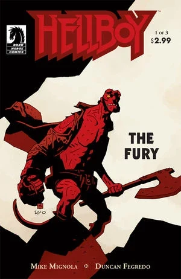
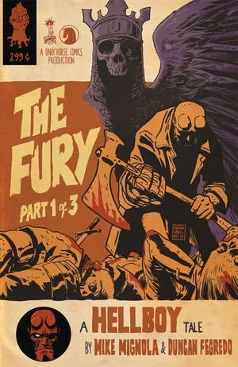
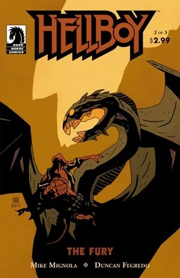
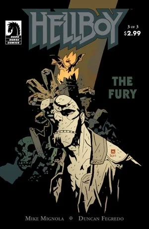

In ***The Fury***, [Hellboy](/entry/Hellboy_%28character%29) confronts [Nimue](/entry/Nimue) as she transforms into the dragon [Ogdru Jahad](/entry/Ogdru_Jahad). George Washbrook battles Nimue's army and Hellboy is faced with death.

## Publication History

*The Fury* is the second part of *The Storm and the Fury*, which serves as the final act in "*The Wild Hunt* trilogy", a series [*Hellboy*](/entry/Hellboy_%28series%29) stories drawn by [Duncan Fegredo](/entry/Duncan_Fegredo). Because of reaction to the delay in the middle of *[The Wild Hunt](/entry/The_Wild_Hunt)*, for the final part it was decided to publish two 3 issue series under separate titles.

## Synopsis

### Part One

The three witches from *[Darkness Calls](/entry/Darkness_Calls)*, having fled the unfolding scene in Nimue's chamber, stand outside her tower and debate their responsibility for the cataclysm that is underway. They witness Hellboy approaching their position at base of the tower and mistake him for Odin and then for Thor because of his hammer-like stone hand and his missing eye. They direct him up to the top chamber from whose window (onto the spears of her soldiers) Nimue tosses Ganeida in an enraged denial of her own ongoing transformation. As Hellboy enters the base of the tower, Alice grieves back in the pub in England, where the barkeep reminds Alice of what King Arthur told her in Morgan's castle - that Alice's life is bound to the sword Excalibur and that she would be the first to see the new king with his crown. As Hellboy confronts a stairway swarming with goblin soldiers, the barkeep tells Alice that the pub belongs to **George Washbrook** (grand-nephew of two traitorous Victorian witches repeatedly referenced in Mignola's [Sir Edward Grey: Witchfinder](/entry/Hellboy_Comics) comics series) who, seeking redemption, had sacrificed himself in a WWI trench only to have his life saved by a robed and ghostly woman with a gold chalice. Upon his return to England he had spent a year wandering its length before purchasing the pub where he had grown impossibly old with the sense that he was "waiting for something ... that was coming to him." As Hellboy battles his last few soldier opponents, George Washbrook, skeletally aged and decrepit, is guided down the stairs of the pub by a ghostly robed woman. As Hellboy rejects a fallen sword and picks up an axe instead, Alice falls to her knees offering Excalibur to Washbrook. Hellboy bursts into Nimue's chamber flinging the axe at her face where it knocks Nimue's three-raven helmet from her head. Meanwhile Washbrook takes Excalibur and as the robed woman crowns him with Arthur's crown he is revealed as a stern and regally armored young man glowing with beauty and power. When Nimue's helmet hits the floor of her chamber it flies up again as three living ravens and the mutating creature before Hellboy announces that it is no longer Nimue. With Alice beside him, Washbrook, as the new king accepts the grail from a circle of radiantly robed women. As two of Nimue's ravens fly from the tower window, the being that was Nimue explains that it is the Ogdru Jahad, returned thanks to [Grigori Rasputin](/entry/Grigori_Rasputin)'s feat, back in [the first Hellboy story](/entry/Seed_of_Destruction), of cracking the walls of its prison, since which the world (like Hellboy's life) has had no light and no hope. At the door of the grail pub, Washbrook pours out a stream of light from his chalice, restoring the undead army to young and vigorous life. As the lightning storm builds outside Nimue's tower, the Ogdru Jahad, one-handedly gripping Hellboy's skull to its now scaled and elongated face, tells Hellboy he is too late, and has him listen, as outside the window, the two escaped ravens deliver the Dragon's order for the army to march and exterminate mankind.

### Part Two

At the door of the pub in England, Alice hears the chant of Nimue's approaching army and the barkeep tells her the four horsemen of the apocalypse ride or stalk at its head, and that those humans who survive the war and the pestilence and famine to follow will then die feeding the Ogdru Hem and their creatures. On the field outside Nimue's tower War and the army he leads clash with Washbrook and his own, as Washbrook swears they'll never set foot in England. As Alice rushes out to find Hellboy over the barkeep's pursuing protests, the Dragon (who now looks very much like a dragon) offers Hellboy a quick death but is cheered when Hellboy attacks him: "Given the way you have lived, I feared you would choose an easy death." The dragon blasts Hellboy out the tower's window with a gust of flame but Hellboy grabs the window-frame and attacks again. The Dragon reminds Hellboy that It had been there from the world's beginning and enigmatically announces "I am time, the destroyer: We are bound together in that." As Hellboy begins to repeatedly batter the dragon, innumerable lightning bolts descend on England demolishing landmarks, landscapes and cities. Alice and the barkeep come upon the last of Nimue's witches at the edge of a lake, apologizing before she, too, drowns herself. King Vold with his Wild Hunt rides through the woods crying "Doom!" and Alice flees into the battlefield, now a sea of blood littered with small islands of corpses and fire. Wandering the field she sees three crowned women reclaiming Excalibur and comforting the dying Washbrook, victorious and once again an old man. Ganeida addresses Alice from the same spear (presumably borne in the battle) on which she had been impaled when flung from Nimue's tower window, saying that Washbrook and his soldiers were fated to die in glory winning this battle, leaving lesser men behind to face "Ragna Rok," the apocalypse. She asks why Queen Mab hasn't yet told Alice that the battlefield is that of Vigrid, where Ragna Rok is prophesied to occur, with a battle between a dragon and the champion of man signaling "the end."

### Part Three

As Hellboy battles the dragon in the ruins atop the tower, the lightning storm demolishes and depopulates England. It continues as Hellboy is thrown down and pinned beneath the Dragon's monstrous claw. As the Dragon exults silently in its power, Alice confronts the barkeep, who she now realizes (from Ganeida's question) is the dead Queen Mab. Queen Mab confirms that she is dead, that the Dragon is that same one whose battle signals the world's end, and that, if unchecked, the storm now ravaging Britain will spread over the whole world, leaving it ruled by monsters until (as seen in *[King of Fear](/entry/King_of_Fear_%28story%29)*), "it all burns." Then, she insists gratefully, a new world will rise. Hellboy cannot win trying to save the world: "This world's run its course, but it's not **that** it goes -- it's **how** it goes." The Dragon having escaped its prison early, " Hellboy fights to buy this world a little more time... time enough for his friends (pictured as BPRD's [Abe Sapien](/entry/Abe_Sapien), [Liz Sherman](/entry/Liz_Sherman), and [Roger](/entry/Roger)) to do what they must ... so when the new world comes, at least the **spirit** of man will survive." As a protesting Alice reaches the foot of the tower, she passes [Sir Edward Grey](/entry/Sir_Edward_Grey), who tells her to hurry. At the tower top, still pinned by the exulting dragon's claw, Hellboy sees *Vasilisa*, the girl from Russian folklore who had helped him in *[Darkness Calls](/entry/Darkness_Calls)* and advised him in *[The Wild Hunt](/entry/The_Wild_Hunt)*. She is holding the last of the live ravens from Nimue's helmet. She asks Hellboy how he feels and he confirms that as she had told him, dying doesn't hurt. Crying, she asks him if he's ready and he says "I guess so." She turns the raven back into iron, and turns the iron raven into an iron sword with a bird's head ornament similar to that adorning Ohlomi's staff from *[The Third Wish](/entry/The_Third_Wish)*. Hellboy takes the sword and as his blood runs down it, it turns to gold. Then he slices half through the Dragon's leg. Alice cowers on the stairs outside the room as the Dragon convulses and Hellboy clings to it using his stone right hand while he releases streams of muddy golden blood from the Dragon's belly with the other. When Hellboy climbs a bit higher and stabs the Dragon's chest, he releases a gout of flame, and sends the Dragon's body collapsing lifelessly onto the tower. As Alice rushes into the room as a cloud emerges from the dragon's chest which takes the form of a robed Nimue who reports that the ghosts of England's drowned witches are dragging her into Hell but that she will take Hellboy with her. She reaches into Hellboy's chest and removes his flaming heart from a now-flaming cavity. Hellboy's body says "Son of a" before toppling backwards and scattering as ash or dust. We see Nimue pulled by a tower of witches into Hell, tossing the still-flaming heart so it tumbles into darkness. Hellboy's gun-belt sits in a pile of dust and the red piece on Morgan's disordered chess board (over which Death stands watching) is rubble. Alice opens her eyes from weeping and finds herself back in the pub which has clearly not been inhabited for years - Washbrook's WWI photo has been replaced with that of the pub's real former owners (one of whom resembles Queen Mab as the barkeep). Mab's crown sits on the counter. Alice collapses on the stairs and weeps. In the woods outside, Morgan le Fey encounters the Gruagach and (over a howled protest from Merlin's tomb) breaks the curse on him, taking him merrily with her into the next life, because neither of them wants to live to see the world that's coming. As England's survivors wander out into the smoke and rubble, lilies (resembling those grown from Hellboy's blood after his battle with [Saint Leonard's worm](/entry/The_Nature_of_the_Beast)) grow in the shadow of a ruined London column.

## Content

Note: This includes the epilogue only included in the collected editions

### Characters

#### General

- Odin (Mentioned)
- [Thor](/entry/Thor) (Mentioned)
- [Hellboy](/entry/Hellboy_%28character%29)
  - Other Witches
- [Alice Monaghan](/entry/Alice_Monaghan)
- [King Arthur](/entry/King_Arthur)
- [Ogdru Jahad](/entry/Ogdru_Jahad)
- George Washbrook (Flashback)
- [Queen Victoria](/entry/Queen_Victoria) (Mentioned)
- Woman who saved George Washbrook
- [Daoine Sidhe](/entry/Daoine_Sidhe) and other [Fae-Folk](/entry/Fairies)
  - [Queen Mab](/entry/Queen_Mab)
  - [Gruagach](/entry/Gruagach)
- Four Horsemen of the Apocalypse
- Bat-Faced Monsters (Vision)
- [King Vold](/entry/King_Vold_%28Story%29) and his Wolves
- Russian Representation of Death[1]
- [Ogdru Hem](/entry/Ogdru_Hem) (Vision)
- [B.P.R.D](/entry/Bureau_for_Paranormal_Research_and_Defense) (Vision)
  - [Abraham Sapien](/entry/Abraham_Sapien) (Vision)
  - [Elizabeth Sherman](/entry/Elizabeth_Sherman) (Vision)
  - [Roger](/entry/Roger) (Vision)
- [Edward Grey](/entry/Edward_Grey)
- [Vasilisa](/entry/Vasilisa)
- [Heliopic Brotherhood of Ra](/entry/Heliopic_Brotherhood_of_Ra) Members (Epilogue)

#### [Witches & Wizards](/entry/Witches)

- [Nimue](/entry/Nimue)
- [Baba Yaga](/entry/Baba_Yaga_%28character%29)
- [Morgan Le Fay](/entry/Morgan_Le_Fay)
- [Merlin](/entry/Merlin) (Off-Panel)

### Locations

- England
  - [Nimue's](/entry/Nimue) Castle
  - George Washbrook's Inn
  - Multiple English Cities
- U.S.A. (Vision)
- [Yggdrasil](/entry/Yggdrasil)

### Noteworthy artifacts

- [Excalibur](/entry/Excalibur)
- [Nimue's](/entry/Nimue) Helmet
  - Dagger made out of the Helmet

## Gallery

Standard covers by [Mike Mignola](/entry/Mike_Mignola).

 \#1 variant by [Francesco Francavilla](/entry/Francesco_Francavilla)

 \#3 variant

[pt-br:The Fury](/entry/pt-br%3AThe_Fury)

[1] *According to Duncan Fegredo (Hellboy Book Club Episode 21 - Hellboy: Darkness Calls 1:48:05)*
