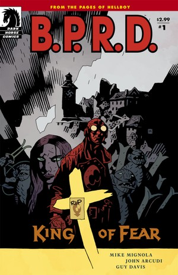
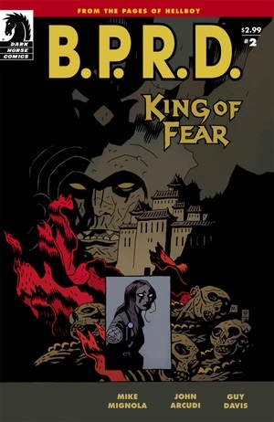
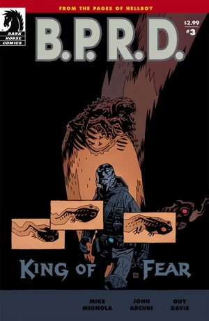
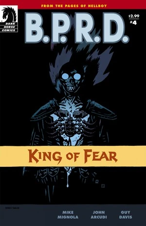
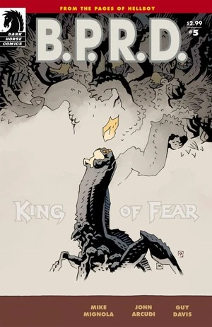
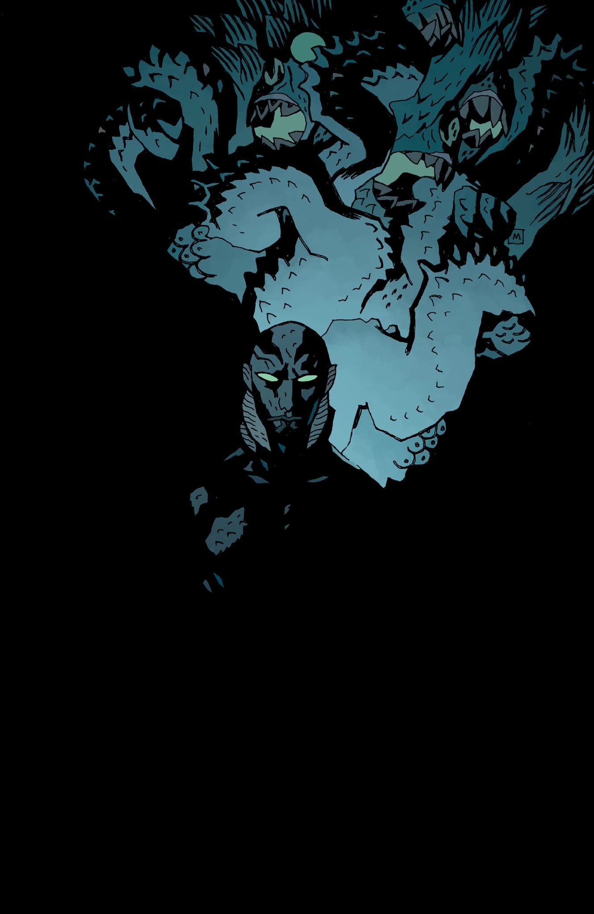

***King of Fear*** is a five-issue miniseries, the third part of the [*Scorched Earth* trilogy](/entry/Scorched_Earth_Trilogy), and the final arc of the [*Plague of Frogs* story cycle](/entry/Plague_of_Frogs_%28story_cycle%29).

## Publication History

The five-issue miniseries was published from January to May 2010. The story was collected in the trade paperback *[B.P.R.D.: King of Fear](/entry/Trade_Collections)* in November 2010. This is the final series in the [Plague of Frogs storyline](/entry/Plague_of_Frogs_%28story_cycle%29). Mike Mignola drew two pages in the fourth issue.

## Synopsis

### Part One

After the defeat of the mystic Memnan Saa, the Bureau for Paranormal Research and Defense—on the outs with the United States government after the bloodstained rescue of Liz Sherman—embarks to the Ural Mountains, the site of B.P.R.D.: Hollow Earth, to put the frog menace to rest once and for all.

Meanwhile, [Kate Corrigan](/entry/Kate_Corrigan) heads to Hunte Castle in Austria, where [Hellboy](/entry/Hellboy_%28character%29) killed the [Conqueror Worm](/entry/Conqueror_Worm_%28Ogdru_Hem%29), on her own rescue mission—to save ectoplasmic special agent [Johann Kraus](/entry/Johann_Kraus), possessed by the ghost of [Lobster Johnson](/entry/Lobster_Johnson_%28character%29).

### Part Two

While Liz and Abe lead a platoon of agents and soldiers into the Hollow Earth, Kate Corrigan tries to juggle work with romance. She travels to Austria to explore the ruins of Hunte Castle—the haunted Nazi fortress where crime fighter Lobster Johnson died and Hellboy fought the Conqueror Worm—where she hopes to place Lobster Johnson's ghost to rest and make him free the spirit of Johann Kraus.

### Part Three

While scouring the Tibetan caverns to obliterate the monstrous frog colony, Liz and Abe face the King of Fear—who's found a powerful new ally in his quest to destroy the surface world.

The King of Fear is revealed to have allied with [The Black Flame](/entry/The_Black_Flame_%28character%29), who was last seen being dragged underground by the frog people. He has apparently had a change of heart, and now is happy to be working for the greater good of the frogs, instead of trying to control them.

### Part Four

Beneath the ruins of the [Hyperborean](/entry/Hyperboreans) temple, Liz is given the most startling visions yet of the end of the world-and Abe discovers his role in it when he finds the link between himself and the frog monsters.

### Part Five

A rogue mission to the center of the earth leaves the B.P.R.D. with a lot to answer for—and uncertain fates for their most terrifying enemies.

## Content

### Characters

#### [B.P.R.D.](/entry/Bureau_for_Paranormal_Research_and_Defense)

- [Elizabeth Sherman](/entry/Elizabeth_Sherman)
- [Thomas Manning](/entry/Thomas_Manning)
- [Abraham Sapien](/entry/Abraham_Sapien)
- [Katherine Corrigan](/entry/%E5%87%AF%E7%89%B9%C2%B7%E8%80%83%E7%91%9E%E6%A0%B9))
- [Johann Kraus](/entry/Johann_Kraus)
- [Andrew Devon](/entry/Andrew_Devon)
- [Panya](/entry/Panya_%28character%29)
  - Olly
  - Mutated Animals
- Doris (Panya's Caretaker)
- [Roger](/entry/Roger) (Flashback)
- [Hellboy](/entry/Hellboy_%28character%29) (Flashback)
- [Carla Giarocco](/entry/Carla_Giarocco) (Corpse, Vision)
- Other Agents and Personnel

#### Hunte Castle

- [Bruno Karhu](/entry/Bruno_Karhu)
- Ghosts
  - [The Lobster](/entry/The_Lobster)
  - Medieval
  - U.S. Soldiers
  - [Nazis](/entry/%3ACategory%3ANazi)
- [Kriegaffe](/entry/Kriegaffe) \#10 (Corpse)

#### Others

- Military Leaders
- Agartha Residents
  - Master Gheghen (Flashback)
  - Monks (Corpses)
- [Servants of the Left Hand](/entry/Servants_of_the_Left_Hand)
- [The King of Fear](/entry/King_of_Fear_%28character%29)
- [Memnan Saa](/entry/Memnan_Saa) (Vision)
- [Ogdru Hem](/entry/Ogdru_Hem)
  - The Ones from Liz's Vision
  - The Ones Fused with the [Hyperborean](/entry/Hyperboreans) War Machines
  - [Salton Sea Monster](/entry/Salton_Sea_Monster)
- [Frog Monsters](/entry/Frog_monster)
- [Landis Pope](/entry/Landis_Pope) ([The Black Flame](/entry/The_Black_Flame_%28character%29))
- [Ogdru Jahad](/entry/Ogdru_Jahad) (Referenced)
- [Shonchin](/entry/Shonchin)
- [Hecate](/entry/Hecate) (Vision)
- U.N. Representatives
- Newscasters
- [Zinco Corporation](/entry/Zinco_Corporation)
  - [Isaiah Marsten](/entry/Isaiah_Marsten)
- [Oannes Society](/entry/Oannes_Society)
  - McWhirter

### Locations

- U.S.A.
  - Washington D.C. Military Facility
  - [B.P.R.D.](/entry/Bureau_for_Paranormal_Research_and_Defense) Headquarters (Colorado)
  - Headquarters of the United Nations (New York City, NY)
  - The Salton Sea (California)
- Austria
  - [B.P.R.D.](/entry/Bureau_for_Paranormal_Research_and_Defense) Field Headquarters Number Four
  - Hunte Castle
- Russia
  - Agartha (Ural Mountains, Above the Arctic Circle)
- Cave system under the Earth
- Indonesia
  - Borneo (Mentioned, Destroyed)
  - Sulawesi (Mentioned, Destroyed)
- Thailand
  - Bar in Bangkok

### Noteworthy Artifacts

- [Hyperborean](/entry/Hyperboreans) Swords
- [Hyperborean](/entry/Hyperboreans) War Machines
- [The Black Flame's](/entry/The_Black_Flame_%28character%29) Suit (Fused with Pope's body)
- [Oannes Society](/entry/Oannes_Society)
  - Mechanical Body
  - Submarine

## Gallery

 \#1

 \#2

 \#3

 \#4

 \#5

 \#5
(unused cover)
