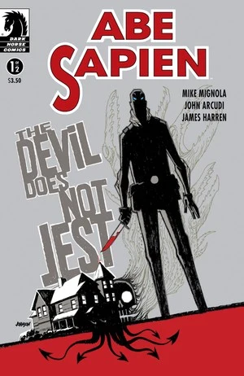
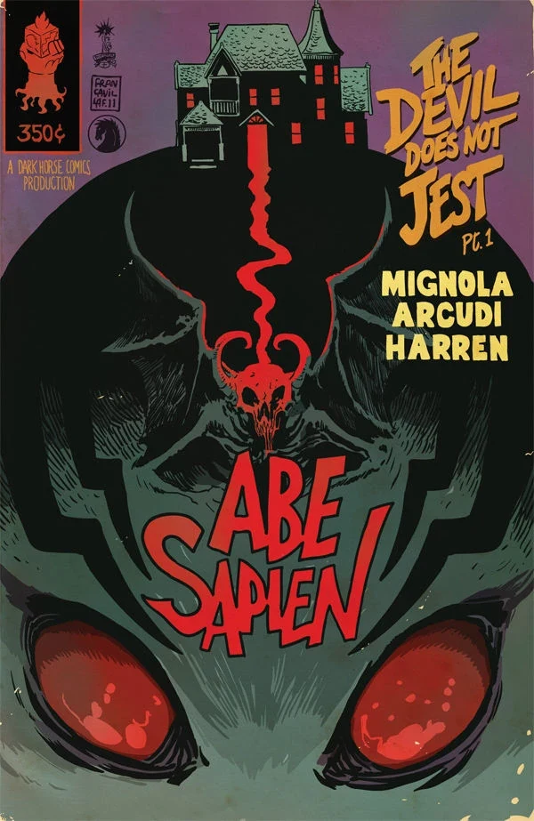

***The Devil Does Not Jest*** is a two-issue *[Abe Sapien](/entry/Abe_Sapien_%28series%29)* story written by [Mike Mignola](/entry/Mike_Mignola) and [John Arcudi](/entry/John_Arcudi). It is the Hellboy Universe debut of artist [James Harren](/entry/James_Harren).

## Publication History

*Abe Sapien: The Devil Does Not Jest* was published as two-issue miniseries from September-October 2011. The story was collected, along with *[The Haunted Boy](/entry/The_Haunted_Boy)* and *[The Abyssal Plain](/entry/The_Abyssal_Plain)*, in the trade *[Abe Sapien — Volume 2: The Devil Does Not Jest and Other Stories](/entry/Trade_Collections)*.

## Synopsis

### Part One

Buried in a demonologist's basement is a deep, dark family secret, where horrific occult practices prove to be life threatening for Abe Sapien.

### Part Two

Abe Sapien's investigation of a demonologist gets gory when, at the mercy of a malformed beast, he stumbles upon the secret of a rotten family tree-the roots of which, he may never escape.

## Gallery

Covers by [Dave Johnson](/entry/Dave_Johnson) unless otherwise stated.

 \#1

 \#1 variant by [Francesco Francavilla](/entry/Francesco_Francavilla)

 \#2
