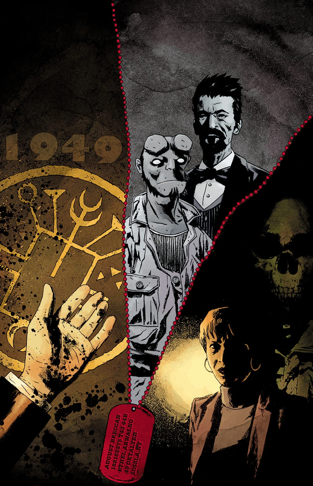
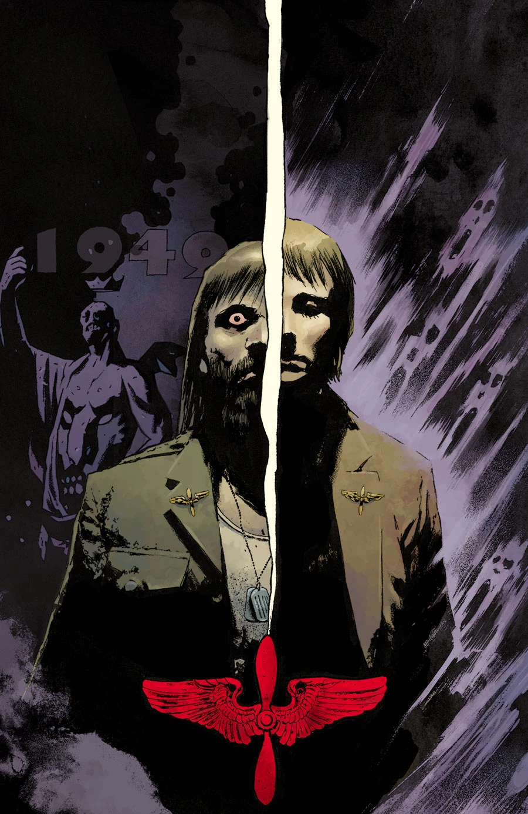

***The Devil's Wings*** is a two-part arc which focuses on [Kate Corrigan](/entry/%E5%87%AF%E7%89%B9%C2%B7%E8%80%83%E7%91%9E%E6%A0%B9)) in the present and [Hellboy](/entry/Hellboy_%28character%29) in flashbacks to 1949.

## Synopsis

### Part One

A blackout causes panic at B.P.R.D. headquarters as Kate comes face to face with the ghost of a satanic veteran.

### Part Two

After a massive blackout shuts down B.P.R.D. headquarters, our heroes are faced with having to exorcise Kate Corrigan and the dead vet who’s with her.

## Gallery

