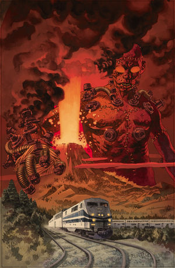
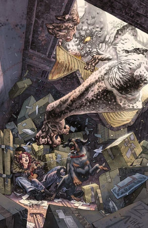
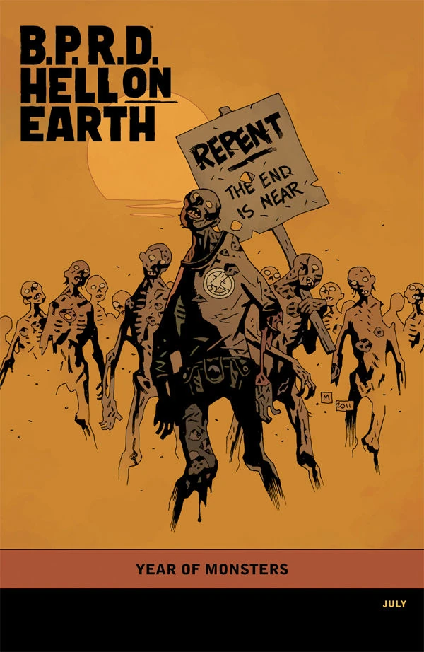

***The Devil's Engine*** is a three-issue miniseries published from May to July 2012.

## Publication History

*The Devil's Engine* is part of the [*Hell on Earth* cycle](/entry/BPRD%3F%E4%BA%BA%E9%97%B4%E5%9C%B0%E7%8B%B1)), continuing the ongoing plotline from *[Russia](/entry/Russia)*. The issues were released with covers by [Duncan Fegredo](/entry/Duncan_Fegredo), with a "[Year of Monsters](/entry/Year_of_Monsters)" variant cover by [Mike Mignola](/entry/Mike_Mignola) for the third issue.

For the trade, *The Devil's Engine* was placed before *The Long Death*.

## Synopsis

### Part One

Caught between bat-faced monsters, a devastating earthquake, and the mad science experiments of [Zinco](/entry/Zinco_Corporation), [Devon](/entry/Andrew_Devon) and [Fenix](/entry/Fenix) form an uneasy alliance in order to get to safety.

### Part Two

A B.P.R.D. agent teams with a psychic crust-punk to combat giant bat-faced monsters as all hell breaks lose.

### Part Three

As Zinco’s latest scheme ends in disaster, Fenix and Devon escape the bat-faced monsters and reveal why Abe needed to die.

## Gallery

 \#1

 \#2

 \#3

 \#3 variant
