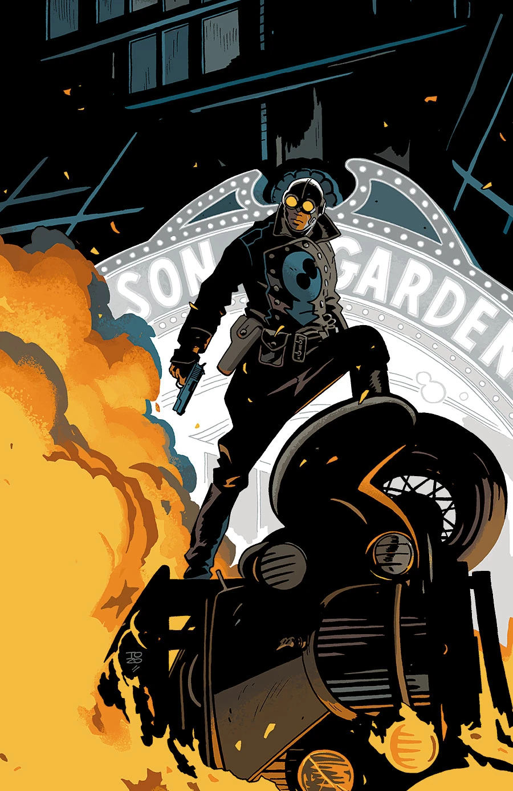
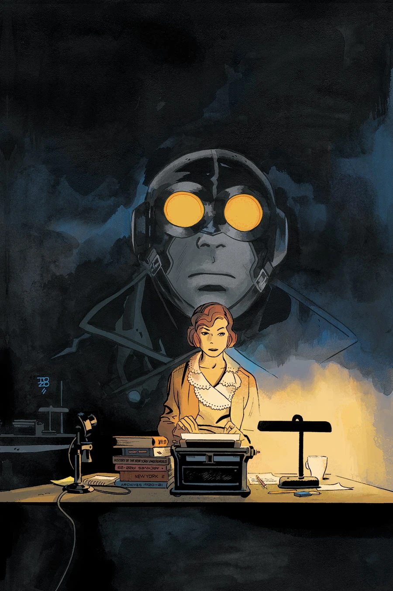
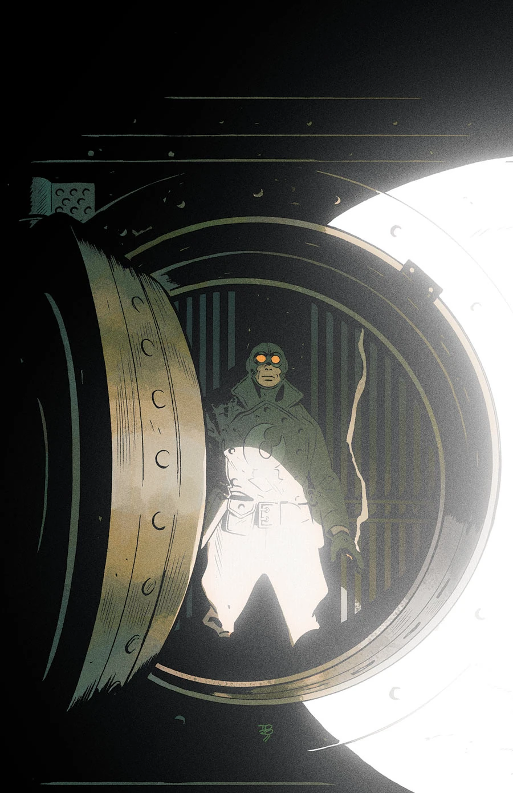
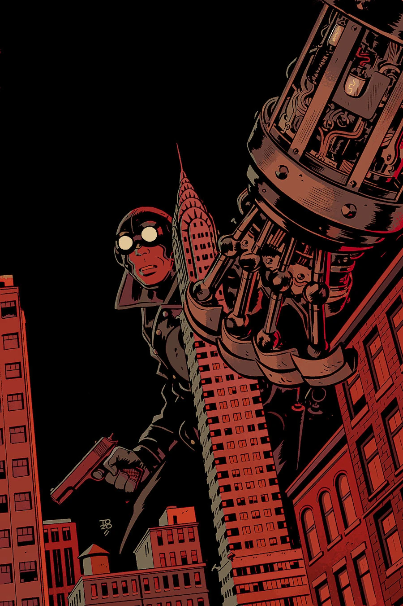
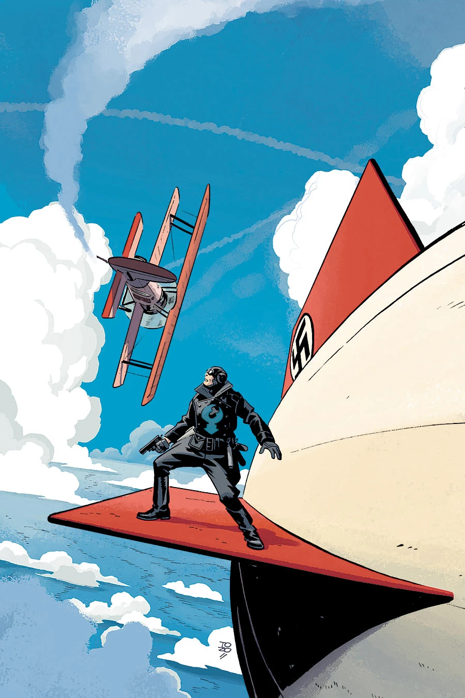

***Get the Lobster!*** is a story takes place early in [the Lobster's](/entry/The_Lobster) career as a crime fighter in the 1930s. This five-issue miniseries will be published in early 2014, with art and covers by [Tonči Zonjić](/entry/Ton%C4%8Di_Zonji%C4%87).

## Synopsis

### Part One

A Manhattan sporting event goes terribly wrong as the ref is killed in front of a live audience by two crazed—and seemingly bulletproof—wrestlers. Who is behind this new reign of terror?

### Part Two

After a grenade fight with two renegade wrestlers, the NYPD declares Lobster Johnson public enemy number one. Can our hero find out who was behind the wrestling rampage with the police hot on his tail?

### Part Three

All police resources are shifted to taking down Lobster Johnson after a vicious grenade fight in the NY streets. Meanwhile, bank vaults all around the city are exploding. Lobster knows it’s a trap, but justice is not afraid of traps.

### Part Four

After shooting a gung-ho NYPD chief right through the head, Lobster heads to the villains' massive laboratory, where he's attacked by two huge steampunk cyborgs!

### Part Five

The Lobster engages in a firefight with a madman in a biplane on top of a zeppelin!

## Gallery

