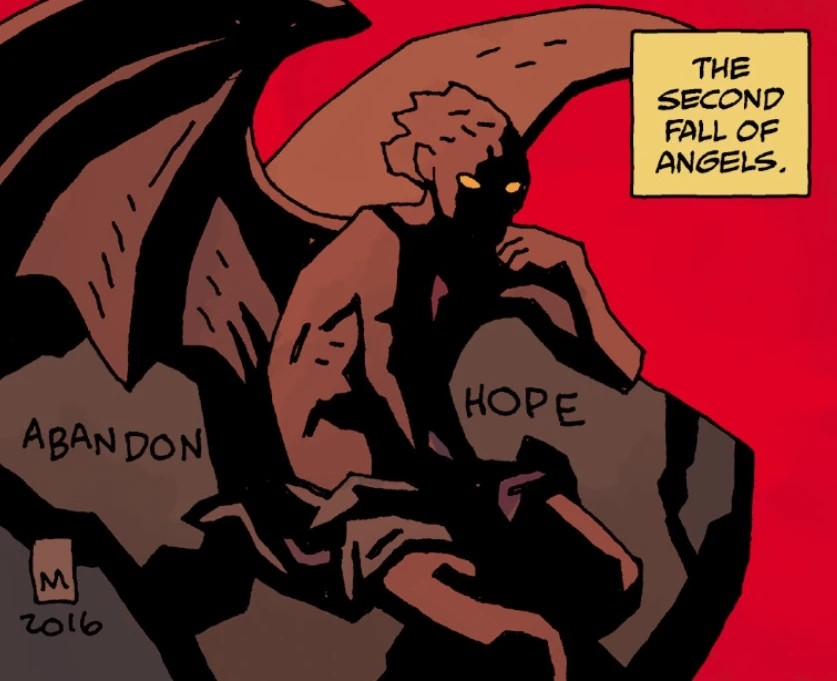

**Satan** or **the Devil** is the foremost enemy of [God](/entry/God). As chief of the rebel spirits, he witnessed the coming of man. He and his followers refused to kneel to God, and for the sin of Pride, were hurled into the Abyss to forever dwell in chains and fire.

However, Satan refused to be bound by his fate and declared himself a king, proceeding to build his city of [Pandemonium](/entry/Pandemonium) after defeating the fallen angels from the First Fall of Angels led by [Pluto](/entry/Pluto).

For reasons unknown, Satan eventually abandoned his position as sole ruler, leaving the governing of Hell to lesser creatures. According to [Astaroth](/entry/Astaroth), he retreated to an underground basement beneath Pandemonium where he has rested for the last two thousand years.

## Death

In [*Hellboy in Hell* \#2](/entry/Hellboy_in_Hell_%28first_story_arc%29), [Hellboy](/entry/Hellboy) learns that all the demon princes and their elite fled Pandemonium, save one. Hellboy's [guide](/entry/Phlegethon) explains that Satan still sleeps alone and unguarded in an underground lair and that it would be a simple matter for someone to go down there and kill him. He presents Hellboy with a knife, telling him of Shakespeare's tale of Macbeth, who also murdered his sleeping king. The scene ends with Hellboy's knife stumbling to the ground, its blade covered in blood.

It is shown that someone approached Satan, causing him to ask who was there, to which they responded by slitting his throat. While Hellboy has no recollection of him doing this, his guide, [Edward Grey](/entry/Edward_Grey), tells him "You don't want to remember. You don't have to. It only matters is that it's done."

## Powers and Abilities

It is unknown what Satan's true powers are, aside from his political power over Pandemonium, but it is likely that he was more powerful than any other demon. Satan's power was tied to the existence of Hell, now that his throne is empty Hell is slowly crumbling. It appears, however, that there is power in his blood, bound to the dagger that killed him, which [Yomyael](/entry/Yomyael) carried with them throughout [*B.P.R.D.: The Devil You Know*](/entry/The_Devil_You_Know_%28story_cycle%29).

## Victims of Misconception

Many people across the various series have, or have been said to have, made a deal with the devil. The fact is that they've mostly dealt with lesser demons, not Satan himself.

[Igor Bromhead](/entry/Igor_Bromhead), and others like him, have capitalized on this factoid by convincing foolish people who wanted to sell their souls to the Devil into making deals with these lesser demons, leaving Satan with an, at least somewhat, undeserved reputation.

[Jeremiah Witkins](/entry/Jeremiah_Witkins) was also implied to have made a deal with the Devil, though it has been proven otherwise.

[Henry Hood](/entry/Henry_Hood), a witch hunter, was supposedly cursed into undeath by the Devil, but it was more likely one of the witches he killed.

## Gallery

|Satan shortly after the second fall of angels.
## Trivia

- The reason why Satan has been sleeping for the last two thousand years, might correlate with the crucifixion of [Jesus Christ](/entry/Jesus_Christ), though this remains unconfirmed.

## Appearance

- [*Hellboy in Hell* (first arc)](/entry/Hellboy_in_Hell_%28first_story_arc%29)
- [*B.P.R.D.: Hell on Earth—End of Days*](/entry/End_of_Days) (corpse)
