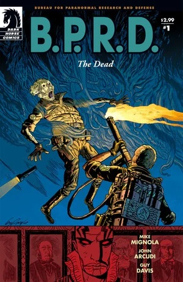
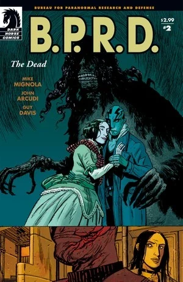
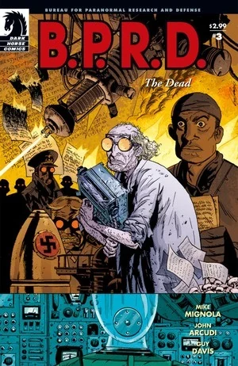
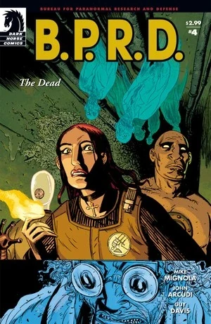
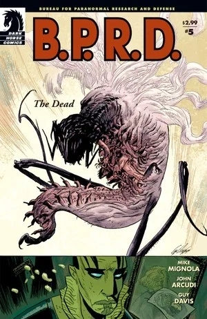

In ***The Dead***, [Ben Daimio](/entry/Benjamin_Daimio) joins the team, and moves them to a new headquarters in Colorado. [Johann Kraus](/entry/Johann_Kraus) explores the new base, uncovering old dangers. Meanwhile, [Abe Sapien](/entry/Abraham_Sapien) and [Kate Corrigan](/entry/%E5%87%AF%E7%89%B9%C2%B7%E8%80%83%E7%91%9E%E6%A0%B9)) look into Abe's newly uncovered past. All the while the [frog monsters](/entry/Frog_monster) continue to spread.

## Publication History

Following *[Plague of Frogs](/entry/Plague_of_Frogs_%28story%29)*, [Mike Mignola](/entry/Mike_Mignola) brought in [John Arcudi](/entry/John_Arcudi) as the regular co-writer for the [*B.P.R.D.*](/entry/B.P.R.D._%28series%29) line.

The five-issue miniseries was published from November 2004 to March 2005. The story was collected in the trade paperback *[B.P.R.D.: The Dead](/entry/Trade_Collections)* in September 2005.

## Synopsis

### Part One

In North Dakota, a barn used by the [frog monsters](/entry/Frog_monster) is investigated by [B.P.R.D.](/entry/Bureau_for_Paranormal_Research_and_Defense) agents. A small egg-like form cracks open and a slug-like creature crawls out. The creature rapidly grows to fill the barn, and the agents frantically attack back.

[Abe Sapien](/entry/Abraham_Sapien) and [Kate Corrigan](/entry/%E5%87%AF%E7%89%B9%C2%B7%E8%80%83%E7%91%9E%E6%A0%B9)) travel to Littleport, Rhode Island to look into Abe's distant past. Abe learns that [Langdon Everett Caul](/entry/Langdon_Everett_Caul) was a sailor under Elihu Cavendish but later settled in Littleport and married Edith Howard. Caul left in 1865 and never returned, unable to deal with the loss, his wife killed herself.

Back at headquarters, the team watch footage of a dead man in a morgue get up and talk. [Thomas Manning](/entry/Thomas_Manning) tells the team that they will be relocating to an old government facility in Colorado, and that [Ben Daimio](/entry/Benjamin_Daimio), the dead man in the video, will be the new Field Team Commander. Daimio makes an awkward introduction to the team.

An old man in a lab coat tends to a room full of mushrooms.

The team fly to their new base in Colorado, while Abe approaches Caul's old home in Littleport.

### Part Two

Abe Sapien enters Caul's house. He remembers back to his vision of Caul's transformation (as seen in [*Plague of Frogs* \#5](/entry/Plague_of_Frogs_%28story%29)).

The team begins to move into the new base in Colorado. While the others settle in Johann Kraus seems distracted.

The old man sits, typing away in a dark room.

Abe is visited by the ghost of Edith Caul. She pulls him into a world where the house is still new, and tries to get Abe to stay with her.

[Liz](/entry/Elizabeth_Sherman) wakes up to see Johann wandering the complex. He hears voices and follows them into an old elevator. He finds a wall and tries to break it down. Liz and Roger take him to see Ben Daimio. He says that they need to focus on the frog monster problem, but he lets them break into the sealed compartment, only to find the frightened old man.

### Part Three

Liz and Ben Daimio try to get information from the old man.

In the subbasement, Johann finds a room full of locked files. One of the drawers open by itself and a book sticks out.

The old man introduces him self as Dr. Gunter Eiss. He was recruited in Germany as a Physicist after the space program failed in 1939 (as seen in [*Conqueror Worm* \#1](/entry/Conqueror_Worm_%28story%29)). He was part of a group trying to harness the power of heaven for the war. However, [Project Ragna Rok](/entry/Project_Ragna_Rok) won out. After the war he came to America to continue the work of [Professor Gallaragas](/entry/Kyriakos_Gallaragas). In 1958, an accident killed most of the researchers, except Eiss. He was sealed in the room, but survived living on mushrooms and spiders.

Johann looks through the book, stopping on a page of images from the 30's and 40's. The images include pictures of [the Black Flame](/entry/The_Black_Flame_%28character%29), [the Crimson Lotus](/entry/Yumiko_Daimio) with a [Noh Monkey](/entry/Noh_monkey), an unknown man (who turns out to be [Memnan Saa](/entry/Memnan_Saa)), The Steel Hawk and a [Vril Energy Suit](/entry/Vril_Energy_Suit). Ben tells Johann that they will send Eiss to a hospital in the morning, but Johann is not so sure.

Eiss wanders the complex, and opens an old locker.

As agents remove the device that Eiss said caused the explosion, they learn that the device has no moving parts and looks to be just a prop of some sort.

Johann is in a room fixing some of the old electronics. In one of the monitors he sees the ghosts of five scientist and talks to them in German. He reaches out to them, and their ectoplasmic forms fly through the base.

Back in Littleport, Kate Corrigan is trying to find Abe. She asks for directions to the Caul house, but is told that she will have to wait till after the storm passes.

Inside the Caul house, Edith holds Abe and tells him she loves him.

### Part Four

The five ghosts fly through the base, as Daimio tries to stop them.

Eiss enters an elevator as a swarm of insects exits.

[Roger](/entry/Roger) and Daimio see Johann, but Johann ignores them, working on some sort of electronics and mumbling to himself in German. Ben rallies the Agents and heads down to the subbasement.

Edith Caul asks Abe Sapien to stay with her forever.

Daimio and the agents catch up to Eiss in the subbasement. Eiss wears an electric device and holds the Spear of Longinus. He shoots electricity out of the spear shocking most of the agents. Eiss explains that he continued working on harnessing the power of heaven, but that his fellow scientists became suspicious. They tried to take apart his work, but it triggered an explosion killing the scientists and sealing him in. Eiss claims that he will open a portal to heaven. As he turns on the machine, Eiss bursts open as a creature grows out of his body.

### Part Five

Daimio frantically looks for a working weapon to fight the creature.

Johann wearing a large contraption on his back heads toward the subbasement, and the creature. When he enters the room the creature attacks. In his search Daimio finds a small Noh monkey in a jar. Johann uses the machinery to close the portal allowing the monster to enter our world, causing a large explosion. The five ghosts leave Johann's containment suit, having completed their task of defeating Eiss. Daimio shoot what is left of Eiss, as a precaution against any further trouble.

Back in Littleport, Abe is still in the world created by Edith Caul. In the house is a covered mirror. Abe, here in the form of Caul, knows that his true form will be reflected in the mirror. He convinces Edith to look and face the truth. She does and vanishes into mist.

## Content

Note: For the content of the prologue included in the Trade Paperback and the Omnibus edition go to [Born Again](/entry/Born_Again)

### Characters

#### Main Story

- North Dakotan Sheriff
- [B.P.R.D.](/entry/Bureau_for_Paranormal_Research_and_Defense)
  - Agent Ferguson
  - [Roger](/entry/Roger)
  - [Johann Kraus](/entry/Johann_Kraus)
  - [Elizabeth Sherman](/entry/Elizabeth_Sherman)
  - [Thomas Manning](/entry/Thomas_Manning)
  - [Benjamin Daimio](/entry/Benjamin_Daimio)
  - Other Personnel
- Roland Wilson (Video)
- Gunter Eiss (Turned into a "Seraphim")
- [Frog Monsters](/entry/Frog_monster)
- [Nazis](/entry/%3ACategory%3ANazi)
  - [Project Ragna Rok](/entry/Project_Ragna_Rok) (Flashback)
    - [Rasputin](/entry/Rasputin) (Flashback)
    - [Karl Ruprect Kroenen](/entry/Karl_Ruprect_Kroenen) (Flashback)
    - [Leopold Kurtz](/entry/Leopold_Kurtz) (Flashback)
- German and American Scientists (Flashback and Spirits)
- [Kyriakos Gallaragas](/entry/Kyriakos_Gallaragas) (Mentioned)
- World War II File (All Photographs)
  - [Raimund Diestel](/entry/Raimund_Diestel) ([The Black Flame](/entry/The_Black_Flame_%28character%29))
  - [Yumiko Daimio (The Crimson Lotus)](/entry/Yumiko_Daimio)
  - [Memnan Saa](/entry/Memnan_Saa)
  - [Rudolf Bergen (The Steel Hawk)](/entry/Rudolf_Bergen)
  - Patrick Redding
- [Noh Monkey](/entry/Noh_monkey) (Corpse and Photograph)

#### Abe's Story

- [B.P.R.D.](/entry/Bureau_for_Paranormal_Research_and_Defense)
  - [Katherine Corrigan](/entry/%E5%87%AF%E7%89%B9%C2%B7%E8%80%83%E7%91%9E%E6%A0%B9))
  - [Abraham Sapien](/entry/Abraham_Sapien)
  - [Scott Clark](/entry/Scott_Clark) (Corpse) (Flashback)
- Whateley Hall Librarian
- [Oannes Society](/entry/Oannes_Society)
  - [Elihu Cavendish](/entry/Elihu_Cavendish) (Flashback)
  - [Langdon Everett Caul](/entry/Abraham_Sapien) (Flashback)
  - Other Members (Flashback)
- Edith Howard
- [Water Spirit](/entry/Water_Spirit) (Flashback)
- Father Nicholas (Severed Head) (Flashback)
- [Hellboy](/entry/Hellboy_%28character%29) (Flashback)
- Humbert T. Jones (Flashback)

### Locations

- U.S.A.
  - Farm in North Dakota
  - [B.P.R.D.](/entry/Bureau_for_Paranormal_Research_and_Defense) Headquarters (Farfield, CT)
  - Littleport, Rhode Island
    - Whateley Hall
    - Abandoned Caul Residence
  - [Cavendish Hall](/entry/Cavendish_Hall) (Upstate New York) (Flashback)
  - Peterson Air Force Base (Colorado Springs, CO)
  - New [B.P.R.D.](/entry/Bureau_for_Paranormal_Research_and_Defense) Headquarters (Colorado)
  - St. Trinian's Hospital (Washington D.C.) (Flashback)
    - [Oannes Society](/entry/Oannes_Society) Meeting Place (Flashback)
  - N.Y.C. Armory (New York City, NY) (Flashback)
- Romania (Flashback)
  - St. Bartholomew Monastery (Flashback)
- Scotland (Flashback)
  - Guarino Residence (LockMaben) (Flashback)
- Atlantic Ocean (Flashback)
- Russia (Photograph)
  - Outisde of Moscow (Photograph)
- Belgium (Photograph)
  - Melines (Photograph)

### Noteworthy Artifacts

- [Oannes Society](/entry/Oannes_Society)
  - Diving Suit (Flashback)
  - Submarine (Flashback)
- [Vril Energy Suit](/entry/Vril_Energy_Suit) (Photograph)
- Robe of Christ
- Spear of Longinus

## Gallery

Covers by Guy Davis

 \#1

 \#2

 \#3

 \#4

 \#5
