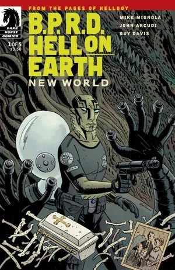
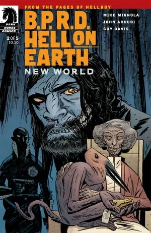
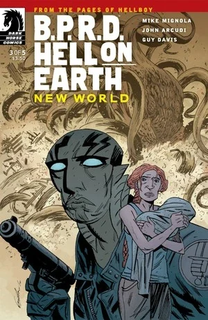
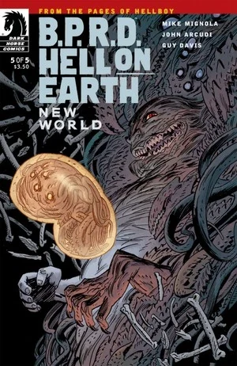
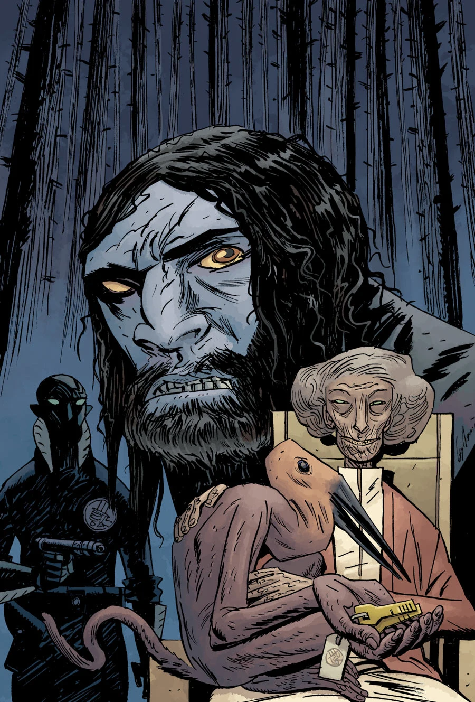

***New World*** is a five-issue miniseries published from August to December 2010. It is the first arc of the [*Hell on Earth* cycle](/entry/BPRD%3F%E4%BA%BA%E9%97%B4%E5%9C%B0%E7%8B%B1)).

## Publication History

Following the conclusion of *[B.P.R.D.: King of Fear](/entry/King_of_Fear_%28story%29)*, the [*B.P.R.D.* line](/entry/Hellboy_Comics) took a two-month break before relaunching as *[B.P.R.D.: Hell on Earth](/entry/BPRD%3F%E4%BA%BA%E9%97%B4%E5%9C%B0%E7%8B%B1))*. *New World* was the first miniseries with the rebranded title.

## Synopsis

### Part One

In Marekeos, British Columbia, people are vanishing without a trace. [Abe Sapien](/entry/Abe_Sapien) is reading an article about sightings of a large white creature in the area, when he receives a video call from [Kate Corrigan](/entry/Kate_Corrigan). She and Abe talk about the search for leads in the fight against the monsters. Abe complains about [Andrew Devon](/entry/Andrew_Devon)'s accusations and suggests firing him. After the call ends Devon walks into Kate's office and tells her to watch Abe, her only response is frustration.

The pair walk to a monitering room, where [Johann Kraus](/entry/Johann_Kraus) sits watching video feed of the creature at Salton Sea, California (as seen in [*King of Fear* \#5](/entry/King_of_Fear_%28story%29)). A bureaucrat now with the B.P.R.D. tells Kate about a lake monster sighting in France, and she decides to send Devon to investigate.

Behind them a TV reporter is interviewing a man. The man is critical of the U.N.'s involvement on American soil and wants "humans" not "monsters" to deal with the problems.

Kate gets a call from Agent [Carla Giarocco](/entry/Carla_Giarocco). She says that the latest lead turned up nothing. She also tells Kate that Abe took a Humvee and went north.

Abe stands in the now deserted town of Marekeos.

Meanwhile a man in a graveyard exhumes a small casket.

The bespectacled representative of the UN Security Council looks through a few files and finds a picture of [Daryl Tynon](/entry/Daryl_Tynon) and his family. He asks Kate about it, but she changes the subject.

Johann stops in to look at the still incomplete body recovered from the [Oannes Society](/entry/Oannes_Society), while one of [Panya](/entry/Panya_%28character%29)'s pets looks on.

Abe travels into the forest of British Columbia, following up on the last sighting of the white monster. As he wanders alone suddenly a grisly bearded man jumps out and demands to know what Abe is doing.

### Part Two

Kate is having scheduling difficulties with the BPRD agents, and Johann claims he isn't available to pick up shifts. He has been spending his time watching the synthetic body in its tank. one of Panya's pet steals the key to this room. Johann chases it to Panya. The issue is finally taken to Kate, where Johann accusses Panya of stealing the keys to free all the creatures recovered from her island.

On television, Reverend Nedin says the hellish events that are unfolding are the result of sin and the way it has spread unchecked. Two men, Jeb and Todd, watch the program in a trailer park. Todd gets aggravated by the program and starts yelling at the television set, but he is warned by Jeb to be quiet in case he wakes the woman in the other room. Todd angrily storms out.

Abe and [Ben Daimio](/entry/Ben_Daimio) (the bearded man from the end of the previous issue) sit around a fire in the woods. Abe tries to convince him to return to the BPRD, but Daimio would rather stay in the woods where there's no one to hurt. As they sleep, they are watched by the wendigo, Daryl.

In the morning, Daimio takes Abe to a lake called Hell's Kettle with black water. Damio believes it is somehow connected to the disappearences. Abe decides to investigate and dives in. The water is full of rotting corpses.

### Part Three

In Lynne, British Columbia, a woman walks into a diner with a sheriff—with her is her baby wrapped in a blanket and held to her chest. When the waitress attempts to have a look at the baby the woman becomes upset and agitated. One of the other patrons suddenely starts to choke and vomit green mucus. As others rush to help the dieing man, the woman and the sheriff stand at the bar without reacting. As she cradles her child, the sheriff's eyes are revealed as completely black and his expression glazed over.

At B.P.R.D headquarters Kate, Johann and the UN liason react in horror at news reports of a volcano materialising beneath Houston, Texas and erupting; destroying the city and killing millions. They quickly overcome their horror and shock realising the need for a B.P.R.D presence in the area to deal with the media as FEMA deal with the destruction. Kate volunteers, leaving Johann in the charge.

In Canadian wilderness, Abe and Ben haul bodies from Hell's Kettle. After realising they are the deceased residents of Marekeos they decide to head to the nearest town to Marekeos; Lynne. Upon arrival they find that the residents have already vanished save for three—the same woman from the beginning and her baby, and another man, who start to head into a house. As Ben approaches them he sees the black eyes of the man just as he closes the door on them and recognises the danger. He runs back to the car and shouts for Abe to drive just as an enormous monster bursts out of the building and gives chase.

At B.P.R.D headquarters the UN liason is surprised to find Panya in the control centre viewing the monitors and not Johann, who has returned to staring at the remaining Oannes society body while upgarding the security in the room.

Abe continues to drive as fast from the monster as possible, Ben uses every weapon and explosive at his disposal to keep it back. Eventually, after losing one car and hotwiring another, they manage to escape the creature. The woman emerges with her child from the wreckage of the house unharmed and starts to walk down the road

As Abe and Ben return to their camp to rearm and organise their next plan they find a man waiting for them sat at the campfire; a child's coffin next to him.

### Part Four

The man reveals he was a US soldier who left his pregnant wife, Nessa, for a tour of duty overseas. He was injured, and in his absense his son was born. Upon his return he found his wife strange and distant, forbidding him from seeing his son claiming that he was ill. She never left the child's side and soon he grew concerned, contacting his wife's family and learning that she had lost the baby while he was away. Stunned by this revelation he attempted to find out what it was sleeping in his son's nursery but Nessa knocked him out and fled with the "child" before he could learn.

Now he has hunted across the wilderness, dragging the body of their real baby in its coffin with him, in a desperate attempt to convince her their son is dead—and to get her away from whatever creature has now latched onto her. At that moment the same monster that chased them in Lynne comes through the trees and attacks their camp.

At B.P.R.D headquarters the UN liason complains to Kate he is having to cover the monitors as they are understaffed and Johann has failed to report to duty. She asks him to get Carla Giarocco to cover instead.

Johann continues to sit and observe the Oannes society body when he detects brainwave activity and the body moves, pressing his hand against the glass. Johann is overjoyed at the sight of movement, as Panya watches from the doorway with a mischievous smile.

Abe, Ben and the soldier continue to do battle with the creature. Ben begins to feel himself undergoing transformation into the Were-Jaguar while the soldier is killed by the monster's tentacles. As Abe runs out of ammunition the wendigo, Daryl, emerges from the forest and attacks the creature alongside Abe. Ben realises the creature is not following them but the woman Nessa and runs into the forest to find her, convinced she is nearby. Nessa strikes Ben with the a club, but he is able to disarm her, and sees the "child" she has been carrying this whole time is small, many tentacled monster not unlike the one they have been battling. As he stands over her and prepares the killing blow the spirit of the creature rises behind him.

### Part Five

As Abe flees from the monster, Ben is attacked by the creature's spirit as it attempts to gain control of him. At that moment their minds touch and he see's its thoughts—how it had come through to the world as Nessa, alone and without her husband, mourned the death of their baby. He sees how it had impregnated in her womb and begun to grow with its "twin". Ben eventually musters up enough strength of will to overcome the creature and shoot Nessa. As the spirit fades away she laments why God would not allow her a child and she dies along with both monsters.

As Abe and Ben dig graves to lay the family to rest, Ben relates what he learned. That the monster was one of the [Ogdru Hem](/entry/Ogdru_Hem) that had been without shape or form. How it had been attracted by Nessa's grief, using her as anchor to make itself corporeal. It had used her ovaries to grow itself, splitting a piece off and creating a "twin". This twin had grown into the large monster that they had fought, gorging on animal flesh to grow to huge proportions and act as a protector; though it was able to disguise itself as a human (the sheriff in Lynne; the man in the house). The other monster, the original, was smaller and exclusively devoured souls, and was ultimately responsibe for the all the missing people. Nevertheless it was Nessa's life that tethered them to the world and with her death the creature's spirit had dissipated—killing both "twins".

Abe is horrified by the revelation and is surprised that this has not happened before. Ben expresses his belief that the world has reached a tipping point and only now are these horrors able to slip through into their world. Abe requests Ben return to the Bureau but Ben declines, warning Abe that the greatest danger is the invasion into people's hearts and minds; that this poses a greater risk than any monster like the one that has risen from the Salton Sea. He does ask Abe to retrieve a few things from HQ however.

At B.P.R.D headquarters Abe is debriefed alongside Agent Devon, Johann and Kate Corrigan about the missing persons. Devon is hostile toward Abe, questioning why he ventured to British Columbia in the first place. Abe defends his actions and starts to storm out only for a tech assistant to enter and report that Abe's laptop had been bugged with spyware. An enraged Abe accuses Devon of spying on him while Devon pleads ignorance. Kate tries to diffuse the situation but to no avail.

In his office, it is revealed Johann had been responsible for the spyware. As he analyses the data on Abe's laptop and see's newspaper reports of sighting of the Wendigo in British Columbia, he opens his drawer and looks at the knife he had taken from Chaves in the *[Killing Ground](/entry/Killing_Ground)*—the knife capable of destroying the Were-jaguar.

In a stretch of forest Abe meets in secret with Ben to give him some supplies, including cigars and a laminated photo of Daryl's family. The two wish each other luck and part ways.

## Gallery

 \#1

 \#2

 \#3

 \#4

 \#5

### Alternate Issue 2 Cover

 For the solicitations, the cover of issue 2 was modified to keep the return of Daimio a secret. Shortly after the publication of issue 1, the true cover was revealed.
