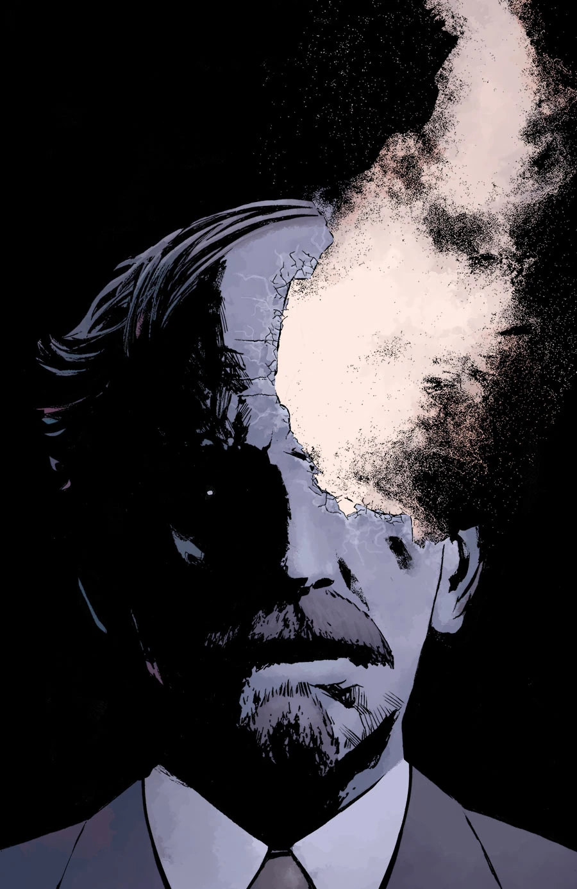
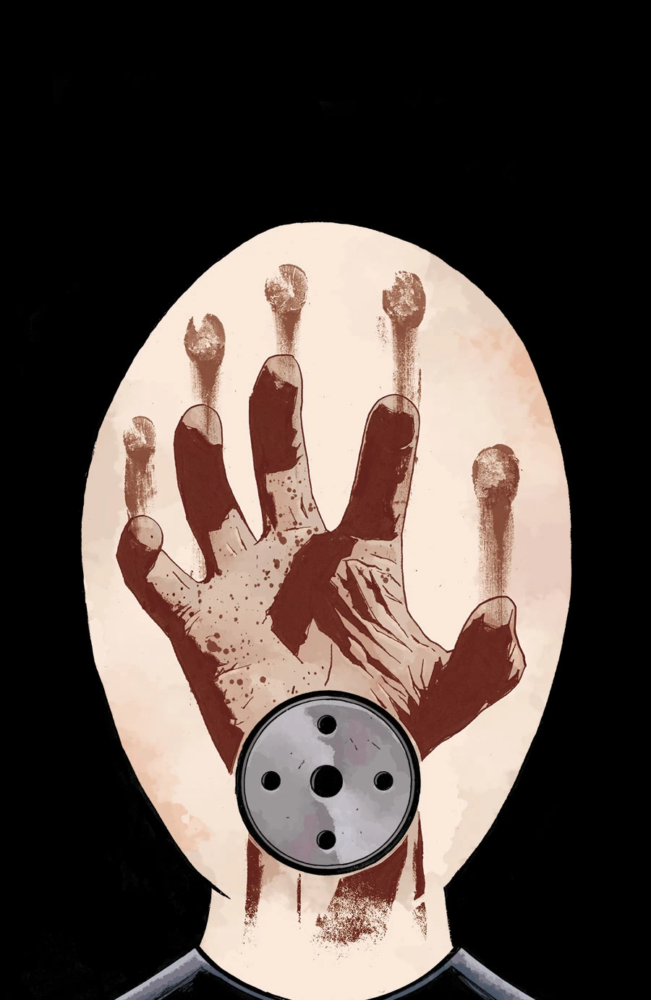
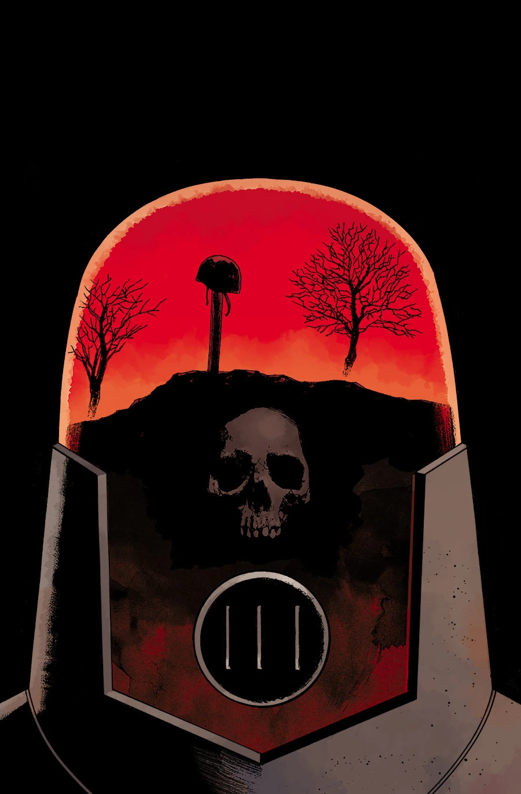

***Nowhere, Nothing, Never*** is a three-issue arc drawn by Peter Snejbjerg.

## Announcement

The arc was announced as a part of October's "13 Days of Hellboy" campaign on [Comic Book Resources](http://www.comicbookresources.com/?page=article&id=56025). Little was revealed about the project beyond its title and a quote from [Scott Allie](/entry/Scott_Allie):

> Arcudi’s biggest contribution to Mignola’s world is to populate it with living breathing people. Unfortunately, they don’t always stay living or breathing. They deal with the mortality of their own teammates too often, and for most of them it doesn’t get easier. Johann’s blurry relationship with mortality comes into focus because it’s gotten too easy for him to accept the deaths of the people around him…

## Synopsis

### Part One

Agent [Johann’s](/entry/Johann_Kraus) alienation from the other [B.P.R.D.](/entry/Bureau_for_Paranormal_Research_and_Defense) agents after a horrific mission causes him to take drastic measures. Will the other agents tell [Kate](/entry/Kate_Corrigan) what really happened? What will happen to the ghost agent?

### Part Two

Kate confronts the BPRD agents after Johann’s disappearance to learn the truth about the motel massacre in a small Kansas town.

### Part Three

Johann returns to the grave of an agent who died under his watch, only to discover the death was worse than he knew.

## Gallery

