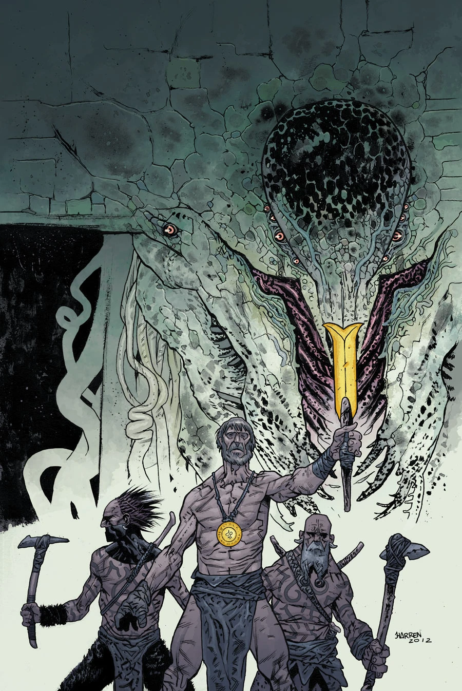

***The Abyss of Time*** is a two-issue miniseries published from January to February 2013.

## Synopsis

### Part One

A group of agents enter an abandoned warehouse in Chicago, only to discover the site of a hundred-year-old magical ritual and an old Hyperborean weapon, which leads to shocking revelations about man’s prehistory and the legacy of the Ogdru Hem!

### Part Two

Transported back to the Prehistoric times, B.P.R.D. [Agent Howards](/entry/Ted_Howards) finds himself among a tribe of cavemen locked in battle with a group of monsters and the evil god they worship.

## Gallery

Covers by [James Harren](/entry/James_Harren).

