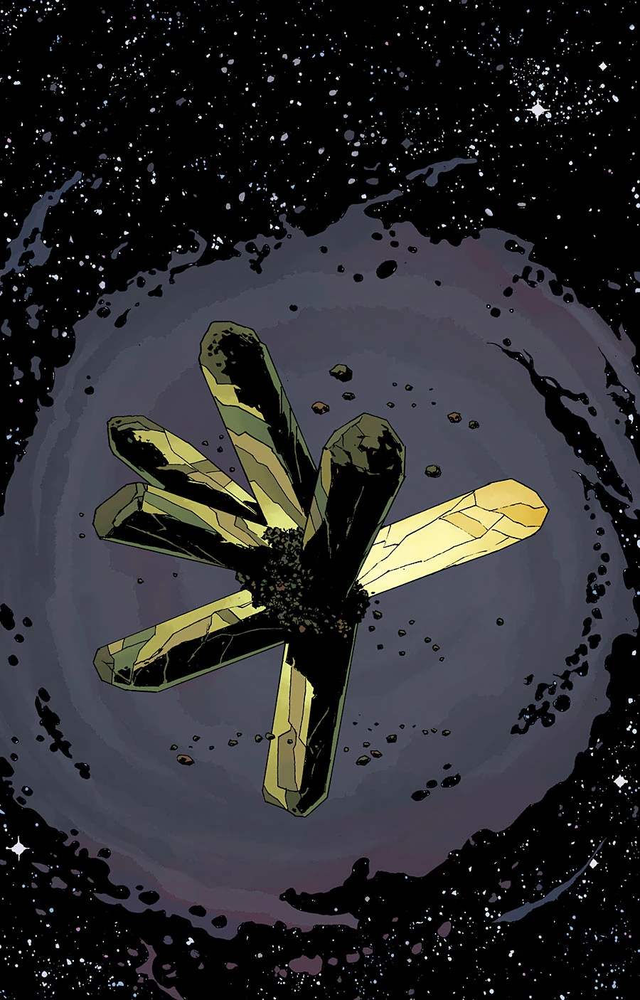
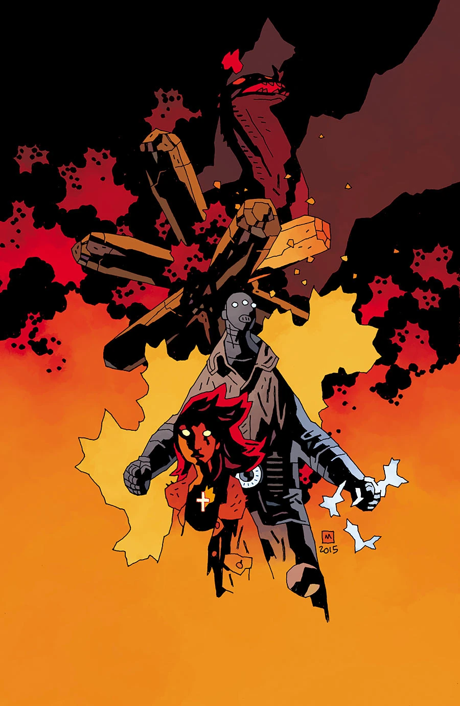
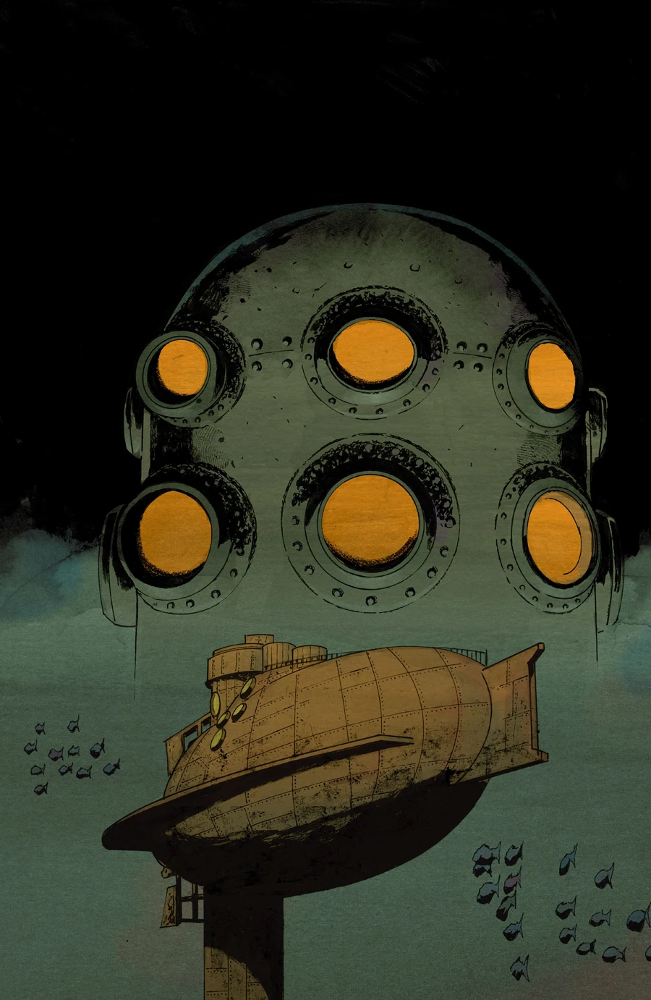
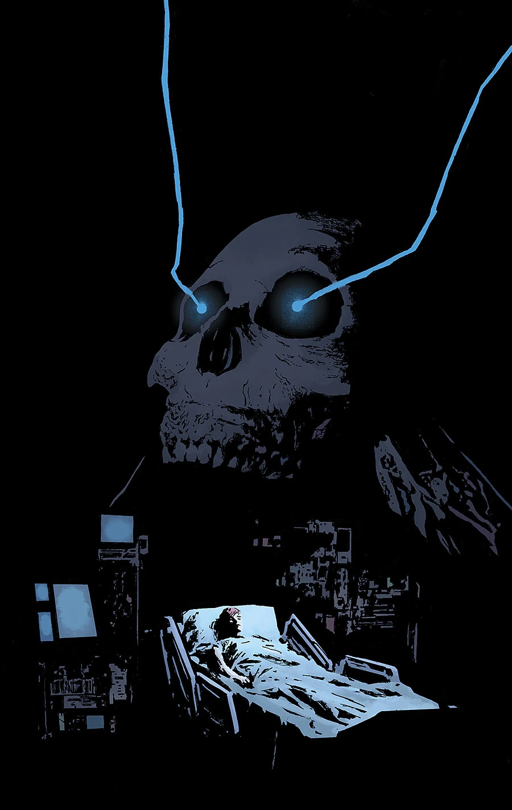
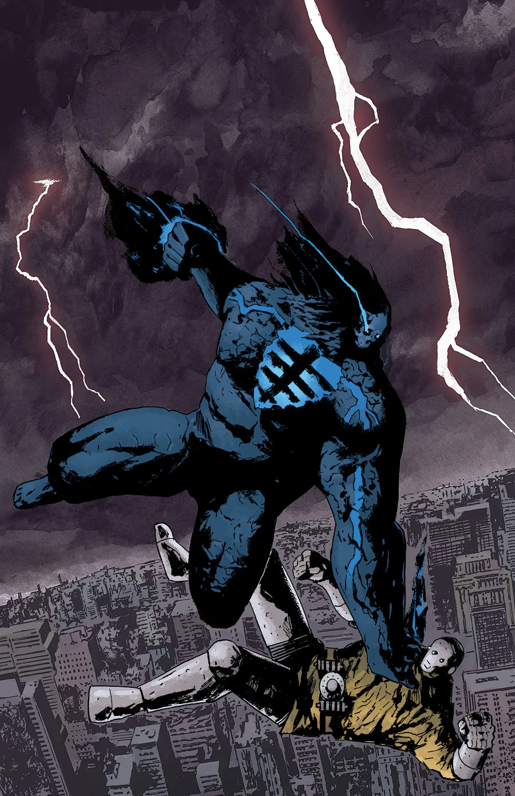
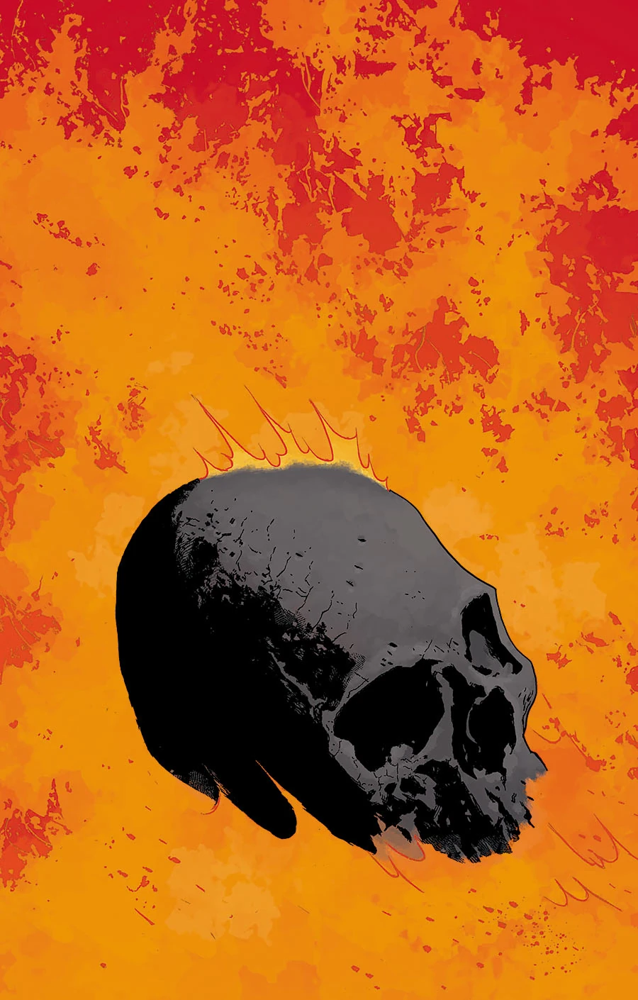

***End of Days*** is a five-issue arc and the first half of the final massive story of *[B.P.R.D.: Hell on Earth](/entry/BPRD%3F%E4%BA%BA%E9%97%B4%E5%9C%B0%E7%8B%B1))*.

## Publication History

A promotional image for this arc was first revealed on [Bleeding Cool](http://www.bleedingcool.com/2015/05/13/dark-horse-reveals-the-impossible-will-happen-for-the-mignolaverse-this-summer-plus-august-covers/), May 2015.

## Synopsis

### Part One

The impossible will happen!

The stakes have never been higher going into the final massive story of Hell on Earth as the Black Flame tests the limits of his power.

### Part Two

The Midwest is in trouble! With the BPRD’s largest foe unleashed upon the earth, they struggle to keep the devastation from spreading, but even their strongest weapons are useless!

### Part Three

The BPRD send their two strongest champions to assist in the destruction of the Black Flame, and with the help of their newest ally’s incredible weapon, things are finally looking up.

### Part Four

The Black Flame has returned and is wreaking havoc on the Hudson River! Panya and Kate try to psychically help from BPRD headquarters while Liz and Johann battle the Black Flame to stop him from destroying New York City.

### Part Five

The battle between the BPRD and the Black Flame rages on! As the team in Denver tries to take down the enemy from afar, Liz and Johann are out to end the fight against the Black Flame before he destroys New York City.

## *Kill the Black Flame*

This two-page back-up feature written and drawn by [Matt Strackbein](/entry/Matt_Strackbein) appeared in *B.P.R.D.: Hell on Earth—End of Days* \#1. It recapped the history of [the Black Flame](/entry/The_Black_Flame_%28character%29). It is not included any any collections.

## Gallery

Mike Mignola variant

NYCC variant

