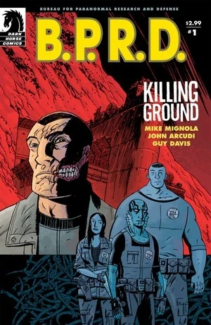
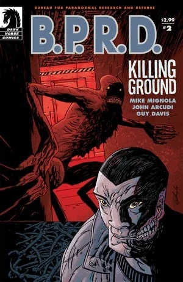
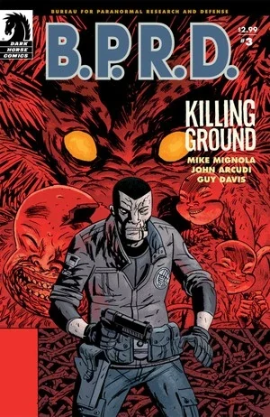
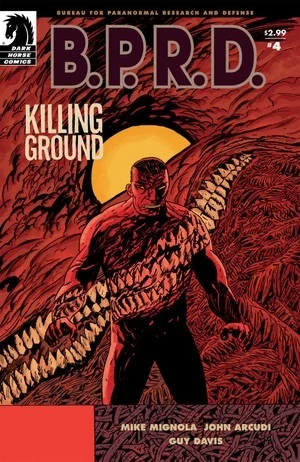
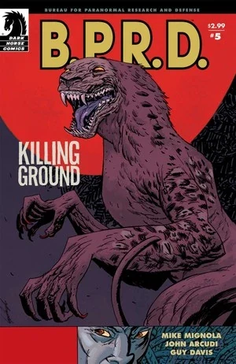

***Killing Ground*** is a five-issue miniseries published in the second half of 2007.

## Publication History

The five-issue miniseries was published from August to December 2007. The story was collected in the trade paperback *[B.P.R.D.: Killing Ground](/entry/Trade_Collections)* in May 2008.

## Synopsis

### Part One

The [B.P.R.D.](/entry/Bureau_for_Paranormal_Research_and_Defense) is changing. [Abe's](/entry/Abraham_Sapien) encounter in Indonesia has brought a new member to the Bureau and [Johann](/entry/Johann_Kraus) finds himself in possession of a very valuable commodity. But not all the changes are for the better, and the B.P.R.D. will need all of its new resources to handle the sinister forces that have wormed their way into the heart of the Bureau's headquarters as the line blurs between the hunters of the supernatural and their prey.

### Part Two

Something wicked has come to the B.P.R.D. as [Liz's](/entry/Liz_Sherman) apocalyptic visions escalate and [Daimio](/entry/Benjamin_Daimio) continues to withdraw from his teammates.

### Part Three

Something wicked has come to the B.P.R.D.'s new headquarters. With a [monster](/entry/Daryl_Tynon) loose and a mysterious armed intruder in the complex, the body count is rising, and the agents of the B.P.R.D. are running out of time to determine whom they can trust.

### Part Four

A mysterious monster is killing its way through the heart of B.P.R.D. headquarters, leaving the agents helpless as Liz withdraws further into the world of her visions.

### Part Five

The monsters have disappeared, leaving a wake of dead bodies and unanswered questions in B.P.R.D.: Killing Ground's final issue. [Kate](/entry/Kate_Corrigan) and Johann hope to get some answers from the people who hold the key to the recent murders: the victims.

## Content

### Characters

#### [B.P.R.D.](/entry/Bureau_for_Paranormal_Research_and_Defense)

- [Benjamin Daimio](/entry/Benjamin_Daimio) (Werejaguar)
- [Elizabeth Sherman](/entry/Elizabeth_Sherman)
- [Katherine Corrigan](/entry/%E5%87%AF%E7%89%B9%C2%B7%E8%80%83%E7%91%9E%E6%A0%B9))
- [Johann Kraus](/entry/Johann_Kraus)
- [Abraham Sapien](/entry/Abraham_Sapien)
- [Panya](/entry/Panya_%28character%29)
- [James Henry O’Donnell](/entry/J%C2%B7H%C2%B7%E5%A5%A5%E5%94%90%E7%BA%B3%E6%95%99%E6%8E%88))
- [Andrew Devon](/entry/Andrew_Devon)
- [Thomas Manning](/entry/Thomas_Manning) (Mentioned)
- Mr. Dorne
- Other Agents and Personnel

#### Others

- Manuel Antonio Chaves
- [Daryl Tynon](/entry/Daryl_Tynon) ([Wendigo](/entry/Wendigo))
- [Ogdru Hem](/entry/Ogdru_Hem) (Dream/Vision)
- [Frog Monsters](/entry/Frog_monster) (Dream/Vision)
- [Memnan Saa](/entry/Memnan_Saa)
- "Chinaman"
- Olly (Cat)
- [Panya](/entry/Panya_%28character%29)'s Dream
  - Olavisi (Cat)
  - Panya's Father/Akhenaten
- [Johann's](/entry/Johann_Kraus) "Friends" (Pauline, Faye, etc.)
- [The Lobster](/entry/The_Lobster)
- Chaves's story (Flashbacks)
  - Eric Polanco (Werejaguar)
  - Army Colonel
  - Huyana

### Locations

- U.S.A.
  - [B.P.R.D.](/entry/Bureau_for_Paranormal_Research_and_Defense) Headquarters (Colorado)
  - Former [B.P.R.D.](/entry/Bureau_for_Paranormal_Research_and_Defense) Headquarters (Farfield, CT)
  - Shaney's Boot Scootin' Roadhouse (Outside Boulder, Colorado)
- Egypt (Dream)
  - [Panya](/entry/Panya_%28character%29)'s Home (Dream)
- Bolivia (Flashback)

### Noteworthy Artifacts

- [Oannes Society's](/entry/Oannes_Society) Biological Body
- [Noh Monkey](/entry/Noh_monkey) in a Jar
- [Spiked Cylinder](/entry/Spiked_Cylinder) ([Hyperborean](/entry/Hyperboreans) Artifact) (Dream) 
- Huyana's Dagger

## Trivia

- A panel that features [Daryl the Wendigo](/entry/Daryl_Tynon) eating a goat is a reference to Goya's painting ["Saturn Devouring His Son"](https://en.wikipedia.org/wiki/Saturn_Devouring_His_Son). The same painting was referenced again on the cover of [The Long Death](/entry/The_Long_Death) issue \#2. Goya is also mentioned prominently in the Hellboy story [In the Chapel of Moloch](/entry/In_the_Chapel_of_Moloch).
- The song playing in "Shaney's Boot Scootin' Roadhouse" is ["Achy Breaky Heart"](https://en.wikipedia.org/wiki/Achy_Breaky_Heart) originally written by Don Von Tress. The most popular version of the song (And the one that is probably being referenced) was recorded by [Billy Ray Cyrus](https://en.wikipedia.org/wiki/Billy_Ray_Cyrus).

## Gallery

Covers by Guy Davis

 \#1

 \#2

 \#3

 \#4

 \#5
