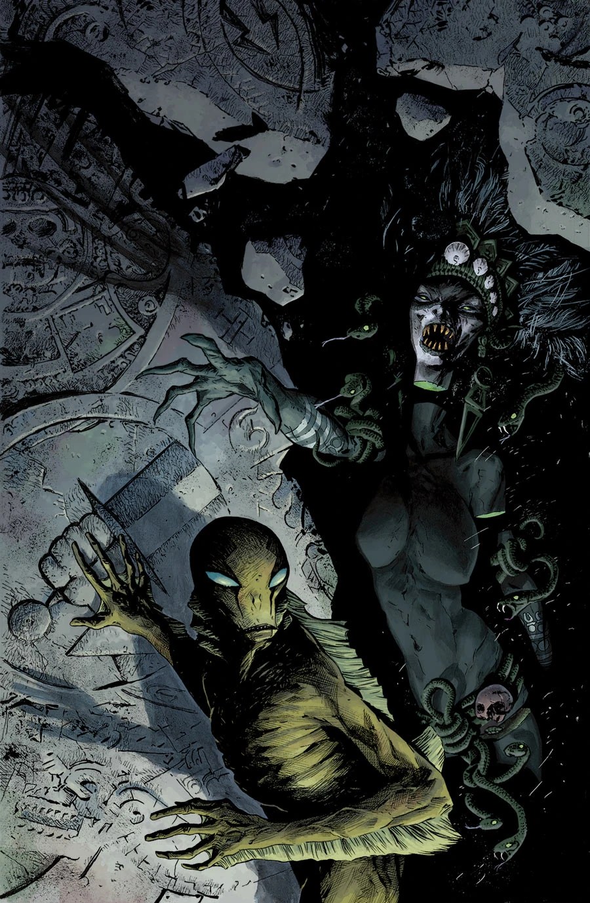

***The Shape of Things to Come*** is a two-issue arc published from October to November 2013 with art by Sebastián Fiumara.

## Synopsis

### Part One

[Abe](/entry/Abraham_Sapien) uncovers connections between the Hell on Earth he and the [B.P.R.D.](/entry/Bureau_for_Paranormal_Research_and_Defense) are experiencing, and blood-soaked Mayan legends of the origins of man and the end of the world.

### Part Two

Abe dives into a fight between carnivorous monsters crawling out of the desert sand and the fortified militia that's walled Phoenix off from the rest of the world.
Abe vs. the Mayan apocalypse!

## Gallery

