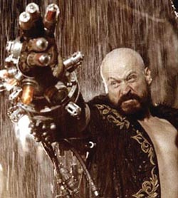

*Everytime I died, I crossed over, and little more of the master came back with me.*

*<small>~ Grigori Yefimovich Rasputin (about himself and the Behemoth).</small>*

*Believe me, I lived long enough to know... not a tear will be shed for this world!*

<small>~ Grigori Yefimovich Rasputin</small>

*Child, look what you have done. You have killed me, an insignificant man. But in my place, there shall rise...a god...*

~ Grigori Rasputin, in his final moments as the Behemoth emerges from his body

**Grigori Rasputin** was a prominent agent of the [Ogdru Jahad](/entry/Ogdru_Jahad) and the archenemy of [Hellboy](/entry/Hellboy_%28character%29). (full name: **Grigori Yefimovich Rasputin**) is a secondary antagonist in the comic book series *Hellboy*. He is based on the real life [Russian mystic](/entry/%3Awikipedia%3AGrigori_Rasputin) that was connected to the late Romanov family of imperial Russia.

## History

Grigori Rasputin was born on January 21 1869. As a young man he frequently had visions, and was aware of great power inside him, the ability to heal sick people and see the future. These powers convinced him he was destined for greatness. He used his power to gain a place in the court of Tsar Nicholas II, using his powers to cure prince Alexei's hemophilia.

In 1902 he had an affair with Zoya, who later came to him with the news that she was expecting his child. Sensing something about the girl Zoya was carrying, Rasputin sent her away. Zoya would once again visit Rasputin in January 1913, accompanied by her husband Yuri and her daughter, whom she had named [Varvara](/entry/Varvara) after his legitimate child to spite him. He killed Yuri and left Varvara and a sickly Zoya in the cold. Zoya died by the following sunrise, and Varvara was possessed by the demon [Yomyael](/entry/Yomyael) shortly afterwards.[1]

### Voice of the Dragon

After being assassinated by Prince Felix Yusopov on 16 December, 1916, Rasputin was revived and contacted by the [Ogdru Jahad](/entry/Ogdru_Jahad) to act as their mortal agent in the world. He subsequently fled to Italy to meditate and come into the contact with the Dragon again. In July, 1937, Rasputin was found by [Heinrich Himmler](/entry/Heinrich_Himmler) and offered the chance to develop on an occult method for ending the Second World War. Rasputin knew Nazi Germany would not win the war, but intended to use its resources as long as he could to achieve his own goals: to trigger the apocalypse which would jump-start a new Eden.

[Project Ragna Rok](/entry/Project_Ragna_Rok) was thus born, headed by Rasputin and a group of Nazi scientists he chose as his followers: [Ilsa Haupstein](/entry/Ilsa_Haupstein), [Karl Ruprect Kroenen](/entry/Karl_Ruprect_Kroenen), and [Leopold Kurtz](/entry/Leopold_Kurtz). In 1941, under the auspices of 'Operation Geist', Kroenen and Kurtz summoned the spirit of Albert Mayhew and bound it to the body to a German soldier for Rasputin to find and gain access to the tomb of Eugene Remy. Mayhew showed them the way to the tomb in Paris and opened it but was killed by Remy's spirit in retribution. Rasputin killed [A.N. Sandhu](/entry/A.N._Sandhu) when he tried to intervene to stop him and gained the ancient tablet that had been buried with Remy. The tablet would provide him with the new knowledge of the Dragon he sought.[2]

### Seed of Destruction

In December, 1944, Rasputin held a ritual on a small island off the Scottish coast that was meant to summon the Beast of the Apocalypse for the Nazis. He was successful in summoning [the creature](/entry/Hellboy_%28character%29), but to another location and into the hands of the Allies instead. While he was confident in what he had set in motion, Rasputin had his followers frozen in suspended animation and retreated to the Arctic Circle. While Rasputin entered into a frozen state himself, the creature he summoned would be raised by [Trevor Bruttenholm](/entry/Trevor_Bruttenholm) as Hellboy.

He returned in 1994 with [Sadu-Hem](/entry/Sadu-Hem), a monstrous spawn of the Ogdru Jahad, in tow. Rasputin's goal was to use Hellboy's stone right hand to free the Ogdru Jahad from their crystal prisons and permit them to raze the earth. However, Rasputin's plans were foiled by the timely intervention of Hellboy's associates from the [Bureau for Paranormal Research and Defense](/entry/Bureau_for_Paranormal_Research_and_Defense), [Liz Sherman](/entry/Liz_Sherman) and [Abe Sapien](/entry/Abe_Sapien). Rasputin was killed and Sadu-Hem was burned to death.

### Wake the Devil

Rasputin re-appeared as a ghost while his pawns attempted to restore the [vampire](/entry/vampire_%28creature%29) [Vladimir Giurescu](/entry/Vladimir_Giurescu) to life. Rasputin directed [Ilsa Haupstein](/entry/Ilsa_Haupstein), a loyal member of Project Ragna Rok, to abandon her efforts to revive Giurescu and instead place herself within an enchanted iron maiden presented by [Koku](/entry/Koku). Haupstein did so, dying in the process, but her blood allowed the goddess [Hecate](/entry/Hecate) to use the iron maiden as a permanent and indestructible body. Hecate's mortal form, like that of Rasputin himself, had been destroyed. Soon after, Rasputin retreated to the roots of Yggdrasil where he met the [Baba Yaga](/entry/Baba_Yaga), who she tells him that he was nothing but a pawn for the Ogdru Jahad.

### Conqueror Worm

Rasputin appeared lastly in his ghostly form as a counsel to [Inger von Klempt](/entry/Inger_von_Klempt). He persuaded her that she was to be the first of a final race of men, but she was executed by [Lobster Johnson](/entry/Lobster_Johnson) and the end of the world was averted with the destruction of the [Conqueror Worm](/entry/Conqueror_Worm). Rasputin's failed efforts to restart his new Eden was mocked by Hecate, to which Rasputin angrily lashed out at the goddess in response and, as a result, he is then decimated by Hecate. [The Baba Yaga](/entry/Baba_Yaga_%28character%29) took what was left of his soul and placed it in an acorn.

### Legacy

#### Rasputin's Acolyte

When the BPRD investigated the disappearance of a regenerated [Sadu-Hem](/entry/Sadu-Hem) from a Bureau facility in New Jersey, they found a Doomsday cult led by an acolyte of Rasputin. The acolyte, who had exhibited a chest wound the day that Rasputin was speared to death, fulfilled Rasputin's prophecy regarding his killer. [Abe Sapien](/entry/Abe_Sapien), the agent that killed Rasputin, was himself speared to death by the acolyte. Sapien, however, was soon revived and both the acolyte and Sadu-Hem were killed.

#### Darkness Calls

Towards the end of the series, as Hellboy is trying to fight his way out of [the Baba Yaga](/entry/Baba_Yaga_%28character%29)'s world, the villainess puts as much of her power as she can into her slave [Koshchei (character)](/entry/Koshchei_%28character%29) the Deathless to kill Hellboy. As she runs out of her own power, she states she has one more try, and wants to use the spirit of Rasputin, (who is still in the acorn) to power Koshchei. But her demon friend [Koku](/entry/Koku) throws the acorn between the roots of the World Tree, stating «not him.» Hellboy hears Rasputin's name mentioned and only states «Don't even get me started on that guy!» The acorn containing Rasuptin's soul then fell into Hell, and ultimately to the Abyss.

### Return

When one of the Ogdru Jahad is summoned to Earth and defeated, its darkness finds its way to Rasputin. He faces off against [Edward Grey](/entry/Edward_Grey) in Hell and is returned to Earth through Varvara once she is freed of [Yomyael](/entry/Yomyael)'s possession. Rasputin once again faces Hellboy, empowered by the Dragon. However, Hellboy manages to gain the upper hand by tapping into the powers of Hell, snapping Rasputin's neck and ending his threat for good.

Nonetheless, Hellboy still had to call on Liz Sherman to unleash her power and to destroy the remaining Sadu-Hem, scorching the Earth and brining about Ragnarok in the process. The remaining Ogdru Jahad were summoned to Earth dead, their power absorbed by the [Osiris Club](/entry/Osiris_Club), whom Hellboy defeated soon afterwards. What remained of humanity was forced underground, and a new race of frog-men emerged from Abe Sapien. In a way, Rasputin's vision of the future thus became a reality, but without a place for him or the Dragon in it.

## Powers and Abilities

Even before Grigori Rasputin was recruited by the Ogdru Jahad, he possessed some measure of supernatural abilities, including the power to temporarily heal others. After he made contact with the Baba Yaga in the late nineteenth/early twentieth century, his powers truly began to come into their own, making Rasputin a very powerful wizard indeed. By offering Baba Yaga a portion of his soul, Rasputin also became immortal, though not invincible.

Prior to his death, Rasputin demonstrated a wide array of supernatural talents. It was with his magic that Hellboy was brought into the world, and it was with his guidance that many of the Nazi doomsday projects came into existence. After meditating for decades and communing with the Dragon, Rasputin's power grew enough to read a man's thoughts with a touch and control the minds of numerous humans from afar. With the assistance of Sadu-Hem, Rasputin was able to transform four explorers into [frog men](/entry/Frog_monster), significantly more powerful than most of those later made by Sadu-Hem alone. When Hellboy first encountered Rasputin in Cavendish Hall, the wizard was able to survive a large caliber gunshot wound to the head and knock Hellboy away with barely a murmur while easily overriding the numerous charms of protection Hellboy kept on his person. Rasputin was also able to take control of Liz Sherman's mind through arcane means, and was shown to survive a spear through the chest, though the injury did weaken him significantly (possibly due to the fact that he had already used a good portion of his power cracking the Ogdru Jahad's prison). Reduced to a flaming skeleton, the last power he demonstrated before his death was the ability to breath fire, in which afterwards Hellboy shattered him with his stone fist, killing him.

After his death Rasputin became a ghost, albeit one that still possessed a great deal of power. Even as a ghost he still bore the spear wound Abe Sapien had given him, which had become a wound that now produced blue flame. As a ghost Rasputin was shown to have the ability to teleport, become immaterial, and make people blind. He could also venture into different dimensions, even going as far as to visit the Baba Yaga near the World Tree. Rasputin could also «mark» individuals he deemed important, causing a blue flame to flicker above their heads. What this mark entailed to the individual, if anything, is unclear.

## Film versions

### *[Hellboy (2004)](/entry/Hellboy_%282004_film%29)*

 Actor [Karel Roden](https://en.wikipedia.org/wiki/Karel_Roden) played Rasputin, the primary antagonist, in *[Hellboy](/entry/Hellboy_%28film%29)*. He was seen working with the Nazis in the film and demonstrated great occult abilities linked with the underworld. Rasputin was depicted as being nearly immortal; every time he died, he was resurrected with a part of his god within his body (this may be a reference to The Island, in which one of the Ogdru-Hem lived within a worshipper). This ability was likely inspired by rumors of the real-life Rasputin being difficult to kill.

Unlike in the comic, Rasputin was not a faith healer but an occult adviser for the Romanov. His unchecked dabble into the dark arts and worshipping of the Ogru Jadhah warranted him an assassination conducted by prince Felix and his cospirators. In a dinner of his honor, he was poisoned, shot, stabbed, clubed and castrated and finally drown by Felix and his co-conspirators. He was later on revived and went into hiding. As the start of World War 2, Rasputin joined the Thule Society and was appointed by Hitler to use the occult to combat the allies. However, the Nazis did not know that Rasputin used them to conduct his plan to release the Ogru Jahad.

In 1944, Rasputin, aided by a team of Nazis, attempted unleash the [Ogdru Jahad](/entry/Ogdru_Jahad) using a large device that, when Rasputin blasted his magic at it by invoking the name of the Great Spirit Anum who created the Ogdru Jahad, would create a portal to the Ogdru Jahad's prison. From what he believed, the Ogdru Jahad would destroy their enemies and remake the world into a paradise. However, the Allies attacked the church where the ceremony was preformed and Professor [Trevor Bruttenholm](/entry/Trevor_Bruttenholm) tossed a grenade at the portal. The grenade damaged the device that created the portal, rendering it unstable. The portal sucked Rasputin towards it, and when he tried to escape, the failing equipment electrocuted him to death.

Sixty years later, Rasputin's lover, [Ilsa von Haupstein](/entry/Ilsa_von_Haupstein) and [Karl Ruprect Kroenen](/entry/Karl_Ruprect_Kroenen) resurrect him in the mountains of Moldavia. Returned to a world that has changed in his absence, Rasputin summoned the hellhound [Sammael](/entry/Sammael). Bruttenholm spent much of the film trying to locate Rasputin, who appeared to Hellboy multiple times in the film. Eventually, he entered the Bureau headquarters with Kroenen, who killed Bruttenholm. At his mausoleum, Rasputin sucked out Liz's soul and told Hellboy her soul would be returned if he freed the Ogdru Jahad. [John Myers](/entry/John_Myers) convinced Hellboy to stop, and he broke off his regrown horns and stabbed Rasputin with one of his horns. This killed the mystic for good.

### *[Hellboy II: The Golden Army](/entry/Hellboy_II%3A_The_Golden_Army)*

On the 3-disc DVD version of *Hellboy II: The Golden Army*, an animated comic called the Zinco Epilogue shows a company called [Zinco](/entry/Zinco_Corporation) researching through the remains of the mausoleum from the first movie. The company only find Kroenen's body and takes it for research. Mr. Zinco, the founder, travels to the Amundsen Glacier along with Kroenen's decapitated head. Zinco places Kroenen's head on a machine he finds and the head is brought back to life. Kroenen responds «As you promised, my master Zinco responds that he isn't his master, until it's revealed that Rasputin has returned. It isn't revealed yet if Rasputin has survived from the Behemoth or if he's a ghost due to the fact that Rasputin reappears in front of Zinco.

### *[Hellboy (2019)](/entry/%E5%9C%B0%E7%8B%B1%E7%94%B7%E7%88%B5%EF%BC%9A%E8%A1%80%E7%9A%87%E5%90%8E%E5%B4%9B%E8%B5%B7))*

Markos Rounthwaite plays Grigori Rasputin in a flashback.

## Gallery

292583-74717-grigori-efimovich-ra_super.jpg

## References

<references />

[1] *[B. P. R. D.: The Devil You Know](/entry/The_Devil_You_Know_%28story_cycle%29) \#11*

[2] *[Rasputin: The Voice of the Dragon](/entry/Rasputin%3A_The_Voice_of_the_Dragon)*
