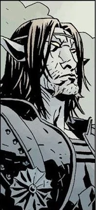

> "But if there *must*be an end, let it be *loud*. Let it be *bloody.*Better to burn than to wither away in the dark. Not to go quiet... not to go unnoticed... Oh you gods of war... let it *be* war."

The **Gruagach of Lough Leane** is a [fairy](/entry/Fairies) creature of the [Daoine Sidhe](/entry/Daoine_Sidhe), and a vengeful adversary of [Hellboy](/entry/Hellboy). He is currently trapped in the degenerated body of the fomorian [giant](/entry/giant) named [Grom](/entry/Grom), and now resembles a stunted, mutant anthropomorphic boar. He blames Hellboy for his current state and seeks revenge for his humiliations. He is also driven by a desire to see his people returned to their former glory and would rather see the fairy folk die fighting for their survival instead of simply fading away in the shadow of the human race.

## History

### Pre-Hellboy

Gruagach was once a shapeshifting warrior of the Tuatha De Danann, who would later become the Daoine Sidhe; the fairy folk of Ireland. Long ago, he rode with the sons of the High King [Dagda](/entry/Dagda) against the giants (presumably the Fomorian enemies of the Tuatha de Danann, as recounted in Celtic myth). Gruagach was able to change into many shapes, and during the battle he took the form of a hulking monster, personally killing twenty of the giants.  Sometime thereafter, Gruagach fell in love with a human girl. This girl wished to see the form he took when he fought the giants, but the fairy was reluctant, fearing that she would be affrighted by him. There was a strange law which meant that should the girl scream at the sight of his monstrous form, Gruagach would be banished to some purgatorial land of mists and never see her again. Nevertheless, the girl managed to persuade him into appearing as a monster. As he'd feared, the girl was quailed by the sight of her fairy lover as a giant, tusked beast, though she resisted the urge to scream. In order to allay her apparent fear, Gruagach turned into a little songbird. However a cat appeared, and the girl screamed to warn him, but with that scream Gruagach was lost to the mists. [1]

Gruagach found himself stranded in a forlorn misty dimension, inhabited by other wretched lost souls of the fairy folk. He wandered this limbo aimlessly for an unknown amount of time, slowly degenerating into withered husk of his former self. Eventually, he managed to find his way back into the world, having lost almost all of his power.

### *[The Corpse](/entry/The_Corpse)*

In 1959, Gruagach (reduced to a mere infantile changeling) was sent to Ireland in order to replace the kidnapped baby [Alice Monaghan](/entry/Alice_Monaghan). The Monaghans had an inkling of this ruse and managed to call on Hellboy to investigate their unusual child. Hellboy exposed the changeling using the age-old fairy bane of Cold Iron. Gruagach was forced to tell Hellboy how to get the child back from the Daoine Sidhe. Adding insult to injury, Gruagach was released into the furnace, but made good his escape. Humiliated, the changeling rather hypocritically swore vengeance on Hellboy for his cruel treatment. While Hellboy set out to play the old game of the fairy folk by their rules, Gruagach dove into a murky river and awoke the folkloric river hag called Jenny Greenteeth (with whom it was implied Gruagach had once shared a love affair). He had Jenny set loose the imprisoned war-monster Grom, last of the Fomorian giants, who resembled a huge, boar-headed humanoid.

Hellboy was erstwhile engaged with lugging around the talkative corpse of a hanged man named Tam O'Clannie, in order to find him a Christian burial place and therefore appease the fairy folk. Grom was unleashed upon Hellboy while he was crossing an old stone bridge with the corpse in tow. Gruagach, floating recklessly nearby, gleefully castigates Hellboy before he himself is snatched from the air mid-taunt and devoured whole by Grom. Hellboy battled with Grom and managed to best the giant using a holy relic which causes Grom to shrink and flee. While Hellboy succeeds in rescuing baby Alice from the Daoine Sidhe, the spirit of Gruagach manages to overthrow the mind of Grom and usurp control over the now-dwarfed body of the Fomorian.[2]

### Council of the Daoine Sidhe

In *[The Third Wish](/entry/The_Third_Wish)* \#2, Gruagach, now permanently trapped in Grom's porcine body, stands together with King Dagda and [Sir Edward Grey](/entry/Sir_Edward_Grey), holding court with many other fairy creatures. Gruagach states his belief that without Hellboy the fairy folk will be able to rule the world again, rather than retreating into the darkness beneath the world and fading away, a fate which Dagda has resigned himself to. Grey says that Gruagach only wants revenge. He does not deny this and says that Hellboy once burned him with iron, and that he is now trapped in the 'pig-body' of Grom. Again, Gruagach says he will have revenge.

In the epilogue of *[The Island](/entry/The_Island)*, Gruagach speaks to [Mab](/entry/Mab), former fairy queen of the Tuatha De Danann. She tells him that Hellboy still lives and is returning to England. Gruagach still wants to stop Hellboy, and asks what the witches are doing. Mab replies that they await word from their queen, [Hecate](/entry/Hecate). She tells him that he cannot beat Hellboy, but Gruagach refuses to listen. He boldly declares that even if it causes an end to his people, he will rather see them go out in the glory of war than simply fade away.

### *[Darkness Calls](/entry/Darkness_Calls)*

Gruagach gate crashes a gathering held by the witches of England, who seek to find a replacement for the (effectively neutralized) Hecate. He tells them they must make 'Her' their queen, speaking of an [unknown benefactress](/entry/Queen_of_Blood). The witches are deeply wary of his suggestion, filled with terror and old shame, but they realize that the one he speaks of is their last best hope for survival.[3]

Gruagach, together with a band of two fairy cronies, travel to a secret cavern beneath an English church. He awakens the guardian of the cavern and presents this giant with a letter from the witches of Britain. The Giant reluctantly complies with the demands of the letter, and travels into a secure pit to release the being imprisoned there, the one who would become the new Queen of Witches.[4]

Gruagach observes as the giant returns with a wooden chest containing the dismembered remains of a former witch queen, betrayed by her own followers. The giant returns to his resting place, wanting nothing to do with the events soon to transpire. Gruagach and his companions take their leave of the church and spot an innocuous bird. He tells the bird that its mistress should choose which side she is on, because the new Queen is coming. The fairies drag away the chest containing their newfound mistress. Meanwhile, Dagda watches them from afar and foresees that their actions shall bring about the doom of his people.[5]

Gruagach and his companions return to the gathering of the Daoine Sidhe, bringing with them the box. King Dagda pleads with them to rethink their actions. One of Gruagach's companions, caught up in the furor of the moment, stabs the fairy monarch in the back. The fairy is nonchalant at first, but when he sees the golden blood staining his knife, the gravity of his murder sinks in. Wretchedly crowing the name of his king, the murderer commits suicide and evaporates. Gruagach, caught off-guard, appears to be deeply troubled by this unexpected turn, but he takes advantage of the moment all the same. He laments the loss of their king but rallies the fairy folk behind himself and his [Queen of Blood](/entry/Queen_of_Blood).[6]

### *[The Wild Hunt](/entry/The_Wild_Hunt)*

Gruagach stands on a hilltop in the midst of a gathering fairy army. A hedgehog fairy, who appears to speak for the assembled host, expresses disappointment that no word has arrived from the other tribes of the fairy folk, including the Scottish Seelie Court, the Welsh Court of Ellyllon, the Nordic Trolls and the Germanic Feens. Gruagach reveals that the Giants are abroad again, and that the Queen of Blood had long ago promised some of their territories would be restored to them, but she was betrayed before she could carry out her plans. The urchin fairy demands to know when this queen would return, but Gruagach can only reply that she will come when she is ready, and that she will bring with her a great host to join the battle.[7]

Later, the demon [Astaroth](/entry/Astaroth) approaches the hilltop in disguise, requesting the company of the Gruagach of Lough Leane. Astaroth is surprised (or feigns surprise) that the stunted pig-man before him is the one he seeks, and Gruagach sadly recounts the tragic events of his past which have led to his sorry state. He expresses hope that the Queen of Blood will restore him to his former glory, and Astaroth gives him a golden and bejeweled Ciborium filled with human blood from a nearby village. Gruagach pours the blood into the box and the Queen of Blood is restored to life, intoning an ominous curse.[8]

Having given her back life, Gruagach attends to the Queen of Blood as she re-establishes her power. He sits with his head in her lap while she coddles him, promising to restore his power when the time was right, so that he might serve well by eliminating Hellboy for her. A sleepy Gruagach bears witness to the dwarf-like emissary from the fairy king of Jutland, who pledges his army to the Queen of Blood and presents her with a golden crown. True to her reputation, she orders the terrified ambassador to reforge the crown into a knife with which he must assassinate his own king. Instead of a crown, she desires an iron helmet in the likeness of three ravens, graven with the names of Badbdb, Macha and Mor-Rioghain (the Celtic triple goddess of war).[9]

Hellboy subsequently lays claim to the sword [Excalibur](/entry/Excalibur) and his unexpected birthright as the rightful King of Britain. Gruagach's queen is also revealed as being Nimue, the former Lady of the Lake, who worshiped the Ogdru Jahad. An impatient Gruagach begs his mistress to empower him now, but the Queen of Blood refuses. The fairy makes the costly mistake of questioning her power, a mistake which he promptly begs forgiveness for, but to no avail. The Queen denounces him, claiming 'better a hedgehog to serve me! A hundred times better, faithless pig!' and casts him out of her service. Blubbering miserably, he flees.[10]

### *[The Storm](/entry/The_Storm)* and *[The Fury](/entry/The_Fury)*

While Hellboy resumes his adventure with the grown-up [Alice Monaghan](/entry/Alice_Monaghan) in tow, a distraught Gruagach roams aimlessly through the woods, seeking to escape the growing storm. He stumbles onto a stone marker and encounters a ghostly bearded man in a robe, who claims that Gruagach is now standing on his grave. Gruagach cowers in front of the man and begs for mercy, calling him master. The man sneers and tells him 'No mercy for you, pig'.[11]

The man, revealing himself as the legendary [Merlin](/entry/Merlin), elaborates on his history with Nimue, who seduced him into giving away all his secrets and then tricked him into an eternal entombed slumber. Without his guidance, the Lady of the Lake was driven mad by the call of the [Dragon](/entry/Ogdru_Jahad) and became the Queen of Blood. Merlin then reveals to Gruagach that the Queen's army has begun to answer her call and condemns the fairy for releasing her in the first place over a mere slight against Hellboy, thus setting in motion the destruction of his own race. Gruagach contests that claim, only to have his hopes crushed when Merlin shows him that the Queen of Blood has murdered Queen Mab, spilling the last pure blood of the Tuatha De Danann and using it to mark her new champion. The wizard chides Gruagach for his naivete and blind rage, predicting that only rivers of blood and fields of bone shall be left in the wake of Nimue's war. Finally, Merlin curses Gruagach, that he shall live to suffer to witness all that he has wrought, 'until the world ceases to turn.'[12]

As Hellboy goes to the Queen's tower to confront her, he happens upon Gruagach, who is hanging from a tree by a noose around his neck, but unable to die. Weeping piteously, he confesses that he wanted revenge against Hellboy, but never wanted the ruin he has brought upon the world, and his own people, by releasing the Queen of Blood. He begs for death, and Hellboy tries to oblige him, emptying an automatic pistol into his chest. Merlin's curse holds, and Gruagach cannot die. Later, Alice Monaghan also passes Gruagach on her way to help Hellboy.

After the Queen of Blood has been defeated, [Morgan Le Fey](/entry/Morgan_Le_Fey) finds Gruagach, still hanging in the forest, and tells him that of all the players in this game, he was always her favorite. Gruagach pleads that he does not want to see the world that is coming, and she says nor does she. Using her power to free him from Merlin's curse, she takes his hand and says they must leave the world now and go where people like them must go.[13]

## Appearances in other media

### *[Hellboy](/entry/%E5%9C%B0%E7%8B%B1%E7%94%B7%E7%88%B5%EF%BC%9A%E8%A1%80%E7%9A%87%E5%90%8E%E5%B4%9B%E8%B5%B7))* (2019)

Gruagach appears in the 2019 *Hellboy* reboot as the secondary antagonist. Unlike in the comics, he is portrayed as being much more tough-talking and foul mouthed, speaking with a thick Scouse/Liverpool English accent.

He first crossed paths with Hellboy in 1992, when he was left behind by fairies to masquerade as an infantile Alice Monaghan. When Hellboy arrived, he used a horseshoe made from iron—a substance harmful to changelings to call him out. After a brief chase around the Monaghan residence, Hellboy managed to burn the exposed Gruagach with a pair of iron tongs, to which he promised that the fairies would return the real Alice. Hellboy, however refused to believe this. Ultimately, the Gruagach escaped. But as he did so, Hellboy yelled through the chimney from which the Gruagach made his escape, demanding that he return Alice to her family or else he would come to retrieve her himself, with the implication that bad things would happen to both the Gruagach and his “fairy friends”. Later that night, Alice was returned to her parents, with Hellboy threatening to come after them if "her diaper was dirty".

The Gruagach spent the next 27 years wandering in shame, reduced to a “wasted, wandering thing”. However, he had vowed to get his revenge on Hellboy for harming him with iron in the first place. Sensing his pain, the witch [Baba Yaga](/entry/Baba_Yaga) summoned the Gruagach and directed him to gather the caskets holding the severed, but still "living", limbs of the blood witch [Vivienne Nimue](/entry/Nimue). He found her head at St. Sebastian’s Abbey, where he slaughtered many of the silent monks who lived there, save for one, whom he forced to take him to the casket. Upon forcing him to use his voice to open the casket, the monk refused. Fed up with this, the Gruagach forcefully ripped the monk’s tongue out and inserted it in his mouth, allowing him to use the monk’s voice himself. He then proceeded to gather the rest of the caskets save for the one holding one of Nimue’s hands. He took the body parts to an old house, where he slaughtered the residents and discussed the position that Nimue was in. She then made a deal with him: if he restored her, she would restore him.

Later that night, the Gruagach broke into the headquarters of the [Osiris Club](/entry/Osiris_Club), slaughtering all present and finding the remaining casket. Hellboy had found the Gruagach while on a mission and attempted to subdue him. Feeling that he was not ready to engage Hellboy head-on, he called out to Nimue for aid, which she provided in the form of a distraction towards Hellboy (namely, appealing to his frustrations). While she distracted him, the Gruagach escaped with the blood witch’s hand in his possession. The Gruagach later watched as three old hags stitched Nimue’s body back together. Upon inquiring about the Gruagach’s obsession with Hellboy, he explained his reasoning, to which Nimue realized that their mutual lust for vengeance had blinded them with rage, only to then hint at her own plans for Hellboy, much to the Gruagach’s confusion. She then tasked him with aiding her in returning her blood to her body. At Pendle Hill, the Gruagach was present when Nimue absorbed her blood into her pale body. When Hellboy caught her off guard with a gunshot from [his revolver](/entry/Hellboy%27s_revolver_%282019_film%29), which took away a considerable chunk of her face, the Gruagach condemned Hellboy for interfering, even mocking him for not "knowing when to wait" when she subdued him.

The Gruagach was eager to be restored and end Hellboy, but was swiftly denied by Nimue; he was quick to remind her that she made a promise to him, only for her to slap him and warn him to mind his tongue. He was then ordered to enter the newly made portal she had created. He later terrorized the streets of London with Nimue, en route to St. Paul’s Cathedral. On the way, they invaded the M-11’s secret office—which was hidden below a fish and chips shop, and slaughtered everyone present before kidnapping Professor Broom and then leaving to make for St. Paul’s Cathedral. Realizing what had happened, Hellboy, along with a grown Alice Monaghan and Major Ben Daimio, leader of M-11 rushed to the cathedral, only to be immediately confronted by the Gruagach, who was empowered by Nimue, to such a point where he was noticeably more buff and much larger. He was also impervious to iron, which had harmed him earlier.

Hellboy engaged in battle with the Gruagach but was eventually overpowered, only to be saved by Daimio, who had assumed his werejaguar form. Together, they gained a brief edge against the empowered Gruagach. Unfortunately, the creature managed to incapacitate Daimio, throwing him against the wall, and once again prepared to finish-off Hellboy; he was then called-off by Nimue. Unwilling to be denied his vengeance, he revealed to Nimue that he was the reason why Nimue was awake at all, and that he had set her plot in motion. At this, Nimue declared herself "the end", meaning that her ambition outgrew his desire for vengeance. She betrayed the Gruagach, revealing that she merely needed someone to push Hellboy to his limit, as she used her magic to make him increasingly smaller. As the Gruagach was facing certain death, he then voiced his disbelief at the blood queen’s betrayal and used his last moments to curse out Hellboy, before exploding in a puddle of blood. At this, Hellboy, tiredly, cursed back at him.

### *[Brawlhalla](/entry/Brawlhalla)*

 The Gruagach appears in Blue Mammoth Games' game *Brawlhalla* (2014) as a crossover skin for Teros.

## Notes

A *Gruagach* (pronounced *groo*-ah-gak, meaning 'Hairy One' in Scottish Gaelic) is a fairy creature appearing primarily in the Celtic folklore of Scotland and Ireland. It is uncertain even in the original legends whether there is one solitary Gruagach or a variety of them (this is the case with most kinds of fairy). The fact that [Astaroth](/entry/Astaroth) called him *the* Gruagach *of* Lough Leane implies that there might be others.

Folkloric Gruagachs were often friendly to humans and were reputed to protect livestock, but they could be capricious like most of the fair folk. A common tradition was to leave a saucer of milk out for them, lest they steal all the milk from the farmstead. They are a local variation of the *Pooka* (a yellow-eyed, shapeshifting hobgoblin who delights in frightening or tricking passerbys) and also bear similarities with the *Brownie* (a small domestic hobgoblin who helps around the household).

Lough Leane (from Irish: Loch Léin meaning "lake of learning") is the largest of the three Lakes of Killarney, a renowned scenic attraction located near Killarney, County Kerry, in Ireland. The River Laune drains Lough Leane to the north towards Killorglin and into Dingle Bay. The other two lakes are known as Upper Lake and Middle Lake, and they lie in a valley ringed by several mountains.

It is curious to note that Lough Leane is a southern Irish lake, in County Kerry, and that the Gruagach held fealty to the Tuatha De Danann and the Daoine Sidhe of Ireland; however, Gruagachs, themselves, are particular to Scottish folklore, associated with the Seelie fairy court of Scotland (which is mentioned in *[The Wild Hunt](/entry/The_Wild_Hunt)* \#1). A possible explanation for this is historically the Scots and their Gaelic culture originated in Ireland and the Gruagach might have originally been from Ireland as well. Though gruagach also appear in Irish folklore as well, clearing up any confusion.

## References

<references />

[1]

[2] *[The Wild Hunt](/entry/The_Wild_Hunt)* \#2

[3] *[Darkness Calls](/entry/Darkness_Calls)* \#3

[4] *[Darkness Calls](/entry/Darkness_Calls)* \#4

[5] *[Darkness Calls](/entry/Darkness_Calls)* \#5

[6] *[Darkness Calls](/entry/Darkness_Calls)* \#6

[7] *[The Wild Hunt](/entry/The_Wild_Hunt)* \#1

[8] *[The Wild Hunt](/entry/The_Wild_Hunt)* \#2

[9] *[The Wild Hunt](/entry/The_Wild_Hunt)* \#5

[10] *[The Wild Hunt](/entry/The_Wild_Hunt)* \#8

[11] *[The Storm](/entry/The_Storm)* \#1

[12] *[The Storm](/entry/The_Storm)* \#2

[13] *[The Fury](/entry/The_Fury)* \#2
