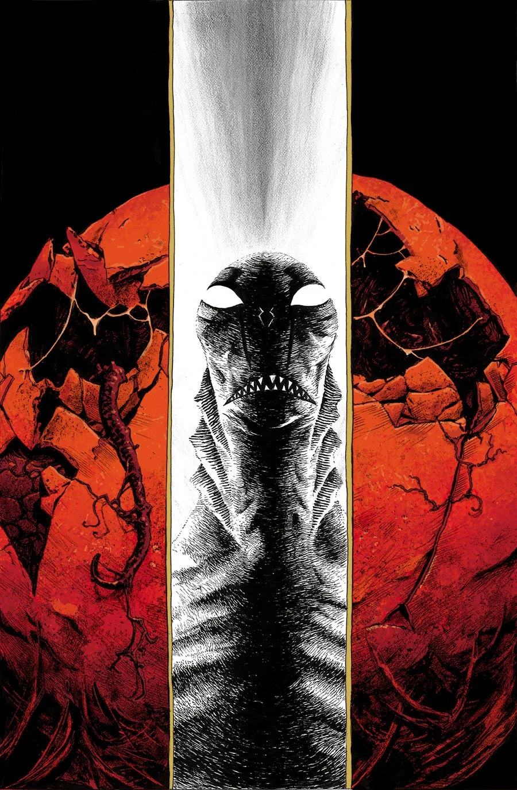
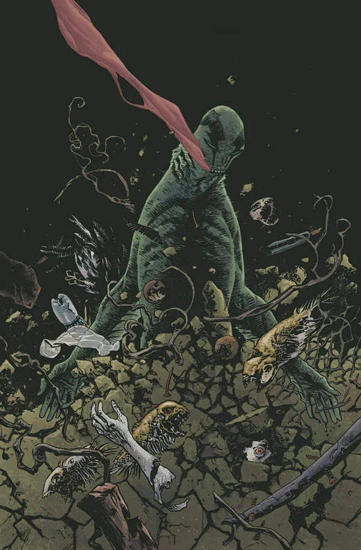

***The New Race of Man*** is a miniseries following Abe as he investigates the Salton Sea eggs.

## Publication History

*The New Race of Man* is a 2 issue arc published in July 2013 with art by Max Fiumara.

*The New Race of Man* was a story John Arcudi had wanted to tell for a long time, but felt he was unable to do it properly in the pages of [*B.P.R.D.*](/entry/B.P.R.D._%28series%29).

## Synopsis

### Part One

While on the run from the Bureau, Abe makes his way to the Salton Sea, where he encounters a bizarre egg-worshiping cult.

### Part Two

After a half-eaten body washes ashore, a small cult suspects the hungry killer may be Abe, who flees to the Salton Sea only to confront a dangerous Ogdru Hem larva.

## Gallery

