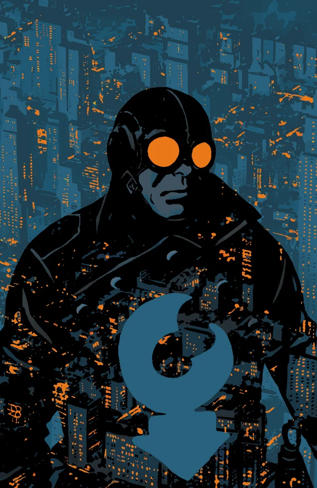
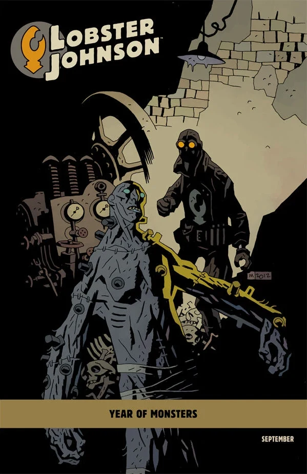

***Caput Mortuum*** takes place early in [the Lobster's](/entry/The_Lobster) career as a crime fighter in the 1930s.

## Publication History

This one-shot was published in September 2012, featuring a cover by Tonči Zonjić and a variant cover by Mike Mignola as a part of the *[Year of Monsters](/entry/Year_of_Monsters)* covers.

## Synopsis

Hellboy's favorite gun-blazing vigilante takes justice to the skies this time by getting locked in combat aboard a zeppelin!

## Gallery

 [Tonci Zonjic](/entry/Tonci_Zonjic)

|[Year of Monsters](/entry/Year_of_Monsters) variant
by [Mike Mignola](/entry/Mike_Mignola)
