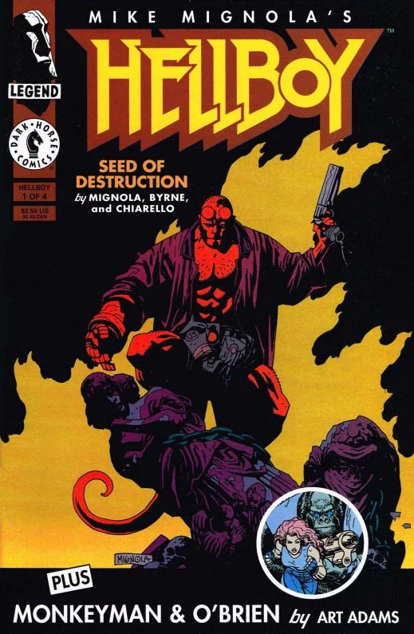

***Hellboy: Seed of Destruction*** is the first *[Hellboy](/entry/Hellboy_%28series%29)* comic book mini-series, published by Dark Horse Comics. It was conceived and illustrated by [Mike Mignola](/entry/Mike_Mignola) and scripted by [John Byrne](/entry/John_Byrne).

This was, in part, the basis for the first [Hellboy motion picture](/entry/Hellboy_%28film%29).

## Publication History

*Seed of Destruction* was originally published as a four issue mini-series published monthly between March and June 1994. These issues contained the four part back-up story *Who are Monkeyman and O'Brien?* written and drawn by Arthur Adams.

The story was reprinted in the *[Hellboy: Seed of Destruction](/entry/TPB)* first edition trade paperback[1] . The trade paperback has since had three additional editions, each with unique cover art. The second edition was released in June of 1997. A second printing of the second edition also with a unique cover followed. Third edition was published November 2003. A custom edition was published in December 2006. The custom edition is a smaller, digest-sized version of the book that came bundled with the *[Hellboy Animated: Sword of Storms](/entry/Hellboy_Animated%3A_Sword_of_Storms)* DVD when purchased through some retailers.

In addition to being published in trade paperback format, *Seed of Destruction* was also published as a hard cover in 1995. The hardcover version was hand numbered out of 1000 and came tucked in a matching slipcase. A second hardcover edition, this time digest sized, was released on June 24, 2008, it came bundle with a PVC Hellboy figurine.

As part of Dark Horse's "1 for $1" promotion, which reprinted the first issue of a number of popular titles, the first issue of *Seed of Destruction* was reprinted with an altered cover in August 2010 and sold for one dollar.[2]

The first issue was again reprinted, with new cover art provided by Mignola and [Dave Stewart](/entry/Dave_Stewart), in celebration of the 25th anniversary of the release of *Seed of Destruction* \#1. This reprint was released for free in March 2019. Multiple retailers and conventions had variant covers produced as part of the celebration.

## Synopsis

### Part One

The comic opens in 1944, with a report from a U.S. Army official named [George Whitman](/entry/George_Whitman), who has been ordered to lead a team of commandos to the (fictional) village of East Bromwich in the English Midlands. The army group (accompanied by a Nazi-fighting superhero named [The Torch of Liberty](/entry/The_Torch_of_Liberty)) is under the guidance of three paranormal officials, one of whom is a young [Trevor Bruttenholm](/entry/Trevor_Bruttenholm). According to the group psychic, one [Lady Cynthia Eden-Jones](/entry/Lady_Cynthia_Eden-Jones), a terrible event is to take place in a local ruined church; a doomsday project orchestrated by the Nazis, which could herald the end of the world.

However, the actual rite is taking place at Tarmagant Island, a small island off the coast of Scotland. The Nazis have set up an array of strange machines around a stone circle, in the center of which stands the fabled Russian psychic [Grigori Rasputin](/entry/Grigori_Rasputin). The wizard, armed with a pair of powerful gauntlets, attempts to summon the [Ogdru Jahad](/entry/Ogdru_Jahad) from their prisons to the earth; although unseen, the beasts are referred to as "knowing no care" and "heralds of pestilence", marking them out as amoral, dangerous entities.

 Although the Ogdru Jahad are not summoned, a red-skinned childlike demon appears in a blast of flame at the Church in East Bromwich, and is soon dubbed "[Hellboy](/entry/Hellboy_%28character%29)" by Professor Bruttenholm. Whilst the leader of the Nazi operation, Klaus Werner von Krupt, is dismayed at Rasputin's apparent lack of success, the mad monk knows otherwise and proclaims he has set into motion the world's ending.

The scene then changes to 1994, at the private residence of a much older Bruttenholm in New York, who is recounting the incident of Hellboy's birth, when the demon himself enters the office. It is revealed that Bruttenholm has been missing for over one year, having disappeared after a polar expedition. He tells Hellboy the story of his recent disappearance, informing him of his trip to the Arctic circle with the three Cavendish boys, and a man named Sven Olafssen, who is a renowned Arctic explorer. The quartet entered a cave at the top of the world, which bore a strange Lovecraftian statue of a tentacled creature, and a human meditating at its feet. When Bruttenholm touched the relic, it seemed to come alive, and he can barely remember the events that followed. Before he can continue, he is interrupted by a plague of frogs, and runs from the office, giving his adopted son the final words of "Save yourself!".

Before Hellboy can react, Bruttenholm is killed by a huge [frog monster](/entry/Frog_monster), leaving him with hole-like markings around his dried-out corpse. The creature attempts to kill Hellboy, but he proves too strong for the frog-monster and is able to shoot it as it attempts to escape. After killing the creature, Hellboy telephones the B. P.R.D Director [Tom Manning](/entry/Tom_Manning), informing him of Bruttenholm's death. As Manning arranges things with his fellow officials, the scene changes to the interior of an old Victorian house, whilst a dark, shadowed figure discusses Bruttenholm's death with a stately old woman. As the comic ends, a frog is seen in her teacup…

### Part Two

Having discovered some clues pertaining to the death of the Professor, Hellboy journeys to an old house named [Cavendish Hall](/entry/Cavendish_Hall), along with his colleagues [Liz Sherman](/entry/Liz_Sherman) and [Abe Sapien](/entry/Abe_Sapien). Lady Emma Cavendish, the woman who owns the house, is recognisable as the woman from the end of the previous chapter. She explains that she is the final heir of Cavendish Hall, her sons having apparently died on their expedition with Bruttenholm. She also notes that her sons had not been the first males of the Cavendish line to try and find the cave as every male for generations has died trying to find it. The practice began with a sailor named Elihu Cavendish, a gentleman and whaler who had traveled the world and heard exotic stories in numerous ports. He had made it his life's goal to find the temple at the north pole; and with his failure, every male of the following generations tried to accomplish his feat. Lady Cavendish confides in the trio her sadness at being the last living member of her family, and her hope that when she dies Cavendish Hall will sink into the lake below.

The butler then escorts the trio to their separate rooms. With Lady Cavendish alone, the shadowy figure returns and informs her he will reunite her with her sons, telling them to emerge with the line "Children, come and kiss your mother goodnight…"

Deciding to begin their investigation, Abe removes his costume and dives out of the window, hoping to find something in the watery depths below the house. Hellboy then calls Liz on an internal line, and they discuss how the butler looked exactly like [Sven Olafson](/entry/Sven_Olafson); the Arctic explorer who had supposedly died during the expedition with Bruttenholm and the Cavendish brothers. A group of frogs suddenly appear in Liz's room, and when she mentions this to Hellboy, he yells at her to get out of the room immediately, running towards her room himself.

Hellboy arrives at the room to find Liz gone; however, Olafssen is in the hall, feigning ignorance as to where she has vanished. When Hellboy threatens the explorer into talking, he transforms into a frog-monster, and the two fight through the house. After apparently killing the second monster, Hellboy returns to the sitting room and finds Lady Cavendish dead, covered in markings similar to those which adorned Bruttenholm's dead body. He regrets not having done something to protect her, but the dark individual seen earlier emerges and reveals himself to be Rasputin. Rasputin states that he had summoned Hellboy from the void, and also that it is Hellboy's destiny to help him destroy the world. Before Hellboy can retreat, a set of large tentacles smash through the floorboards and drag Hellboy to the cavernous depths below the house.

### Part Three

In the darkness beneath [Cavendish Hall](/entry/Cavendish_Hall) — which is revealed to be an Aztec temple—Rasputin begins lecturing Hellboy on the nature of the [Ogdru Jahad](/entry/Ogdru_Jahad), and their desire to be free from their prison. Hellboy quickly becomes impatient and shoots Rasputin in the head; but the monk quickly heals and utters a spell which sends Hellboy flying through the air. This worries the demon, as this means his cadre of charms, amulets, relics etc. are of no use against Rasputin's power. The wizard warns Hellboy that he brought him into the world, and he can just as easily take him out of it. The Olafssen frog monster then returns, and begins battling anew with Hellboy.

Meanwhile, Abe has ventured through the waterways which connect the cellars and caverns of Cavendish Hall to the lake. In the subterranean caves, he comes across the two Cavendish brothers, who have themselves become frog-monsters; however, they are not as violent as Olafssen, and are instead seen embracing the corpse of their mother, whom they killed under Rasputin's orders. Venturing further, Abe discovers the body of Elihu Cavendish, kept on a throne-like chair and bearing a harpoon in his hand.

Back in the temple, Rasputin reveals his connection with the Ogdru Jahad. Having been killed by a group of nobles in 1916 and his body flung into the River Neva, Rasputin was brought back to life by the Ogdru Jahad and he left Russia, seeking solace in an Italian village, gathering reputation as prophet of the apocalypse. He was soon visited by [Heinrich Himmler](/entry/Heinrich_Himmler), who took him to Germany to head one of [Adolf Hitler](/entry/Adolf_Hitler)'s various desperate Doomsday Projects. Although Rasputin knew Hitler was doomed to failure, he also knew he could use the money, scientific minds and technological resources of the Third Reich to broaden his ambitions. He aligned himself with [Karl Ruprect Kroenen](/entry/Karl_Ruprect_Kroenen), [Ilsa Haupstein](/entry/Ilsa_Haupstein), [Leopold Kurtz](/entry/Leopold_Kurtz) and others, designing a machine that would bring the Ogdru Jahad to earth and burn it to cinders.

When the project failed and the group disbanded, Rasputin headed northwards, receiving a vision from [Sadu-Hem](/entry/Sadu-Hem) — the statue-creature found by Bruttenholm, which is now in the temple beneath Cavendish Hall. The monk went into a deep meditation and saw the Ogdru Jahad in the abyss. After being re-awoken by Bruttenholm's touch, he accessed the Professor's memories and learned of Hellboy's existence. Using his renewed powers, he mind-controlled the expeditionary group to place Sadu Hem on board a ship and take him to America, the creature feeding upon everyone on board. He also allowed a maddened Bruttenholm to return to New York, knowing this would be excellent bait to lure Hellboy into a trap.

Rasputin then reveals he had Olafssen capture Liz, and now plans to channel her powers through himself and into Sadu Hem, who will in turn use this energy to unlock the crystal cocoons of the Ogdru Jahad. He now no longer needs Hellboy, and proclaims that hell on earth is approaching.

### Part Four

As Liz's power flows into Sadu Hem, the Ogdru Jahad are seen rumbling in their prisons. An unknown [alien](/entry/The_Visitor_%28character%29) race is seen observing the events, fearing that "the Seven" will devour the universe once they have blackened the earth. Hellboy continues to battle with Olafssen, before finding a concussion grenade and forcing it down his throat, before apologizing to whatever little human sense remains in the creature.

Rasputin rejoices in his nearing victory, reciting the same spell he had used fifty years ago in his attempt to summon the creature. However, before he completes the spell, he is speared through the chest by Abe, who is under the possession of a vengeful Elihu Cavendish. With the monk's concentration broken, Liz's fire-power becomes uncontrollable, frying Sadu Hem and causing the cavern to collapse. Abe awakens from Cavendish's control and leaps forward to save Liz, before greeting Hellboy and then carrying Liz out a nearby staircase.

A furious Rasputin then attempts to kill Hellboy, but the majority of his power spent, he is unable to do so. He tries to blackmail the demon, stating if he is killed, Hellboy will never know his true purpose. Hellboy smashes Rasputin's skull with his giant right hand, and runs up the staircase himself, before leaving the hall and watching it sink into the lake. Abe and Liz try to quiz him on what happened in the cave, as well as the identity of the wizard, but Hellboy is reluctant to inform them.

As Hellboy recalls the monk's last words, the scene changes to an abandoned castle in Norway, which bears the ruins of an old, esoteric Nazi laboratory. The figures of [Kroenen](/entry/Karl_Ruprecht_Kroenen), [Ilsa](/entry/Ilsa_Haupstein) and [Kurtz](/entry/Leopold_Kurtz) — Rasputin's old disciples — are seen frozen into the wall in a thick sheet of ice. However, a nearby device blinks into life, and the ice begins to crack…

## Story Chronology

Within the Hellboy world, *Seed of Destruction* takes place in early 1994.[3] The main action of the story, culminating with the destruction of [Cavendish Hall](/entry/Cavendish_Hall), takes place on May 11th. This date is explicit in *[Plague of Frogs](/entry/Plague_of_Frogs_%28story%29)* \#4.

Chronologically this story is preceded by *[Makoma](/entry/Makoma_%28story%29)* (Aug 16, 1993), and followed by *[The Chained Coffin](/entry/The_Chained_Coffin)* (May 14, 1994).

## Content

### Characters

#### Hellboy Incident

- [The Torch of Liberty](/entry/The_Torch_of_Liberty) (Flashback)
- [The British Paranormal Society](/entry/The_British_Paranormal_Society_%28organization%29)
  - [Trevor Bruttenholm](/entry/Trevor_Bruttenholm)
  - [Malcolm Frost](/entry/Malcolm_Frost) (Flashback)
  - [Cynthia Eden-Jones](/entry/Cynthia_Eden-Jones) (Flashback)
- [George Whitman](/entry/George_Whitman) (Flashback)
- [Sarah Hughes](/entry/Sarah_Hughes)'s Children (Ghosts) (Flashback)

#### [Nazis](/entry/%3ACategory%3ANazi)

- [Project Ragna Rok](/entry/Project_Ragna_Rok)
  - [Grigori Rasputin](/entry/Grigori_Rasputin)
  - [Karl Ruprect Kroenen](/entry/Karl_Ruprect_Kroenen)
  - [Klaus Werner von Krupt](/entry/Klaus_Werner_von_Krupt) (Flashback)
  - [Ilsa Haupstein](/entry/Ilsa_Haupstein)
  - [Leopold Kurtz](/entry/Leopold_Kurtz)
- [Heinrich Himmler](/entry/Heinrich_Himmler) (Flashback)
- [Adolf Hitler](/entry/Adolf_Hitler) (Flashback)
- [Herman von Klempt](/entry/Herman_von_Klempt) (Flashback)
- [Kriegaffe](/entry/Kriegaffe) (Flashback)

#### [B.P.R.D.](/entry/Bureau_for_Paranormal_Research_and_Defense)

- [Hellboy](/entry/Hellboy_%28character%29)
- [Thomas Manning](/entry/Thomas_Manning)
- [Elizabeth Sherman](/entry/Elizabeth_Sherman)
- [Abraham Sapien](/entry/Abraham_Sapien)

#### Other

- [Sven Olafson](/entry/Sven_Olafson) (Turned into [Frog Monster](/entry/Frog_monster))
- Cavendish Family
  - Emma Cavendish
  - [Elihu Cavendish](/entry/Elihu_Cavendish)
  - Three Brothers (Turned into [Frog Monsters](/entry/Frog_monster))
- [Ogdru Jahad](/entry/Ogdru_Jahad) (Vision)
- [Ogdru Hem](/entry/Ogdru_Hem)
  - [Sadu-Hem](/entry/Sadu-Hem)
- [Ereshigal](/entry/Ereshigal) (Mentioned)
- [Aliens](/entry/Aliens)

### Locations

- England
  - East Bromwich church ruins (Flashback)
- Scotland (Flashback)
  - Tarmagant Island (Flashback)
- U.S.A.
  - [Trevor Bruttenholm's](/entry/Trevor_Bruttenholm) Private Residence (New York City)
  - [B.P.R.D.](/entry/Bureau_for_Paranormal_Research_and_Defense) Headquarters (Farfield, CT)
  - [Cavendish Hall](/entry/Cavendish_Hall) (Upstate New York)
  - St. Trinian's Hospital (Washington D.C.) (Flashback)
- Norway
  - [Ogdru Hem](/entry/Ogdru_Hem) Temple (Flashback)
  - [Project Ragna Rok's](/entry/Project_Ragna_Rok) Castle
- Alien Spaceship (Outer Space)

## Trivia

First printing, featuring <em>Monkeyman &amp; O'Brien</em> promo.

- The original covers of *Seed of Destruction* all featured a "PLUS: *Monkeyman & O'Brien* by Art Adams" banner and accompanying circular cut-out illustration of the two characters drawn by Adams, promoting the stories that appeared as backups (see image to the right). As reprints and compilations of *Seed of Destruction* exclude these stories, the issue's covers are usually lightly edited to remove the text and cover the illustration of Monkeyman & O'Brien with a generic B.P.R.D. logo.
  - Both Mignola and Adams were members of Dark Horse Comics' short-lived [Legend](/entry/Dark_Horse_Comics) imprint.
  - The [30th anniversary *Seed of Destruction* \#1 screenprint](https://www.darkhorsedirect.com/products/hellboy-30th-anniversary-seed-of-destruction-1-screenprint) is a rare example of a modern release that includes the *Monkeyman & O'Brien* cross-promotion.
- [Ereshigal](/entry/Ereshigal), mentioned by Rasputin, is a Mesopotamian goddess who ruled over the land of the dead.
- Among the many artifacts in Trevor's house, a relief depicting a [Neo-Assyrian Winged Genie](https://www.meisterdrucke.ie/fine-art-prints/Assyrian/190143/Relief-depicting-a-Winged-Genie,-from-the-Palace-of-Sargon-II-at-Khorsabad,-Iraq-.html) can be seen.
- Some paintings in Cavendish Hall are based on real world art:
  - One seems like a photo of British Naval Officer James Fitzjames
  - Another seems to be partially based on an [illustration](https://commons.wikimedia.org/wiki/File:Moby_Dick_p510_illustration.jpg) by Rockwell Kent for a 1982 edition of *Moby Dick*.

## Cover Gallery

All covers by [Mike Mignola](/entry/Mike_Mignola).

### Individual Issues

25th Anniversary Edition
E
25th Anniversary Edition
ComicsPro exclusive

### Trade Paperbacks

Bundled with *[Hellboy Animated: Sword of Storms](/entry/Hellboy_Animated%3A_Sword_of_Storms)* DVD

### Hardcovers

Bundled with PVC Hellboy figurine

## Awards

- 1995
  - Won Best Graphic Album: Reprint [Eisner Award](https://www.comic-con.org/awards/eisner-awards-current-info)
  - Won Best Writer/Artist Eisner Award, for Mike Mignola

## References

<references />

## Links

- [Dark Horse profile of issue \#1](http://www.darkhorse.com/profile/profile.php?sku=93-336)
- [Review of the trade](http://www.comicsbulletin.com/reviews/107395241575582.htm), [Comics Bulletin](/entry/Comics_Bulletin)

[1] (1994, [Dark Horse Comics](/entry/Dark_Horse_Comics), TPB, 128 pages, 1994, [ISBN 978-1-56971-316-7](/entry/Special%3ABookSources/978-1-56971-316-7), 2004, [ISBN 978-1-59307-094-6](/entry/Special%3ABookSources/978-1-59307-094-6), hardcover, 1995, [ISBN 978-1-56971-051-7](/entry/Special%3ABookSources/978-1-56971-051-7))

[2] [profile](http://www.darkhorse.com/Comics/17-639/1-for-1-Hellboy-Seed-of-Destruction)

[3] The year is made explicit in *Darkness Calls* \#1, where Bruttenholm is said to have died in 1994 in a footnote.
