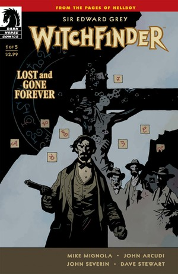
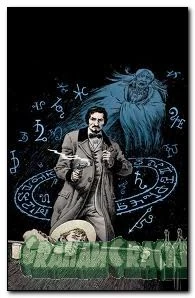
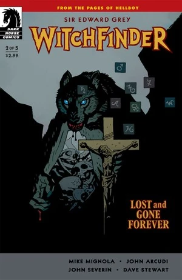
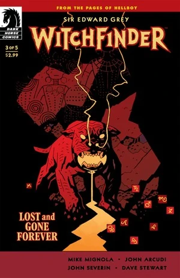
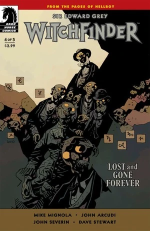
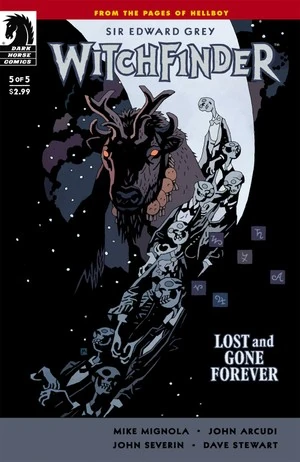

***Lost and Gone Forever*** is a five-issue miniseries published from February to June 2011. It is the second [*Witchfinder*](/entry/Sir_Edward_Grey%3A_Witchfinder) miniseries, following *[In the Service of Angels](/entry/In_the_Service_of_Angels)*. The first issue was published with two covers, one by [Mike Mignola](/entry/Mike_Mignola) and a variant by [John Severin](/entry/John_Severin).

## Characters

- [Sir Edward Grey](/entry/Sir_Edward_Grey)
- [Morgan Kaler](/entry/Morgan_Kaler)
- Isaac
- [Lord Adam Glaren](/entry/Lord_Glaren)
- [Eris](/entry/Eris)
- Kaipa the Shaman
- Waveya

## Synopsis

### Part One

In 1880, [Sir Edward Grey](/entry/Sir_Edward_Grey) arrives in Reidlynne, Utah. He enters a local bar and asks to speak to the sheriff. Grey get in a fight and winds up being forced out of town. He rides away with Morgan Kaler, a local man willing to help him. Kaler tells Grey about the town and about the local church. The church was said to have been claimed by the devil, and the townsfolk burned it to the ground. Grey tells Kaler that he is looking for a man named Lord Glaren, who was in the area. As they continue to ride, a man with the head of a buffalo jumps out at Grey.

### Part Two

Bitten by a werewolf and left for dead, Edward Grey survived only through the grace of God. But in the deadly plains of the Wild West, God is nowhere to be seen as Grey recounts his harrowing adventures facing creatures of the occult.

### Part Three

After a zombie shootout, Grey encounters a deadly stone dog, one of the many vicious minions of the evil witch Eris.

### Part Four

Evading the jaws of a monstrous stone dog, Grey heads to an abandoned coal mine filled with a horde of zombies.

### Part Five

A fierce storm beats down on the land, as Edward Grey takes on Eris the witch and her gang of cowboy zombies.

## Gallery

 \#1

 \#1 Variant by John Severin

 \#2

 \#3

 \#4

 \#5
