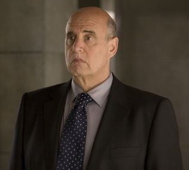

**Thomas Manning** is the director of the [Bureau for Paranormal Research and Defense](/entry/Bureau_for_Paranormal_Research_and_Defense).

## History

Manning was born on January 16th, 1946, in Somerville, Massachusetts. The son of a government employee and the second of three children, Manning became an accomplished student and attended American University in Washington, D.C., where he earned a B.A. in International Studies.

### B.P.R.D. career

Although Manning's family and friends had expected him to enter the foreign service, Manning instead applied for a field position with the [Bureau for Paranormal Research and Defense](/entry/Bureau_for_Paranormal_Research_and_Defense). He joined the B.P.R.D. in 1976.

In 1980, after four years working as a field agent, Manning was promoted to Director of Field Operations. In 1982, [Trevor Bruttenholm](/entry/Trevor_Bruttenholm) resigned from his role as Bureau director; Manning was promoted to director of field operations and assisted with the interim director's transition.

In 1997, Manning orchestrated [the search for Castle Giurescu](/entry/Wake_the_Devil). However, as a result of the mission, [Bud Waller](/entry/Bud_Waller) was killed, and [Liz Sherman](/entry/Liz_Sherman) had the life sucked out of her by a [homunculus](/entry/Roger). In the Wauer Institute of Romania, Manning along with [Abe Sapien](/entry/Abe_Sapien) and [Sidney Leach](/entry/Sidney_Leach) accompanied Sherman, while being treated by Dr. Olasz. Unfortunately, Liz passed away. But, mere moments after her death, [Hellboy](/entry/Hellboy_%28character%29), [Kate Corrigan](/entry/Kate_Corrigan), and the homunculus (whom Hellboy had dubbed [Roger](/entry/Roger), much to the confusion of Leach) came into the hospital. Roger then channeled Liz's pyrokenetic energy back into her, bringing her back to life, but at the cost of his own.

Manning brought Roger back to the U.S., where B.P.R.D. scientists implanted a generator in Roger's chest to keep him alive. As a precaution, Manning had a small bomb inserted within the generator, to kill Roger should he become hostile. Even though the bomb never had to be used, this lack of trust incensed Hellboy, who resigned from the B.P.R.D. in the aftermath of [the Hunte Castle affair](/entry/Conqueror_Worm_%28story%29) in 2001.

#### Directorship

Thomas Manning became director of the B.P.R.D. in 2002.

During the plague of [frogs](/entry/Frog_monster) and the rise of the [Black Flame](/entry/Landis_Pope), Manning supervised field missions in eliminating the frog monsters and was responsible for recruiting [Ben Daimio](/entry/Ben_Daimio) to the Bureau. In addition, he oversaw the 2004 relocation of the B.P.R.D.'s headquarters to Colorado.

By the time Hellboy returned to the B.P.R.D. in 2017, Manning was suffering from an undisclosed illness and was bedridden. He nonetheless continued to run the Bureau from a secure facility in Washington, D.C.

## Personality

Manning is a very serious and straightforward individual, but one that is well-respected and trusted by his subordinates. Manning is on good terms with most of his subordinates, making him a competent and reliable leader. Unfortunately Manning is often conflicted between the needs of his subordinates and the demands of his superiors, usually following the latter in his earlier years. The order to place a bomb within Roger had not been done at his behest, but rather, at the behest of his superiors, and he openly admitted to Hellboy, after the latter chewed him out a bit, that he didn't like the order any more then he did.

In recent years, Manning promoted Roger to lead his own squad, likely to atone for the bomb fiasco. Manning, perhaps in reaction to Hellboy's resignation from the Bureau, recently refused to accept the resignation of Captain Ben Daimio after a disaster that claimed Roger and his team. In this way, Manning has begun developing a deeper rapport with those under his watch, making the more questionable orders of his superiors more and more rescindent.

## Other media

### 2004-2008 film series

Jeffrey Tambor as Manning

#### *[Hellboy](/entry/Hellboy_%28film%29)*

In the film series Tom Manning (played by [Jeffrey Tambor](/entry/Jeffrey_Tambor)) is more of a bureaucrat and politician than supernatural investigator. In addition to being the director of the B.P.R.D., he is also the FBI Head Of Special Operations. He is also instrumental in denying the existence of [Hellboy](/entry/Hellboy_%282004%E2%80%932008_film_character%29) and the B.P.R.D. to the public, deriding any photos or eyewitness reports as deliberate fabrications. Manning holds a tense working relationship with Hellboy (even calling Hellboy a monster and being thrown out a window as a result) until Hellboy saves Manning's life (and vice versa), after which the two share a bonding moment in which Manning teaches Hellboy how to properly light up a cigar. A post-credits scene shows him still in the room where he saved Hellboy, frightened and calling desperately for Hellboy and the others to come help him.

#### *[Hellboy II: The Golden Army](/entry/Hellboy_II__The_Golden_Army)*

Manning's tension with Hellboy is renewed, however, in *Hellboy II: The Golden Army*, in which Hellboy's actions result in the outing of the B.P.R.D.'s existence and Manning being replaced by [Johann Kraus](/entry/Johann_Kraus) as Hellboy's superior. At the beginning of the film, Manning seems upset and under stress from the amount of work he put in to keep Hellboy undercover (because Hellboy wasn't very concerned about staying secret, there were often many pictures or videos of him that Manning was forced to track down and get a hold of). Because of Hellboy's exposure, [Johann Kraus](/entry/Johann_Kraus) was dispatched in leading the team, which Manning takes an immediately liking for the ectoplasmic agent. After Hellboy and the other B.P.R.D. agents (including Kraus) went renegade and stopped [Prince Nuada](/entry/Prince_Nuada) without Manning's consent, Manning reprimanded them but only to be left in shock when they announce their resignations from the Bureau.

### Hellboy: Animated

Manning appears in *[Hellboy: Blood and Iron](/entry/Hellboy__Blood_and_Iron)* in a small role, voiced by Jim Cummings. His personality is very close to that of his comic book counterpart, though he comes across as slightly less serious and controlling, going so far as to try assigning mission teams only to give up when the team members begin disagreeing with each other, allowing them to make whatever teams they want.
