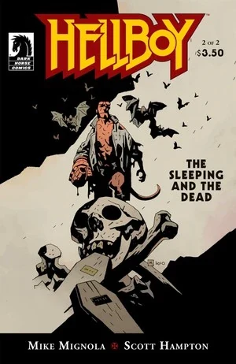

In ***The Sleeping and the Dead***, [Hellboy](/entry/Hellboy_%28character%29) fights a [vampire](/entry/Vampire_%28creature%29) only to find a family ruined long ago.

## Publication History

*The Sleeping and the Dead* was published as a two issue mini-series in December 2010 and February 2011. The First Issue was released with two covers, one by [Mike Mignola](/entry/Mike_Mignola) and an alternate by Scott Hampton. The story was collected in [*Hellboy – Volume 11: The Bride of Hell and Others*](/entry/Trade_Collections), first published in October 2011.

## Synopsis

### Part One

In 1966, [Hellboy](/entry/Hellboy_%28character%29) stalks a woman vampire in an English Inn. He shoots the vampire and follows it to ensure it will die. When he finds the vampire's body an older man is standing over it. The man shoots Hellboy. When Hellboy wakes up he tracks the man back to him house only to find woman dead. The man explains that the woman was his sister and that an older vampire had enslaved him, turned his sister and tortured his other sister. The man thinks that the older vampire will be enraged by the woman's death. Hellboy is tricked into confronting the other sister, not quite a vampire but no longer human.

### Part Two

[Hellboy](/entry/Hellboy_%28character%29) fights the sister in a space beneath the house. Meanwhile two [B.P.R.D.](/entry/Bureau_for_Paranormal_Research_and_Defense) agents meet up with a man who was helping Hellboy earlier in the story.

The Vampire rises at night and learns that his love is dead. He wakes the many sleeping vampires he has quietly been creating for a generation. The agents suddenly find that vampires are springing from the ground all around them, and fight for their lives.

Hellboy punches the creature, once a little girl, through a wall. Breaking the wall freed the creature, it attacks the one who tortured her, the vampire, killing him. With their master dead, the vampires attacking the agents fall lifeless.

The spirit of the girl releases all the evil she held and her corpse crumbles to the ground finally at peace. Hellboy stumbles out of the house and finds the agents.

## Gallery

Covers by [Mike Mignola](/entry/Mike_Mignola).

