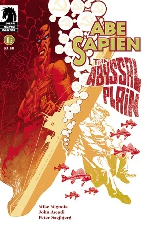
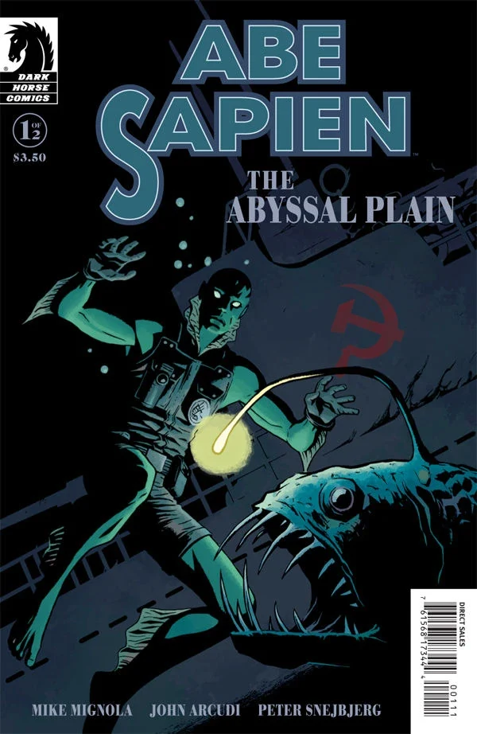
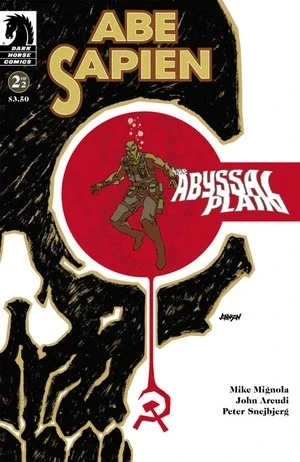

***The Abyssal Plain*** is a two-issue *[Abe Sapien](/entry/Abe_Sapien_%28series%29)* miniseries written by [Mike Mignola](/entry/Mike_Mignola) and [John Arcudi](/entry/John_Arcudi) with art by [Peter Snejbjerg](/entry/Peter_Snejbjerg).

## Publication History

*Abe Sapien: The Abyssal Plain* was published as a two-issue miniseries in June and July 2010. The first issue was published with two covers; one by [Dave Johnson](/entry/Dave_Johnson) and a variant by [Peter Snejbjerg](/entry/Peter_Snejbjerg) with [Dave Stewart](/entry/Dave_Stewart). The story was collected, along with *[The Haunted Boy](/entry/The_Haunted_Boy)* and*[The Devil Does Not Jest](/entry/The_Devil_Does_Not_Jest)*, in the trade *[Abe Sapien – Volume 2: The Devil Does Not Jest and Other Stories](/entry/Trade_Collections)*.

## Synopsis

### Part One

In 1948, a Soviet soldier named [Iosif](/entry/Iosif_Nichayko), sits in a sunken submarine at the bottom of the Norwegian Sea, slowly waiting to die. He writes a letter to the woman he loves, leaning on a box labeled "Melchiorre's Burgonet".

Years later, in August 1984, [Abe Sapien](/entry/Abe_Sapien) and Agent [Sal Tasso](/entry/Salvatore_Tasso) are on a ship in the Norwegian Sea, to retrieve "Melchiorre's Burgonet." Abe recounts the object's history;

During the time of Pope Clement the VII, Ugo Melchiorre served him as a captain. Melchiorre managed to turn certain defeat into victory at the Battle of Modena. Though Melchiorre was gravely wounded he walked off the field of battle without help. However as soon as they took off his helmet he died.

During World War Two the Nazi's had the Burgonet. The Soviet Special Sciences Service took the artifact after the war in 1946. The Burgonet was put on a submarine in 1948 to go to a Russian Mystic to be studied, but the submarine never arrived.

Abe swims down to the wreck and returns with the Burgonet. While exploring the wreck, Abe has mixed feelings about disturbing the dead. Back on the ship Abe says he plans on taking the helmet to [Professor O'Donnell](/entry/Professor_James_Henry_O%27Donnell) for analysis.

The ship's Captain and Abe get in an argument about salvaging the wreck. Abe wants the sub left in peace, in memory of the dead. The Captain, needing the money, wants to see if there is anything valuable left. But before they can finish arguing, a single water swollen zombie climbs onto the deck.

### Part Two

The issue alternates between flashback scenes with Iosif the Soviet soldier and Abe Sapien on the ship.

In the present day, a Soviet cruiser is headed to the site of the sunken submarine. A Soviet Special Sciences Service agent named Vasily and his commanding officer are discussing their mission. Vasily tells him that he volunteered for the Special Sciences Service because he wanted to get experience again the terror he felt when he saw a ghost as a small boy.

Meanwhile, Agent Tasso shoots the zombie, but unfazed it keeps walking and does not harm them. Abe realizes that the zombie is that same man who was sitting over the Burgonet, and decides to observe it.

The zombie stands in front of the safe now holding the Burgonet. It still takes no action against them. Abe still wants to wait and watch, but the captain wants to destroy it. Suddenly, they get word that a Soviet cruiser is approaching.

In a flashback, we find out that Iosif used to work in the Special Sciences Service and that he takes his duties seriously, although he dearly loves his wife. and he is taken in to talk to [Varvara](/entry/Varvara). She tells him he will escort a crate for the next five weeks. He protests that he will miss his wife's birthday, but she insists.

In the present, the word of a Soviet cruiser approaching ends the conflict betwen Abe and the captain. The captain prepares to set sail. Abe, still observing the zombie, realizes that as soon as it was resurrected, it resumed its duty of guarding the Burgonet. He steps forward and opens the safe for it.

In another flashback, Iosif tells his wife that he must go and perform his duty, but vows to return to Polina and never leave again.

Abe and Tasso sail away as the Russians approach the sunken sub. Tasso says that it is a shame that they will get the Burgonet. Abe replies that he radioed the Vatican and that they will pressure the Kremlin into turning over the Burgonet. As they speak, we see Vasily dive towards the wreck with glee on his face -- approaching Iosif the zombie who is curled up around the Burgonet, guarding it protectively.

## Story Chronology

The Submarine sunk in Spring of 1948. The main story takes place in August 1984.

## Gallery

Covers by [Dave Johnson](/entry/Dave_Johnson) unless otherwise stated.

 \#1

 \#1 variant
by [Peter Snejbjerg](/entry/Peter_Snejbjerg)

 \#2
