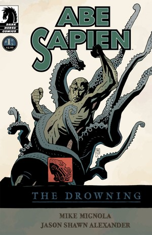
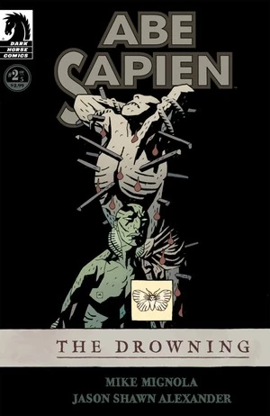
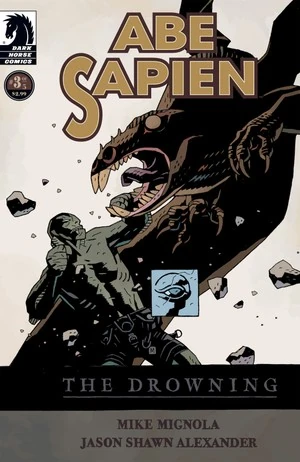
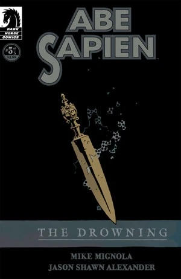

***The Drowning*** is [Abe Sapien's](/entry/Abe_Sapien_%28series%29) first solo miniseries, set in the early 1980s.

## Publication History

*Abe Sapien: The Drowning* was published as a five-issue miniseries from February to June 2008. The story was collected in the trade [*Abe Sapien – Volume 1: The Drowning*](/entry/Trade_Collections), published in September 2008.

## Synopsis

### Part One

A century ago, paranormal investigator [Edward Grey](/entry/Edward_Grey) fought and destroyed a powerful warlock off the island of [Saint-Sēbastien](/entry/Saint-S%C4%93bastien). In the early 1980s, the [B.P.R.D.](/entry/Bureau_for_Paranormal_Research_and_Defense)'s newest agent was sent to retrieve the warlock's remains. But Abe Sapien is ill-prepared for the supernatural forces that block his way.

### Part Two

Supernatural forces converge on the island of [Saint-Sēbastien](/entry/Saint-S%C4%93bastien) as [Abe](/entry/Abraham_Sapien) finds himself alone against a century-old evil.

### Part Three

With his companions dead and the island of Saint-Sēbastien overwhelmed by the stuff of nightmares, Abe struggles to stay alive as he fights his way toward the eye of the storm- and the monster that hides within.

### Part Four

The terrible secrets of Saint-Sēbastien come to light as Abe pushes deeper into the mystery of the island and a legacy of evil that spans the life of humanity itself.

### Part Five

Abe comes face to face with the power that has protected Saint-Sēbastien for centuries in this breathtaking conclusion to his first solo miniseries.

## Gallery

 \#1

 \#2

 \#3

 \#4

 \#5
