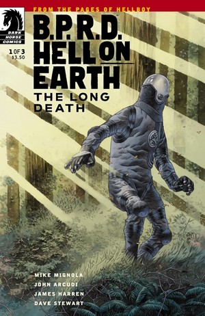
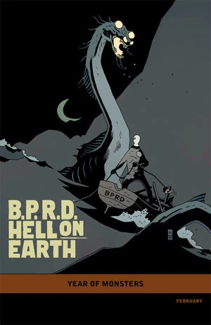
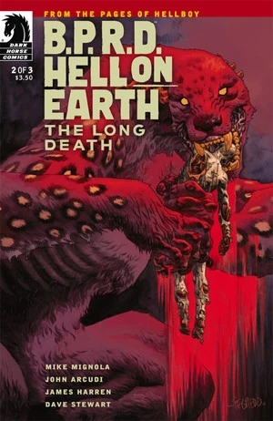
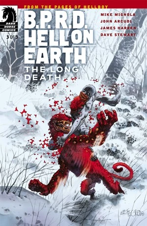

***The Long Death*** is a three-issue miniseries published from February to April 2012.

## Publication History

This is the fifth arc of the [*Hell on Earth* cycle](/entry/BPRD%3A%E4%BA%BA%E9%97%B4%E5%9C%B0%E7%8B%B1)), following *[Russia](/entry/Russia)*. The issues will be published with covers by [Duncan Fegredo](/entry/Duncan_Fegredo). The first issue was published with a "[Year of Monsters](/entry/Year_of_Monsters)" variant cover by [Mike Mignola](/entry/Mike_Mignola).

For the trade, *The Long Death* was placed after *The Devil's Engine*.

## Synopsis

### Part One

[Johann Kraus](/entry/Johann_Kraus) dreams of his past conversation with [Ben Daimio](/entry/Ben_Daimio) regarding his crisis [helping the souls](/entry/War_on_Frogs) of those changed into Frog monsters pass to the next life. Suddenely his containment suite swells and bursts open to reveal a monstrous entity as he wakes from the nightmare.

Johann reports to his colleagues, [Panya](/entry/Panya_%28character%29) and the UN liason, his joy at sleeping and dreaming for the first time since his body was [destroyed](/entry/Killing_Ground); attributing it to his new containment suit he picked up during [recent events](/entry/Russia). The UN liason reports that further dissapearances have occured in British Columbia, not far from where Abe reported he defeated an [Ogdru Hem](/entry/New_World_%28B.P.R.D._story_arc%29) spirit. With Abe comatose, Johann quickly volunteers to investigate - knowing full well what he may find.

Aboard a helicopter Johann speaks with [Carla Giarocco](/entry/Carla_Giarocco), the latter showing him her son's baptisement.

Upon arrival Johann quickly dissappears into the woods and abandons his team, who take refuge in a ranger waystation after Carla angrily reports to the UN representative Johann has vanished. Johann pieces together clues from recent events and quickly realises this is the area that Ben Daimio was last located and where Abe had come to meet him. Armed with the knife he found on [Chaves](/entry/Chaves)'s body, the knife capable of destroying the Were-Jaguar and Ben with it, he takes up in the pursuit in the woods.

Meanwhile, Carla records a message to her son while her team mates try to sleep at the waystation. As one of her squadmates chastises her, the were-jaguar attacks; making quick work of several [B.P.R.D.](/entry/B.P.R.D.) soldiers as they try to fight the beast off with no success. Despite being wounded, Carla calls for the squad to flee as she throws a grenade at the monster at close range.

### Part Two

Agent Johann Kraus, the ectoplasmic man, leads a special task force through monster-filled northwestern woods packed with mangled campers in order to hunt and kill the man he blames for the host body he lost in Killing Ground.

### Part Three

In a frozen camp full of slaughtered agents, two monstrous, long-running characters go head to head in a life-and-death battle!

## Gallery

 \#1

 \#1 variant

 \#2

 \#3

## Trivia

- The cover of issue \#2 is a homage to the painting [Saturn Devouring His Son](https://en.wikipedia.org/wiki/Saturn_Devouring_His_Son) by [Francisco Goya](https://en.wikipedia.org/wiki/Francisco_Goya).
