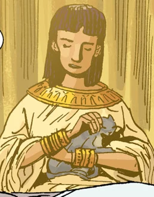
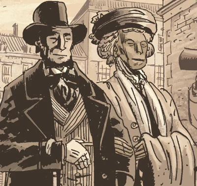
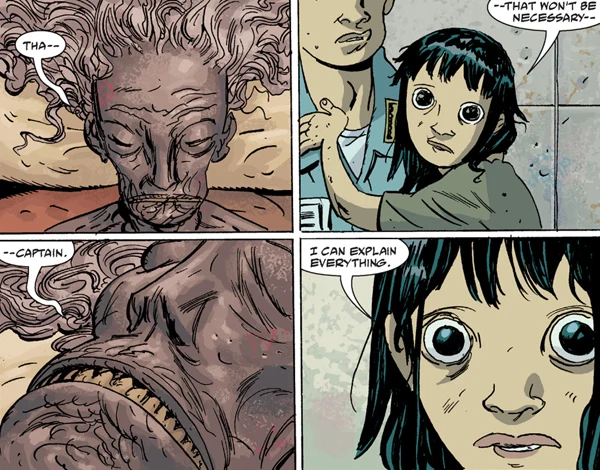
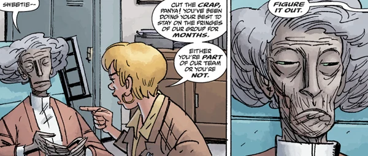

**Panya** is an ancient Egyptian, who was discovered to still be alive after her mummified body was unwrapped in November, 1859. She became a popular persona in Victorian Society before she was abducted and held captive by the [Oannes Society](/entry/Oannes_Society) until she was rescued by the [B.P.R.D.](/entry/B.P.R.D.) in August 2006. Her motives are not often clear.

## Biography

### Early Life

 Little is known about Panya's life before her death and mummification. In a conversation with [Liz Sherman](/entry/Liz_Sherman), she speaks about her first pet, a cat named Olabisi, her father Meryra who appeared in recent dreams as Akhenaten, but has not spoken of any other family or life before her death.

### Awakening

In Victorian Era England, Egyptomania was at the height of its popularity. This included events such as mummy unwrapping parties. Panya was the subject of one of these when, during the middle of her unwrapping, her eyes sprang open and she was revealed to be alive. Born into a new world, she was helpless. Lord Glaren of the [Heliopic Brotherhood of Ra](/entry/Heliopic_Brotherhood_of_Ra) took her under their wing, teaching her to read and write and about the rules of English society. She became something of a celebrity and basked in the social spotlight, counting many important figures among her friends.

Among these figures was [Martin Gilfryd](/entry/Memnan_Saa), an eccentric occultist with a specialty in Egyptian studies. Gilfryd believed that Panya held some secret to resurrection that she was not sharing, and began to harass her. This caused the Brotherhood to become more wary of her social contacts. Lord Glaren claimed he wanted to shelter her, and invited her to the Brotherhood's manor estate.

There, Panya was allowed to explore intellectualy, becoming involved in many of their experiments in both science and the paranormal, and never wanting for company. But she began to grow tired of being cooped indoors and decided to take some time away. Lord Glaren refused to let her leave.

 It was then that Panya began to hone her psychic powers more formidably, until she was able to render everyone on the estate unconscious while she escaped. Through a messenger, she was able to meet with members of a rival cult, the [Oannes Society](/entry/Oannes_Society) who promised to help her run away to America. Panya had few worries about having to restart her life - she was free. But this was a ruse on part of the Society. Rather than taking her to America, she was taken to a small island hidden off the coast of Indonesia. The island had long been a secret base of operations for the cult, with a huge manor and many hybrid animals to keep her company. But the truth couldn't be avoided - Panya had escaped one cage to be caught in another.

However, as the years went on, Panya's resentment began to fade and their research proved to be a decent distraction. As she slowly aged, her body fell into mistreatment until she was restricted to a wheelchair, and then to a bed. And while the Society had gone to great lengths to obtain her and believed her to be an incarnation of a water goddess named Naunet, they did not entirely trust her; they regularly burned opiates around her bed to keep her from any psychic misdeeds. She eventually acclimated herself to the drug's influence but found that the Society's minds were too strong to manipulate any worse than a strong headache. Still, Panya never missed an opportunity to be a thorn in their side whenever possible, and to keep her eyes open for a way to get out.

### Escape

Panya's chance came at last in 2006. Taking control of a young Indonesian girl, she lured former Oannes Society member [Abe Sapien](/entry/Abe_Sapien) to the island hideout. While Abe was held by the Society, she contact [Ben Daimio](/entry/Ben_Daimio) through the girl to warn him of the Society's ultimate plan: to wipe out most of Indonesia and capture the souls of those killed in giant bodies controlled by the Society members, each one becoming "a nation unto themselves".

 With Ben and Abe's help, she was able to put a stop to all of the bombs and escape from the island. Panya - along with many of the fabricated animals on the island - was taken to B.P.R.D. headquarters for rehabilitation. She was kept in isolation mostly for her own safety; she had been isolated from the world for decades and was vulnerable to modern viruses and bacteria.

### Life at the Bureau

She bonded quickly with [Liz Sherman](/entry/Liz_Sherman), who brought her a fruit smoothie to enjoy while she was bedridden. Panya seemed to have unusual insight into Liz's current problems with nightmares, and requested that Liz help her get a kitten.

Panya was able to later help Liz in locating [Memnan Saa](/entry/Memnan_Saa); with Liz and [Kate Corrigan](/entry/Kate_Corrigan) , Johann held a seance to summon the spectre of [Lobster Johnson](/entry/Lobster_Johnson). A flurry of cards stuck to the wall, spelling the name "MARTIN GILFRYD". It was Panya who realized that the man from her past was the same man who tormented Liz now. She then went back from the connection in Liz's mind to Gilfryd's, seeking to find out where Memnan Saa was hiding. She was able to locate him before he expelled her himself.

[Johann Kraus](/entry/Johann_Kraus) also sought out her abilities, asking if it was possible for her to find anyone. Panya correctly guessed that he wanted her help tracking down Ben Daimio, who had formerly gone on a killing rampage, among which Johann's second body (which was apprehended from the Oannes Society) was a casualty. Johann angrily stormed out moments later, which suggest that Panya denied helping him.

While the B.P.R.D. went out to rescue Liz after her abduction by Gilfryd, Panya stayed behind. At this point, she was able to leave the bed and operate a wheelchair. In addition to her cat, she gained a hybrid bird-monkey from the island. While Panya claims that it must have escaped, there is implication that Panya found a way to release it herself. In any case, the hybrid animal becomes her almost constant companion.

At this time, Panya repeatedly stated that Liz would not be returning to the Bureau, even after Liz had been rescued. Ultimately, Panya proved to be correct - Liz was rescued but disappeared shortly afterwards, having never actually returned to headquarters.

### *B.P.R.D.: Hell on Earth*

Panya continued to be of use and regain her physical strength at the Bureau; while she was in no condition to be a field agent, she was able to do monitor duty to keep an eye on new events.

 During this time, without Liz to keep her company, she turned to new methods of entertainment: tormenting Johann Kraus. The two had a rocky relationship, sometimes one of open antagonism that required Kate to intervene. Johann had become obsessed with the idea of reanimating the unused body reclaimed from the Oannes Society, a hope fanned even further when he believed that it had moved on its own. In reality, it had been Panya manipulating the underdeveloped flesh. She also mocked the possibility that he'd had a dream as just a lapse of awareness.

With the addition of [Fenix](/entry/Fenix) to the Bureau, Panya has been assigned to oversee her training. But on their first session, Fenix panics after seeing a horrific vision of a possible future and accuses Panya of trying to manipulate her before fleeing.

### Current Status

Panya is still with the B.P.R.D. and is presumed to be there for some time. She is going to be in direct influence over Fenix's training. In one of Liz's visions, she was seen in a photograph fully mobile and in a suit, possibly hinting at a future where she is more physically capable and a field agent.

## Abilities

Whether inherent or learned is unknown, but either way Panya has powerful psychic abilities. She was able to control a girl's mind from dozens of miles away and speak through her, as well as step into Memnan Saa's mind to locate his hideout.

She also correctly believed that Liz would not be returning to the Bureau headquarters after being rescued from Memnan Saa; whether or not she is able to prophesize the future is also something that has not been entirely expanded upon.

Just what her limits are and how she can use them is still debatable.

## Relationships

### Allies

- [Liz Sherman:](/entry/Liz_Sherman) A pyrokinetic, this brooding, somber woman has the psychic ability to create and manipulate fire. Liz and Panya shared a close bond, with Liz confessing to Panya about her visions from Memnan Saa.
- [Abe Sapien](/entry/Abe_Sapien) : An amphibious man with no memory of his past. Abe was responsible for Panya's rescue, but otherwise have never interacted; whether this is because of Abe's busy duties or his desires to leave his past as Langdon Caul behind him is debatable.
- [Kate Corrigan](/entry/Kate_Corrigan) : The field director for the special talents team. Kate and Panya get on well, though Kate has proven herself above Panya's manipulations, to Panya's disappointment.
- [Johann Kraus](/entry/Johann_Kraus) : Kraus is a German medium who's body was destroyed, but his ectoplasmic form remained. While not openly hostile, Panya makes no secret about her belief that Johann is a fool and seems to delight in tormenting him.
- [Andrew Devon](/entry/Andrew_Devon) : A recent addition to the Bureau, former scholar. Appears to be on decent terms with Panya, though somewhat nervous of her.
- [Fenix](/entry/Fenix): A young teenager with prophetic abilities. Panya has been assigned to Fenix in an attempt to train the girl to harness Fenix's powers.

### Enemies

- [Oannes Society](/entry/Oannes_Society) : A Victorian cult who believed in the power of the ocean. Responsible for Panya's captivity for over a hundred years.
- [Memnan Saa](/entry/Memnan_Saa) : Formerly Martin Gilfryd, an occultist from Victorian era that Panya was aware of before he became Memnan Saa.
