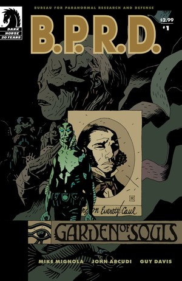
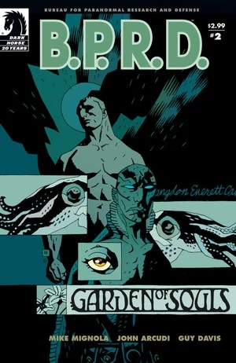
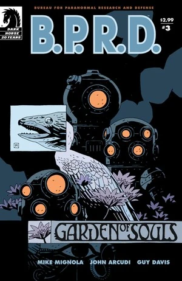
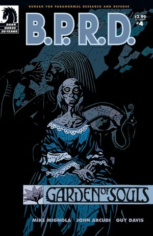

In ***Garden of Souls***, [Abe Sapien](/entry/Abraham_Sapien) follows a strange clue to the jungles of Indonesia and a secret society with connections to his past life during the American Civil War. Meanwhile, [Liz's](/entry/Liz_Sherman) apocalyptic visions have begun to escalate, and [Johann](/entry/Johann_Kraus) makes a startling discovery about a member of the [Bureau](/entry/Bureau_for_Paranormal_Research_and_Defense).

## Publication History

The five-issue miniseries was published from March to July 2007. The story was collected in the trade paperback *[B.P.R.D.: Garden of Souls](/entry/Trade_Collections)* in January 2008.

## Synopsis

### Part One

Abe Sapien's past has caught up with him, sending the B.P.R.D. to the South China Sea and into the jungles of Indonesia.

### Part Two

Abe Sapien's investigation brings him closer to a jungle compound housing a group of cyborgs with a strange connection to his own past. Meanwhile, in the new B.P.R.D. headquarters basement, Johann makes a startling discovery about a member of the team, and Liz has a vision of the end of the world.

### Part Three

During his desperate search for Abe, [Daimio](/entry/Ben_Daimio) discovers a plot that could shake the foundations of the earth. Meanwhile, Abe's reunion with figures from his past turns sour when he reveals that he remembers almost nothing of his previous life as Langdon Caul. Back at B.P.R.D. headquarters, Johann, [Kate](/entry/Kate_Corrigan), and Liz discuss the implications of Daimio's own hidden history.

### Part Four

While Abe learns the history of another bizarre survivor from the Victorian age, and uncovers the apocalyptic machinations of his former comrades, Daimio and a small girl race to prevent the end of all life on earth.

### Part Five

As events in Indonesia rise to a climax, Abe and Daimio race to stop the apocalyptic plans of the bizarre figures from Abe's past.

## Content

### Characters

#### [B.P.R.D.](/entry/Bureau_for_Paranormal_Research_and_Defense)

- [Abraham Sapien/Langdon Caul](/entry/Abraham_Sapien)
- [Elizabeth Sherman](/entry/Elizabeth_Sherman)
- [Benjamin Daimio](/entry/Benjamin_Daimio)
- [Johann Kraus](/entry/Johann_Kraus)
- [Katherine Corrigan](/entry/%E5%87%AF%E7%89%B9%C2%B7%E8%80%83%E7%91%9E%E6%A0%B9))
- [Thomas Manning](/entry/Thomas_Manning) (Photograph)
- Other Agents and Personnel

#### Others

- [Memnan Saa/Martin Gilfryd](/entry/Memnan_Saa)
- [Panya](/entry/Panya_%28character%29)
- [Heliopic Brotherhood of Ra](/entry/Heliopic_Brotherhood_of_Ra)
  - [Adam Glaren](/entry/Adam_Glaren) (Flashback)
- [Oannes Society](/entry/Oannes_Society)
  - Edward Musgrove Sundborne
  - McWhirter
  - Philip Ensner
  - Dameron
  - Mutated Animals
- Daniel Puan
- [Shonchin](/entry/Shonchin) (Flashback)
- "Chinaman"
- [Noh Monkey](/entry/Noh_monkey)
- Damio's Bolivian Mission Soldiers (Dream)
- [Gunter Eiss](/entry/Gunter_Eiss) (Mentioned)
- Edith Howard (Photograph)
- Lastri
- B.P.R.D. Files
  - [Kyriakos Gallaragas](/entry/Kyriakos_Gallaragas) (Photograph)
  - [Raimund Diestel](/entry/Raimund_Diestel) ([The Black Flame](/entry/The_Black_Flame_%28character%29)) (Photograph)
  - [Yumiko Damio (The Crimson Lotus)](/entry/Yumiko_Daimio) (Photograph)
  - [Rudolf Bergen (The Steel Hawk)](/entry/Rudolf_Bergen) (Photograph)
  - Rickard Mott (Geist) (Photograph)[1]
- [Ogdru Hem](/entry/Ogdru_Hem) (Vision)
- [Frog Monsters](/entry/Frog_monster) (Vision)
- Balikpapan Police
- [Water Spirit](/entry/Water_Spirit) (Flashback)

### Locations

- England
  - Lord Minbrough's Baywater House (London) (Flashback)
- U.S.A.
  - [B.P.R.D.](/entry/Bureau_for_Paranormal_Research_and_Defense) Headquarters (Colorado)
  - St. Trinian's Hospital (Washington D.C.) (Flashback)
    - [Oannes Society](/entry/Oannes_Society) Meeting Place (Flashback)
- Indonesia
  - Balikpapan
  - [Oannes Society's](/entry/Oannes_Society) Island/Mansion

### Noteworthy Artifacts

- [Roger's](/entry/Roger) grave (Buried as "Archie Stanton")
- [Vril Energy Suit](/entry/Vril_Energy_Suit) Helmet (Prometheus model) (Photograph)
- [The Lobster's](/entry/The_Lobster) Calling Card
- [Oannes Society](/entry/Oannes_Society)
  - Mechanical Bodies
  - Biological Bodies
  - Bomb
  - Diving Suit
  - Submarine

## Trivia

- In Chapter 2, the painting behind Johann's desk is *[The Dream: "In his sleep he Saw Love, Glory and Wealth Appear to Him"](https://www.wikiart.org/en/pierre-puvis-de-chavannes/the-dream-in-his-sleep-he-saw-love-glory-and-wealth-appear-to-him-1883)* by artist Pierre Puvis de Chavannes.
- In Chapter 3, the song Dameron sings is [After the Ball](https://www.youtube.com/watch?v=zIXGlQdTDKY) by Charles K. Harris.
- The [Oannes Society](/entry/Oannes_Society) members refer to Panya as [Naunet](https://en.wikipedia.org/wiki/Nu_(mythology)), the primordial Egyptian goddess that represents the sea.

## Gallery

 \#1

 \#2

 \#3

 \#4

 \#5

## Notes

<references/>

[1] According to the sketchbook
